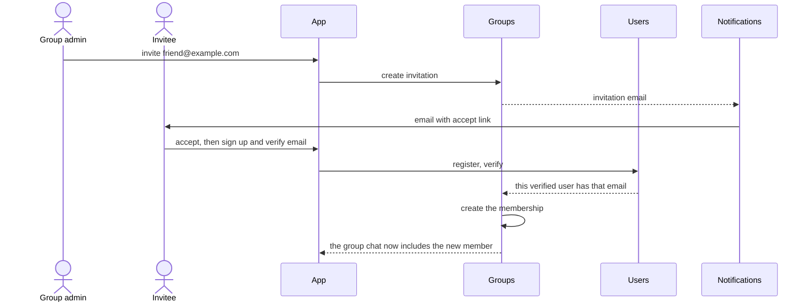
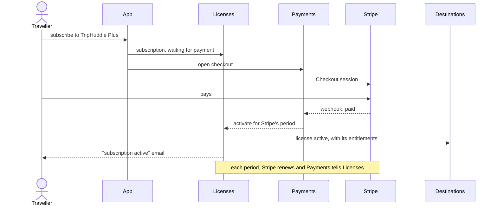
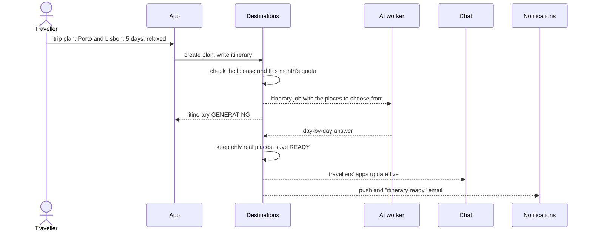
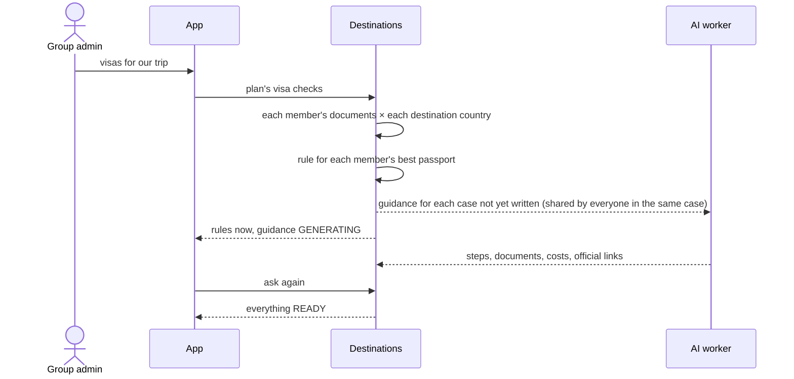
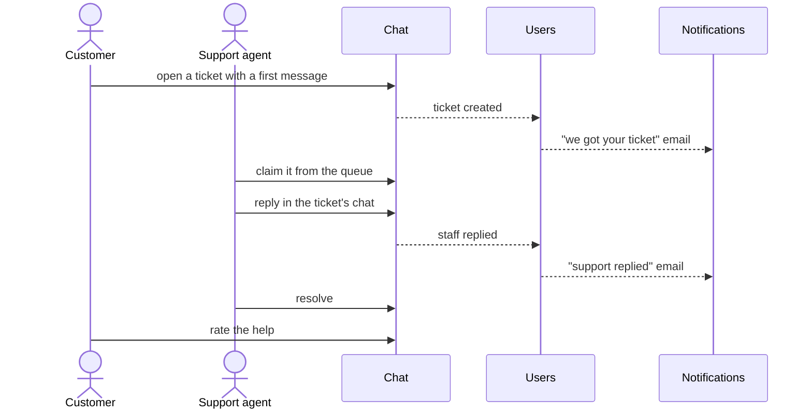
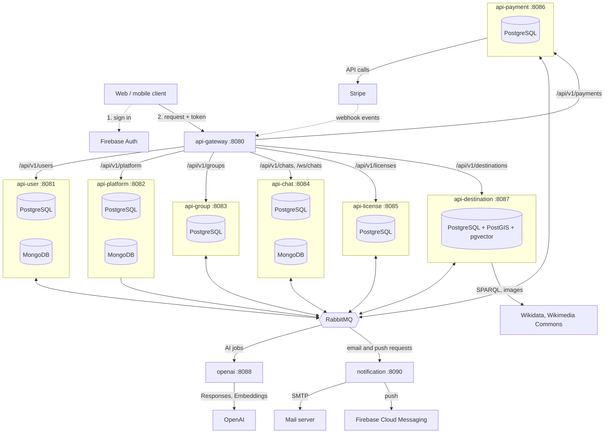
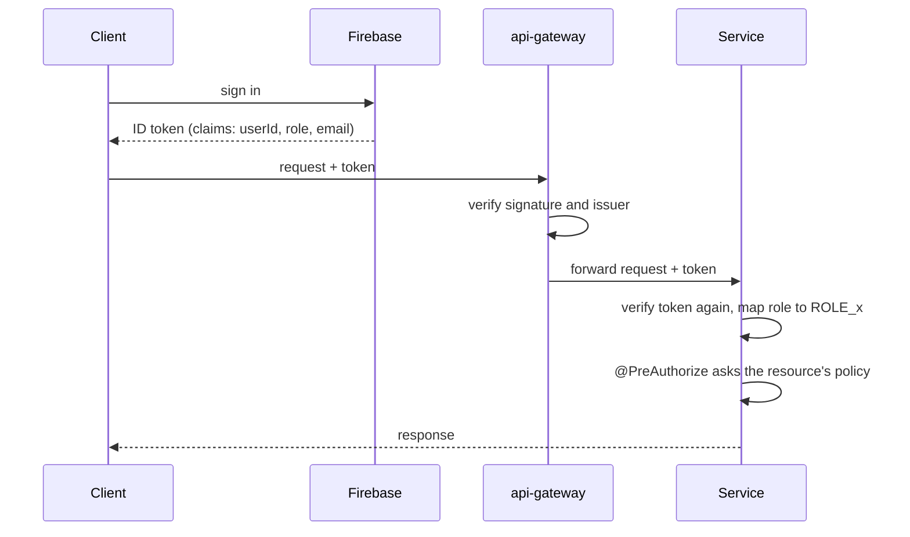
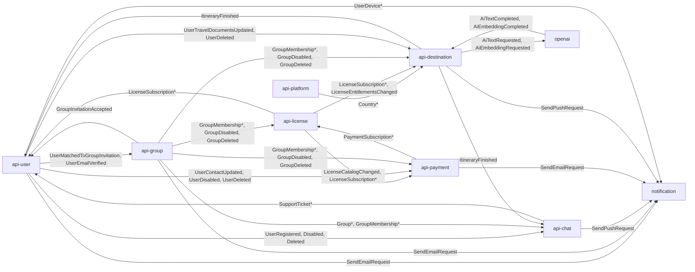

# TripHuddle backend

TripHuddle helps people plan trips, on their own or as a group. Travellers discover countries, regions, cities and landmarks, read what is worth seeing and what visitors say about each place, and get a day-by-day itinerary written for their dates, budget and pace. They also learn what visa each person needs. Groups plan together: they chat, share plans, and share a subscription. Access is sold as monthly or yearly licenses, paid through Stripe.

This repository is the backend: a set of small services behind one API gateway, used by the web and mobile apps.

- [What it does](#what-it-does)
- [Technical stack](#technical-stack)
- [Who uses it](#who-uses-it)
- [User stories](#user-stories)
- [End-to-end flows](#end-to-end-flows)
- [Software requirements](#software-requirements)
- [Architecture](#architecture), for developers

## What it does

| Area | In short |
|---|---|
| **Accounts** | Sign-up with Firebase, email verification, profiles, preferences, and the nationalities and residence permits used for visa checks |
| **Groups** | Create a group, invite people by email, manage members and admins |
| **Chat and support** | Private and group chats in real time, with attachments, reactions, read receipts and push notifications. Support tickets are handled by staff in their own chat |
| **Licenses and payments** | A catalogue of licenses with entitlements and promotions. Subscriptions for a user or a group, paid, renewed and refunded through Stripe |
| **Places** | Countries, regions, cities and points of interest imported from Wikidata, with photos from Wikimedia Commons, categories and tags. Search by name, distance, map area or meaning |
| **AI content** | For each place and language: an overview, what visitors say (with sources), and practical information. Answers to a traveller's own questions |
| **Trips** | Trip plans for a user or a group, and AI itineraries within a monthly quota. Any day can be rewritten or edited by hand |
| **Visas** | For each traveller and destination: the entry requirement for their best passport, and an AI explanation with official links |
| **Personal lists** | Favourites, visited places, and reviews with reporting and moderation |
| **Notifications** | Emails and phone pushes for verification, invitations, tickets, payments and finished itineraries |

## Technical stack

| Layer | Technology |
|---|---|
| Language and framework | Java 17, Spring Boot 3.2.2, Spring Cloud 2023.0.0, one Maven multi-module project |
| Entry point and discovery | Spring Cloud Gateway with Resilience4j circuit breakers; Netflix Eureka |
| Data | PostgreSQL 16 (with PostGIS, pgvector, pg_trgm and unaccent for places), MongoDB 7 (chat messages, preferences, device tokens, feature flags), Google Cloud Storage (attachments, photos) |
| Messaging | RabbitMQ: work queues, fanout exchanges, dead-letter queues, and the STOMP relay for real time |
| Identity | Firebase Authentication (ID tokens with `userId` and `role` claims), Firebase Admin SDK |
| Payments | Stripe Checkout, Billing and webhooks, through stripe-java 34.1.0 (API `2026-10-28.endive`) |
| AI | OpenAI Responses API (structured JSON, web search). `gpt-4o-mini` for bulk work, `gpt-4.1` for itineraries, visas and questions, `text-embedding-3-small` for embeddings |
| Open data | Wikidata SPARQL, Wikimedia Commons, the passport-index visa dataset (MIT) |
| Notifications | Thymeleaf email templates over SMTP; Firebase Cloud Messaging |
| Code | Spring Data JPA (Hibernate), Lombok, MapStruct, Bean Validation, springdoc OpenAPI |
| Operations | Zipkin tracing, Docker Compose for local infrastructure |

## Who uses it

| Person | Platform role | What they do |
|---|---|---|
| **Traveller** | Customer | Plans trips, reads about places, chats, subscribes |
| **Group admin** | Customer, ADMIN of a group | Invites and manages members, subscribes the group, sees every member's visa details |
| **Group member** | Customer, MEMBER of a group | Shares the group's plans, chat and subscription |
| **Support agent** | Support | Works the support ticket queue, moderates reports, curates places |
| **Administrator** | Admin | Everything Support does, plus licenses, grants, refunds and imports |
| **Inspector** | Inspector | Reads everything for auditing; changes nothing |

Group roles (ADMIN, MEMBER) are separate from platform roles: any Customer can admin their own group.

## User stories

**Account**
- As a new visitor, I sign up with my email and verify it, so that I can use TripHuddle and be found by the groups that invite me.
- As a traveller, I record my nationalities and residence permits once, so that every trip checks my visas for me.

**Groups**
- As a traveller, I create a group for a trip and invite friends by email, even before they have an account.
- As an invitee, I accept or reject the invitation from the email, and become a member once my account is verified.
- As a group admin, I promote, demote or remove members; the group always keeps at least one admin.

**Chat and support**
- As a traveller, I chat privately with another user or with my whole group, and see messages, typing and read receipts live.
- As a traveller, I block someone, mute a chat, or report a message.
- As a customer, I open a support ticket and talk to an agent in its chat, then rate the help I got.
- As a support agent, I claim tickets from a queue ordered by urgency, keep internal notes, and resolve tickets.

**Licenses and payments**
- As a traveller, I see the published licenses and their price, with any promotion or code I enter.
- As a traveller or group admin, I subscribe and pay through Stripe Checkout, and switch, cancel or resume later.
- As a payer, I get an email for each payment and each failed renewal, and see my invoices.
- As an administrator, I create and publish licenses and promotions, grant free periods, and refund invoices.

**Discovering places**
- As a traveller, I search places by name (with typos and accents forgiven), near me, on the map, or inside a country or city.
- As a traveller, I describe what I want ("quiet beach town with seafood") and get matching places, or ask for places like one I liked.
- As a traveller, I read a place's overview, what visitors praise and complain about with the sources, and practical tips, in my language.
- As a traveller, I ask my own question about a place and get an answer with sources.

**Planning trips**
- As a traveller or group member, I create a trip plan with dates, destinations, must-sees, budget, pace and interests.
- As a traveller, I have an itinerary written, and I'm told by push, email and in the app when it is ready.
- As a traveller, I rewrite one day ("more food, less walking"), reorder it, or add and remove items by hand.

**Visas**
- As a traveller, I see for each destination what my best passport needs: visa-free and for how long, an e-visa, an ETA, or a visa, with steps, costs and official links.
- As a group admin, I see every member's visa situation for the trip, and who still has to enter their documents.

**My lists and reviews**
- As a traveller, I save favourites and mark places as visited.
- As a traveller, I rate and review a place, and report reviews that are wrong or abusive.
- As a support agent, I see reported reviews and content, and keep or hide them.

**Running the catalogue**
- As an administrator, I import a country's regions, cities and landmarks from Wikidata with their photos, and fix, merge, hide or feature places.
- As an administrator, I reload the visa rules from the dataset.

## End-to-end flows

### Joining a group by invitation

### Subscribing and paying

### Planning a trip and getting an itinerary

### Checking visas for a group trip

### Getting help from support

## Software requirements

These describe what the current code does.

### Functional

**Accounts and identity**
- FR-1 Users sign up with Firebase. The system creates the platform user, sets the `userId` and `role` claims, and sends a verification email.
- FR-2 A user verifies their email through a link, which sends a welcome email and lets pending group invitations complete.
- FR-3 Users manage a profile, preferences (language, country, marketing opt-in), push devices, and travel documents (up to 4 nationalities and 10 residence permits; no document numbers).
- FR-4 Staff can disable a user; a user can delete their own account. Other services stop serving them and forget their personal data.

**Groups**
- FR-5 Any user can create a group and becomes its first admin. A group always keeps at least one admin.
- FR-6 Admins invite by email. An invitation is valid for 7 days, and only one may be pending per email and group.
- FR-7 An accepted invitation becomes a membership once a verified user with that email exists.

**Chat and support**
- FR-8 Users chat in private and group conversations in real time (STOMP), with up to 4,000 characters and 10 attachments per message, edits, deletes, reactions, typing and read receipts.
- FR-9 Users can block, mute and report. Staff review reports and may remove messages.
- FR-10 Customers open up to 3 ongoing support tickets. Staff claim, assign, reply, keep internal notes, and resolve. Resolved tickets close after 7 days, and customers rate the support.

**Licenses and payments**
- FR-11 Staff manage licenses (draft, published, archived), each with a price, an interval and entitlements.
- FR-12 Staff manage promotions: by amount or percentage, automatic or by code, for a number of periods, with redemption limits.
- FR-13 A user or a group (subscribed by its admin) has at most one active and one pending subscription. Subscribing to another license is a switch.
- FR-14 Payment goes through Stripe Checkout, and renewals through Stripe Billing. A failed renewal keeps access while Stripe retries. Cancel and resume take effect at the period's end.
- FR-15 Staff can activate, grant (1 to 120 free periods), extend and refund. Invoices are listed for payers, group admins and staff.
- FR-16 Payments are reconciled with Stripe daily, to repair what a lost webhook missed.

**Places and content**
- FR-17 Every destination feature needs a current license with the access entitlement, the user's own or their group's. Staff always have access.
- FR-18 Staff import a country's regions, cities and notable places from Wikidata, with photos and licences from Commons, and curate them (edit, move, merge, hide, feature, categorise, tag).
- FR-19 Search works by words in any language (forgiving typos and accents), by distance, map area, subtree, category and tag. Semantic search works by meaning, and similar places can be found.
- FR-20 For each place and language, AI writes an overview, visitors' opinions with cited sources, and practical information. Each is cached and refreshed after 30 to 180 days. Users can report content.
- FR-21 Users ask questions about a place and get private, sourced answers.

**Trips and visas**
- FR-22 Users create trip plans of up to 30 days and 10 destinations, for themselves or their group.
- FR-23 An itinerary uses one unit of the owner's monthly AI itinerary quota, and failures give it back. Days can be rewritten by AI or edited by hand. Travellers are told by socket, push and email.
- FR-24 Visa rules come from the passport-index dataset, which staff reload. Each traveller is checked on their best passport, with residence permits valid through the trip taken into account.
- FR-25 Visa guidance is written by AI with official links and a disclaimer. Group admins see every member, and members only themselves.

**Personal lists and reviews**
- FR-26 Users keep private favourites and visited places.
- FR-27 Users write one review per place (rating 1 to 5). Three open reports hide a review until staff decide. Summaries show the count, the average and the spread.

**Notifications**
- FR-28 The system sends templated emails (verification, welcome, password reset, invitations, tickets, subscriptions, payments, itineraries) and pushes (new messages, finished itineraries).

### Non-functional

- NFR-1 **Security.** Every request carries a Firebase token, checked at the gateway and again by the service. Every operation is decided by the resource's authorization policy. The Stripe webhook is verified by signature.
- NFR-2 **Privacy.** No service reads another's database. Visa guidance holds nothing about any one traveller. Questions, favourites and travel documents are visible only to their owner. Deleted users' personal rows are removed or emptied.
- NFR-3 **Loose coupling.** Services talk only through RabbitMQ, never over HTTP. A stopped service delays work but doesn't fail other services' requests.
- NFR-4 **Reliability.** Every consumer can take the same message twice. Failed messages are retried three times, then go to a dead-letter queue. Messages are published only after their transaction commits. Payments use idempotency keys.
- NFR-5 **Scalability.** Services are stateless and run as several instances. Scheduled jobs share work with `SKIP LOCKED`. Real-time events reach every instance through the STOMP relay.
- NFR-6 **Cost control.** AI usage is capped per day (a token budget and a hard limit) and per user. Content is shared, so it is written once. Unchanged embeddings aren't redone.
- NFR-7 **Data integrity.** Uniqueness is enforced in the database, not only in code. Records are soft-deleted (`deletedAt`), except a few personal rows that privacy requires removing.
- NFR-8 **Consistency.** Copies of other services' data are eventually consistent. Updates carry a time or ID, so late and repeated events do no harm.
- NFR-9 **Observability.** Every service sends traces to Zipkin, and errors come back in one `ErrorResponse` shape.
- NFR-10 **Localisation.** Content, guidance and answers are written in the reader's language, with English as the fallback.
- NFR-11 **Lists that move.** Feeds and work queues use cursor pagination, so items arriving or leaving don't repeat or skip.

## Architecture

### The system at a glance

Each API service box contains the data stores only it uses. Every service also registers with **Eureka** (`eureka-server :8761`), which the gateway uses to route, and sends traces to **Zipkin** (`:9411`). `api-user` calls Firebase directly, to set token claims and create password reset links.

### Modules

| Module | Kind | Port | Responsibility | Docs |
|---|---|---|---|---|
| `api-gateway` | service | 8080 | public entry point: token check, CORS, routing | [docs](api-gateway/docs/README.md) |
| `eureka-server` | service | 8761 | service registry | [docs](eureka-server/docs/README.md) |
| `api-user` | service | 8081 | users, profiles, preferences, travel documents, Firebase accounts | [docs](api-user/docs/README.md) |
| `api-platform` | service | 8082 | countries, currencies, languages, feature flags | [docs](api-platform/docs/README.md) |
| `api-group` | service | 8083 | groups, memberships, invitations | [docs](api-group/docs/README.md) |
| `api-chat` | service | 8084 | private, group and support chats, support tickets, real time over STOMP | [docs](api-chat/docs/README.md) |
| `api-license` | service | 8085 | licenses, entitlements, promotions, subscriptions | [docs](api-license/docs/README.md) |
| `api-payment` | service | 8086 | Stripe checkout, renewals, invoices, refunds, reconciliation | [docs](api-payment/docs/README.md) |
| `api-destination` | service | 8087 | places, AI content, search, trips and itineraries, visas, reviews | [docs](api-destination/docs/README.md) |
| `openai` | service | 8088 | the AI worker: text and embedding jobs over amqp | [docs](openai/docs/README.md) |
| `notification` | service | 8090 | emails and push notifications requested by other services | [docs](notification/docs/README.md) |
| `common` | library | | base classes, security, pagination, error handling | [docs](common/docs/README.md) |
| `amqp` | library | | RabbitMQ setup and every message definition | [docs](amqp/docs/README.md) |
| `stripe` | library | | the Stripe client and webhook signature checks | [docs](stripe/docs/README.md) |

Every API service depends on `common` and `amqp`; `notification` and `openai` depend on `amqp` only, and only `api-payment` uses `stripe`. The gateway and Eureka depend on neither library.

### Principles

- **One service, one data store.** No service reads another's database. `api-group` stores user IDs, never user records.
- **No HTTP between services.** A service that needs something from another publishes a message and reacts to the reply, or keeps its own copy from the other's events.
- **The same shape everywhere.** A resource is an entity plus a controller, service, repository, mapper and authorization policy, built on the base types in `common`.
- **Soft deletes.** Deleting sets `deletedAt` and disabling sets `disabledAt`. The exceptions are a few personal rows (favourites, travel documents) that privacy requires removing.

### Authentication and authorization

Firebase Authentication issues the tokens. The backend never sees passwords.

- **Claims:** `api-user` sets two custom claims: `userId` (the platform user ID) and `role`.
- **Validated twice:** the gateway and each service both validate the token, so a public route must be opened in both places.
- **Group rights:** rights within a group come from memberships. Services that need them keep a copy from `api-group`'s events.

### Messaging

Every message is a record (the event) plus a contract class naming its queues, all defined in `amqp`.
- **One consumer:** the message goes to the default exchange with the queue name as routing key.
- **Several consumers:** it is published once to a fanout exchange, and each consuming service reads its own queue bound to that exchange.
- **Failures:** a listener that throws is retried three times with a growing pause; after that the message goes to a dead-letter queue.

The full catalogue is in the [amqp docs](amqp/docs/README.md).

### Data

| Service | PostgreSQL | MongoDB |
|---|---|---|
| `api-user` | `jobbie_giggle_user`: users, profiles, travel documents | preferences |
| `api-platform` | `jobbie_giggle_platform`: countries, currencies, languages | feature flags |
| `api-group` | `jobbie_giggle_group`: groups, memberships, invitations | none |
| `api-chat` | `jobbie_giggle_chat`: conversations, participants, support tickets, blocks, reports, chat users | chat messages |
| `api-license` | `jobbie_giggle_license`: licenses, entitlements, promotions, subscriptions, redemptions, group admins | none |
| `api-payment` | `jobbie_giggle_payment`: Stripe events, products and prices, customers, billing subscriptions, invoices, refunds, user contacts, group admins | none |
| `api-destination` | `jobbie_giggle_destination` (PostGIS, pgvector, pg_trgm, unaccent): places and their content, trips, visas, lists, reviews, embeddings, and copies of countries, licenses and memberships | none |
| `notification` | none | device tokens |

Relational schemas are checked at startup (`ddl-auto: validate`) and created by hand, so the tables must exist before a service starts. Each service's docs hold its DDL.

### Cross-cutting concerns

| Concern | How |
|---|---|
| Service discovery | every service registers with Eureka; the gateway routes to `lb://<SERVICE-NAME>` |
| Resilience | a circuit breaker and a 60s time limit per route at the gateway |
| Errors | `GlobalExceptionHandler` returns one `ErrorResponse` shape: 400, 403, 404, 422, 500 |
| API documentation | each API service serves OpenAPI at `/api-docs`; the gateway exposes it at `/<service>/v3/api-docs` |
| Tracing | every service reports to Zipkin at `http://zipkin:9411` |
| Pagination | `page` (from 1) and `pageSize` (up to 100) in, `Paginated<T>` out. Feeds and work queues use cursors instead: `cursor` and `limit` in, `CursorPaginated<T>` out |
| Real time | `api-chat` serves STOMP over WebSocket at `/ws/chats`, relayed through RabbitMQ's STOMP plugin so every instance reaches every client |

### What a deployment needs

- **Infrastructure:** PostgreSQL at host `postgres` (the `docker/postgres` image adds pgvector to PostGIS), MongoDB at `mongodb`, RabbitMQ with the `rabbitmq_stomp` plugin (port 61613), Eureka at `eureka-server`, and Zipkin at `zipkin`. `docker compose up -d` at the root starts all but Eureka for local development.
- **Environment:**
  - RabbitMQ: `RABBITMQ_HOST`, `RABBITMQ_USERNAME`, `RABBITMQ_PASSWORD`, `RABBITMQ_VIRTUAL_HOST`
  - Email: `SMTP_PASSWORD`
  - Google: application default credentials for the Firebase Admin SDK, also used for FCM and for signing storage URLs
  - Optional: `CHAT_ATTACHMENTS_BUCKET` turns chat attachments on
- **`api-payment`:** `STRIPE_SECRET_KEY` and `STRIPE_WEBHOOK_SECRET`, without which it does not start, and a Stripe webhook pointing at `/api/v1/payments/webhook` on the gateway. Locally, `docker compose --profile stripe up -d stripe-cli` forwards test events.
- **`openai`:** `OPENAI_API_KEY`; see its docs.

### Adding a service

1. Create the module, depend on `common` and `amqp`, and add it to the root `pom.xml`.
2. For each resource, add the entity, repository, DTOs, mapper, policy, service and controller on top of the base types.
3. Add a `SecurityConfig` implementing `BaseSecurityConfig` and list any public routes.
4. Define its events and contracts in `amqp` and register the queue names.
5. Add its routes, time limit and public paths to the gateway.
6. Add a `docs/README.md` following the shape of the others: what it does, user stories, main flows, requirements, then the technical reference. Add a row to the modules table above.
