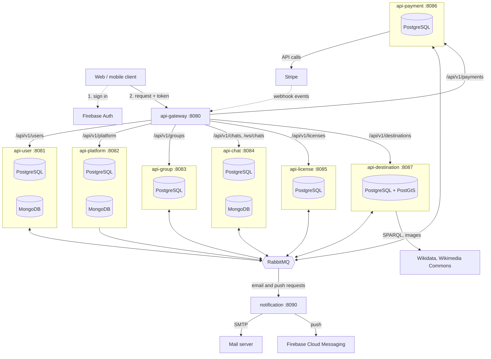
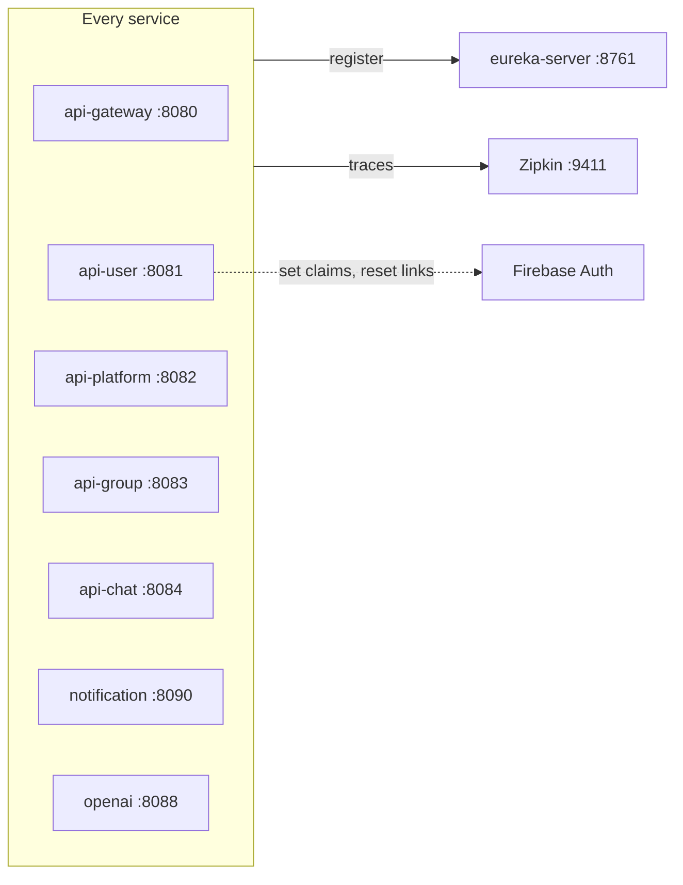
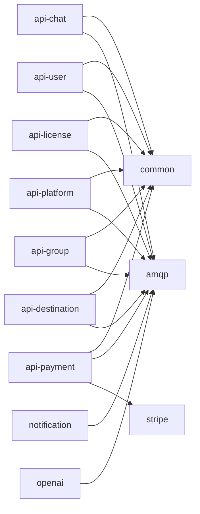
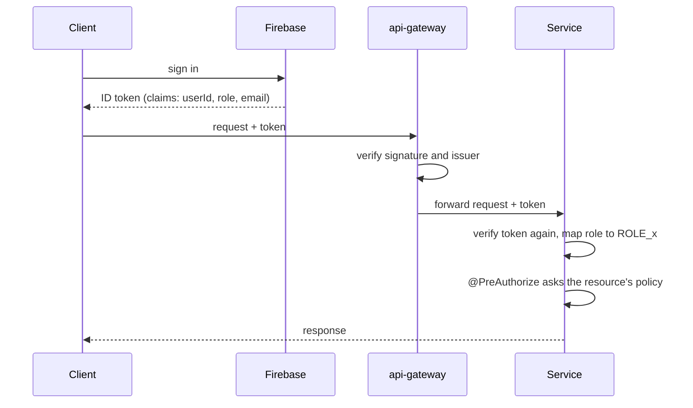
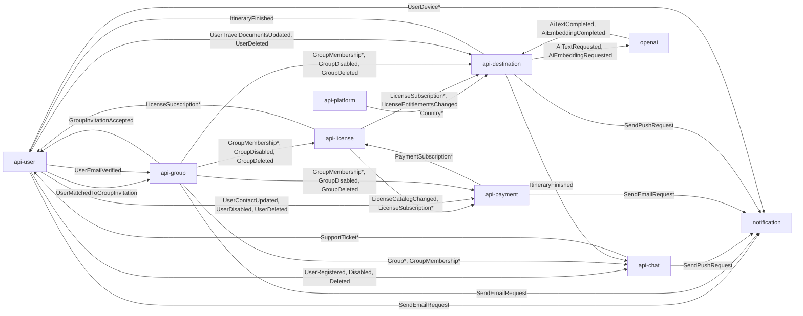
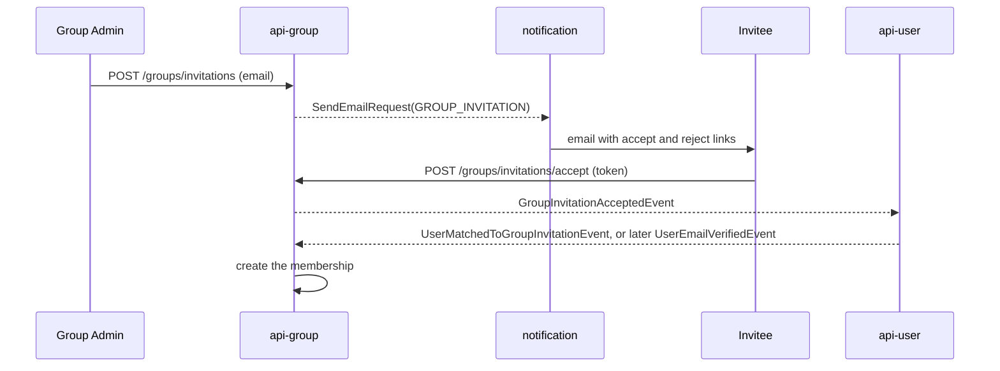

# TripHuddle backend architecture

TripHuddle's backend is a set of small Spring Boot services behind one gateway. Each service owns its own data, clients reach them over HTTP through the gateway, and the services talk to each other only through RabbitMQ.

Built with Java 17, Spring Boot 3.2.2 and Spring Cloud 2023.0.0, as one Maven multi-module project.

## The system at a glance

Each API service box contains the data stores only it uses.

### Supporting pieces

The first diagram leaves out what every service uses in the same way. Those are here.

- **Eureka**: every service registers with it, and the gateway looks services up there to route requests.
- **Zipkin**: every service sends its traces there.
- **Firebase**: besides signing users in, it is called directly by `api-user`, to set token claims and create password reset links.
- **`openai`** is the AI worker: it takes text and embedding jobs from amqp, calls OpenAI, and answers on the requester's own queue. `api-destination` sends it place content, itineraries, visa guidance and questions to write, and places and search queries to embed.

## Modules

| Module | Kind | Port | Responsibility | Docs |
|---|---|---|---|---|
| `api-gateway` | service | 8080 | public entry point: token check, CORS, routing | [docs](../api-gateway/docs/README.md) |
| `eureka-server` | service | 8761 | service registry | [docs](../eureka-server/docs/README.md) |
| `api-user` | service | 8081 | users, profiles, preferences, Firebase accounts | [docs](../api-user/docs/README.md) |
| `api-platform` | service | 8082 | countries, currencies, languages, feature flags | [docs](../api-platform/docs/README.md) |
| `api-group` | service | 8083 | groups, memberships, invitations | [docs](../api-group/docs/README.md) |
| `api-chat` | service | 8084 | private, group and support chats, support tickets, messages, real time over STOMP | [docs](../api-chat/docs/README.md) |
| `api-license` | service | 8085 | licenses, entitlements, promotions and subscriptions | [docs](../api-license/docs/README.md) |
| `api-destination` | service | 8087 | places in a tree under each country, imported from Wikidata with Wikimedia Commons photos; AI overviews, opinions with sources and practical info per language; the category tree and tags; search by words, distance, map area and subtree; trip plans with AI itineraries under a monthly quota; visa rules and AI visa guidance per traveller; favourites, visited places, reviews, questions about places, and semantic search with pgvector; licensed access | [docs](../api-destination/docs/README.md) |
| `api-payment` | service | 8086 | Stripe payments for subscriptions: checkout, renewals, failed payments, cancel and switching, invoices and refunds, daily reconciliation, the webhook and its event inbox, the Stripe catalog, and payment emails | [docs](../api-payment/docs/README.md) |
| `notification` | service | 8090 | sends emails and push notifications requested by other services | [docs](../notification/docs/README.md) |
| `openai` | service | 8088 | the AI worker: text (structured, with web search) and embedding jobs over amqp | [docs](../openai/docs/README.md) |
| `common` | library | | base classes, security, pagination, error handling | [docs](../common/docs/README.md) |
| `amqp` | library | | RabbitMQ setup and every message definition | [docs](../amqp/docs/README.md) |
| `stripe` | library | | the Stripe client and webhook signature checks | [docs](../stripe/docs/README.md) |

The gateway and the Eureka server depend on neither library. Only `api-payment` uses `stripe`.

## Principles

- **One service, one data store.** No service reads another's database. `api-group` stores user IDs, never user records.
- **No HTTP between services.** A service that needs something from another publishes a message and reacts to the reply. A slow or stopped service delays work but does not fail the caller's request.
- **The same shape everywhere.** A resource is an entity plus a controller, service, repository, mapper and authorization policy, all built on the base types in `common`.
- **Nothing is physically deleted.** Deleting sets `deletedAt` and disabling sets `disabledAt`.

## Authentication and authorization

Firebase Authentication issues the tokens. The backend never sees passwords.

- The token carries two custom claims that `api-user` sets: `userId` (the platform user ID) and `role`.
- Roles: `Customer` (default), `Sales`, `Inspector`, `Support`, `Admin`.
- The gateway and each service both validate the token, so a route that is public must be opened in both places.
- Group-level rights (Admin or Member of a group) are separate from platform roles and are decided inside `api-group` from memberships.

## Messaging

Every message is a record (the event) plus a contract class naming its queue and dead-letter queue, all defined in `amqp`. A message with one consumer is published to the default exchange with the queue name as routing key, so it lands in exactly that queue. Each queue has one consumer.

When several services need the same message, it is published once to a fanout exchange named after it, and each service reads its own queue bound to that exchange. For example, `group.membership.created.exchange` feeds `api-chat`'s `group.membership.created.queue`, `api-license`'s `.license` queue and `api-payment`'s `.payment` queue. Adding a consumer means a new queue and binding in `amqp`, not a change to the publisher.

A listener that throws is retried three times with a growing pause; after that the message goes to a dead-letter queue. Most created, updated, disabled and deleted events have no consumer yet; they exist so that future services can react without the publisher changing. The full catalogue is in the [amqp docs](../amqp/docs/README.md).

### Example: inviting someone to a group

## Data

| Service | PostgreSQL | MongoDB |
|---|---|---|
| `api-user` | `jobbie_giggle_user`: users, user profiles, travel documents | user preferences |
| `api-platform` | `jobbie_giggle_platform`: countries, currencies, languages | feature flags |
| `api-group` | `jobbie_giggle_group`: groups, memberships, invitations | none |
| `api-chat` | `jobbie_giggle_chat`: conversations, participants, support tickets and their events, blocks, reports, chat users | chat messages |
| `api-license` | `jobbie_giggle_license`: licenses, entitlements, promotions, subscriptions, promotion redemptions, group admins | none |
| `api-destination` | `jobbie_giggle_destination` (PostGIS, pgvector, pg_trgm, unaccent): places, names, categories, tags, photos, imports, countries, license access, group members, trip plans, itineraries, quota usage, visa rules, travellers' documents, visa guidance, favourites and visited places, reviews, questions, place and query embeddings | none |
| `api-payment` | `jobbie_giggle_payment`: received Stripe events, license products and prices, Stripe customers, billing subscriptions, invoices, refunds, user contacts, group admins | none |
| `notification` | none | device tokens |

Relational schemas are checked at startup (`ddl-auto: validate`), so the tables must exist before a service starts.

## Cross-cutting concerns

| Concern | How |
|---|---|
| Service discovery | every service registers with Eureka; the gateway routes to `lb://<SERVICE-NAME>` |
| Resilience | a circuit breaker and a 60s time limit per route at the gateway |
| Errors | `GlobalExceptionHandler` returns one `ErrorResponse` shape: 400, 403, 404, 422, 500 |
| API documentation | each API service serves OpenAPI at `/api-docs`; the gateway exposes it at `/<service>/v3/api-docs` |
| Tracing | every service reports to Zipkin at `http://zipkin:9411` |
| Pagination | `page` (from 1) and `pageSize` (up to 100) in; `Paginated<T>` with metadata out. Feeds that grow at their head and work queues that shrink while being read (chats, reviews, invoices, Stripe events, support and report queues) use cursors instead: `cursor` and `limit` in, `CursorPaginated<T>` out |
| Real time | `api-chat` serves STOMP over WebSocket at `/ws/chats`, relayed through RabbitMQ's STOMP plugin so every instance reaches every client |

## What a deployment needs

- PostgreSQL at host `postgres`, MongoDB at `mongodb`, RabbitMQ with the `rabbitmq_stomp` plugin (port 61613), Eureka at `eureka-server`, Zipkin at `zipkin`. `docker compose up -d` at the root starts all but Eureka for local development.
- Environment: `RABBITMQ_HOST`, `RABBITMQ_USERNAME`, `RABBITMQ_PASSWORD`, `RABBITMQ_VIRTUAL_HOST`, `SMTP_PASSWORD`, and Google application default credentials for the Firebase Admin SDK (also used for FCM and for signing chat attachment URLs). Optionally `CHAT_ATTACHMENTS_BUCKET` to turn chat attachments on.
- For `api-payment`: `STRIPE_SECRET_KEY` and `STRIPE_WEBHOOK_SECRET`, without which it does not start, and a Stripe webhook endpoint pointing at `/api/v1/payments/webhook` on the gateway. Locally, `docker compose --profile stripe up -d stripe-cli` forwards test events.

## Adding a service

1. Create the module, depend on `common` and `amqp`, and add it to the root `pom.xml`.
2. For each resource, add the entity, repository, DTOs, mapper, policy, service and controller on top of the base types.
3. Add a `SecurityConfig` implementing `BaseSecurityConfig` and list any public routes.
4. Define its events and contracts in `amqp` and register the queue names.
5. Add its routes, time limit and public paths to the gateway.
6. Add a `docs/README.md` and a row in the modules table above.
