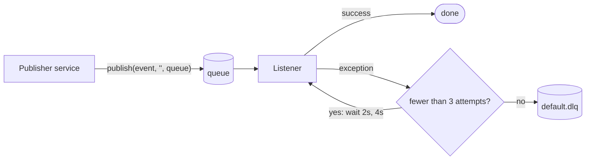
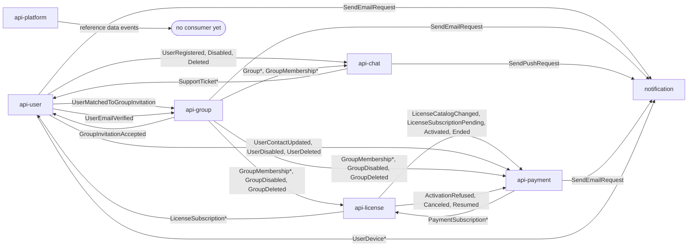

# amqp

The messaging library shared by every service that talks over RabbitMQ. It holds the broker configuration, the publisher, and the definition of every message: one **event** record and one **contract** class per message.

Services never call each other over HTTP. Everything between them goes through the queues defined here.

## Conventions

- **Event**: a Java record with the data, for example `GroupInvitationAcceptedEvent(groupInvitationId, groupId, email, role)`.
- **Contract**: a class with two constants, the queue name and its dead-letter queue name.
- **Queue names**: `<domain>.<thing>.<action>.queue` and `.dlq`, for example `group.invitation.accepted.queue`.
- **Registration**: each domain has a `*Queues` class listing its queue names. `RabbitMQConfig` declares all of them as durable queues at startup, in whichever service starts first.
- **Publishing**: `RabbitMQMessageProducer.publish(event, "", queueName)`. The empty exchange is RabbitMQ's default exchange, so the message goes straight to the named queue.
- **One consumer per queue.** A queue is a work queue, not a topic: if two services listened on the same queue, each message would reach only one of them. When a second service needs a message, the publisher sends it to a second queue as well, named after that service: `group.membership.created.queue` for `api-chat`, `group.membership.created.license.queue` for `api-license` and `group.membership.created.payment.queue` for `api-payment`, all in `GroupMembershipCreatedContract`.
- **Format**: JSON, through `Jackson2JsonMessageConverter`.
- **Shared types**: a value both ends of a message must agree on lives next to the messages, so services don't each keep a copy. Both travel as their names, so the JSON is unchanged:
  - `license.BillingInterval` (`MONTH`, `YEAR`, with `months()` and `addTo` for UTC calendar periods), typed in `LicenseCatalogChangedEvent` and `LicenseSubscriptionPendingEvent`;
  - `license.LicenseTarget` (`USER`, `GROUP`): who a license is for, and the type of a subscriber. It is typed as `target` and `subscriberType` in every license event.
  - `api-license`, `api-payment` and, for the license emails, `api-user` use them.

## Delivery and failure

Listeners that use `simpleRabbitListenerContainerFactory` get this retry policy. The notification service has its own factories that dead-letter to `notification.email.dlq` and `notification.push.dlq` instead.

## Message catalogue

| Domain | Messages | Published by | Consumed by |
|---|---|---|---|
| `notification` | `SendEmailRequest` | `api-user`, `api-group` | `notification` |
| `notification` | `SendPushRequest` | `api-chat` | `notification` |
| `user` | `UserRegisteredEvent`, `UserDisabledEvent`, `UserDeletedEvent` | `api-user` | `api-chat`; Disabled and Deleted also on `.payment` queues for `api-payment` |
| `user` | `UserContactUpdatedEvent`: email, name and whether the email is verified, on registering, verifying and changing them | `api-user` | `api-payment` |
| `user` | `UserDeviceRegisteredEvent`, `UserDeviceUnregisteredEvent` | `api-user` | `notification` |
| `user` | `UserProfilePictureUpdatedEvent` | `api-user` | nobody yet |
| `user` | `UserEmailVerifiedEvent` | `api-user` | `api-group` |
| `user` | `UserMatchedToGroupInvitationEvent` | `api-user` | `api-group` |
| `platform` | Country, Currency, Language × Created, Disabled, Deleted (9) | `api-platform` | nobody yet |
| `group` | Group × Created, Updated, Disabled, Deleted (4) | `api-group` | `api-chat`; Disabled and Deleted also on `.license` queues for `api-license` and `.payment` queues for `api-payment` |
| `group` | GroupMembership × Created, Updated, Disabled, Deleted (4) | `api-group` | `api-chat`, and on `.license` queues `api-license` and `.payment` queues `api-payment` |
| `group` | GroupInvitation × Created, Updated, Disabled, Deleted, Rejected, Canceled (6) | `api-group` | nobody yet |
| `group` | `GroupInvitationAcceptedEvent` | `api-group` | `api-user` |
| `chat` | ChatMessage × Sent, Edited, Deleted, Disabled, Reported (5) | `api-chat` | nobody yet |
| `chat` | SupportTicket × Created, StatusChanged, Replied (3) | `api-chat` | `api-user` |
| `license` | LicenseSubscription × Activated, Canceled, Ended, RenewalDue (4) | `api-license` | `api-user`; Activated and Ended also on `.payment` queues for `api-payment` |
| `license` | `LicenseSubscriptionPendingEvent`: what a subscription waiting for payment must be charged | `api-license` | `api-payment` |
| `license` | `LicenseCatalogChangedEvent`: a published or archived license's whole state | `api-license` | `api-payment` |
| `license` | `LicenseSubscriptionActivationRefusedEvent`: a payment for a subscription that no longer waits for one | `api-license` | `api-payment` |
| `payment` | `PaymentSubscriptionActivatedEvent`: a subscription's first payment went through at checkout or by a switch, with Stripe's period | `api-payment` | `api-license` |
| `payment` | PaymentSubscription × Renewed, PastDue, Ended, RenewalChanged (4): what Stripe did to a subscription it bills | `api-payment` | `api-license` |
| `license` | `LicenseSubscriptionResumedEvent`, and `LicenseSubscriptionCanceledEvent` on a `.payment` queue | `api-license` | `api-payment` |
| `notification` | `SendEmailRequest` for payment emails | `api-payment` | `notification` |
| `license` | `LicenseSubscriptionRenewedEvent`, `LicenseEntitlementsChangedEvent` | `api-license` | nobody yet |

Messages on a queue with no consumer stay there until one is added.

## Adding a message

1. Add `XxxEvent` (record) and `XxxContract` (queue and DLQ names) in the domain's package.
2. Add both names to the domain's `*Queues` class.
3. Publish with `RabbitMQMessageProducer`; consume with `@RabbitListener(queues = XxxContract.XXX_QUEUE_NAME, containerFactory = "simpleRabbitListenerContainerFactory")`.
