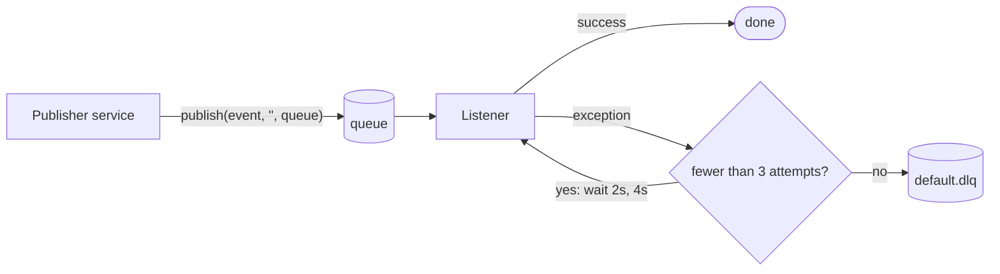
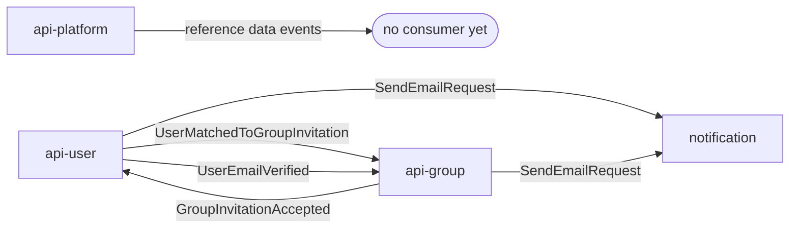

# amqp

The messaging library shared by every service that talks over RabbitMQ. It holds the broker configuration, the publisher, and the definition of every message: one **event** record and one **contract** class per message.

Services never call each other over HTTP. Everything between them goes through the queues defined here.

## Conventions

- **Event**: a Java record with the data, for example `GroupInvitationAcceptedEvent(groupInvitationId, groupId, email, role)`.
- **Contract**: a class with two constants, the queue name and its dead-letter queue name.
- **Queue names**: `<domain>.<thing>.<action>.queue` and `.dlq`, for example `group.invitation.accepted.queue`.
- **Registration**: each domain has a `*Queues` class listing its queue names. `RabbitMQConfig` declares all of them as durable queues at startup, in whichever service starts first.
- **Publishing**: `RabbitMQMessageProducer.publish(event, "", queueName)`. The empty exchange is RabbitMQ's default exchange, so the message goes straight to the named queue.
- **One consumer per queue.** A queue is a work queue, not a topic: if two services listened on the same queue, each message would reach only one of them.
- **Format**: JSON, through `Jackson2JsonMessageConverter`.

## Delivery and failure

Listeners that use `simpleRabbitListenerContainerFactory` get this retry policy. The notification service has its own factory that dead-letters to `notification.email.dlq` instead.

## Message catalogue

| Domain | Messages | Published by | Consumed by |
|---|---|---|---|
| `notification` | `SendEmailRequest` | `api-user`, `api-group` | `notification` |
| `user` | `UserRegisteredEvent`, `UserProfilePictureUpdatedEvent` | `api-user` | nobody yet |
| `user` | `UserEmailVerifiedEvent` | `api-user` | `api-group` |
| `user` | `UserMatchedToGroupInvitationEvent` | `api-user` | `api-group` |
| `platform` | Country, Currency, Language × Created, Disabled, Deleted (9) | `api-platform` | nobody yet |
| `group` | Group × Created, Updated, Disabled, Deleted (4) | `api-group` | nobody yet |
| `group` | GroupMembership × Created, Updated, Disabled, Deleted (4) | `api-group` | nobody yet |
| `group` | GroupInvitation × Created, Updated, Disabled, Deleted, Rejected, Canceled (6) | `api-group` | nobody yet |
| `group` | `GroupInvitationAcceptedEvent` | `api-group` | `api-user` |

Messages on a queue with no consumer stay there until one is added.

## Adding a message

1. Add `XxxEvent` (record) and `XxxContract` (queue and DLQ names) in the domain's package.
2. Add both names to the domain's `*Queues` class.
3. Publish with `RabbitMQMessageProducer`; consume with `@RabbitListener(queues = XxxContract.XXX_QUEUE_NAME, containerFactory = "simpleRabbitListenerContainerFactory")`.
