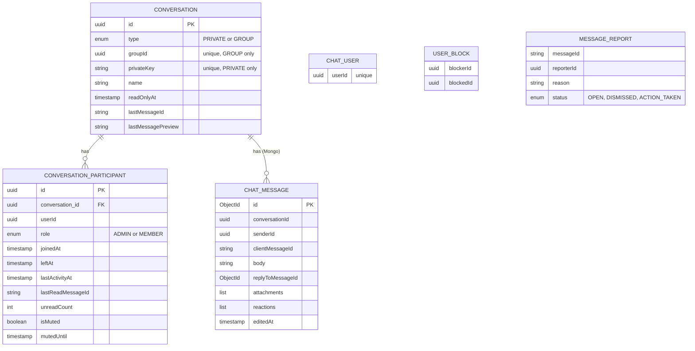
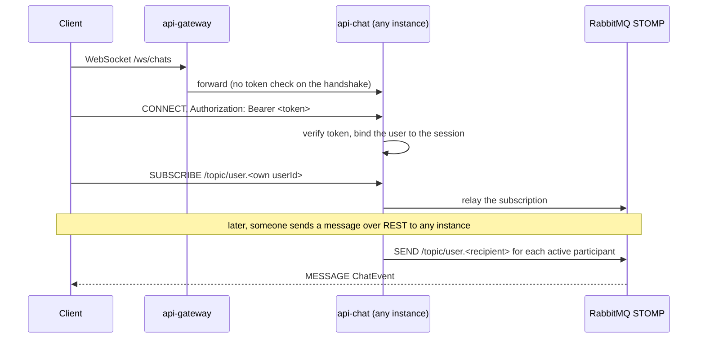
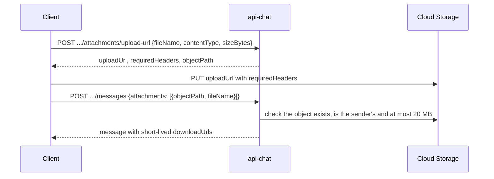

# api-chat

Owns conversations between users and their messages, on port **8084**. A conversation is either **private**, between two users, or the **group chat** of a group in `api-group`. Clients send over REST and receive in real time over STOMP on a WebSocket.

## Data

Conversations, participants, blocks and reports are in PostgreSQL (`jobbie_giggle_chat`). Messages are in MongoDB (`jobbie_giggle_chat`, collection `chat_messages`). Users and groups live in their own services; this service keeps their IDs, learned from events.

Every record also has `createdAt`, `updatedAt`, `disabledAt` and `deletedAt`.

There are no migrations: the tables must exist before the service starts (`ddl-auto: validate`).

## Rules

- **Private chats**: any platform user can open one with any other, unless either blocks the other. There is one per pair: opening it again returns the same conversation.
- **Group chats**: one per group, created and kept in step from `api-group`'s events. Group Admins are chat Admins and may delete anyone's message.
- **Leaving a group**: the member keeps reading the history up to the moment they left, but cannot send, react or type, and receives no more events. Rejoining brings back the whole history.
- **Disabled or deleted group**: its chat becomes read-only for everyone.
- **Messages**: up to 4,000 characters and 10 attachments, and at least one of the two. The sender can edit the text at any time. Deleting hides the content but keeps it for moderation.
- **Retries**: the client sends a `clientMessageId` with each message; sending again with the same one returns the first message instead of posting twice.
- **Blocks** apply to private chats: neither side can send or open the chat. In group chats a blocked user's messages are still shown, but they trigger no push to the blocker.
- **Disabled or deleted users** cannot send, and nobody can open a new private chat with them.
- **Mute** stops push notifications for a conversation, indefinitely or until `mutedUntil`.
- **Reports**: anyone who can read a message may report it, once while the report is open. Admin, Support and Inspector review reports and may remove the message.

## Endpoints

All need a Firebase token. "Participants" includes those who left, for reading their part of the history.

| Method and path | Who may call it |
|---|---|
| `GET /api/v1/chats/conversations?cursor=&limit=` | any signed-in user (their own) |
| `POST /api/v1/chats/conversations/private` `{userId}` | any signed-in user |
| `GET /api/v1/chats/conversations/{id}` | participants |
| `PUT /api/v1/chats/conversations/{id}/mute` `{isMuted, mutedUntil}` | participants |
| `POST /api/v1/chats/conversations/{id}/read` `{messageId}` | participants |
| `GET /api/v1/chats/conversations/{id}/messages?before=&after=&limit=` | participants |
| `POST /api/v1/chats/conversations/{id}/messages` | active participants |
| `POST /api/v1/chats/conversations/{id}/attachments/upload-url` | active participants |
| `GET /api/v1/chats/messages/{id}` | participants who can see it |
| `PATCH /api/v1/chats/messages/{id}` `{body}` | the sender, while active |
| `DELETE /api/v1/chats/messages/{id}` | the sender while active, Admins of the group |
| `PUT`, `DELETE /api/v1/chats/messages/{id}/reactions/{emoji}` | active participants |
| `POST /api/v1/chats/messages/{id}/reports` `{reason}` | participants who can see it |
| `GET /api/v1/chats/reports?status=`, `/reports/{id}`, `/reports/{id}/context` | Admin, Support, Inspector |
| `PATCH /api/v1/chats/reports/{id}` `{status, resolutionNote, isMessageRemoved}` | Admin, Support, Inspector |
| `POST /api/v1/chats/blocks` `{userId}`, `GET`, `DELETE /blocks/{userId}` | any signed-in user (their own) |

Conversations and messages use **cursor pagination** (`CursorPaginated` from `common`), because new messages arrive at the head of the list while it is read and would shift page numbers. Pass `nextCursor` back as `cursor` (conversations) or `before` (messages). `after=<messageId>` returns what is newer than a message, oldest first, for catching up after a reconnect. Blocks and reports, which do not move like that, use the usual `page` and `pageSize`.

## Real time

- **One topic per user.** Each event is sent to the topic of every active participant, never to a shared conversation topic. So someone removed from a group stops receiving at once, without unsubscribing.
- A session may only subscribe to its own user topic and only `SEND` to `/app/**`. A frame that breaks these rules gets an ERROR frame. An expired token must reconnect.
- Every event is a `ChatEvent {type, conversationId, payload, occurredAt}`:

| `type` | `payload` |
|---|---|
| `MESSAGE_CREATED`, `MESSAGE_UPDATED`, `MESSAGE_DELETED`, `REACTIONS_UPDATED` | `MessageResponse` |
| `READ_RECEIPT` | `{userId, messageId, readAt}` |
| `TYPING` | `{userId, isTyping}` |
| `CONVERSATION_UPDATED` | none: refetch the conversation |

- **Typing**: `SEND /app/conversations/{id}/typing` with `{"isTyping": true}`. It is relayed to the other active participants and not stored.
- With `app.chat.broker.relay-enabled=false` an in-memory broker is used instead of RabbitMQ. Events then only reach clients connected to the same instance, so turn it off only for a single instance.

## Attachments

- Any file type is accepted, up to 20 MB. The signed upload URL carries `x-goog-content-length-range`, so GCS refuses a larger body.
- Objects are stored at `chats/<conversationId>/<uploaderId>/<uuid>`. A message can only attach its sender's uploads for that conversation.
- Attachments are off when `app.chat.attachments.bucket` is empty: upload URLs are then refused with 422.
- Signing URLs needs a service account: a key file in `GOOGLE_APPLICATION_CREDENTIALS` locally, or `iam.serviceAccounts.signBlob` for the runtime service account on GCP.

## Push notifications

For each new message, the service publishes a `SendPushRequest` to the notification service. Its recipients are the active participants except the sender, anyone who muted the conversation, anyone who blocks the sender, and disabled or deleted users.

## Messages

| Direction | Message | Effect |
|---|---|---|
| consumes | `UserRegisteredEvent` | the user becomes known |
| consumes | `UserDisabledEvent`, `UserDeletedEvent` | the user can no longer chat |
| consumes | `GroupCreatedEvent`, `GroupUpdatedEvent` | creates or renames the group chat |
| consumes | `GroupDisabledEvent`, `GroupDeletedEvent` | the group chat becomes read-only |
| consumes | `GroupMembershipCreatedEvent` | adds the member, or brings them back |
| consumes | `GroupMembershipUpdatedEvent` | follows their role |
| consumes | `GroupMembershipDisabledEvent`, `GroupMembershipDeletedEvent` | the member leaves the chat |
| publishes | `ChatMessageSentEvent`, `ChatMessageEditedEvent`, `ChatMessageDeletedEvent` | a message is sent, edited or deleted |
| publishes | `ChatMessageReportedEvent` | a message is reported |
| publishes | `SendPushRequest` | a new message should reach phones |

Group events arrive on separate queues, so a membership can arrive before its group. Each handler creates whatever is missing and is safe to run twice.

## Settings

| Property | Default | Meaning |
|---|---|---|
| `app.chat.broker.relay-enabled` | `true` (`CHAT_STOMP_RELAY_ENABLED`) | relay STOMP to RabbitMQ; `false` for one instance only |
| `app.chat.broker.relay-port` | `61613` (`RABBITMQ_STOMP_PORT`) | port of RabbitMQ's `rabbitmq_stomp` plugin |
| `app.chat.attachments.bucket` | empty (`CHAT_ATTACHMENTS_BUCKET`) | Cloud Storage bucket; empty turns attachments off |
| `app.chat.attachments.max-size-bytes` | `20971520` | largest attachment |
| `app.chat.attachments.upload-url-ttl-minutes` | `15` | life of an upload URL |
| `app.chat.attachments.download-url-ttl-minutes` | `60` | life of a download URL |
| `app.cors.allowed-origins` | `http://localhost:3000` | browser origins allowed to open the WebSocket |
| `RABBITMQ_HOST`, `RABBITMQ_USERNAME`, `RABBITMQ_PASSWORD`, `RABBITMQ_VIRTUAL_HOST` | | broker connection, for AMQP and STOMP |
