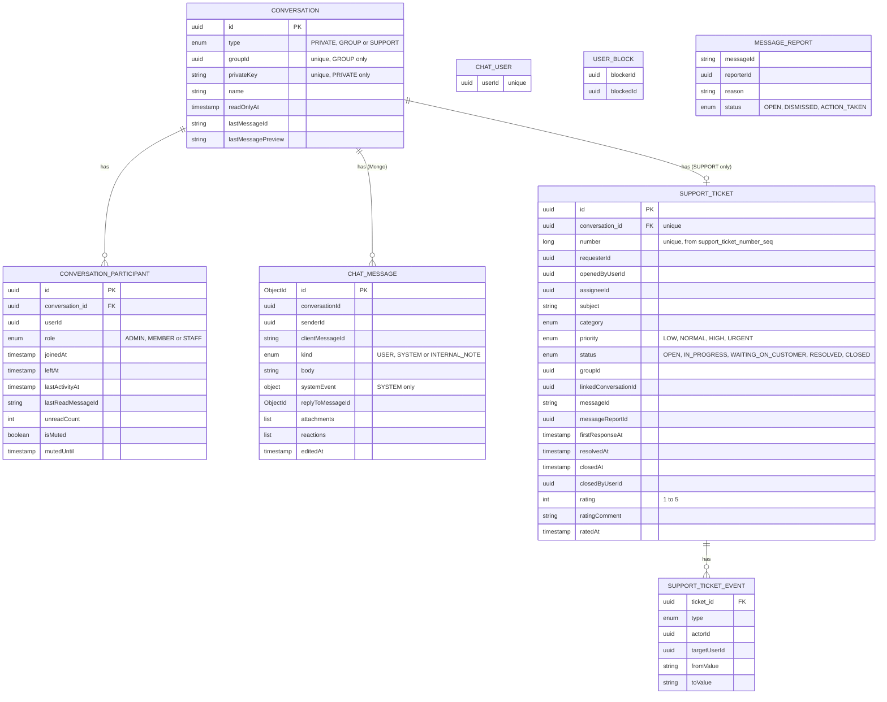
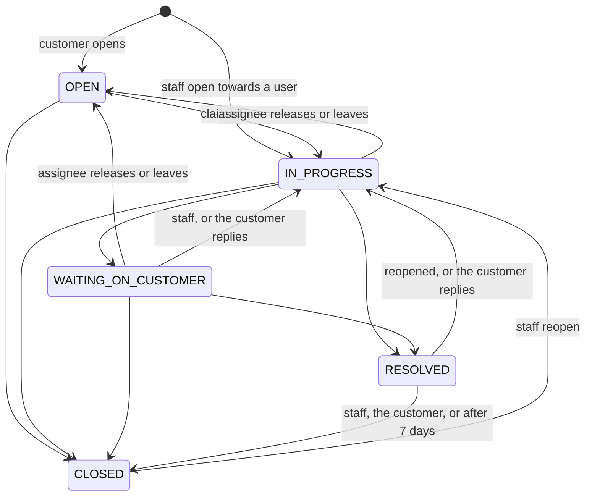
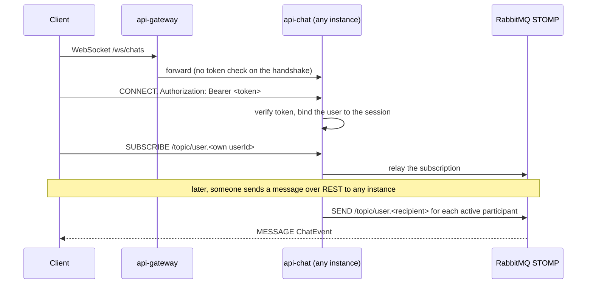
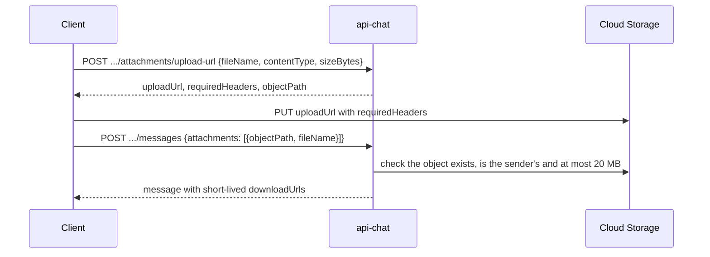

# api-chat

Owns conversations between users and their messages, on port **8084**. A conversation is **private**, between two users, the **group chat** of a group in `api-group`, or a **support chat**: the conversation of a support ticket between one customer and Support or Admin staff. Clients send over REST and receive in real time over STOMP on a WebSocket.

## Data

Conversations, participants, support tickets and their history, blocks and reports are in PostgreSQL (`jobbie_giggle_chat`). Messages are in MongoDB (`jobbie_giggle_chat`, collection `chat_messages`). Users and groups live in their own services; this service keeps their IDs, learned from events.



Every record also has `createdAt`, `updatedAt`, `disabledAt` and `deletedAt`.

There are no migrations: the tables must exist before the service starts (`ddl-auto: validate`). That includes `support_tickets`, `support_ticket_events` and the sequence `support_ticket_number_seq`, which ticket numbers are drawn from.

## Constraints

A user has at most one open report of a message; the service checks before saving, and this partial index stops two requests at once. JPA can't declare a partial index, so `MessageReport` only says so in a comment. There are no migrations, and `ddl-auto: validate` doesn't check unique constraints, so run these by hand. Creating one fails if duplicates already exist, so run the check query first and settle any rows it returns.

```sql
-- Check: should return no rows.
SELECT message_id, reporter_id FROM message_reports WHERE status = 'OPEN'
GROUP BY message_id, reporter_id HAVING count(*) > 1;

CREATE UNIQUE INDEX IF NOT EXISTS message_reports_open_uq
    ON message_reports (message_id, reporter_id) WHERE status = 'OPEN';
```

## Rules

- **Private chats**: any platform user can open one with any other, unless either blocks the other. There is one per pair: opening it again returns the same conversation.
- **Group chats**: one per group, created and kept in step from `api-group`'s events. Group Admins are chat Admins and may delete anyone's message.
- **Leaving a group**: the member keeps reading the history up to the moment they left, but cannot send, react or type, and receives no more events. Rejoining brings back the whole history.
- **Disabled or deleted group**: its chat becomes read-only for everyone.
- **Messages**: up to 4,000 characters and 10 attachments, and at least one of the two. The sender can edit the text at any time. Deleting hides the content but keeps it for moderation.
- **Retries**: the client sends a `clientMessageId` with each message; sending again with the same one returns the first message instead of posting twice.
- **Blocks** apply to private chats: neither side can send or open the chat. In group chats a blocked user's messages are still shown, but they trigger no push to the blocker.
- **Disabled or deleted users** cannot send, and nobody can open a new private chat with them.
- **Mute** stops push notifications for a conversation, indefinitely or until `mutedUntil`.
- **Reports**: anyone who can read a message may report it, once while the report is open. Admin, Support and Inspector review reports and may remove the message. Messages in support chats and system messages cannot be reported.
- **Message kinds**: `USER` messages are written by participants. `SYSTEM` messages record changes to a support ticket; they carry a `systemEvent` for clients to render in their own language, and nobody can edit, delete or react to them. `INTERNAL_NOTE` messages are written by staff in a support chat and never reach the customer: not in the history, events, pushes, unread counts or the conversation's last message.

## Support tickets

A support ticket is a `SUPPORT` conversation with a ticket attached. The customer is a `MEMBER` participant and the staff helping them are `STAFF` participants. "Staff" means the Support and Admin roles, read from the token.



- **Opening**: a customer opens a ticket with a subject, a category and a first message. They can have at most 3 tickets (`app.chat.support.max-ongoing-tickets-per-customer`) that are `OPEN`, `IN_PROGRESS` or `WAITING_ON_CUSTOMER`. Disabled or deleted users cannot open tickets or reply. Staff can open a ticket towards another user (`userId`); it starts `IN_PROGRESS`, assigned to them, and does not count towards the user's limit. Retrying with the same `clientMessageId` returns the ticket already opened.
- **Links**: a ticket may point at a group, a conversation, a message and a message report. A customer can only point at what they took part in, can see, or reported themselves.
- **Priority**: `SAFETY` tickets start `HIGH`, all others `NORMAL`. Only staff see and change the priority.
- **Assignment**: staff claim an unassigned ticket from the queue, which makes them its assignee, adds them to the chat and moves an `OPEN` ticket to `IN_PROGRESS`. Other staff join to help. The assignee, or any Admin, can release the ticket; the assignee leaving releases it too. Either puts an `IN_PROGRESS` or `WAITING_ON_CUSTOMER` ticket back to `OPEN`. Nobody can claim or join their own ticket.
- **Status**: staff follow the diagram. `IN_PROGRESS` and `WAITING_ON_CUSTOMER` need an assignee. The customer can only close their ticket, or reopen it while `RESOLVED`. Reopening goes to `IN_PROGRESS` if the ticket is assigned, otherwise to `OPEN`. A customer's reply moves a `WAITING_ON_CUSTOMER` or `RESOLVED` ticket back the same way.
- **Closed** tickets are read-only for everyone until staff reopen them.
- **Auto-close**: a ticket left `RESOLVED` for `app.chat.support.auto-close-after-days` (7) closes on its own, with no actor. A job checks every 10 minutes. Instances running it at the same time skip the tickets another one has locked, so each ticket is closed once.
- **Rating**: once a ticket is `RESOLVED` or `CLOSED`, its customer can rate the support from 1 to 5, with an optional comment. Rating again replaces the earlier rating. The rating is kept in the ticket's events but not posted to the chat.
- **Reading**: any Support or Admin user can read every support chat in full, internal notes included, without joining. To write, react or type they must join, and they need to still hold the role.
- **Moderation**: staff cannot delete the customer's messages. Customers cannot mute a support chat; staff can.
- **History**: every change is kept in the ticket's events. All changes except priority are also posted as system messages, and participants get `CONVERSATION_UPDATED`. Staff subscribed to the support queue topic get `TICKET_UPDATED` with the whole ticket.
- **Emails**: the service publishes `SupportTicketCreatedEvent`, `SupportTicketStatusChangedEvent` and `SupportTicketRepliedEvent`. `api-user`, which knows the customer's email address, turns them into emails. `SupportTicketRepliedEvent` is only published for the first staff message after the customer last wrote, so a burst of replies sends one email.
- **Response time**: `firstResponseAt` is set by the first message a staff participant writes to the customer, on tickets the customer opened.

## Endpoints

All need a Firebase token. "Participants" includes those who left, for reading their part of the history.

| Method and path | Who may call it |
|---|---|
| `GET /api/v1/chats/conversations?cursor=&limit=&type=` | any signed-in user (their own) |
| `POST /api/v1/chats/conversations/private` `{userId}` | any signed-in user |
| `GET /api/v1/chats/conversations/{id}` | participants |
| `PUT /api/v1/chats/conversations/{id}/mute` `{isMuted, mutedUntil}` | participants, except customers of a support chat |
| `POST /api/v1/chats/conversations/{id}/read` `{messageId}` | participants |
| `GET /api/v1/chats/conversations/{id}/messages?before=&after=&limit=` | participants; Support and Admin for support chats |
| `POST /api/v1/chats/conversations/{id}/messages` `{…, isInternalNote}` | active participants; notes by staff of a support chat |
| `POST /api/v1/chats/conversations/{id}/attachments/upload-url` | active participants |
| `GET /api/v1/chats/messages/{id}` | participants who can see it; Support and Admin in support chats |
| `PATCH /api/v1/chats/messages/{id}` `{body}` | the sender, while active |
| `DELETE /api/v1/chats/messages/{id}` | the sender while active, Admins of the group |
| `PUT`, `DELETE /api/v1/chats/messages/{id}/reactions/{emoji}` | active participants |
| `POST /api/v1/chats/messages/{id}/reports` `{reason}` | participants who can see it |
| `GET /api/v1/chats/reports?status=&cursor=&limit=`, `/reports/{id}`, `/reports/{id}/context` | Admin, Support, Inspector |
| `PATCH /api/v1/chats/reports/{id}` `{status, resolutionNote, isMessageRemoved}` | Admin, Support, Inspector |
| `POST /api/v1/chats/blocks` `{userId}`, `GET`, `DELETE /blocks/{userId}` | any signed-in user (their own) |
| `POST /api/v1/chats/support-tickets` `{subject, category, clientMessageId, body, groupId, conversationId, messageId, messageReportId}` | any signed-in user; with `userId`, Support and Admin |
| `GET /api/v1/chats/support-tickets/mine?status=&cursor=&limit=` | any signed-in user (their own) |
| `GET /api/v1/chats/support-tickets?status=&category=&priority=&assigneeId=&isUnassigned=&cursor=&limit=` | Support, Admin |
| `GET /api/v1/chats/support-tickets/{id}` | its customer, Support, Admin |
| `PATCH /api/v1/chats/support-tickets/{id}` `{priority, category}` | Support, Admin |
| `PATCH /api/v1/chats/support-tickets/{id}/status` `{status}` | its customer (close, reopen), Support, Admin |
| `POST /api/v1/chats/support-tickets/{id}/claim`, `/join`, `/leave` | Support, Admin |
| `POST /api/v1/chats/support-tickets/{id}/release` | its assignee, Admin |
| `PUT /api/v1/chats/support-tickets/{id}/rating` `{rating, comment}` | its customer |
| `GET /api/v1/chats/support-tickets/{id}/events` | Support, Admin |

Conversations and messages use **cursor pagination** (`CursorPaginated` from `common`), because new messages arrive at the head of the list while it is read and would shift page numbers. Pass `nextCursor` back as `cursor` (conversations) or `before` (messages). `after=<messageId>` returns what is newer than a message, oldest first, for catching up after a reconnect. A customer's support tickets (newest first), the staff ticket queue (most urgent first, then oldest first) and message reports (oldest first) use cursors too: tickets and reports leave the queue while staff work through it, which would make page numbers skip items. Blocks use the usual `page` and `pageSize`.

## Real time



- **One topic per user.** Each event is sent to the topic of every active participant, never to a shared conversation topic. So someone removed from a group stops receiving at once, without unsubscribing.
- **Support queue topic.** The one shared topic is `/topic/support.queue`, for Support and Admin sessions only. Every new ticket and every change to a ticket is sent there as `TICKET_UPDATED`, so staff see the queue move live. The role is checked when subscribing, from the token used to CONNECT.
- A session may only subscribe to its own user topic (and staff to the support queue topic) and only `SEND` to `/app/**`. A frame that breaks these rules gets an ERROR frame. An expired token must reconnect.
- Every event is a `ChatEvent {type, conversationId, payload, occurredAt}`:

| `type` | `payload` |
|---|---|
| `MESSAGE_CREATED`, `MESSAGE_UPDATED`, `MESSAGE_DELETED`, `REACTIONS_UPDATED` | `MessageResponse` |
| `READ_RECEIPT` | `{userId, messageId, readAt}` |
| `TYPING` | `{userId, isTyping}` |
| `CONVERSATION_UPDATED` | none: refetch the conversation |
| `TICKET_UPDATED` | `SupportTicketResponse` as staff see it; only on `/topic/support.queue` |
| `ITINERARY_FINISHED` | `ItineraryFinishedEvent` from api-destination, with no conversation; on each traveller's user topic |

- **Typing**: `SEND /app/conversations/{id}/typing` with `{"isTyping": true}`. It is relayed to the other active participants and not stored.
- With `app.chat.broker.relay-enabled=false` an in-memory broker is used instead of RabbitMQ. Events then only reach clients connected to the same instance, so turn it off only for a single instance.

## Attachments



- Any file type is accepted, up to 20 MB. The signed upload URL carries `x-goog-content-length-range`, so GCS refuses a larger body.
- Objects are stored at `chats/<conversationId>/<uploaderId>/<uuid>`. A message can only attach its sender's uploads for that conversation.
- Attachments are off when `app.chat.attachments.bucket` is empty: upload URLs are then refused with 422.
- Signing URLs needs a service account: a key file in `GOOGLE_APPLICATION_CREDENTIALS` locally, or `iam.serviceAccounts.signBlob` for the runtime service account on GCP.

## Push notifications

For each new message, the service publishes a `SendPushRequest` to the notification service. Its recipients are the active participants except the sender, anyone who muted the conversation, anyone who blocks the sender, and disabled or deleted users.

## Messages

| Direction | Message | Effect |
|---|---|---|
| consumes | `UserRegisteredEvent` | the user becomes known |
| consumes | `UserDisabledEvent`, `UserDeletedEvent` | the user can no longer chat |
| consumes | `GroupCreatedEvent`, `GroupUpdatedEvent` | creates or renames the group chat |
| consumes | `GroupDisabledEvent`, `GroupDeletedEvent` | the group chat becomes read-only |
| consumes | `GroupMembershipCreatedEvent` | adds the member, or brings them back |
| consumes | `GroupMembershipUpdatedEvent` | follows their role |
| consumes | `GroupMembershipDisabledEvent`, `GroupMembershipDeletedEvent` | the member leaves the chat |
| consumes | `ItineraryFinishedEvent` | on `destination.itinerary.finished.chat.queue`; sends `ITINERARY_FINISHED` to the travellers' sockets |
| publishes | `ChatMessageSentEvent`, `ChatMessageEditedEvent`, `ChatMessageDeletedEvent` | a message is sent, edited or deleted |
| publishes | `ChatMessageReportedEvent` | a message is reported |
| publishes | `SendPushRequest` | a new message should reach phones |
| publishes | `SupportTicketCreatedEvent` | a support ticket is opened |
| publishes | `SupportTicketStatusChangedEvent` | a support ticket moves to another status |
| publishes | `SupportTicketRepliedEvent` | staff reply to the customer after the customer last wrote |

Group events arrive on separate queues, so a membership can arrive before its group. Each handler creates whatever is missing and is safe to run twice.

## Settings

| Property | Default | Meaning |
|---|---|---|
| `app.chat.broker.relay-enabled` | `true` (`CHAT_STOMP_RELAY_ENABLED`) | relay STOMP to RabbitMQ; `false` for one instance only |
| `app.chat.broker.relay-port` | `61613` (`RABBITMQ_STOMP_PORT`) | port of RabbitMQ's `rabbitmq_stomp` plugin |
| `app.chat.attachments.bucket` | empty (`CHAT_ATTACHMENTS_BUCKET`) | Cloud Storage bucket; empty turns attachments off |
| `app.chat.attachments.max-size-bytes` | `20971520` | largest attachment |
| `app.chat.attachments.upload-url-ttl-minutes` | `15` | life of an upload URL |
| `app.chat.attachments.download-url-ttl-minutes` | `60` | life of a download URL |
| `app.chat.support.max-ongoing-tickets-per-customer` | `3` | unresolved tickets a customer may have opened at once |
| `app.chat.support.auto-close-after-days` | `7` (`CHAT_SUPPORT_AUTO_CLOSE_AFTER_DAYS`) | how long a ticket stays `RESOLVED` before it closes on its own |
| `app.chat.support.auto-close-interval-ms` | `600000` | pause between runs of the auto-close job |
| `app.cors.allowed-origins` | `http://localhost:3000` | browser origins allowed to open the WebSocket |
| `RABBITMQ_HOST`, `RABBITMQ_USERNAME`, `RABBITMQ_PASSWORD`, `RABBITMQ_VIRTUAL_HOST` | | broker connection, for AMQP and STOMP |
