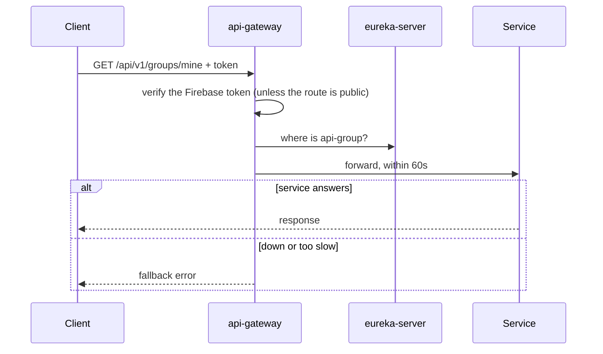
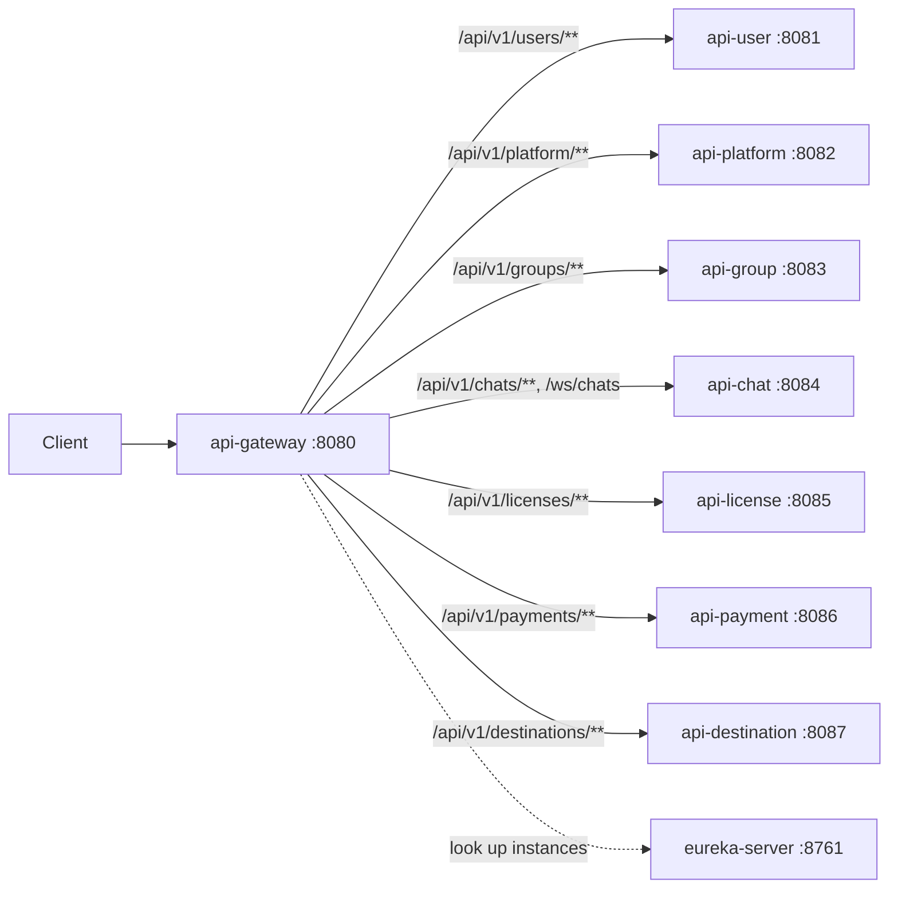

# api-gateway

The single public entry point, on port **8080**. It validates the Firebase token, applies CORS, and forwards each request to the right service, which it finds through Eureka. It is a Spring Cloud Gateway (WebFlux) application and holds no data.

## In short

The one door every request from the apps comes through. It checks that the caller is signed in, then passes the request on to the service that handles it, and gives a quick error rather than hanging when that service is down.

**Stack:** Spring Cloud Gateway (WebFlux), Spring Security OAuth2 resource server (Firebase JWTs), Resilience4j circuit breakers, Eureka client.

## User stories

- As a client app, I call one address for every feature, and open the chat WebSocket through it too.
- As a user, I get a fast error when a service is down, instead of waiting.
- As a visitor, I read public pages (licenses and prices, countries) and answer an invitation without signing in.
- As a developer, I read each service's OpenAPI document through the gateway.
- As Stripe, I deliver webhooks without a token; api-payment checks my signature.

## Main flows

## Requirements

- **GW-1** Every route needs a valid Firebase JWT, except the public ones listed under [Security](#security).
- **GW-2** Requests are routed by path prefix to a service instance found through Eureka.
- **GW-3** Each HTTP route has a circuit breaker and a 60-second time limit. The WebSocket route has neither.
- **GW-4** CORS allows only the configured origins.
- **GW-5** Each service's OpenAPI document is reachable at `/<service>/v3/api-docs`; Swagger is public only in local development.

---

## Technical reference

The sections below describe how it works.

## Routing

| Path | Goes to | Notes |
|---|---|---|
| `/api/v1/users/**` | `api-user` | circuit breaker, 60s time limit |
| `/api/v1/platform/**` | `api-platform` | circuit breaker, 60s time limit |
| `/api/v1/groups/**` | `api-group` | circuit breaker, 60s time limit |
| `/api/v1/chats/**` | `api-chat` | circuit breaker, 60s time limit |
| `/api/v1/licenses/**` | `api-license` | circuit breaker, 60s time limit |
| `/api/v1/payments/**` | `api-payment` | circuit breaker, 60s time limit; includes the Stripe webhook |
| `/api/v1/destinations/**` | `api-destination` | circuit breaker, 60s time limit |
| `/ws/chats/**` | `api-chat`, as WebSocket (`lb:ws://`) | no circuit breaker or time limit: they would cut every socket |
| `/api-user/v3/api-docs` | `api-user` `/api-docs` | OpenAPI document |
| `/api-platform/v3/api-docs` | `api-platform` `/api-docs` | OpenAPI document |
| `/api-group/v3/api-docs` | `api-group` `/api-docs` | OpenAPI document |
| `/api-chat/v3/api-docs` | `api-chat` `/api-docs` | OpenAPI document |
| `/api-license/v3/api-docs` | `api-license` `/api-docs` | OpenAPI document |
| `/api-payment/v3/api-docs` | `api-payment` `/api-docs` | OpenAPI document |
| `/api-destination/v3/api-docs` | `api-destination` `/api-docs` | OpenAPI document |

When a service does not answer, the circuit breaker forwards to `/fallback`, which answers 503 Service Unavailable, so clients retry later rather than take it for a missing resource.

## Security

Every route needs a valid Firebase JWT except:

| Route | Why it is public |
|---|---|
| `GET /api/v1/platform/countries/**`, `currencies/**`, `languages/**` | reference data |
| `GET /api/v1/licenses`, `GET /api/v1/licenses/*`, `GET /api/v1/licenses/*/price` | the license catalog and price quotes, e.g. for a pricing page |
| `POST /api/v1/groups/invitations/accept`, `/reject` | the invitee may have no account; the token is the proof |
| `/api/v1/users/verify-email` | opened from the verification email |
| `/api/v1/users/forgot-password` | permitted here; no service route behind it yet |
| `/api/v1/payments/webhook`, `/api/v1/payments/webhook/**` | Stripe calls it without a token; `api-payment` checks the Stripe signature |
| `/ws/chats/**` | browsers cannot put a token on the WebSocket handshake; `api-chat` checks the one in the STOMP CONNECT frame |
| `/actuator/health`, `/fallback` | health and fallback; health is the only actuator endpoint exposed, and any other under `/actuator` is refused |

Swagger paths are public only when `app.swagger.public=true` (local development).

A route that is public here must also be public in the service behind it: the service checks the token again.

## Settings

| Property | Default | Meaning |
|---|---|---|
| `app.cors.allowed-origins` | `http://localhost:3000` | origins allowed to call `/api/**` |
| `app.swagger.public` | `false` | open the Swagger paths without a token |

## Testing

`GatewayIT` starts the gateway with a plain HTTP server standing in for every service, found through Spring Cloud's simple discovery client instead of Eureka, and requests carrying test JWTs. It checks that each prefix reaches its service unchanged and the OpenAPI paths are rewritten (GW-2, GW-5), that exactly the public routes pass without a token (GW-1), the CORS preflight for allowed and other origins (GW-4), that a service that is down answers 503 through `/fallback` (GW-3), and that no actuator endpoint but health is reachable. `GatewaySecurityTest` checks the role claim becomes the same authority the services use. `mvn verify` runs both; no Docker is needed. Coverage is enforced: 85% of lines and 75% of branches.

## Adding a service

Add a route (and its Swagger route) in `application.yml`, a `timelimiter` instance, and any public paths in `SecurityConfig`.
