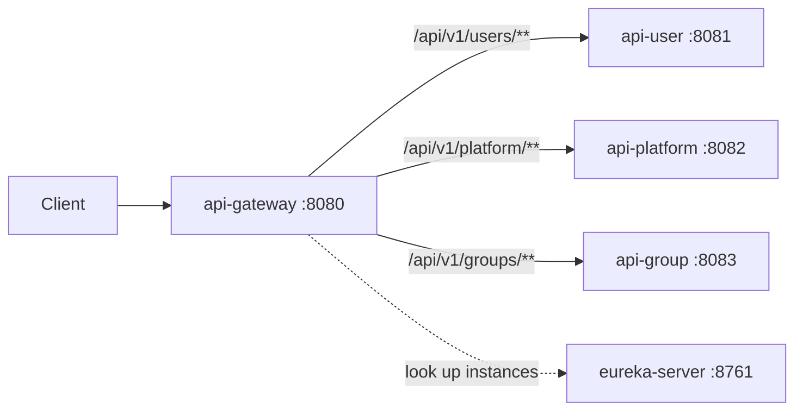

# api-gateway

The single public entry point, on port **8080**. It validates the Firebase token, applies CORS, and forwards each request to the right service, which it finds through Eureka. It is a Spring Cloud Gateway (WebFlux) application and holds no data.

## Routing

| Path | Goes to | Notes |
|---|---|---|
| `/api/v1/users/**` | `api-user` | circuit breaker, 60s time limit |
| `/api/v1/platform/**` | `api-platform` | circuit breaker, 60s time limit |
| `/api/v1/groups/**` | `api-group` | circuit breaker, 60s time limit |
| `/api-user/v3/api-docs` | `api-user` `/api-docs` | OpenAPI document |
| `/api-platform/v3/api-docs` | `api-platform` `/api-docs` | OpenAPI document |
| `/api-group/v3/api-docs` | `api-group` `/api-docs` | OpenAPI document |

When a service does not answer, the circuit breaker forwards to `/fallback`.

## Security

Every route needs a valid Firebase JWT except:

| Route | Why it is public |
|---|---|
| `GET /api/v1/platform/countries/**`, `currencies/**`, `languages/**` | reference data |
| `POST /api/v1/groups/invitations/accept`, `/reject` | the invitee may have no account; the token is the proof |
| `/api/v1/users/verify-email` | opened from the verification email |
| `/api/v1/users/forgot-password` | permitted here; no service route behind it yet |
| `/api/v1/payments/webhook/**` | permitted here; no service route behind it yet |
| `/actuator/health`, `/fallback` | health and fallback |

Swagger paths are public only when `app.swagger.public=true` (local development).

A route that is public here must also be public in the service behind it: the service checks the token again.

## Settings

| Property | Default | Meaning |
|---|---|---|
| `app.cors.allowed-origins` | `http://localhost:3000` | origins allowed to call `/api/**` |
| `app.swagger.public` | `false` | open the Swagger paths without a token |

## Adding a service

Add a route (and its Swagger route) in `application.yml`, a `timelimiter` instance, and any public paths in `SecurityConfig`.
