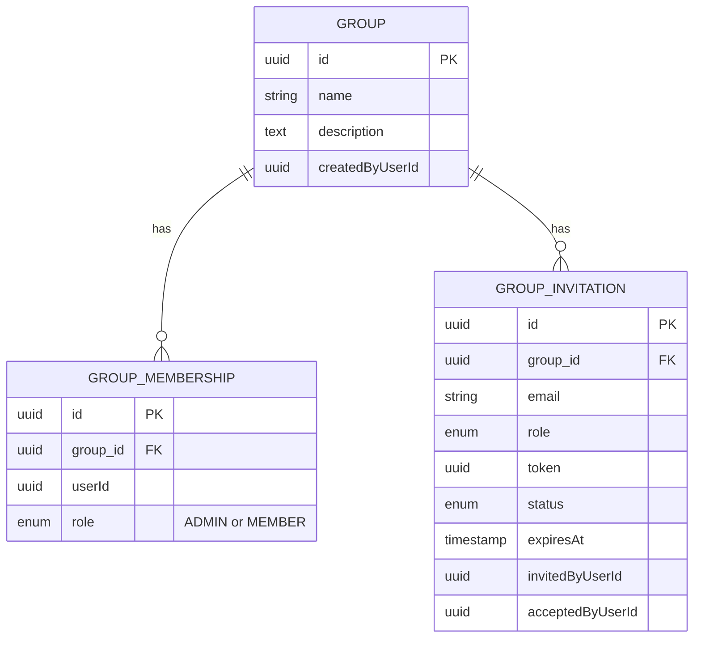
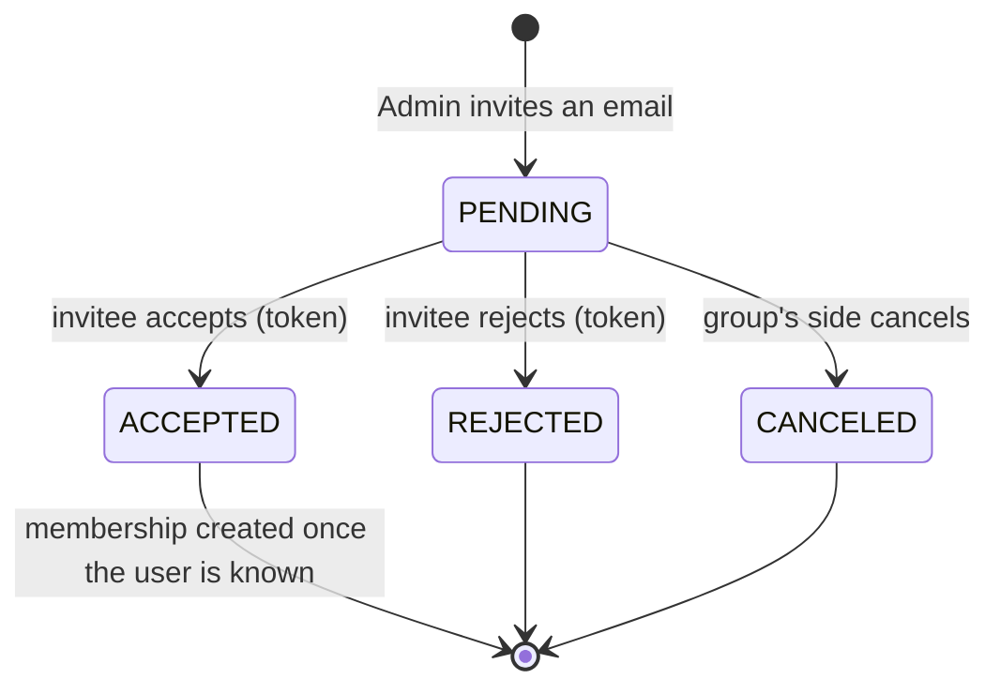
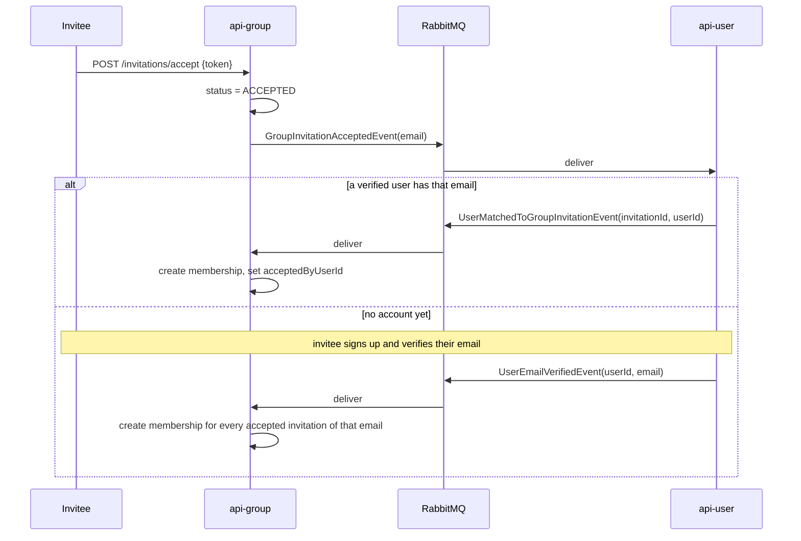

# api-group

Owns groups of users, who belongs to them, and the invitations that bring people in, on port **8083**. People join a group by accepting an invitation sent to their email address.

## Data

Everything is in PostgreSQL (`jobbie_giggle_group`). Users live in `api-user`; this service only keeps their IDs.

Every record also has `createdAt`, `updatedAt`, `disabledAt` and `deletedAt`.

## Rules

- The user who creates a group becomes its first **Admin**.
- A group always keeps at least one active Admin: the last one cannot be demoted, disabled or removed.
- A user has at most one membership per group. A disabled membership still holds the place; only a deleted one frees it.
- A group has at most one pending invitation per email address.
- An invitation can be answered for `app.group-invitation.ttl-days` (7) days.
- "Staff" below means the platform roles Admin and Support (plus Inspector for reading).

## Endpoints

| Method and path | Who may call it |
|---|---|
| `POST /api/v1/groups` | any signed-in user |
| `GET /api/v1/groups/mine` | any signed-in user |
| `GET /api/v1/groups/{id}` | members of the group, staff |
| `GET /api/v1/groups` | staff |
| `PUT /api/v1/groups` | Admins of the group, Admin or Support |
| `DELETE /api/v1/groups/{id}` | Admins of the group |
| `GET /api/v1/groups/memberships/group/{groupId}` | members of the group, staff |
| `POST /api/v1/groups/memberships`, `PUT` | Admins of the group, Admin or Support |
| `DELETE /api/v1/groups/memberships/{id}` | Admins of the group, or the member themselves (leave) |
| `POST /api/v1/groups/invitations`, `PUT` | Admins of the group, Admin or Support |
| `GET /api/v1/groups/invitations/group/{groupId}` | Admins of the group, staff |
| `POST /api/v1/groups/invitations/{id}/cancel` | Admins of the group, Admin or Support |
| `DELETE /api/v1/groups/invitations/{id}` | Admins of the group |
| `POST /api/v1/groups/invitations/accept`, `/reject` | **public**, body `{"token": "..."}` |
| `DELETE .../{id}/disable` (all three resources) | Admin or Support |

The token is only ever sent in the invitation email; no API response contains it.

## Life of an invitation

Once an invitation is no longer pending, its email links return 422. After expiry, accepting returns 422 as well. A canceled or rejected email address can be invited again.

## From acceptance to membership

This service cannot look users up, so it asks `api-user` over RabbitMQ.

So the membership does not exist the moment `accept` returns; it appears shortly after, or after the invitee verifies their email. Someone signed in with a different email address than the invited one is refused with 403. Linking is safe to repeat: a second delivery of the same message changes nothing.

## Messages

| Direction | Message | When |
|---|---|---|
| publishes | Group × Created, Updated, Disabled, Deleted | a group changes |
| publishes | GroupMembership × Created, Updated, Disabled, Deleted | a membership changes |
| publishes | GroupInvitation × Created, Updated, Disabled, Deleted | an invitation changes |
| publishes | `GroupInvitationAcceptedEvent`, `...RejectedEvent`, `...CanceledEvent` | an invitation is answered or canceled |
| publishes | `SendEmailRequest(GROUP_INVITATION)` | an invitation is created |
| consumes | `UserMatchedToGroupInvitationEvent`, `UserEmailVerifiedEvent` | from `api-user` |

## Settings

| Property | Default | Meaning |
|---|---|---|
| `app.frontend-url` | `http://localhost:3000` | base of the accept and reject links in the email |
| `app.group-invitation.ttl-days` | `7` | how long an invitation can be answered |

The email links are `{frontend-url}/group-invitations/accept?token=` and `/reject?token=`. They open frontend pages that then `POST` the token, so that a mail scanner following a link changes nothing.
