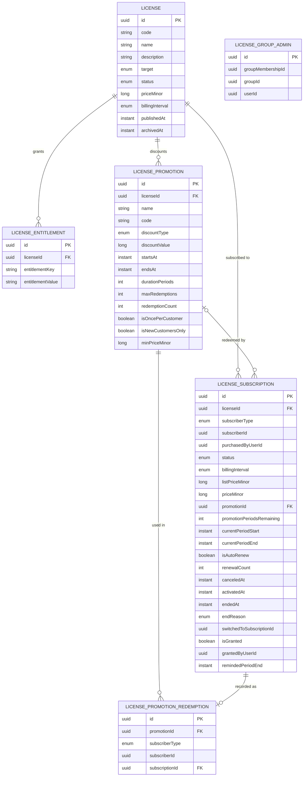
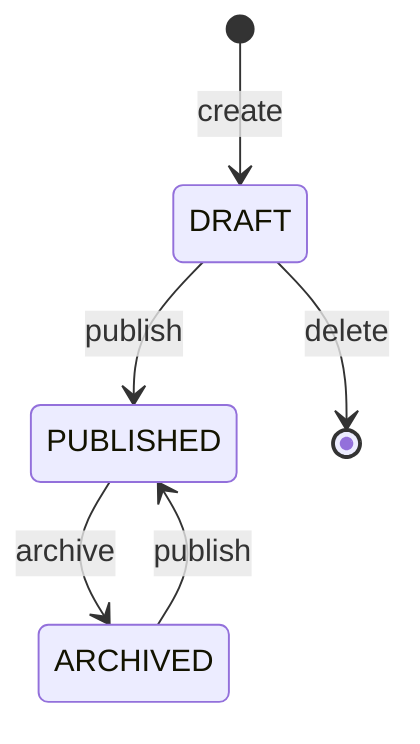
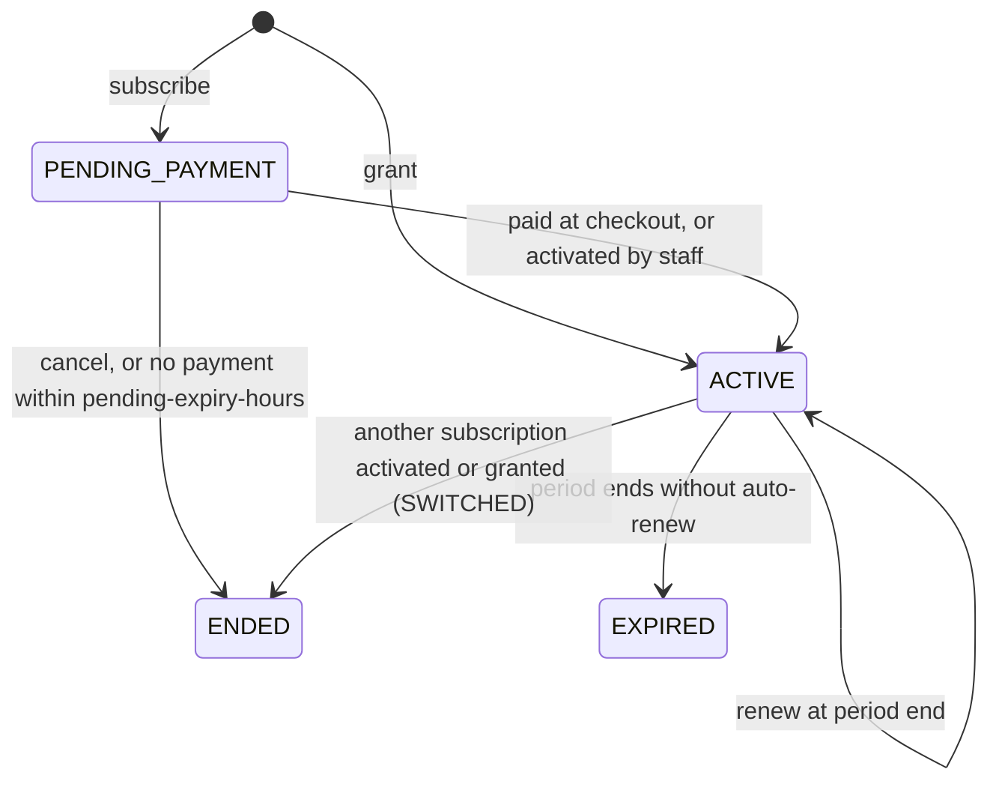

# api-license

Owns the licenses the platform offers and the subscriptions to them, on port **8085**. A license is a recurring price (monthly or yearly, in one platform currency) plus a list of entitlements that other services enforce.

## Data

Licenses, their entitlements, promotions, subscriptions, promotion redemptions and a copy of group admins are in PostgreSQL (`jobbie_giggle_license`).



Every record also has `createdAt`, `updatedAt`, `disabledAt` and `deletedAt`.

- **Code** is `UPPER_SNAKE_CASE` and unique among licenses that are not deleted.
- **Target** says who a license is bought for: a `USER` or a `GROUP`.
- **Price** is in minor units of `app.license.currency` (default `EUR`), so `999` is 9.99 EUR.
- **Entitlements** are `UPPER_SNAKE_CASE` keys, one per key per license. A key with a value is a limit (`MAX_GROUPS=10`); a key without one is a flag (`AI_PLANNER`). Keys are free-form, so a new feature needs no change here.

## Lifecycle



- Only `PUBLISHED` licenses are visible to customers and, later, take new subscriptions.
- `ARCHIVED` licenses take no new subscriptions, but existing ones keep running.
- Only drafts can be deleted. Disabling is not used: archiving replaces it.
- Code and target can only change while a license is a draft.
- Price and interval can always change. Subscribers keep the price they subscribed at.
- Entitlements can change unless the license is archived, and they apply to every subscriber at once.

## Promotions

A promotion discounts a license from `startsAt` until `endsAt`, or until further notice if there is no end.

- **Discount:** `AMOUNT` takes `discountValue` minor units off; `PERCENTAGE` takes `discountValue`% off (1 to 100), rounded half up. The result never goes below `minPriceMinor` (default 0), and a floor above the list price never raises it.
- **Code or automatic:** a promotion without a code applies by itself; one with a code only applies when the customer enters it. A valid code replaces the automatic promotion, so a subscription gets at most one. Codes are stored in upper case and are unique per license.
- **No overlap:** the runs of a license's automatic promotions can't overlap, so at most one applies at any moment. Code promotions can run alongside them. Changes lock the license row, so two staff members can't add overlapping runs at once.
- **Duration:** `durationPeriods` is how many billing periods are discounted; none means every period. The discounted price is locked into the subscription when it is created.
- **Limits:** `maxRedemptions` caps how many subscriptions may use it; a redemption is taken in one guarded update, so two subscriptions can't both take the last one. `isOncePerCustomer` refuses a customer with a redemption of it; `isNewCustomersOnly` refuses one who ever had a subscription that started. A signed-in caller's quote checks these too: an automatic promotion they may not use is left out, and such a code is a 422.
- **Freezing:** once redeemed, only a promotion's name, end and max redemptions can change, and it can be ended but not deleted. A promotion that has not started can be deleted but not ended.
- **State** is derived, not stored: `SCHEDULED`, `RUNNING`, `EXHAUSTED` (no redemptions left) or `ENDED`.

Promotions can be added to drafts and published licenses, not to archived ones.

## Subscriptions

A subscription belongs to a subscriber: a user for a `USER` license, a group for a `GROUP` license. Its price and interval are copied from the license, so later changes to the license don't reach it; its entitlements are the license's current ones.



- **One at a time:** a subscriber has at most one `ACTIVE` and at most one `PENDING_PAYMENT` subscription, enforced by partial unique indexes. Subscribing again to the active license is refused; subscribing to another one is a switch.
- **Subscribing** needs a published license. A `GROUP` license needs a `groupId`, and only an admin of that group may subscribe it; a `USER` license takes none. The subscription waits for payment, and any promotion is redeemed at once, so the quoted price holds. The customer pays through Stripe Checkout in [api-payment](../../api-payment/docs/README.md#checkout).
- **Activating** ends the subscriber's active subscription, if any, as `SWITCHED`, pointing at its replacement. It happens in one of two ways:
  - **Paid at checkout:** `PaymentSubscriptionActivatedEvent` from api-payment activates it for the period Stripe billed, with auto-renew on. A payment for a subscription that no longer waits for it is refused with `LicenseSubscriptionActivationRefusedEvent`, so api-payment stops the Stripe subscription and flags a refund. This covers one that was canceled, timed out or activated by staff. A repeated payment event is ignored.
  - **By staff** (`/activate`), e.g. after a bank transfer: the first period starts now with auto-renew off, as nothing bills it, so it expires at the end of the period.
  - Proration of a switch comes in a later phase.
- **Granting** gives a user (`userId`) or a group (`groupId`), matching the license's target, a license for free for 1 to 120 periods, active at once and without auto-renew. It also switches out the active subscription. Drafts can't be granted; archived licenses can.
- **Cancelling** a pending subscription ends it and gives its promotion back. Cancelling an active one turns auto-renew off: it runs to the end of its period, and can be resumed before then. Granted subscriptions don't renew, so they can't be cancelled or resumed.
- **Cancelling and resuming a paid subscription** also reach Stripe: api-payment sets or clears `cancel_at_period_end` there.
- **Extending** pushes the end of an active subscription's period forward by 1 to 3650 days. Subscriptions Stripe bills can't be extended, as Stripe charges the next period on its own date; refund them instead.
- **Renewal:** periods follow the UTC calendar, so a monthly period from 31 January ends on the last day of February. Subscriptions to archived licenses keep renewing.
  - **Granted, or activated by staff:** `SubscriptionRenewalJob` handles them. At the end of a period, one with auto-renew gets the next period, and the others expire.
  - **Billed by Stripe** (`isBilledByStripe`): the job leaves them alone, and Stripe drives them through api-payment's events:
    - `PaymentSubscriptionRenewedEvent`: Stripe charged the next period, which the subscription moves on to, counting down promoted periods. A repeated event changes nothing. A charge for a subscription that is over is refused, as at activation.
    - `PaymentSubscriptionPastDueEvent`: the charge failed and Stripe retries. `pastDueAt` is set and access stays. The next paid renewal clears it.
    - `PaymentSubscriptionEndedEvent`: Stripe ended it, at the end of a canceled period or after its last retry, so it `EXPIRED`.
    - `PaymentSubscriptionRenewalChangedEvent`: auto-renew was turned off or on in Stripe, e.g. from the dashboard or because the user was disabled or deleted. This is applied as a cancel or resume with no actor, so the canceled email still goes out.
- **Promoted periods:** `promotionPeriodsRemaining` starts at the promotion's `durationPeriods` and counts down at each renewal. At 0 the price goes back to the list price the subscription was promised. With a promotion and no count, every period stays discounted.

### Group subscriptions

`api-license` does not ask `api-group` who administers a group: it keeps its own copy of ADMIN memberships in `license_group_admins`, from the `GroupMembership*` events `api-group` sends to the `.license` queues.

- A membership created or updated as `ADMIN` is recorded, by membership ID, so repeated or out-of-order events do no harm. Any other role, and a disabled or deleted membership, is forgotten.
- Group admins can subscribe their group, see its subscriptions, and cancel or resume them. Emails about a group subscription go to whoever bought it; a group grant sends none.
- When a group is disabled or deleted, its admins are forgotten, its active subscription stops renewing and runs out, and a pending one ends.
- The copy only holds memberships changed after `api-license` first started listening, as the `.license` queues did not exist before: memberships older than that need to be replayed, or changed once, to count.

### Jobs

| Job | Every | Does |
|---|---|---|
| `SubscriptionRenewalJob` | `app.license.renewal-interval-ms` (1 min) | renews or expires active subscriptions whose period is over, except those Stripe bills |
| `PendingSubscriptionTimeoutJob` | `app.license.pending-timeout-interval-ms` (10 min) | ends subscriptions waiting for payment longer than `app.license.pending-expiry-hours` (48, `LICENSE_PENDING_EXPIRY_HOURS`), giving their promotion back |
| `RenewalReminderJob` | `app.license.renewal-reminder-interval-ms` (1 h) | publishes `LicenseSubscriptionRenewalDueEvent` for auto-renewals within `app.license.renewal-reminder-days` (3, `LICENSE_RENEWAL_REMINDER_DAYS`), once per period end; granted subscriptions are left out |

All three take batches of 50 rows with `SKIP LOCKED`, up to 20 batches per run, so several instances split the work. Changes to a subscription lock its row, so they and the jobs don't cross.

## Endpoints

| Method and path | Who may call it |
|---|---|
| `GET /api/v1/licenses` | anyone, signed in or not; only staff (Admin, Support, Inspector) see other statuses than `PUBLISHED` and may filter by `status` |
| `GET /api/v1/licenses/{id}` | anyone, signed in or not; a license that is not published is not found for anyone but staff (Admin, Support, Inspector) |
| `GET /api/v1/licenses/{id}/price?code=&groupId=` | anyone, signed in or not, for a license they can see; an unknown, ended, used-up or not yet started code is a 422. Signed in, the caller's own limits apply, or for a group license those of `groupId` if they administer it |
| `POST /api/v1/licenses` | Admin or Support |
| `PUT /api/v1/licenses/{id}` | Admin or Support |
| `PUT /api/v1/licenses/{id}/entitlements` | Admin or Support |
| `POST /api/v1/licenses/{id}/publish`, `POST /api/v1/licenses/{id}/archive` | Admin or Support |
| `DELETE /api/v1/licenses/{id}` | Admin or Support |
| `POST /api/v1/licenses/{licenseId}/promotions` | Admin or Support |
| `GET /api/v1/licenses/{licenseId}/promotions` | Admin, Support or Inspector |
| `GET /api/v1/licenses/{licenseId}/promotions/{id}` | Admin, Support or Inspector |
| `PUT`, `DELETE /api/v1/licenses/{licenseId}/promotions/{id}` | Admin or Support |
| `POST /api/v1/licenses/{licenseId}/promotions/{id}/end` | Admin or Support |
| `POST /api/v1/licenses/subscriptions` | any signed-in user, for themselves or for a group they administer |
| `GET /api/v1/licenses/subscriptions/mine?status=`, `GET /api/v1/licenses/subscriptions/mine/active` | any signed-in user; `active` is a 204 without one |
| `GET /api/v1/licenses/subscriptions/groups/{groupId}?status=`, `GET /api/v1/licenses/subscriptions/groups/{groupId}/active` | the group's admins, Admin, Support or Inspector; `active` is a 204 without one |
| `GET /api/v1/licenses/subscriptions/{id}` | the subscriber or, for a group, its admins; Admin, Support or Inspector |
| `POST /api/v1/licenses/subscriptions/{id}/cancel`, `/resume` | the subscriber or, for a group, its admins; Admin or Support |
| `GET /api/v1/licenses/subscriptions?subscriberId=&licenseId=&status=` | Admin, Support or Inspector |
| `POST /api/v1/licenses/subscriptions/grant` | Admin or Support |
| `POST /api/v1/licenses/subscriptions/{id}/activate`, `/extend` | Admin or Support; `/activate` is for payments made outside Stripe and leaves auto-renew off |

The list is ordered cheapest first and then by name, and can be filtered by `target`. Each license carries its running automatic promotion, if any, and `promotedPriceMinor`, the price with it. Promotions are readable by Admin, Support and Inspector only, as listing them would reveal their codes. The public reads (list, one license, price quote) are listed in `additionalPermitAllMatchers()` and at the gateway, with anonymous authentication on so the policy is still asked, as in [api-platform](../../api-platform/docs/README.md#why-reads-work-without-a-token). `GET /api/v1/licenses/subscriptions` matches the one-segment public pattern too, so without a token it is a 403 from its policy rather than a 401.

## Schema

There are no migrations: `ddl-auto: validate` checks the schema at startup, so create it by hand in `jobbie_giggle_license`.

```sql
CREATE TABLE licenses (
    id               UUID PRIMARY KEY,
    code             VARCHAR(64)  NOT NULL,
    name             VARCHAR(120) NOT NULL,
    description      TEXT,
    target           VARCHAR(16)  NOT NULL,
    status           VARCHAR(16)  NOT NULL,
    price_minor      BIGINT       NOT NULL CHECK (price_minor >= 0),
    billing_interval VARCHAR(16)  NOT NULL,
    published_at     TIMESTAMP(6) WITH TIME ZONE,
    archived_at      TIMESTAMP(6) WITH TIME ZONE,
    created_at       TIMESTAMP(6) WITH TIME ZONE NOT NULL,
    updated_at       TIMESTAMP(6) WITH TIME ZONE NOT NULL,
    disabled_at      TIMESTAMP(6) WITH TIME ZONE,
    deleted_at       TIMESTAMP(6) WITH TIME ZONE
);
-- A deleted draft frees its code.
CREATE UNIQUE INDEX licenses_code_uq ON licenses (code) WHERE deleted_at IS NULL;

CREATE TABLE license_entitlements (
    id                UUID PRIMARY KEY,
    license_id        UUID        NOT NULL REFERENCES licenses (id),
    entitlement_key   VARCHAR(64) NOT NULL,
    entitlement_value VARCHAR(255),
    created_at        TIMESTAMP(6) WITH TIME ZONE NOT NULL,
    updated_at        TIMESTAMP(6) WITH TIME ZONE NOT NULL,
    disabled_at       TIMESTAMP(6) WITH TIME ZONE,
    deleted_at        TIMESTAMP(6) WITH TIME ZONE,
    UNIQUE (license_id, entitlement_key)
);

CREATE TABLE license_promotions (
    id                    UUID PRIMARY KEY,
    license_id            UUID         NOT NULL REFERENCES licenses (id),
    name                  VARCHAR(120) NOT NULL,
    code                  VARCHAR(32),
    discount_type         VARCHAR(16)  NOT NULL,
    discount_value        BIGINT       NOT NULL CHECK (discount_value > 0),
    starts_at             TIMESTAMP(6) WITH TIME ZONE NOT NULL,
    ends_at               TIMESTAMP(6) WITH TIME ZONE,
    duration_periods      INTEGER CHECK (duration_periods > 0),
    max_redemptions       INTEGER CHECK (max_redemptions > 0),
    redemption_count      INTEGER      NOT NULL DEFAULT 0,
    is_once_per_customer  BOOLEAN      NOT NULL,
    is_new_customers_only BOOLEAN      NOT NULL,
    min_price_minor       BIGINT       NOT NULL DEFAULT 0 CHECK (min_price_minor >= 0),
    created_at            TIMESTAMP(6) WITH TIME ZONE NOT NULL,
    updated_at            TIMESTAMP(6) WITH TIME ZONE NOT NULL,
    disabled_at           TIMESTAMP(6) WITH TIME ZONE,
    deleted_at            TIMESTAMP(6) WITH TIME ZONE
);
CREATE UNIQUE INDEX license_promotions_code_uq ON license_promotions (license_id, code)
    WHERE code IS NOT NULL AND deleted_at IS NULL;
CREATE INDEX license_promotions_license_idx ON license_promotions (license_id, starts_at);

CREATE TABLE license_subscriptions (
    id                          UUID PRIMARY KEY,
    license_id                  UUID        NOT NULL REFERENCES licenses (id),
    subscriber_type             VARCHAR(16) NOT NULL,
    subscriber_id               UUID        NOT NULL,
    purchased_by_user_id        UUID        NOT NULL,
    status                      VARCHAR(16) NOT NULL,
    billing_interval            VARCHAR(16) NOT NULL,
    list_price_minor            BIGINT      NOT NULL,
    price_minor                 BIGINT      NOT NULL,
    promotion_id                UUID REFERENCES license_promotions (id),
    promotion_periods_remaining INTEGER,
    current_period_start        TIMESTAMP(6) WITH TIME ZONE,
    current_period_end          TIMESTAMP(6) WITH TIME ZONE,
    is_auto_renew               BOOLEAN     NOT NULL,
    renewal_count               INTEGER     NOT NULL DEFAULT 0,
    canceled_at                 TIMESTAMP(6) WITH TIME ZONE,
    activated_at                TIMESTAMP(6) WITH TIME ZONE,
    activated_by_user_id        UUID,
    ended_at                    TIMESTAMP(6) WITH TIME ZONE,
    end_reason                  VARCHAR(32),
    switched_to_subscription_id UUID,
    is_granted                  BOOLEAN     NOT NULL,
    granted_by_user_id          UUID,
    reminded_period_end         TIMESTAMP(6) WITH TIME ZONE,
    is_billed_by_stripe         BOOLEAN     NOT NULL DEFAULT FALSE,
    past_due_at                 TIMESTAMP(6) WITH TIME ZONE,
    created_at                  TIMESTAMP(6) WITH TIME ZONE NOT NULL,
    updated_at                  TIMESTAMP(6) WITH TIME ZONE NOT NULL,
    disabled_at                 TIMESTAMP(6) WITH TIME ZONE,
    deleted_at                  TIMESTAMP(6) WITH TIME ZONE
);
-- One active and one pending subscription per subscriber, whatever the race.
CREATE UNIQUE INDEX license_subscriptions_active_uq ON license_subscriptions (subscriber_type, subscriber_id)
    WHERE status = 'ACTIVE' AND deleted_at IS NULL;
CREATE UNIQUE INDEX license_subscriptions_pending_uq ON license_subscriptions (subscriber_type, subscriber_id)
    WHERE status = 'PENDING_PAYMENT' AND deleted_at IS NULL;
CREATE INDEX license_subscriptions_subscriber_idx ON license_subscriptions (subscriber_type, subscriber_id, created_at);
CREATE INDEX license_subscriptions_renewal_idx ON license_subscriptions (current_period_end) WHERE status = 'ACTIVE';
CREATE INDEX license_subscriptions_pending_idx ON license_subscriptions (created_at) WHERE status = 'PENDING_PAYMENT';

CREATE TABLE license_promotion_redemptions (
    id              UUID PRIMARY KEY,
    promotion_id    UUID        NOT NULL REFERENCES license_promotions (id),
    subscriber_type VARCHAR(16) NOT NULL,
    subscriber_id   UUID        NOT NULL,
    subscription_id UUID        NOT NULL UNIQUE REFERENCES license_subscriptions (id),
    created_at      TIMESTAMP(6) WITH TIME ZONE NOT NULL,
    updated_at      TIMESTAMP(6) WITH TIME ZONE NOT NULL,
    disabled_at     TIMESTAMP(6) WITH TIME ZONE,
    deleted_at      TIMESTAMP(6) WITH TIME ZONE
);
CREATE INDEX license_promotion_redemptions_subscriber_idx
    ON license_promotion_redemptions (promotion_id, subscriber_type, subscriber_id);

CREATE TABLE license_group_admins (
    id                  UUID PRIMARY KEY,
    group_membership_id UUID NOT NULL UNIQUE,
    group_id            UUID NOT NULL,
    user_id             UUID NOT NULL,
    created_at          TIMESTAMP(6) WITH TIME ZONE NOT NULL,
    updated_at          TIMESTAMP(6) WITH TIME ZONE NOT NULL,
    disabled_at         TIMESTAMP(6) WITH TIME ZONE,
    deleted_at          TIMESTAMP(6) WITH TIME ZONE
);
CREATE INDEX license_group_admins_group_user_idx ON license_group_admins (group_id, user_id);
```

If `license_subscriptions` already exists from the previous step, add the reminder column:

```sql
ALTER TABLE license_subscriptions ADD COLUMN reminded_period_end TIMESTAMP(6) WITH TIME ZONE;
```

For payments in Stripe, add the billing columns:

```sql
ALTER TABLE license_subscriptions
    ADD COLUMN is_billed_by_stripe BOOLEAN NOT NULL DEFAULT FALSE,
    ADD COLUMN past_due_at TIMESTAMP(6) WITH TIME ZONE;
```

## Messages

Published once their transaction commits, so a rollback sends nothing.

| | Message | When |
|---|---|---|
| publishes | `LicenseSubscriptionPendingEvent` | a subscription is created and waits for payment; carries the list price, the first period's price and how many periods the promotion covers, for checkout |
| publishes | `LicenseSubscriptionActivatedEvent` | a subscription starts, by activation or grant; carries the entitlements; to its fanout exchange, which feeds `api-user`, `api-payment` and `api-destination` |
| publishes | `LicenseSubscriptionRenewedEvent` | a subscription moves on to its next period |
| publishes | `LicenseSubscriptionCanceledEvent` | an active subscription stops renewing; `actorId` is null when its group went away or Stripe stopped it; to its fanout exchange, which feeds `api-user` and `api-payment` |
| publishes | `LicenseSubscriptionEndedEvent` | a subscription expires, or ends early (switched, pending canceled or timed out); to its fanout exchange, which feeds `api-user`, `api-payment` and `api-destination` |
| publishes | `LicenseSubscriptionRenewalDueEvent` | an auto-renewal is within `renewal-reminder-days` |
| publishes | `LicenseEntitlementsChangedEvent` | a license's entitlements are replaced |
| publishes | `LicenseCatalogChangedEvent` | a license is published or archived, or a published or archived one is updated; carries its whole state and `changedAt`, for api-payment's Stripe catalog. Drafts are never sent |
| publishes | `LicenseSubscriptionActivationRefusedEvent` | a payment arrived for a subscription that can no longer take it: at activation, or a renewal of one that is over |
| publishes | `LicenseSubscriptionResumedEvent` | a canceled subscription renews again; for api-payment |
| consumes | `GroupMembership*`, `GroupDisabledEvent`, `GroupDeletedEvent` | from `api-group`, on the `.license` queues |
| consumes | `PaymentSubscriptionActivatedEvent` | from `api-payment`, when the first payment went through at checkout or by a switch |
| consumes | `PaymentSubscriptionRenewedEvent`, `PaymentSubscriptionPastDueEvent`, `PaymentSubscriptionEndedEvent`, `PaymentSubscriptionRenewalChangedEvent` | from `api-payment`, for subscriptions Stripe bills |

Each event carries `notifyUserId`, who its emails go to: the user, or for a group whoever bought it (nobody for a group grant). `api-user` consumes the activated, canceled, ended and renewal-due events to send emails, so a service that wants to keep its own copy of entitlements needs its own queues for them, as with the group events.
