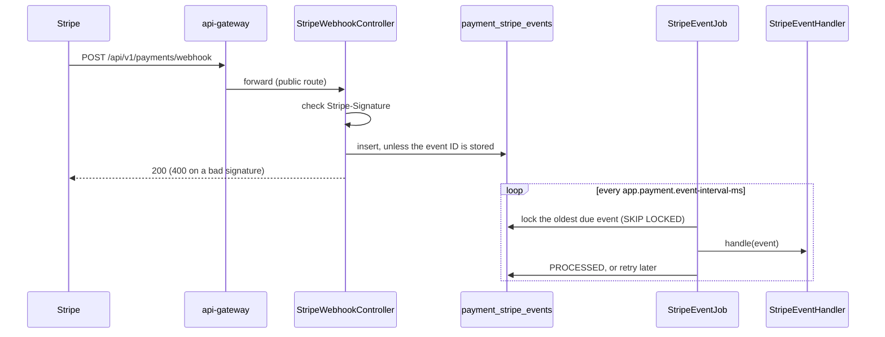
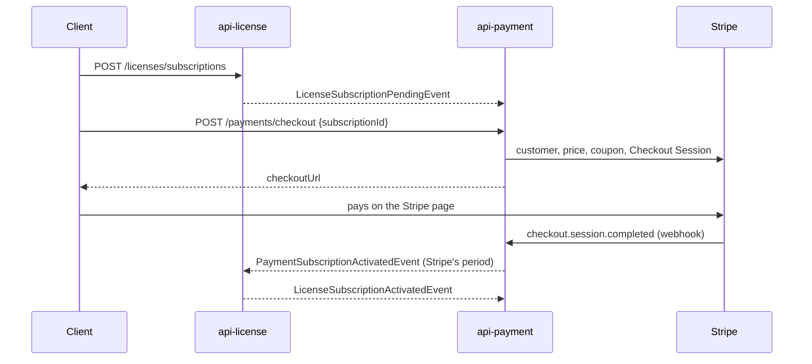

# api-payment

Takes payments for license subscriptions through Stripe, on port **8086**, with data in PostgreSQL (`jobbie_giggle_payment`). It uses the [stripe](../../stripe/docs/README.md) library to call Stripe.

So far it:
- opens Stripe Checkout for subscriptions waiting for payment, or switches a paid subscription with proration, and tells api-license once the first payment is in;
- follows what Stripe does to paid subscriptions: renewals, failed renewals and ends, and carries cancel and resume over to Stripe;
- emails the payer about each payment and each failed renewal;
- records every invoice and refund, lists them for customers, group admins and staff, and refunds for staff;
- compares paid and pending subscriptions with Stripe every day, to repair what a lost webhook missed;
- receives Stripe's webhook and works through the events it stores;
- keeps copies of what it needs from other services: published licenses, subscriptions waiting for payment, user contacts and group admins;
- pushes published licenses to Stripe as Products and Prices.

## In short

Where money changes hands. It sends people to Stripe Checkout to pay for a subscription, follows Stripe as it renews or fails to charge, records every invoice and refund, and checks against Stripe every day that nothing was missed. It tells api-license when a subscription is paid, renewed or over.

**Stack:** Spring Boot (Web, Data JPA, Security), PostgreSQL, RabbitMQ, Stripe (stripe-java through the [stripe](../../stripe/docs/README.md) library: Checkout, Billing, Tax, webhooks).

## User stories

- As a traveller or group admin, I pay for a subscription on Stripe's checkout page, by card, Link, Apple Pay or Google Pay.
- As a payer, I switch to another license and pay only the difference for the rest of the period.
- As a payer, I get an email with the amount after each payment, and one with a link to fix my card when a renewal fails.
- As a payer or group admin, I see my or my group's invoices, with Stripe's PDF.
- As an administrator, I refund all or part of an invoice, optionally ending the subscription.
- As an inspector, I see every Stripe event received and what happened to it, and staff can replay one that failed.

## Main flows

- **Paying at checkout:** see [Checkout](#checkout).
- **Renewals and failed payments:** see [Paid subscriptions](#paid-subscriptions).
- **A payment that arrives too late:** see [When the payment can't be taken](#when-the-payment-cant-be-taken).

## Requirements

- **PAY-1** Every webhook is verified by signature, stored once by its Stripe ID, and processed from that inbox with retries.
- **PAY-2** Checkout opens only for a subscription still waiting for payment. The first payment activates it in api-license for Stripe's period.
- **PAY-3** A payment for a subscription that no longer waits stops the Stripe subscription at once and flags it for refund.
- **PAY-4** Renewals, failed renewals, ends and dashboard changes are passed to api-license. Cancel and resume from api-license reach Stripe.
- **PAY-5** Every invoice and refund is recorded. Refunds never exceed what is left, and a double click makes one refund.
- **PAY-6** A daily reconciliation compares each paid or pending subscription with Stripe and repairs what a lost webhook missed.
- **PAY-7** Published licenses are pushed to Stripe as Products and tax-inclusive Prices.
- **PAY-8** Payment emails go to the payer only, and only to a verified, active account.

---

## Technical reference

The sections below describe how it works.

## Receiving events



- **Verify, then store:** the signature covers the raw body, so the controller takes it as a string. A missing, wrong or older-than-5-minute signature gets a 400.
- **Once per event:** a redelivered event is skipped by its Stripe ID (`insert ... on conflict do nothing`), so two deliveries arriving at once both get a 200.
- **Answer at once:** nothing is handled while Stripe waits. A slow handler never makes Stripe time out and redeliver.
- **One transaction per event:** a failing handler rolls back only its own work. The event is retried after 30s, 1m, 2m and so on, up to an hour apart. After `app.payment.event-max-attempts` (10) tries it is `FAILED`.
- **Types nobody handles** are marked `IGNORED`. Each type has at most one `StripeEventHandler` bean, and startup fails on two.
- **Order isn't guaranteed:** Stripe neither orders nor deduplicates deliveries. The job takes the oldest first, but a handler must cope with events arriving out of order, and with seeing one again after a replay.
- **API version:** an event whose `api_version` differs from stripe-java's can't be read into its models. It is set to `FAILED` at once, since retrying won't help. Move the endpoint to the right version, then replay the event.

## Statuses

| Status | Meaning |
|---|---|
| `PENDING` | waiting for its first or next attempt at `next_attempt_at` |
| `PROCESSED` | handled |
| `IGNORED` | no handler for its type |
| `FAILED` | out of attempts, or in an unreadable API version |

## Checkout



`POST /api/v1/payments/checkout {subscriptionId}` returns `{subscriptionId, checkoutUrl, expiresAt, isPaid}`:
- **A page to visit:** `checkoutUrl` is set and `isPaid` is false.
- **Already paid:** `isPaid` is true and there is no page. Either it was paid at an earlier checkout and waits for api-license, or it was paid by [switching](#switching).

- **Who:** the subscriber of a user subscription, or any admin of the group of a group one, from the local copy of group admins.
- **When:**
  - only while the subscription is `PENDING` and before its pending expiry;
  - a `404` before api-license's pending event has arrived;
  - a `409` while the license is still being pushed to Stripe;
  - a `409` once the license is archived, as Stripe sells no inactive product; the subscription then times out.
  - The payer's contact must have arrived from api-user, or it is a `409` too.
- **Reuse:** an open session with more than 5 minutes left is returned again rather than a new one.
- **Customer:** one Stripe Customer per user or per group, made the first time with the payer's email. A user's own customer follows later changes to their email and name; a group's keeps the first payer's. The customer's address and business name come from checkout.
- **Price:** the Stripe Price at the subscription's own list price, which may be older than the license's current one, so subscribers keep the price they were quoted.
- **Promotion:** when the first period is cheaper than the list price, a coupon made for this subscription alone (`subscription_<id>`, one redemption) takes off exactly the difference api-license computed, so its floor and rounding hold. It applies for the promotion's periods (×12 months for yearly licenses), or forever without a count. Stripe's own promotion code box is off.
- **Session:**
  - **Payment methods:** card and Link; cards bring Apple Pay and Google Pay.
  - **Tax:** Stripe Tax, with a required billing address and tax ID collection.
  - **Expiry:** at the subscription's pending expiry, kept within Stripe's 30 minutes to 24 hours.
  - **Metadata:** `licenseSubscriptionId`, on both the session and the Stripe Subscription it creates.

### Stripe events handled

| Event | Does |
|---|---|
| `checkout.session.completed` | when paid (or `no_payment_required`): records the Stripe subscription and customer, reads the paid period, and publishes `PaymentSubscriptionActivatedEvent`. Unpaid ones wait for the next event |
| `checkout.session.async_payment_succeeded` | the same, for a payment that confirmed later |
| `checkout.session.expired` | forgets the session, so the next checkout opens a new one |

Renewals and the rest of a paid subscription's life are under [Paid subscriptions](#paid-subscriptions).

A paid session whose pending event hasn't arrived yet fails and is retried, with the usual backoff. A repeated one is handled once.

### Switching

A subscriber whose active subscription Stripe already bills doesn't get a second Stripe subscription. Instead the one they have is moved to the new price (`switchPrice`):
- **Price:** the new subscription's price and coupon replace the old ones. With no coupon, any old discount is dropped.
- **Period:** a new period starts now (`billing_cycle_anchor` now).
- **Charge:** the unused part of the old period is credited, and the difference is charged at once to the saved card (`proration_behavior=always_invoice`).
- **All or nothing:** `payment_behavior=error_if_incomplete`, so a declined or unconfirmed charge leaves the subscription as it was.

Once the charge goes through:
1. The Stripe subscription moves from the old billing subscription to the new one.
2. `PaymentSubscriptionActivatedEvent` goes out, and api-license switches as usual.
3. The old one's end changes nothing in Stripe, as it holds no Stripe subscription any more.

If Stripe answers `402` (declined, or the card needs the customer), checkout opens a page instead. When that page is paid, the old Stripe subscription is canceled at once, without a credit.

### When the payment can't be taken

Money may come in for a subscription that no longer waits for it: it was canceled, timed out, or activated by staff while the page was open. This is found two ways:
- api-payment sees it ended or active already;
- or api-license refuses the activation (`LicenseSubscriptionActivationRefusedEvent`).

Either way, the Stripe subscription is canceled at once so it never charges again, `refund_due_at` is set, and an error is logged. Staff then refund the invoice, through the API or the dashboard; see [Invoices and refunds](#invoices-and-refunds).

To make this rare, the open session is expired as soon as the subscription ends while pending, or staff activate it.

## Paid subscriptions

Stripe renews what it bills. api-license's renewal job leaves those subscriptions alone and follows these events instead:

| Stripe event | Does |
|---|---|
| `invoice.paid` | emails the payer the amount, tax included, with a link to Stripe's invoice page; nothing is sent for a free invoice. For a renewal (`subscription_cycle`), it reads Stripe's new period and publishes `PaymentSubscriptionRenewedEvent`. A first invoice that arrives before its checkout event is retried |
| `invoice.payment_failed` | for a renewal only: publishes `PaymentSubscriptionPastDueEvent` and emails the payer the amount due, Stripe's next try and a link to pay or change the card. Access stays while Stripe retries, as set in the Stripe dashboard. A later successful retry comes as `invoice.paid` |
| `customer.subscription.deleted` | publishes `PaymentSubscriptionEndedEvent`, and api-license expires the subscription. It doesn't fire for one we stopped ourselves (refund due), or one that was switched away |
| `customer.subscription.updated` | when `cancel_at_period_end` differs from what api-payment last set, e.g. it was changed in the dashboard: records it and publishes `PaymentSubscriptionRenewalChangedEvent` |

Changes the other way:
- **Cancel and resume** in api-license (`LicenseSubscriptionCanceledEvent` on its `.payment` queue, `LicenseSubscriptionResumedEvent`) set or clear `cancel_at_period_end` in Stripe. The flag is recorded first, so the `customer.subscription.updated` it causes isn't sent back.
- **A disabled or deleted user's** paid subscriptions stop at the end of their period. api-license, which doesn't follow users, is told with `PaymentSubscriptionRenewalChangedEvent`.
- **A disabled or deleted group's** subscriptions stop through api-license, which already cancels them.

## Invoices and refunds

Every subscription invoice is recorded in `payment_invoices` from `invoice.paid`, `invoice.payment_failed`, `invoice.voided` and `invoice.marked_uncollectible`. Each record keeps:
- the number, Stripe's status, the total, the tax and the amount paid;
- Stripe's hosted page and PDF;
- for paid invoices, the payment intent that paid it, read from Stripe's invoice payments.

Refunds are made against that payment intent.

- **Staff refund:** `POST /invoices/{id}/refund {amountMinor?, isEndingSubscription?, isRequestedByCustomer?}` refunds part or all of what is left.
  - Without an amount it refunds all that is left; more than that is refused.
  - The idempotency key covers the invoice, the amount refunded so far and this amount, so a double click makes one refund.
  - With `isEndingSubscription`, the Stripe subscription is canceled at once, and Stripe's `customer.subscription.deleted` then expires the subscription in api-license.
- **Dashboard refunds:** `refund.created`, `refund.updated` and `refund.failed` record every refund, whoever made it.
  - A refund is matched to its invoice by our `invoiceId` metadata, or by its payment intent.
  - The invoice's `amount_refunded_minor` counts every refund that went through or is on its way, so a failed or canceled one stops counting.
  - Refunds of payments that are no recorded invoice are skipped.
- **Payments that couldn't be taken** ([above](#when-the-payment-cant-be-taken)): their `refund_due_at` is cleared as soon as a refund of the subscription's invoice is recorded. `GET /subscriptions?isRefundDue=true` lists the ones still waiting.

## Reconciliation

`ReconciliationJob` runs every `app.payment.reconcile-interval-ms` (10 min) and compares each billing subscription with Stripe about once every `app.payment.reconcile-every-hours` (24). It takes those Stripe holds something for: active ones with a Stripe subscription and no refund due, and pending ones with a checkout session. It handles up to 100 per run, one transaction each, with `SKIP LOCKED`.

| Stripe says | Sent on |
|---|---|
| a pending checkout is `complete` and paid | handled as `checkout.session.completed` |
| a pending checkout `expired` | the session is forgotten |
| the subscription is `canceled` or `incomplete_expired` | `PaymentSubscriptionEndedEvent` |
| it is `past_due` or `unpaid` | `PaymentSubscriptionPastDueEvent` |
| otherwise | `PaymentSubscriptionRenewedEvent` with Stripe's period: api-license moves on only if the period is later, and otherwise only clears a past-due mark |
| `cancel_at_period_end` differs from what is recorded | `PaymentSubscriptionRenewalChangedEvent` |

Everything it sends is something its receiver already takes more than once. A comparison that fails is logged, and that subscription waits for its next turn.

Payment emails go to the payer: the user, or for a group the admin who subscribed it. They need a verified email address, and an account that is not disabled or deleted.

## Copies from other services

No HTTP between services, so api-payment keeps what it needs from their events. Each copy copes with repeated and out-of-order events.

| Copy | Table | From | Rules |
|---|---|---|---|
| Licenses | `payment_license_products` | `LicenseCatalogChangedEvent` | the whole state of a published or archived license; an event older than the stored `changedAt` is dropped. Each change queues a Stripe sync |
| Subscriptions waiting for payment | `payment_subscriptions` | `LicenseSubscriptionPendingEvent`, Activated and Ended on `.payment` queues | `PENDING`, then `ACTIVE` or `ENDED`. An activation or end that arrives before the pending event is kept, and the pending event only fills in the details. Grants are never recorded |
| User contacts | `payment_user_contacts` | `UserContactUpdatedEvent`, `UserDisabledEvent`, `UserDeletedEvent` | the latest contact by `changedAt`; disabling and deleting set `disabled_at` and `deleted_at`, which a later contact doesn't clear |
| Group admins | `payment_group_admins` | `GroupMembership*`, `GroupDisabledEvent`, `GroupDeletedEvent` on `.payment` queues | as in `api-license`: ADMIN memberships are kept, any other role or a removed membership or group is forgotten |

The copies only know what happened after the `.payment` queues and the new events exist. Existing users, group admins and published licenses need a replay once: for licenses, updating each published one without changes is enough, as an update republishes it.

## Stripe catalog

`CatalogSyncJob` (every `app.payment.catalog-sync-interval-ms`, 30s) pushes each changed license to Stripe, one transaction per license:

1. **Product:** created with the ID `license_<licenseId>`, so a repeated create finds it, or updated to the stored name, description and tax code. It is active only while the license is published. Archiving it in Stripe stops new checkouts but not existing subscriptions.
2. **Price:** the current price is found by its lookup key `license_<licenseId>_<interval>_<amount>_<currency>`, or created recurring and tax-inclusive (`tax_behavior=inclusive`). It is then made the product's default price. A price change creates a new Price and leaves the old ones, so subscribers keep theirs.
3. **Retries:** a failure is retried after 1m, 2m, 4m and so on, up to an hour apart, and never given up on. `last_sync_error` shows why.

Checkout will ask `CatalogSyncService.ensurePrice` for the Price at a subscription's own list price, which may be an older one.

Metadata on both: `licenseId` and `licenseCode`. Promotions are not synced: each checkout will get its own coupon.

## Endpoints

| Endpoint | Who |
|---|---|
| `POST /api/v1/payments/checkout` | the subscriber, or an admin of the subscribed group |
| `POST /api/v1/payments/webhook` | Stripe only: public, with a signature check |
| `GET /api/v1/payments/invoices/mine?cursor=&limit=` | any signed-in user, for their own subscriptions; newest first |
| `GET /api/v1/payments/invoices/groups/{groupId}?cursor=&limit=` | the group's admins; Admin, Support or Inspector |
| `GET /api/v1/payments/invoices?subscriberId=&licenseSubscriptionId=&status=&page=&pageSize=` | Admin, Support or Inspector |
| `GET /api/v1/payments/invoices/{id}` | the subscriber or, for a group, its admins; Admin, Support or Inspector; with its refunds |
| `POST /api/v1/payments/invoices/{id}/refund` | Admin or Support |
| `GET /api/v1/payments/subscriptions?status=&subscriberId=&isRefundDue=` | Admin, Support or Inspector |
| `GET /api/v1/payments/stripe-events?status=&eventType=&cursor=&limit=` | Admin, Support or Inspector; newest first, without payloads |
| `GET /api/v1/payments/stripe-events/{id}` | Admin, Support or Inspector; with the raw payload |
| `POST /api/v1/payments/stripe-events/{id}/replay` | Admin or Support; only `FAILED` or `IGNORED` events, which go back to `PENDING` with their attempts reset |

A user's or group's invoices and the Stripe events use **cursor pagination** (`cursor`, `limit`; the answer has `nextCursor` and `hasMore`), as both grow at their head while being read. The staff invoice list keeps `page` and `pageSize`, for its page numbers and total.

Stripe can also resend an event from its dashboard. A resend keeps the event ID, so it is skipped as a duplicate; use replay for events stored here.

## Settings

| Property | Env | Default | Meaning |
|---|---|---|---|
| `app.payment.event-interval-ms` | `PAYMENT_EVENT_INTERVAL_MS` | 5000 | pause between runs of the event job |
| `app.payment.event-max-attempts` | `PAYMENT_EVENT_MAX_ATTEMPTS` | 10 | attempts before an event is `FAILED` |
| `app.payment.catalog-sync-interval-ms` | `PAYMENT_CATALOG_SYNC_INTERVAL_MS` | 30000 | pause between runs of the catalog sync |
| `app.payment.product-tax-code` | `PAYMENT_PRODUCT_TAX_CODE` | empty | Stripe Tax code of license products, e.g. `txcd_10103001`; empty uses the account's default |
| `app.payment.checkout-success-url` | `PAYMENT_CHECKOUT_SUCCESS_URL` | `http://localhost:3000/account/subscriptions/{subscriptionId}?checkout=success` | where Stripe sends a customer who paid |
| `app.payment.checkout-cancel-url` | `PAYMENT_CHECKOUT_CANCEL_URL` | `http://localhost:3000/account/subscriptions/{subscriptionId}?checkout=canceled` | where Stripe sends a customer who went back |
| `app.payment.subscription-url` | `PAYMENT_SUBSCRIPTION_URL` | `http://localhost:3000/account/subscriptions/{subscriptionId}` | the subscription's page, linked from payment emails |
| `app.payment.reconcile-interval-ms` | `PAYMENT_RECONCILE_INTERVAL_MS` | 600000 | pause between runs of the reconciliation job |
| `app.payment.reconcile-every-hours` | `PAYMENT_RECONCILE_EVERY_HOURS` | 24 | how often each subscription is compared with Stripe |

The Stripe settings are in the [stripe docs](../../stripe/docs/README.md#settings).

## Running locally

1. Use test-mode keys only. Put `STRIPE_SECRET_KEY=sk_test_...` in your environment.
2. Get the CLI's signing secret, which stays the same for the key, and set it as `STRIPE_WEBHOOK_SECRET`:
   ```bash
   docker compose run --rm stripe-cli listen --print-secret
   ```
3. Start forwarding to the gateway on the host:
   ```bash
   docker compose --profile stripe up -d stripe-cli
   ```
4. Send a test event:
   ```bash
   docker compose run --rm stripe-cli trigger invoice.paid
   ```

Events then show up in `GET /api/v1/payments/stripe-events`; types without a handler are `IGNORED`. Pay with Stripe's test card `4242 4242 4242 4242` on a checkout page to go through the whole flow.

The Stripe CLI uses your account's default API version, unless the CLI is told otherwise (`--latest` or the account setting). If it differs from `2026-10-28.endive`, events are stored but handled ones go `FAILED`.

## Stripe setup

- **Webhook endpoint:** `https://<gateway>/api/v1/payments/webhook`, on API version `2026-10-28.endive`, sending:
  - `checkout.session.completed`, `checkout.session.async_payment_succeeded`, `checkout.session.expired`
  - `invoice.paid`, `invoice.payment_failed`, `invoice.voided`, `invoice.marked_uncollectible`
  - `customer.subscription.updated`, `customer.subscription.deleted`
  - `refund.created`, `refund.updated`, `refund.failed`
- **Stripe Tax:** your tax registrations, and a default tax code or `PAYMENT_PRODUCT_TAX_CODE`.
- **Retries:** a Smart Retries schedule, with the subscription canceled after the last failed try, so past-due subscriptions end.

## Schema

`ddl-auto: validate`, so create the database and tables first. `create-databases.sql` only runs on a new postgres volume, so on an existing one also run `CREATE DATABASE jobbie_giggle_payment;`.

```sql
CREATE TABLE payment_stripe_events (
    id                  UUID         PRIMARY KEY,
    created_at          TIMESTAMPTZ  NOT NULL,
    updated_at          TIMESTAMPTZ  NOT NULL,
    disabled_at         TIMESTAMPTZ,
    deleted_at          TIMESTAMPTZ,
    stripe_event_id     VARCHAR(255) NOT NULL UNIQUE,
    event_type          VARCHAR(255) NOT NULL,
    api_version         VARCHAR(64),
    is_livemode         BOOLEAN      NOT NULL,
    stripe_created_at   TIMESTAMPTZ  NOT NULL,
    payload             TEXT         NOT NULL,
    status              VARCHAR(16)  NOT NULL,
    attempts            INTEGER      NOT NULL DEFAULT 0,
    next_attempt_at     TIMESTAMPTZ,
    processed_at        TIMESTAMPTZ,
    last_error          TEXT
);

-- The job's lookup of due events.
CREATE INDEX payment_stripe_events_due_idx ON payment_stripe_events (stripe_created_at)
    WHERE status = 'PENDING';
CREATE INDEX payment_stripe_events_type_idx ON payment_stripe_events (event_type, stripe_created_at);

CREATE TABLE payment_license_products (
    id                  UUID         PRIMARY KEY,
    created_at          TIMESTAMPTZ  NOT NULL,
    updated_at          TIMESTAMPTZ  NOT NULL,
    disabled_at         TIMESTAMPTZ,
    deleted_at          TIMESTAMPTZ,
    license_id          UUID         NOT NULL UNIQUE,
    code                VARCHAR(64)  NOT NULL,
    name                VARCHAR(120) NOT NULL,
    description         TEXT,
    target              VARCHAR(16)  NOT NULL,
    license_status      VARCHAR(16)  NOT NULL,
    price_minor         BIGINT       NOT NULL,
    currency            VARCHAR(3)   NOT NULL,
    billing_interval    VARCHAR(16)  NOT NULL,
    catalog_changed_at  TIMESTAMPTZ  NOT NULL,
    stripe_product_id   VARCHAR(255) NOT NULL UNIQUE,
    next_sync_at        TIMESTAMPTZ,
    sync_attempts       INTEGER      NOT NULL DEFAULT 0,
    last_sync_error     TEXT,
    synced_at           TIMESTAMPTZ
);

CREATE INDEX payment_license_products_sync_idx ON payment_license_products (next_sync_at)
    WHERE next_sync_at IS NOT NULL;

CREATE TABLE payment_license_prices (
    id                  UUID         PRIMARY KEY,
    created_at          TIMESTAMPTZ  NOT NULL,
    updated_at          TIMESTAMPTZ  NOT NULL,
    disabled_at         TIMESTAMPTZ,
    deleted_at          TIMESTAMPTZ,
    license_id          UUID         NOT NULL,
    amount_minor        BIGINT       NOT NULL,
    currency            VARCHAR(3)   NOT NULL,
    billing_interval    VARCHAR(16)  NOT NULL,
    lookup_key          VARCHAR(255) NOT NULL UNIQUE,
    stripe_price_id     VARCHAR(255) NOT NULL UNIQUE
);

CREATE TABLE payment_subscriptions (
    id                          UUID         PRIMARY KEY,
    created_at                  TIMESTAMPTZ  NOT NULL,
    updated_at                  TIMESTAMPTZ  NOT NULL,
    disabled_at                 TIMESTAMPTZ,
    deleted_at                  TIMESTAMPTZ,
    license_subscription_id     UUID         NOT NULL UNIQUE,
    status                      VARCHAR(16)  NOT NULL,
    -- The details are null while only an activation or end has arrived.
    license_id                  UUID,
    subscriber_type             VARCHAR(16),
    subscriber_id               UUID,
    purchased_by_user_id        UUID,
    billing_interval            VARCHAR(16),
    list_price_minor            BIGINT,
    first_price_minor           BIGINT,
    currency                    VARCHAR(3),
    promotion_periods           INTEGER,
    pending_created_at          TIMESTAMPTZ,
    pending_expires_at          TIMESTAMPTZ,
    activated_at                TIMESTAMPTZ,
    ended_at                    TIMESTAMPTZ,
    license_end_status          VARCHAR(16),
    end_reason                  VARCHAR(32),
    stripe_customer_id          VARCHAR(255),
    stripe_checkout_session_id  VARCHAR(255),
    stripe_checkout_url         TEXT,
    stripe_checkout_expires_at  TIMESTAMPTZ,
    stripe_subscription_id      VARCHAR(255) UNIQUE,
    paid_at                     TIMESTAMPTZ,
    refund_due_at               TIMESTAMPTZ,
    is_cancel_at_period_end     BOOLEAN      NOT NULL DEFAULT FALSE,
    reconciled_at               TIMESTAMPTZ
);

CREATE INDEX payment_subscriptions_subscriber_idx ON payment_subscriptions (subscriber_type, subscriber_id);

-- If payment_subscriptions was created in phase 2, add the checkout columns instead:
-- ALTER TABLE payment_subscriptions
--     ADD COLUMN stripe_customer_id VARCHAR(255),
--     ADD COLUMN stripe_checkout_url TEXT,
--     ADD COLUMN stripe_checkout_expires_at TIMESTAMPTZ,
--     ADD COLUMN paid_at TIMESTAMPTZ,
--     ADD COLUMN refund_due_at TIMESTAMPTZ;
-- and, for phase 4:
-- ALTER TABLE payment_subscriptions ADD COLUMN is_cancel_at_period_end BOOLEAN NOT NULL DEFAULT FALSE;
-- and, for phase 5:
-- ALTER TABLE payment_subscriptions ADD COLUMN reconciled_at TIMESTAMPTZ;

CREATE INDEX payment_subscriptions_reconcile_idx ON payment_subscriptions (reconciled_at NULLS FIRST)
    WHERE status IN ('ACTIVE', 'PENDING');

CREATE TABLE payment_invoices (
    id                       UUID         PRIMARY KEY,
    created_at               TIMESTAMPTZ  NOT NULL,
    updated_at               TIMESTAMPTZ  NOT NULL,
    disabled_at              TIMESTAMPTZ,
    deleted_at               TIMESTAMPTZ,
    stripe_invoice_id        VARCHAR(255) NOT NULL UNIQUE,
    number                   VARCHAR(64),
    license_subscription_id  UUID         NOT NULL,
    license_id               UUID,
    subscriber_type          VARCHAR(16)  NOT NULL,
    subscriber_id            UUID         NOT NULL,
    stripe_subscription_id   VARCHAR(255) NOT NULL,
    stripe_payment_intent_id VARCHAR(255),
    billing_reason           VARCHAR(32),
    status                   VARCHAR(16)  NOT NULL,
    currency                 VARCHAR(3)   NOT NULL,
    total_minor              BIGINT       NOT NULL,
    tax_minor                BIGINT       NOT NULL,
    amount_paid_minor        BIGINT       NOT NULL,
    amount_refunded_minor    BIGINT       NOT NULL DEFAULT 0,
    hosted_invoice_url       TEXT,
    invoice_pdf_url          TEXT,
    stripe_created_at        TIMESTAMPTZ  NOT NULL,
    paid_at                  TIMESTAMPTZ
);

CREATE INDEX payment_invoices_subscriber_idx ON payment_invoices (subscriber_type, subscriber_id, stripe_created_at);
CREATE INDEX payment_invoices_payment_intent_idx ON payment_invoices (stripe_payment_intent_id);

CREATE TABLE payment_refunds (
    id                  UUID         PRIMARY KEY,
    created_at          TIMESTAMPTZ  NOT NULL,
    updated_at          TIMESTAMPTZ  NOT NULL,
    disabled_at         TIMESTAMPTZ,
    deleted_at          TIMESTAMPTZ,
    invoice_id          UUID         NOT NULL REFERENCES payment_invoices (id),
    stripe_refund_id    VARCHAR(255) NOT NULL UNIQUE,
    amount_minor        BIGINT       NOT NULL,
    currency            VARCHAR(3)   NOT NULL,
    status              VARCHAR(32)  NOT NULL,
    reason              VARCHAR(64),
    created_by_user_id  UUID,
    stripe_created_at   TIMESTAMPTZ  NOT NULL
);

CREATE INDEX payment_refunds_invoice_idx ON payment_refunds (invoice_id, stripe_created_at);

CREATE TABLE payment_customers (
    id                  UUID         PRIMARY KEY,
    created_at          TIMESTAMPTZ  NOT NULL,
    updated_at          TIMESTAMPTZ  NOT NULL,
    disabled_at         TIMESTAMPTZ,
    deleted_at          TIMESTAMPTZ,
    subscriber_type     VARCHAR(16)  NOT NULL,
    subscriber_id       UUID         NOT NULL,
    stripe_customer_id  VARCHAR(255) NOT NULL UNIQUE,
    UNIQUE (subscriber_type, subscriber_id)
);

CREATE TABLE payment_user_contacts (
    id                  UUID         PRIMARY KEY,
    created_at          TIMESTAMPTZ  NOT NULL,
    updated_at          TIMESTAMPTZ  NOT NULL,
    disabled_at         TIMESTAMPTZ,
    deleted_at          TIMESTAMPTZ,
    user_id             UUID         NOT NULL UNIQUE,
    -- Null while only a disable or delete has arrived.
    email               VARCHAR(255),
    first_name          VARCHAR(255),
    last_name           VARCHAR(255),
    is_email_verified   BOOLEAN      NOT NULL DEFAULT FALSE,
    contact_changed_at  TIMESTAMPTZ
);

CREATE TABLE payment_group_admins (
    id                   UUID        PRIMARY KEY,
    created_at           TIMESTAMPTZ NOT NULL,
    updated_at           TIMESTAMPTZ NOT NULL,
    disabled_at          TIMESTAMPTZ,
    deleted_at           TIMESTAMPTZ,
    group_membership_id  UUID        NOT NULL UNIQUE,
    group_id             UUID        NOT NULL,
    user_id              UUID        NOT NULL
);

CREATE INDEX payment_group_admins_group_idx ON payment_group_admins (group_id, user_id);
```

## Messages

| | Message | Queue |
|---|---|---|
| consumes | `LicenseCatalogChangedEvent` | `license.catalog.changed.queue` |
| consumes | `LicenseSubscriptionPendingEvent` | `license.subscription.pending.queue` |
| consumes | `LicenseSubscriptionActivatedEvent`, `LicenseSubscriptionEndedEvent` | their `.payment` queues |
| consumes | `LicenseSubscriptionActivationRefusedEvent` | `license.subscription.activation.refused.queue` |
| consumes | `LicenseSubscriptionCanceledEvent`, `LicenseSubscriptionResumedEvent` | `license.subscription.canceled.payment.queue`, `license.subscription.resumed.queue` |
| consumes | `UserContactUpdatedEvent` | `user.contact.updated.queue` |
| consumes | `UserDisabledEvent`, `UserDeletedEvent` | their `.payment` queues |
| consumes | `GroupMembership*`, `GroupDisabledEvent`, `GroupDeletedEvent` | their `.payment` queues |

| publishes | `PaymentSubscriptionActivatedEvent`, `PaymentSubscriptionRenewedEvent`, `PaymentSubscriptionPastDueEvent`, `PaymentSubscriptionEndedEvent`, `PaymentSubscriptionRenewalChangedEvent` | their `payment.subscription.*.queue`, once their transaction commits |
| publishes | `SendEmailRequest` (`LICENSE_PAYMENT_SUCCEEDED`, `LICENSE_PAYMENT_FAILED`) | notification's email queue |
