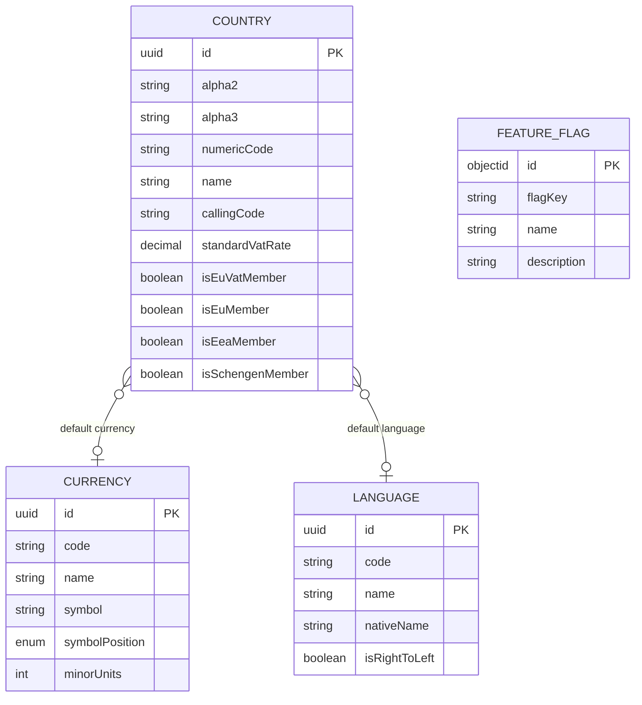
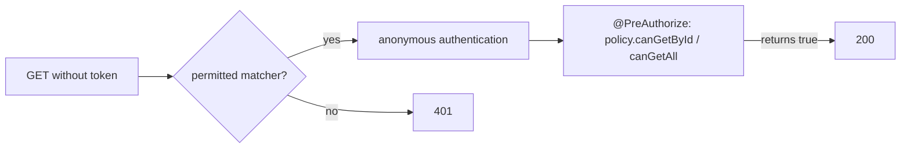

# api-platform

Owns the reference data every other part of the product relies on: countries, currencies and languages, on port **8082**. It also stores feature flags.

## In short

The shared reference lists every part of the product relies on: countries, currencies and languages. Apps read them without signing in, for example to fill a country picker. It also stores feature flags.

**Stack:** Spring Boot (Web, Data JPA, Data MongoDB, Security), PostgreSQL, MongoDB, RabbitMQ.

## User stories

- As a visitor on the sign-up or pricing page, I see the lists of countries, currencies and languages without an account.
- As an administrator, I add, correct, disable or delete a country, currency or language.
- As api-destination, I learn about each new or removed country, so that places can be imported under it.
- As a developer, I turn a feature on or off with a flag.

## Main flows

```mermaid
sequenceDiagram
    actor A as Administrator
    participant P as api-platform
    participant D as api-destination
    A->>P: POST /countries (PT, PRT, 620, Portugal)
    P->>P: check the codes are free
    P-->>D: CountryCreatedEvent
    D->>D: copy the country; places can be imported for it
```

## Requirements

- **PLT-1** Countries have unique ISO alpha-2, alpha-3 and numeric codes. Currencies and languages have unique codes. The database enforces it.
- **PLT-2** Reading the lists needs no token; changing them needs Admin or Support.
- **PLT-3** Countries, currencies and languages publish created, disabled and deleted events. api-destination consumes the country events.
- **PLT-4** Feature flags are stored by unique key.

---

## Technical reference

The sections below describe how it works.

## Data

Countries, currencies and languages are in PostgreSQL (`jobbie_giggle_platform`); feature flags are documents in MongoDB.



Every record also has `createdAt`, `updatedAt`, `disabledAt` and `deletedAt`. Codes are unique: a currency or language by `code`, a country by each of `alpha2`, `alpha3` and `numericCode`.

## Constraints

The codes the services check before saving are unique in the database too, so two requests at once can't both create a code. Flyway's `V1` creates the tables with these constraints and `V2` seeds every ISO 3166-1 country, the currencies and languages they default to. A database whose tables existed before the migrations is baselined at `V1`, so it gets the seed but not the constraints, and `ddl-auto: validate` doesn't check them; run these by hand. Creating one fails if duplicates already exist, so run the check query first and settle any rows it returns.

```sql
-- Check: each should return no rows.
SELECT alpha2 FROM countries GROUP BY alpha2 HAVING count(*) > 1;
SELECT alpha3 FROM countries GROUP BY alpha3 HAVING count(*) > 1;
SELECT numeric_code FROM countries GROUP BY numeric_code HAVING count(*) > 1;
SELECT code FROM currencies GROUP BY code HAVING count(*) > 1;
SELECT code FROM languages GROUP BY code HAVING count(*) > 1;

CREATE UNIQUE INDEX IF NOT EXISTS uk_country_alpha2 ON countries (alpha2);
CREATE UNIQUE INDEX IF NOT EXISTS uk_country_alpha3 ON countries (alpha3);
CREATE UNIQUE INDEX IF NOT EXISTS uk_country_numeric_code ON countries (numeric_code);
CREATE UNIQUE INDEX IF NOT EXISTS uk_currency_code ON currencies (code);
CREATE UNIQUE INDEX IF NOT EXISTS uk_language_code ON languages (code);
```

## Endpoints

The three resources have the same endpoints, under `/api/v1/platform/countries`, `/currencies` and `/languages`.

| Method and path | Who may call it |
|---|---|
| `GET /{resource}`, `GET /{resource}/{id}` | anyone, signed in or not |
| `POST /{resource}`, `PUT /{resource}` | Admin or Support |
| `DELETE /{resource}/{id}/disable` | Admin or Support |
| `DELETE /{resource}/{id}` | Admin or Support |

**Feature flags have no endpoints and no service.** They are meant to be managed by administrators directly in the database.

## Why reads work without a token



The read routes are listed in `additionalPermitAllMatchers()`, and `anonymousAuthenticationEnabled()` returns `true` so that the policy is still asked.

## Messages

Publishes one event when a country, currency or language is created, disabled or deleted (nine in all), for example `CountryCreatedEvent(countryId, alpha2)`. Nothing consumes them yet. This service consumes no messages.
