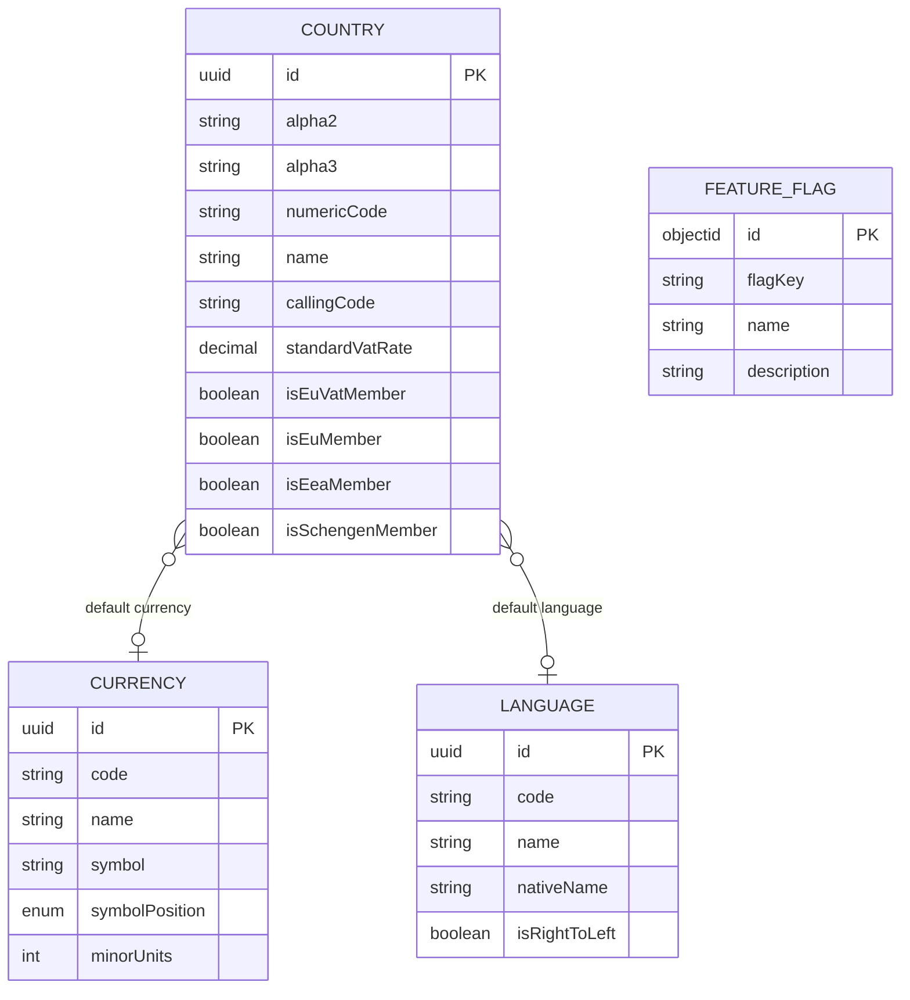
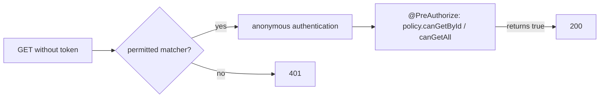

# api-platform

Owns the reference data every other part of the product relies on: countries, currencies and languages, on port **8082**. It also stores feature flags.

## Data

Countries, currencies and languages are in PostgreSQL (`jobbie_giggle_platform`); feature flags are documents in MongoDB.

Every record also has `createdAt`, `updatedAt`, `disabledAt` and `deletedAt`. Codes are unique: a currency or language by `code`, a country by each of `alpha2`, `alpha3` and `numericCode`.

## Endpoints

The three resources have the same endpoints, under `/api/v1/platform/countries`, `/currencies` and `/languages`.

| Method and path | Who may call it |
|---|---|
| `GET /{resource}`, `GET /{resource}/{id}` | anyone, signed in or not |
| `POST /{resource}`, `PUT /{resource}` | Admin or Support |
| `DELETE /{resource}/{id}/disable` | Admin or Support |
| `DELETE /{resource}/{id}` | Admin or Support |

**Feature flags have no endpoints and no service.** They are meant to be managed by administrators directly in the database.

## Why reads work without a token

The read routes are listed in `additionalPermitAllMatchers()`, and `anonymousAuthenticationEnabled()` returns `true` so that the policy is still asked.

## Messages

Publishes one event when a country, currency or language is created, disabled or deleted (nine in all), for example `CountryCreatedEvent(countryId, alpha2)`. Nothing consumes them yet. This service consumes no messages.
