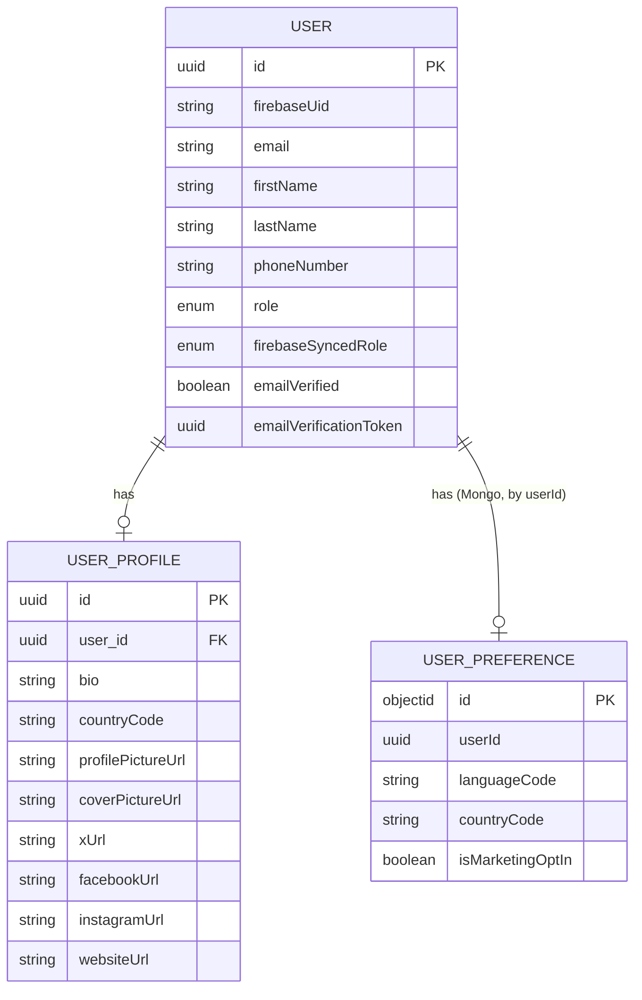
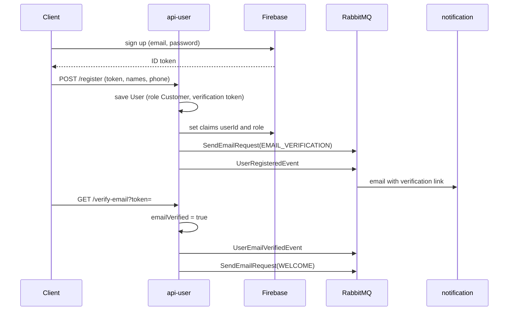

# api-user

Owns users, their public profiles, their preferences and their travel documents (nationalities and residence permits, for visa guidance), on port **8081**. It is also the only service that talks to Firebase about accounts: it registers users, sets their token claims and keeps their roles in sync.

## Data

Users and profiles are in PostgreSQL (`jobbie_giggle_user`); preferences are documents in MongoDB.



Every record also has `createdAt`, `updatedAt`, `disabledAt` and `deletedAt`.

**Travel documents:** each user's nationalities and residence permits, in `user_travel_documents`. Only countries, permit kinds and expiry dates are kept, never document numbers. They are removed when the user is deleted. There are no migrations (`ddl-auto: validate`), so create the table by hand:

```sql
CREATE TABLE user_travel_documents (
    id           UUID PRIMARY KEY,
    created_at   TIMESTAMP(6) WITH TIME ZONE NOT NULL,
    updated_at   TIMESTAMP(6) WITH TIME ZONE NOT NULL,
    disabled_at  TIMESTAMP(6) WITH TIME ZONE,
    deleted_at   TIMESTAMP(6) WITH TIME ZONE,
    user_id      UUID        NOT NULL REFERENCES users (id),
    type         VARCHAR(24) NOT NULL,
    country_code VARCHAR(2)  NOT NULL,
    permit_kind  VARCHAR(16),
    valid_until  DATE
);
CREATE UNIQUE INDEX user_travel_documents_uq ON user_travel_documents (user_id, type, country_code);
```

## Constraints

A user has at most one profile; the service checks before saving, and this index stops two requests at once. There are no migrations, and `ddl-auto: validate` doesn't check unique constraints, so run these by hand. Creating one fails if duplicates already exist, so run the check query first and settle any rows it returns.

```sql
-- Check: should return no rows.
SELECT user_id FROM user_profiles GROUP BY user_id HAVING count(*) > 1;

CREATE UNIQUE INDEX IF NOT EXISTS user_profiles_user_id_uq ON user_profiles (user_id);
```

## Endpoints

All need a Firebase token except `verify-email`.

| Method and path | Who may call it |
|---|---|
| `POST /api/v1/users/register` | any signed-in Firebase account |
| `GET /api/v1/users/verify-email?token=` | public (link in the verification email) |
| `POST /api/v1/users/reset-password` | the signed-in user, for themselves |
| `GET /api/v1/users`, `GET /api/v1/users/{id}` | any signed-in user |
| `PUT /api/v1/users` | the user themselves, Admin or Support |
| `DELETE /api/v1/users/{id}/disable` | Admin or Support |
| `DELETE /api/v1/users/{id}` | the user themselves |
| `POST /api/v1/users` | nobody: returns 405, use `/register` |
| `POST /api/v1/users/me/devices` `{token, platform}` | the signed-in user, for themselves |
| `POST /api/v1/users/me/devices/unregister` `{token}` | the signed-in user, for themselves |
| `GET /api/v1/users/me/travel-documents` | the signed-in user, for themselves |
| `PUT /api/v1/users/me/travel-documents` `{nationalities, residencePermits: [{countryCode, kind, validUntil}]}` | the signed-in user; replaces every document. At most 4 nationalities and 10 permits; no permit for a country they're a citizen of, one per country, none expired |

Profiles live under `/api/v1/users/user-profiles` and preferences under `/api/v1/users/user-preferences`, each with the standard create, get, list, update, disable and delete.

| Resource | Read | Create and update | Delete |
|---|---|---|---|
| Profile | any signed-in user | owner, Admin or Support | owner |
| Preference | owner, or Admin, Support, Inspector | owner, Admin or Support | owner or Admin |

A user has at most one profile and one preference document.

Device tokens (Firebase Cloud Messaging, platform `ANDROID`, `IOS` or `WEB`) are not stored here. They are passed on to the notification service, which owns them, so the device endpoints answer 202.

## Registration and verification



Registering twice with the same Firebase account returns the existing user. If Firebase cannot be reached while setting the claims, registration still succeeds and the role sync job sets them later.

## Role sync job

`FirebaseRoleSyncJob` runs every `app.firebase-role-sync.interval-ms` (60 seconds). It finds users whose `role` differs from `firebaseSyncedRole`, sets their Firebase claims in batches of 200, and stops for this run after three consecutive failures.

## Messages

| Direction | Message | When |
|---|---|---|
| publishes | `SendEmailRequest` | verification, welcome, password reset, pictures updated, support tickets, license subscriptions, itineraries |
| publishes | `UserRegisteredEvent` | a user registers |
| publishes | `UserTravelDocumentsUpdatedEvent` | travel documents are replaced; the whole set and `changedAt`, for `api-destination`, once saved |
| publishes | `UserEmailVerifiedEvent` | a user verifies their email address |
| publishes | `UserProfilePictureUpdatedEvent` | a profile or cover picture URL changes |
| publishes | `UserDisabledEvent`, `UserDeletedEvent` | a user is disabled or deleted; once, to its fanout exchange, which feeds `api-chat` and `api-payment`, and for deletes `api-destination` |
| publishes | `UserContactUpdatedEvent` | a user registers, verifies their email address, or changes their email address or name; the whole contact and `changedAt`, for `api-payment` |
| publishes | `UserDeviceRegisteredEvent`, `UserDeviceUnregisteredEvent` | a device is registered or unregistered for push |
| consumes | `GroupInvitationAcceptedEvent` | an invitation is accepted in `api-group` |
| publishes | `UserMatchedToGroupInvitationEvent` | in reply, if a verified user has the invited email |
| consumes | `SupportTicketCreatedEvent` | emails the customer that their ticket is open, or that support contacted them |
| consumes | `SupportTicketRepliedEvent` | emails the customer that support replied |
| consumes | `SupportTicketStatusChangedEvent` | emails the customer when the ticket is resolved, or closed by someone else |
| consumes | `LicenseSubscriptionActivatedEvent` | emails the customer that their subscription is active |
| consumes | `LicenseSubscriptionRenewalDueEvent` | emails the customer that their subscription renews soon, with the price |
| consumes | `LicenseSubscriptionCanceledEvent` | emails the customer that their subscription will not renew, and until when it runs |
| consumes | `LicenseSubscriptionEndedEvent` | emails the customer when their subscription expired; one ended early gets no email |
| consumes | `ItineraryFinishedEvent` | on `destination.itinerary.finished.user.queue`; emails whoever asked when it is READY (verified, active users only) |

## Settings

| Property | Default | Meaning |
|---|---|---|
| `app.base-url` | `http://localhost:8080` | base of the links placed in emails |
| `app.frontend-url` | `http://localhost:3000` | base of the links in emails: `<frontend-url>/support/tickets/<ticketId>` for tickets, `<frontend-url>/account/subscriptions/<subscriptionId>` for subscriptions |
| `app.firebase-role-sync.interval-ms` | `60000` | pause between role sync runs |
| `firebase.project-id` | `jobbiegiggle` | Firebase project |
| `firebase.enabled` | `true` | set to `false` to start without Firebase |
