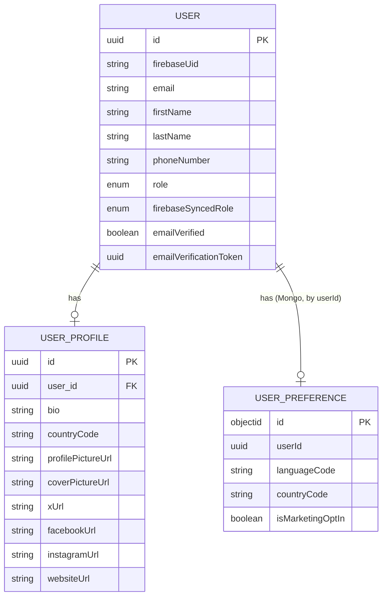
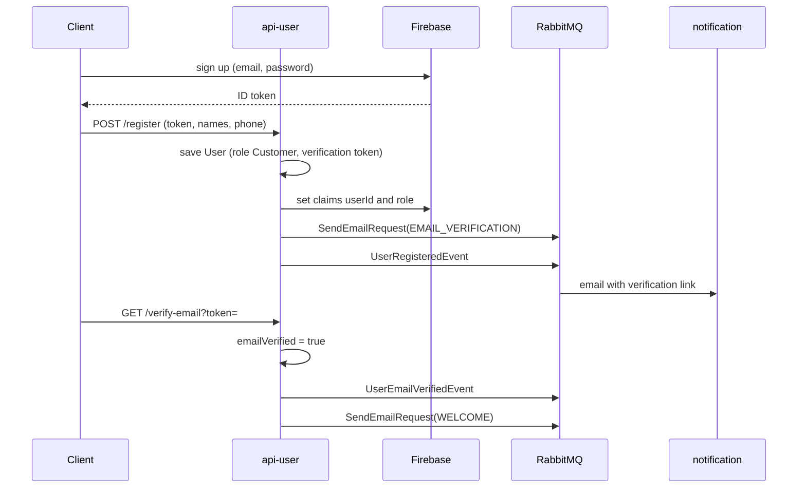

# api-user

Owns users, their public profiles and their preferences, on port **8081**. It is also the only service that talks to Firebase about accounts: it registers users, sets their token claims and keeps their roles in sync.

## Data

Users and profiles are in PostgreSQL (`jobbie_giggle_user`); preferences are documents in MongoDB.

Every record also has `createdAt`, `updatedAt`, `disabledAt` and `deletedAt`.

## Endpoints

All need a Firebase token except `verify-email`.

| Method and path | Who may call it |
|---|---|
| `POST /api/v1/users/register` | any signed-in Firebase account |
| `GET /api/v1/users/verify-email?token=` | public (link in the verification email) |
| `POST /api/v1/users/reset-password` | the signed-in user, for themselves |
| `GET /api/v1/users`, `GET /api/v1/users/{id}` | any signed-in user |
| `PUT /api/v1/users` | the user themselves, Admin or Support |
| `DELETE /api/v1/users/{id}/disable` | Admin or Support |
| `DELETE /api/v1/users/{id}` | the user themselves |
| `POST /api/v1/users` | nobody: returns 405, use `/register` |

Profiles live under `/api/v1/users/user-profiles` and preferences under `/api/v1/users/user-preferences`, each with the standard create, get, list, update, disable and delete.

| Resource | Read | Create and update | Delete |
|---|---|---|---|
| Profile | any signed-in user | owner, Admin or Support | owner |
| Preference | owner, or Admin, Support, Inspector | owner, Admin or Support | owner or Admin |

A user has at most one profile and one preference document.

## Registration and verification

Registering twice with the same Firebase account returns the existing user. If Firebase cannot be reached while setting the claims, registration still succeeds and the role sync job sets them later.

## Role sync job

`FirebaseRoleSyncJob` runs every `app.firebase-role-sync.interval-ms` (60 seconds). It finds users whose `role` differs from `firebaseSyncedRole`, sets their Firebase claims in batches of 200, and stops for this run after three consecutive failures.

## Messages

| Direction | Message | When |
|---|---|---|
| publishes | `SendEmailRequest` | verification, welcome, password reset, pictures updated |
| publishes | `UserRegisteredEvent` | a user registers |
| publishes | `UserEmailVerifiedEvent` | a user verifies their email address |
| publishes | `UserProfilePictureUpdatedEvent` | a profile or cover picture URL changes |
| consumes | `GroupInvitationAcceptedEvent` | an invitation is accepted in `api-group` |
| publishes | `UserMatchedToGroupInvitationEvent` | in reply, if a verified user has the invited email |

## Settings

| Property | Default | Meaning |
|---|---|---|
| `app.base-url` | `http://localhost:8080` | base of the links placed in emails |
| `app.firebase-role-sync.interval-ms` | `60000` | pause between role sync runs |
| `firebase.project-id` | `jobbiegiggle` | Firebase project |
| `firebase.enabled` | `true` | set to `false` to start without Firebase |
