# TripHuddle backend: all documentation

Every Markdown file in the backend repository, combined in one file. The root README comes first, then the client-facing services (api-*), then the supporting modules, then the testing strategy. Each file starts under a line naming its path. Relative links inside the files point into the repository and will not resolve here.

Contents:

- `README.md`
- `api-user/docs/README.md`
- `api-group/docs/README.md`
- `api-chat/docs/README.md`
- `api-destination/docs/README.md`
- `api-license/docs/README.md`
- `api-payment/docs/README.md`
- `api-platform/docs/README.md`
- `api-gateway/docs/README.md`
- `notification/docs/README.md`
- `openai/docs/README.md`
- `stripe/docs/README.md`
- `amqp/docs/README.md`
- `common/docs/README.md`
- `eureka-server/docs/README.md`
- `smoke-tests/docs/README.md`
- `docs/testing-strategy.md`

---

**File: `README.md`**

# TripHuddle backend

TripHuddle helps people plan trips, on their own or as a group. Travellers discover countries, regions, cities and landmarks, read what is worth seeing and what visitors say about each place, and get a day-by-day itinerary written for their dates, budget and pace. They also learn what visa each person needs. Groups plan together: they chat, share plans, and share a subscription. Access is sold as monthly or yearly licenses, paid through Stripe.

This repository is the backend: a set of small services behind one API gateway, used by the web and mobile apps.

- [What it does](#what-it-does)
- [Technical stack](#technical-stack)
- [Who uses it](#who-uses-it)
- [User stories](#user-stories)
- [End-to-end flows](#end-to-end-flows)
- [Software requirements](#software-requirements)
- [Architecture](#architecture), for developers

## What it does

| Area | In short |
|---|---|
| **Accounts** | Sign-up with Firebase, email verification, profiles, preferences, and the nationalities and residence permits used for visa checks |
| **Groups** | Create a group, invite people by email, manage members and admins |
| **Chat and support** | Private and group chats in real time, with attachments, reactions, read receipts and push notifications. Support tickets are handled by staff in their own chat |
| **Licenses and payments** | A catalogue of licenses with entitlements and promotions. Subscriptions for a user or a group, paid, renewed and refunded through Stripe |
| **Places** | Countries, regions, cities and points of interest imported from Wikidata, with photos from Wikimedia Commons, categories and tags. Search by name, distance, map area or meaning |
| **AI content** | For each place and language: an overview, what visitors say (with sources), and practical information. Answers to a traveller's own questions |
| **Trips** | Trip plans for a user or a group, and AI itineraries within a monthly quota. Any day can be rewritten or edited by hand |
| **Visas** | For each traveller and destination: the entry requirement for their best passport, and an AI explanation with official links |
| **Personal lists** | Favourites, visited places, and reviews with reporting and moderation |
| **Notifications** | Emails and phone pushes for verification, invitations, tickets, payments and finished itineraries |

## Technical stack

| Layer | Technology |
|---|---|
| Language and framework | Java 17, Spring Boot 3.2.2, Spring Cloud 2023.0.0, one Maven multi-module project |
| Entry point and discovery | Spring Cloud Gateway with Resilience4j circuit breakers; Netflix Eureka |
| Data | PostgreSQL 16 (with PostGIS, pgvector, pg_trgm and unaccent for places), MongoDB 7 (chat messages, preferences, device tokens, feature flags), Google Cloud Storage (attachments, photos) |
| Messaging | RabbitMQ: work queues, fanout exchanges, dead-letter queues, and the STOMP relay for real time |
| Identity | Firebase Authentication (ID tokens with `userId` and `role` claims), Firebase Admin SDK |
| Payments | Stripe Checkout, Billing and webhooks, through stripe-java 34.1.0 (API `2026-10-28.endive`) |
| AI | OpenAI Responses API (structured JSON, web search). `gpt-4o-mini` for bulk work, `gpt-4.1` for itineraries, visas and questions, `text-embedding-3-small` for embeddings |
| Open data | Wikidata SPARQL, Wikimedia Commons, the passport-index visa dataset (MIT) |
| Notifications | Thymeleaf email templates over SMTP; Firebase Cloud Messaging |
| Code | Spring Data JPA (Hibernate), Lombok, MapStruct, Bean Validation, springdoc OpenAPI |
| Operations | Zipkin tracing, Docker Compose for local infrastructure |

## Who uses it

| Person | Platform role | What they do |
|---|---|---|
| **Traveller** | Customer | Plans trips, reads about places, chats, subscribes |
| **Group admin** | Customer, ADMIN of a group | Invites and manages members, subscribes the group, sees every member's visa details |
| **Group member** | Customer, MEMBER of a group | Shares the group's plans, chat and subscription |
| **Support agent** | Support | Works the support ticket queue, moderates reports, curates places |
| **Administrator** | Admin | Everything Support does, plus licenses, grants, refunds and imports |
| **Inspector** | Inspector | Reads everything for auditing; changes nothing |

Group roles (ADMIN, MEMBER) are separate from platform roles: any Customer can admin their own group.

## User stories

**Account**
- As a new visitor, I sign up with my email and verify it, so that I can use TripHuddle and be found by the groups that invite me.
- As a traveller, I record my nationalities and residence permits once, so that every trip checks my visas for me.

**Groups**
- As a traveller, I create a group for a trip and invite friends by email, even before they have an account.
- As an invitee, I accept or reject the invitation from the email, and become a member once my account is verified.
- As a group admin, I promote, demote or remove members; the group always keeps at least one admin.

**Chat and support**
- As a traveller, I chat privately with another user or with my whole group, and see messages, typing and read receipts live.
- As a traveller, I block someone, mute a chat, or report a message.
- As a customer, I open a support ticket and talk to an agent in its chat, then rate the help I got.
- As a support agent, I claim tickets from a queue ordered by urgency, keep internal notes, and resolve tickets.

**Licenses and payments**
- As a traveller, I see the published licenses and their price, with any promotion or code I enter.
- As a traveller or group admin, I subscribe and pay through Stripe Checkout, and switch, cancel or resume later.
- As a payer, I get an email for each payment and each failed renewal, and see my invoices.
- As an administrator, I create and publish licenses and promotions, grant free periods, and refund invoices.

**Discovering places**
- As a traveller, I search places by name (with typos and accents forgiven), near me, on the map, or inside a country or city.
- As a traveller, I describe what I want ("quiet beach town with seafood") and get matching places, or ask for places like one I liked.
- As a traveller, I read a place's overview, what visitors praise and complain about with the sources, and practical tips, in my language.
- As a traveller, I ask my own question about a place and get an answer with sources.

**Planning trips**
- As a traveller or group member, I create a trip plan with dates, destinations, must-sees, budget, pace and interests.
- As a traveller, I have an itinerary written, and I'm told by push, email and in the app when it is ready.
- As a traveller, I rewrite one day ("more food, less walking"), reorder it, or add and remove items by hand.

**Visas**
- As a traveller, I see for each destination what my best passport needs: visa-free and for how long, an e-visa, an ETA, or a visa, with steps, costs and official links.
- As a group admin, I see every member's visa situation for the trip, and who still has to enter their documents.

**My lists and reviews**
- As a traveller, I save favourites and mark places as visited.
- As a traveller, I rate and review a place, and report reviews that are wrong or abusive.
- As a support agent, I see reported reviews and content, and keep or hide them.

**Running the catalogue**
- As an administrator, I import a country's regions, cities and landmarks from Wikidata with their photos, and fix, merge, hide or feature places.
- As an administrator, I reload the visa rules from the dataset.

## End-to-end flows

### Joining a group by invitation

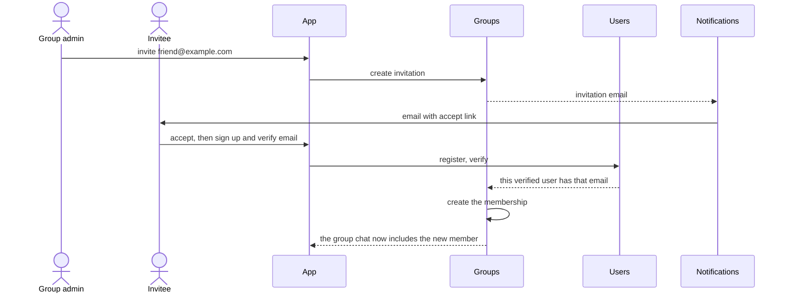

### Subscribing and paying

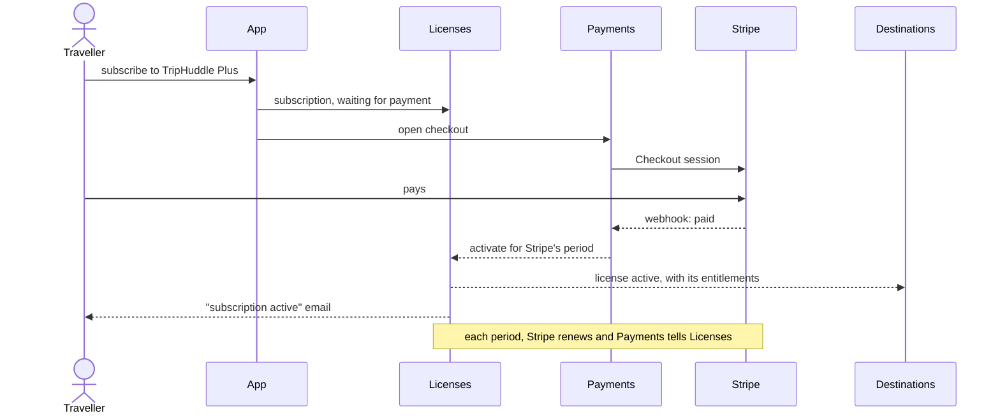

### Planning a trip and getting an itinerary

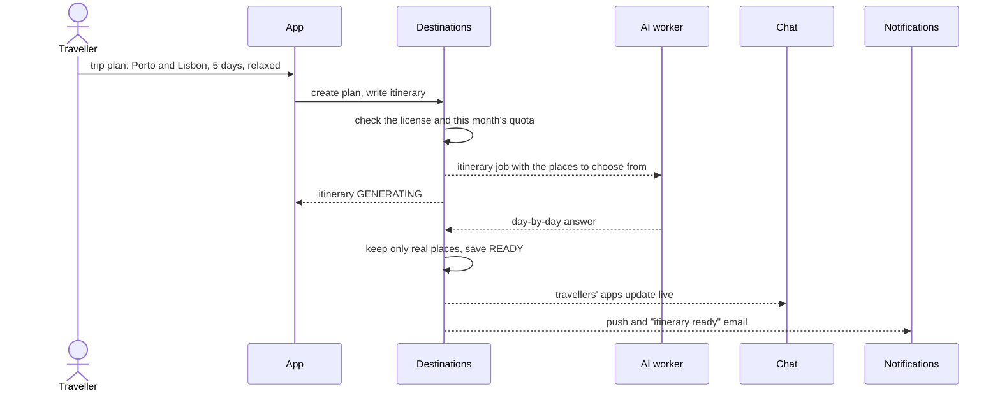

### Checking visas for a group trip

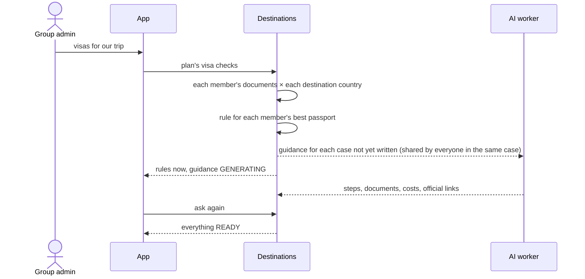

### Getting help from support

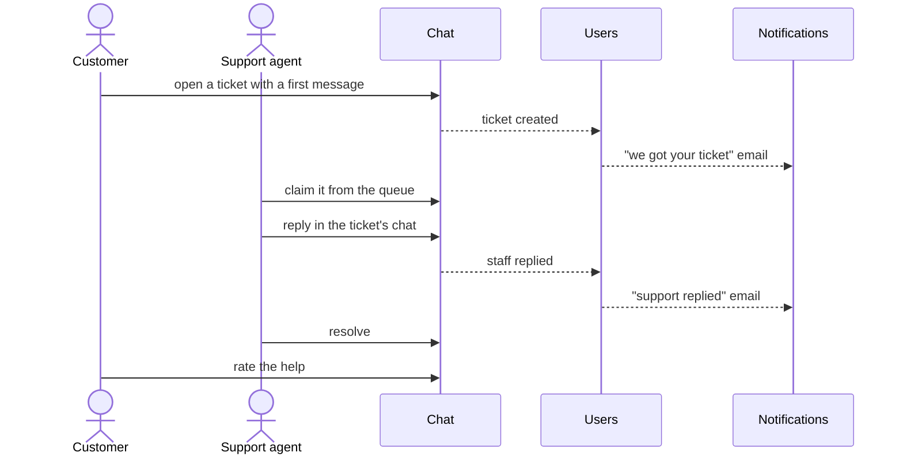

## Software requirements

These describe what the current code does.

### Functional

**Accounts and identity**
- FR-1 Users sign up with Firebase. The system creates the platform user, sets the `userId` and `role` claims, and sends a verification email.
- FR-2 A user verifies their email through a link, which sends a welcome email and lets pending group invitations complete.
- FR-3 Users manage a profile, preferences (language, country, marketing opt-in), push devices, and travel documents (up to 4 nationalities and 10 residence permits; no document numbers).
- FR-4 Staff can disable a user; a user can delete their own account. Other services stop serving them and forget their personal data.

**Groups**
- FR-5 Any user can create a group and becomes its first admin. A group always keeps at least one admin.
- FR-6 Admins invite by email. An invitation is valid for 7 days, and only one may be pending per email and group.
- FR-7 An accepted invitation becomes a membership once a verified user with that email exists.

**Chat and support**
- FR-8 Users chat in private and group conversations in real time (STOMP), with up to 4,000 characters and 10 attachments per message, edits, deletes, reactions, typing and read receipts.
- FR-9 Users can block, mute and report. Staff review reports and may remove messages.
- FR-10 Customers open up to 3 ongoing support tickets. Staff claim, assign, reply, keep internal notes, and resolve. Resolved tickets close after 7 days, and customers rate the support.

**Licenses and payments**
- FR-11 Staff manage licenses (draft, published, archived), each with a price, an interval and entitlements.
- FR-12 Staff manage promotions: by amount or percentage, automatic or by code, for a number of periods, with redemption limits.
- FR-13 A user or a group (subscribed by its admin) has at most one active and one pending subscription. Subscribing to another license is a switch.
- FR-14 Payment goes through Stripe Checkout, and renewals through Stripe Billing. A failed renewal keeps access while Stripe retries. Cancel and resume take effect at the period's end.
- FR-15 Staff can activate, grant (1 to 120 free periods), extend and refund. Invoices are listed for payers, group admins and staff.
- FR-16 Payments are reconciled with Stripe daily, to repair what a lost webhook missed.

**Places and content**
- FR-17 Every destination feature needs a current license with the access entitlement, the user's own or their group's. Staff always have access.
- FR-18 Staff import a country's regions, cities and notable places from Wikidata, with photos and licences from Commons, and curate them (edit, move, merge, hide, feature, categorise, tag).
- FR-19 Search works by words in any language (forgiving typos and accents), by distance, map area, subtree, category and tag. Semantic search works by meaning, and similar places can be found.
- FR-20 For each place and language, AI writes an overview, visitors' opinions with cited sources, and practical information. Each is cached and refreshed after 30 to 180 days. Users can report content.
- FR-21 Users ask questions about a place and get private, sourced answers.

**Trips and visas**
- FR-22 Users create trip plans of up to 30 days and 10 destinations, for themselves or their group.
- FR-23 An itinerary uses one unit of the owner's monthly AI itinerary quota, and failures give it back. Days can be rewritten by AI or edited by hand. Travellers are told by socket, push and email.
- FR-24 Visa rules come from the passport-index dataset, which staff reload. Each traveller is checked on their best passport, with residence permits valid through the trip taken into account.
- FR-25 Visa guidance is written by AI with official links and a disclaimer. Group admins see every member, and members only themselves.

**Personal lists and reviews**
- FR-26 Users keep private favourites and visited places.
- FR-27 Users write one review per place (rating 1 to 5). Three open reports hide a review until staff decide. Summaries show the count, the average and the spread.

**Notifications**
- FR-28 The system sends templated emails (verification, welcome, password reset, invitations, tickets, subscriptions, payments, itineraries) and pushes (new messages, finished itineraries).

### Non-functional

- NFR-1 **Security.** Every request carries a Firebase token, checked at the gateway and again by the service. Every operation is decided by the resource's authorization policy. The Stripe webhook is verified by signature.
- NFR-2 **Privacy.** No service reads another's database. Visa guidance holds nothing about any one traveller. Questions, favourites and travel documents are visible only to their owner. Deleted users' personal rows are removed or emptied.
- NFR-3 **Loose coupling.** Services talk only through RabbitMQ, never over HTTP. A stopped service delays work but doesn't fail other services' requests.
- NFR-4 **Reliability.** Every consumer can take the same message twice. Failed messages are retried three times, then go to a dead-letter queue. Messages are published only after their transaction commits. Payments use idempotency keys.
- NFR-5 **Scalability.** Services are stateless and run as several instances. Scheduled jobs share work with `SKIP LOCKED`. Real-time events reach every instance through the STOMP relay.
- NFR-6 **Cost control.** AI usage is capped per day (a token budget and a hard limit) and per user. Content is shared, so it is written once. Unchanged embeddings aren't redone.
- NFR-7 **Data integrity.** Uniqueness is enforced in the database, not only in code. Records are soft-deleted (`deletedAt`), except a few personal rows that privacy requires removing.
- NFR-8 **Consistency.** Copies of other services' data are eventually consistent. Updates carry a time or ID, so late and repeated events do no harm.
- NFR-9 **Observability.** Every service sends traces to Zipkin, and errors come back in one `ErrorResponse` shape.
- NFR-10 **Localisation.** Content, guidance and answers are written in the reader's language, with English as the fallback.
- NFR-11 **Lists that move.** Feeds and work queues use cursor pagination, so items arriving or leaving don't repeat or skip.

## Architecture

### The system at a glance

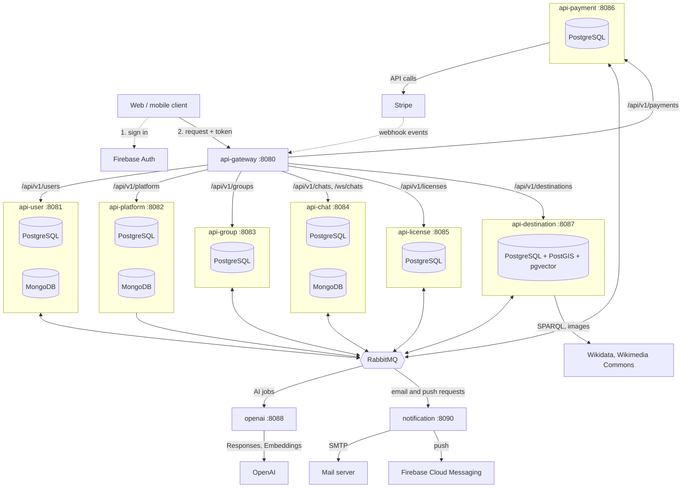

Each API service box contains the data stores only it uses. Every service also registers with **Eureka** (`eureka-server :8761`), which the gateway uses to route, and sends traces to **Zipkin** (`:9411`). `api-user` calls Firebase directly, to set token claims and create password reset links.

### Modules

| Module | Kind | Port | Responsibility | Docs |
|---|---|---|---|---|
| `api-gateway` | service | 8080 | public entry point: token check, CORS, routing | [docs](api-gateway/docs/README.md) |
| `eureka-server` | service | 8761 | service registry | [docs](eureka-server/docs/README.md) |
| `api-user` | service | 8081 | users, profiles, preferences, travel documents, Firebase accounts | [docs](api-user/docs/README.md) |
| `api-platform` | service | 8082 | countries, currencies, languages, feature flags | [docs](api-platform/docs/README.md) |
| `api-group` | service | 8083 | groups, memberships, invitations | [docs](api-group/docs/README.md) |
| `api-chat` | service | 8084 | private, group and support chats, support tickets, real time over STOMP | [docs](api-chat/docs/README.md) |
| `api-license` | service | 8085 | licenses, entitlements, promotions, subscriptions | [docs](api-license/docs/README.md) |
| `api-payment` | service | 8086 | Stripe checkout, renewals, invoices, refunds, reconciliation | [docs](api-payment/docs/README.md) |
| `api-destination` | service | 8087 | places, AI content, search, trips and itineraries, visas, reviews | [docs](api-destination/docs/README.md) |
| `openai` | service | 8088 | the AI worker: text and embedding jobs over amqp | [docs](openai/docs/README.md) |
| `notification` | service | 8090 | emails and push notifications requested by other services | [docs](notification/docs/README.md) |
| `common` | library | | base classes, security, pagination, error handling | [docs](common/docs/README.md) |
| `amqp` | library | | RabbitMQ setup and every message definition | [docs](amqp/docs/README.md) |
| `stripe` | library | | the Stripe client and webhook signature checks | [docs](stripe/docs/README.md) |
| `test-support` | tests | | shared test building blocks: containers, recorders, the authorization matrix, architecture rules | [strategy](docs/testing-strategy.md) |
| `smoke-tests` | tests | | end-to-end tests through the gateway, and the check that every requirement has a test | [docs](smoke-tests/docs/README.md) |

Every API service depends on `common` and `amqp`; `notification` and `openai` depend on `amqp` only, and only `api-payment` uses `stripe`. The gateway and Eureka depend on neither library.

### Principles

- **One service, one data store.** No service reads another's database. `api-group` stores user IDs, never user records.
- **No HTTP between services.** A service that needs something from another publishes a message and reacts to the reply, or keeps its own copy from the other's events.
- **The same shape everywhere.** A resource is an entity plus a controller, service, repository, mapper and authorization policy, built on the base types in `common`.
- **Soft deletes.** Deleting sets `deletedAt` and disabling sets `disabledAt`. The exceptions are a few personal rows (favourites, travel documents) that privacy requires removing.

### Authentication and authorization

Firebase Authentication issues the tokens. The backend never sees passwords.

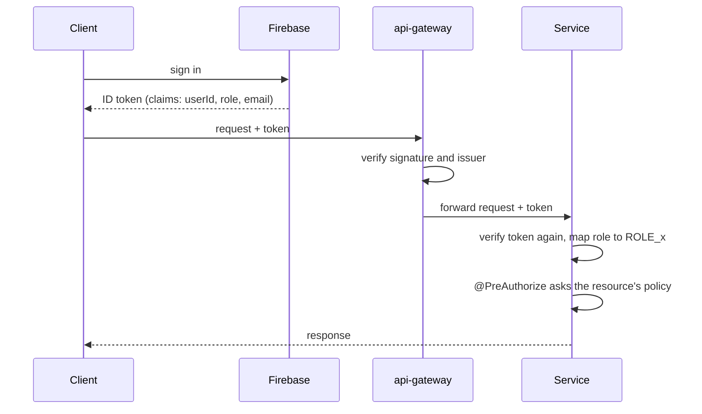

- **Claims:** `api-user` sets two custom claims: `userId` (the platform user ID) and `role`.
- **Validated twice:** the gateway and each service both validate the token, so a public route must be opened in both places.
- **Group rights:** rights within a group come from memberships. Services that need them keep a copy from `api-group`'s events.

### Messaging

Every message is a record (the event) plus a contract class naming its queues, all defined in `amqp`.
- **One consumer:** the message goes to the default exchange with the queue name as routing key.
- **Several consumers:** it is published once to a fanout exchange, and each consuming service reads its own queue bound to that exchange.
- **Failures:** a listener that throws is retried three times with a growing pause; after that the message goes to a dead-letter queue.

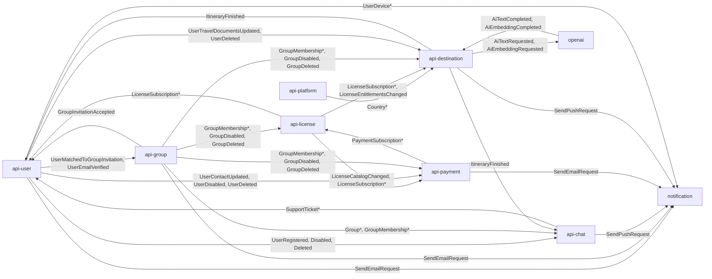

The full catalogue is in the [amqp docs](amqp/docs/README.md).

### Data

| Service | PostgreSQL | MongoDB |
|---|---|---|
| `api-user` | `jobbie_giggle_user`: users, profiles, travel documents | preferences |
| `api-platform` | `jobbie_giggle_platform`: countries, currencies, languages | feature flags |
| `api-group` | `jobbie_giggle_group`: groups, memberships, invitations | none |
| `api-chat` | `jobbie_giggle_chat`: conversations, participants, support tickets, blocks, reports, chat users | chat messages |
| `api-license` | `jobbie_giggle_license`: licenses, entitlements, promotions, subscriptions, redemptions, group admins | none |
| `api-payment` | `jobbie_giggle_payment`: Stripe events, products and prices, customers, billing subscriptions, invoices, refunds, user contacts, group admins | none |
| `api-destination` | `jobbie_giggle_destination` (PostGIS, pgvector, pg_trgm, unaccent): places and their content, trips, visas, lists, reviews, embeddings, and copies of countries, licenses and memberships | none |
| `notification` | none | device tokens |

Relational schemas are checked at startup (`ddl-auto: validate`) and created by hand, so the tables must exist before a service starts. Each service's docs hold its DDL.

### Cross-cutting concerns

| Concern | How |
|---|---|
| Service discovery | every service registers with Eureka; the gateway routes to `lb://<SERVICE-NAME>` |
| Resilience | a circuit breaker and a 60s time limit per route at the gateway |
| Errors | `GlobalExceptionHandler` returns one `ErrorResponse` shape: 400, 403, 404, 422, 500 |
| API documentation | each API service serves OpenAPI at `/api-docs`; the gateway exposes it at `/<service>/v3/api-docs` |
| Tracing | every service reports to Zipkin at `http://zipkin:9411` |
| Pagination | `page` (from 1) and `pageSize` (up to 100) in, `Paginated<T>` out. Feeds and work queues use cursors instead: `cursor` and `limit` in, `CursorPaginated<T>` out |
| Real time | `api-chat` serves STOMP over WebSocket at `/ws/chats`, relayed through RabbitMQ's STOMP plugin so every instance reaches every client |

### What a deployment needs

- **Infrastructure:** PostgreSQL at host `postgres` (the `docker/postgres` image adds pgvector to PostGIS), MongoDB at `mongodb`, RabbitMQ with the `rabbitmq_stomp` plugin (port 61613), Eureka at `eureka-server`, and Zipkin at `zipkin`. `docker compose up -d` at the root starts all but Eureka for local development.
- **Environment:**
  - RabbitMQ: `RABBITMQ_HOST`, `RABBITMQ_USERNAME`, `RABBITMQ_PASSWORD`, `RABBITMQ_VIRTUAL_HOST`
  - Email: `SMTP_PASSWORD`
  - Google: application default credentials for the Firebase Admin SDK, also used for FCM and for signing storage URLs
  - Optional: `CHAT_ATTACHMENTS_BUCKET` turns chat attachments on
- **`api-payment`:** `STRIPE_SECRET_KEY` and `STRIPE_WEBHOOK_SECRET`, without which it does not start, and a Stripe webhook pointing at `/api/v1/payments/webhook` on the gateway. Locally, `docker compose --profile stripe up -d stripe-cli` forwards test events.
- **`openai`:** `OPENAI_API_KEY`; see its docs.

### Adding a service

1. Create the module, depend on `common` and `amqp`, and add it to the root `pom.xml`.
2. For each resource, add the entity, repository, DTOs, mapper, policy, service and controller on top of the base types.
3. Add a `SecurityConfig` implementing `BaseSecurityConfig` and list any public routes.
4. Define its events and contracts in `amqp` and register the queue names.
5. Add its routes, time limit and public paths to the gateway.
6. Add a `docs/README.md` following the shape of the others: what it does, user stories, main flows, requirements, then the technical reference. Add a row to the modules table above.


---

**File: `api-user/docs/README.md`**

# api-user

Owns users, their public profiles, their preferences and their travel documents (nationalities and residence permits, for visa guidance), on port **8081**. It is also the only service that talks to Firebase about accounts: it registers users, sets their token claims and keeps their roles in sync.

## In short

The home of everyone's account: who they are, their public profile, their settings, their push devices, and the passports and residence permits used for visa checks. It is also the bridge to Firebase, and turns other services' news (support tickets, subscriptions, finished itineraries) into emails to the right address.

**Stack:** Spring Boot (Web, Data JPA, Data MongoDB, Security), PostgreSQL, MongoDB, Firebase Admin SDK, RabbitMQ.

## User stories

- As a new visitor, I sign up with the account I made in Firebase, so that I get a TripHuddle user and a verification email.
- As a new user, I open the link in that email to verify my address, and get a welcome email.
- As a signed-in user, I ask for a password reset link by email.
- As a user, I edit my profile (bio, country, pictures, social links) and my preferences (language, country, marketing emails).
- As a user, I register my phone for push notifications, and unregister it when I sign out.
- As a traveller, I enter my nationalities and residence permits, so that visa checks know which passport I travel on.
- As a user, I delete my account, and other services forget what they kept about me.
- As a support agent or admin, I disable a user who breaks the rules.

## Main flows

- **Signing up and verifying:** see [Registration and verification](#registration-and-verification).
- **Travel documents:**

```mermaid
sequenceDiagram
    actor T as Traveller
    participant U as api-user
    participant D as api-destination
    T->>U: PUT /me/travel-documents (PT, IN; US permanent permit)
    U->>U: validate and replace them
    U-->>D: UserTravelDocumentsUpdatedEvent, once saved
    D->>D: keep the latest copy for visa checks
```

## Requirements

- **USR-1** Registering creates one platform user per Firebase account; registering again returns the same user.
- **USR-2** Each user gets the Customer role and the `userId` and `role` token claims. If Firebase can't be reached, a job sets them later.
- **USR-3** Email addresses are verified through a single-use link. Verifying sends the welcome email and lets pending group invitations complete.
- **USR-4** Emails, Firebase UIDs and phone numbers are unique. A user has at most one profile and one preference document.
- **USR-5** Push device tokens are passed on to `notification`, which owns them.
- **USR-6** Travel documents hold at most 4 nationalities and 10 residence permits, by ISO country code (plus Kosovo, `XK`). There is no permit for a country of nationality, one per country, and none expired. No document numbers are stored.
- **USR-7** Deleting a user removes their travel documents and tells the other services (`UserDeletedEvent`). Disabling tells the other services too (`UserDisabledEvent`), which stop serving the user.
- **USR-8** Emails about tickets, subscriptions and itineraries go only to verified, active users.

---

## Technical reference

The sections below describe how it works.

## Data

Users and profiles are in PostgreSQL (`jobbie_giggle_user`); preferences are documents in MongoDB.

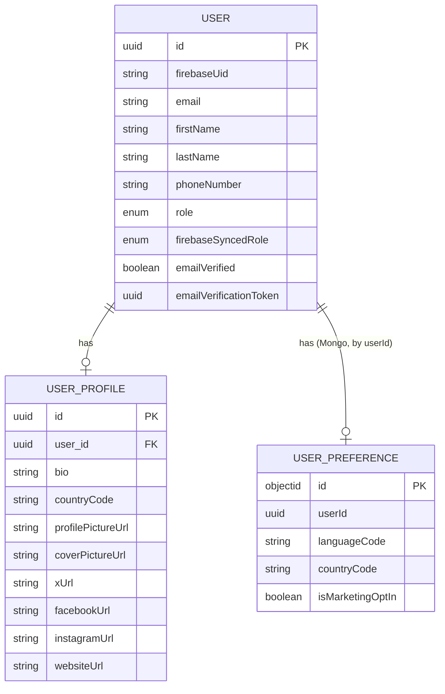

Every record also has `createdAt`, `updatedAt`, `disabledAt` and `deletedAt`.

**Travel documents:** each user's nationalities and residence permits, in `user_travel_documents`. Only countries, permit kinds and expiry dates are kept, never document numbers. They are removed when the user is deleted. Flyway's [V1](../src/main/resources/db/migration/V1__create_user_schema.sql) creates it; on a database baselined at `V1` (its tables existed before the migrations), create it by hand:

```sql
CREATE TABLE user_travel_documents (
    id           UUID PRIMARY KEY,
    created_at   TIMESTAMP(6) WITH TIME ZONE NOT NULL,
    updated_at   TIMESTAMP(6) WITH TIME ZONE NOT NULL,
    disabled_at  TIMESTAMP(6) WITH TIME ZONE,
    deleted_at   TIMESTAMP(6) WITH TIME ZONE,
    user_id      UUID        NOT NULL REFERENCES users (id),
    type         VARCHAR(24) NOT NULL,
    country_code VARCHAR(2)  NOT NULL,
    permit_kind  VARCHAR(16),
    valid_until  DATE
);
CREATE UNIQUE INDEX user_travel_documents_uq ON user_travel_documents (user_id, type, country_code);
```

## Constraints

A user has at most one profile; the service checks before saving, and this index stops two requests at once. V1 creates it. A database whose tables existed before the migrations is baselined at `V1`, so it skips it, and `ddl-auto: validate` doesn't check unique constraints, so run these by hand on it. Creating one fails if duplicates already exist, so run the check query first and settle any rows it returns.

```sql
-- Check: should return no rows.
SELECT user_id FROM user_profiles GROUP BY user_id HAVING count(*) > 1;

CREATE UNIQUE INDEX IF NOT EXISTS uk_user_profile_user ON user_profiles (user_id);
```

## Endpoints

All need a Firebase token except `verify-email`.

| Method and path | Who may call it |
|---|---|
| `POST /api/v1/users/register` | any signed-in Firebase account |
| `GET /api/v1/users/verify-email?token=` | public (link in the verification email) |
| `POST /api/v1/users/reset-password` | the signed-in user, for themselves |
| `GET /api/v1/users`, `GET /api/v1/users/{id}` | any signed-in user |
| `PUT /api/v1/users` | the user themselves, Admin or Support |
| `DELETE /api/v1/users/{id}/disable` | Admin or Support |
| `DELETE /api/v1/users/{id}` | the user themselves |
| `POST /api/v1/users` | nobody: returns 405, use `/register` |
| `POST /api/v1/users/me/devices` `{token, platform}` | the signed-in user, for themselves |
| `POST /api/v1/users/me/devices/unregister` `{token}` | the signed-in user, for themselves |
| `GET /api/v1/users/me/travel-documents` | the signed-in user, for themselves |
| `PUT /api/v1/users/me/travel-documents` `{nationalities, residencePermits: [{countryCode, kind, validUntil}]}` | the signed-in user; replaces every document. At most 4 nationalities and 10 permits; no permit for a country they're a citizen of, one per country, none expired |

Profiles live under `/api/v1/users/user-profiles` and preferences under `/api/v1/users/user-preferences`, each with the standard create, get, list, update, disable and delete.

| Resource | Read | Create and update | Delete |
|---|---|---|---|
| Profile | any signed-in user | owner, Admin or Support | owner |
| Preference | owner, or Admin, Support, Inspector | owner, Admin or Support | owner or Admin |

A user has at most one profile and one preference document.

Device tokens (Firebase Cloud Messaging, platform `ANDROID`, `IOS` or `WEB`) are not stored here. They are passed on to the notification service, which owns them, so the device endpoints answer 202.

## Registration and verification

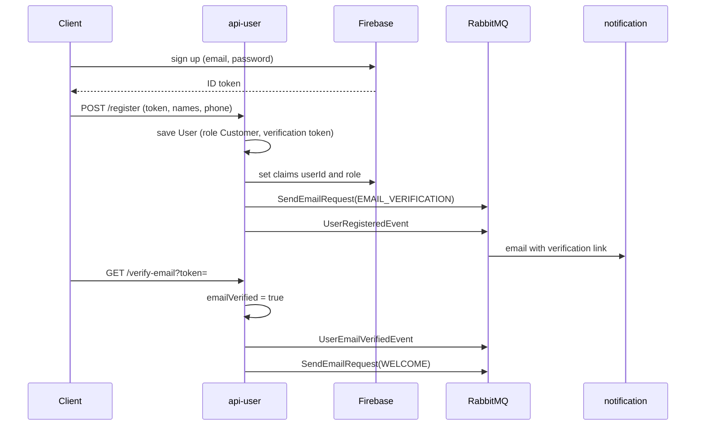

Registering twice with the same Firebase account returns the existing user. If Firebase cannot be reached while setting the claims, registration still succeeds and the role sync job sets them later.

## Role sync job

`FirebaseRoleSyncJob` runs every `app.firebase-role-sync.interval-ms` (60 seconds). It finds users whose `role` differs from `firebaseSyncedRole`, sets their Firebase claims in batches of 200, and stops for this run after three consecutive failures.

## Messages

| Direction | Message | When |
|---|---|---|
| publishes | `SendEmailRequest` | verification, welcome, password reset, pictures updated, support tickets, license subscriptions, itineraries |
| publishes | `UserRegisteredEvent` | a user registers |
| publishes | `UserTravelDocumentsUpdatedEvent` | travel documents are replaced; the whole set and `changedAt`, for `api-destination`, once saved |
| publishes | `UserEmailVerifiedEvent` | a user verifies their email address |
| publishes | `UserProfilePictureUpdatedEvent` | a profile or cover picture URL changes |
| publishes | `UserDisabledEvent`, `UserDeletedEvent` | a user is disabled or deleted; once, to its fanout exchange, which feeds `api-chat` and `api-payment`, and for deletes `api-destination` |
| publishes | `UserContactUpdatedEvent` | a user registers, verifies their email address, or changes their email address or name; the whole contact and `changedAt`, for `api-payment` |
| publishes | `UserDeviceRegisteredEvent`, `UserDeviceUnregisteredEvent` | a device is registered or unregistered for push |
| consumes | `GroupInvitationAcceptedEvent` | an invitation is accepted in `api-group` |
| publishes | `UserMatchedToGroupInvitationEvent` | in reply, if a verified user has the invited email |
| consumes | `SupportTicketCreatedEvent` | emails the customer that their ticket is open, or that support contacted them |
| consumes | `SupportTicketRepliedEvent` | emails the customer that support replied |
| consumes | `SupportTicketStatusChangedEvent` | emails the customer when the ticket is resolved, or closed by someone else |
| consumes | `LicenseSubscriptionActivatedEvent` | emails the customer that their subscription is active |
| consumes | `LicenseSubscriptionRenewalDueEvent` | emails the customer that their subscription renews soon, with the price |
| consumes | `LicenseSubscriptionCanceledEvent` | emails the customer that their subscription will not renew, and until when it runs |
| consumes | `LicenseSubscriptionEndedEvent` | emails the customer when their subscription expired; one ended early gets no email |
| consumes | `ItineraryFinishedEvent` | on `destination.itinerary.finished.user.queue`; emails whoever asked when it is READY (verified, active users only) |

## Settings

| Property | Default | Meaning |
|---|---|---|
| `app.base-url` | `http://localhost:8080` | base of the links placed in emails |
| `app.frontend-url` | `http://localhost:3000` | base of the links in emails: `<frontend-url>/support/tickets/<ticketId>` for tickets, `<frontend-url>/account/subscriptions/<subscriptionId>` for subscriptions |
| `app.firebase-role-sync.interval-ms` | `60000` | pause between role sync runs |
| `firebase.project-id` | `jobbiegiggle` | Firebase project |
| `firebase.enabled` | `true` | set to `false` to start without Firebase |


---

**File: `api-group/docs/README.md`**

# api-group

Owns groups of users, who belongs to them, and the invitations that bring people in, on port **8083**. People join a group by accepting an invitation sent to their email address.

## In short

Groups of people who travel together: who is in each group, who runs it, and the email invitations that bring people in. An invitation can go to someone who has no account yet; they join once they sign up and verify that address.

**Stack:** Spring Boot (Web, Data JPA, Security), PostgreSQL, RabbitMQ.

## User stories

- As a traveller, I create a group and become its admin.
- As a group admin, I invite people by email, see who is pending, and cancel an invitation.
- As an invitee, I accept or reject from the email's links, with or without an account.
- As a group admin, I promote members to admin, demote or remove them, and rename or delete the group.
- As a member, I leave a group.
- As chat, licenses, payments and destinations, I learn about every change to groups and memberships, so that the group chat, the group's subscription and its trip plans follow.

## Main flows

- **An invitation's life:** see [Life of an invitation](#life-of-an-invitation).
- **Accepting before or after signing up:** see [From acceptance to membership](#from-acceptance-to-membership).

## Requirements

- **GRP-1** The creator of a group becomes its first admin. A group always keeps at least one active admin.
- **GRP-2** A user has at most one membership per group, and an email at most one pending invitation per group, among rows not deleted. The database enforces both.
- **GRP-3** Invitations can be answered for 7 days. A rejected or canceled address can be invited again.
- **GRP-4** An accepted invitation becomes a membership only for a verified user with the invited email. Someone signed in with another address is refused.
- **GRP-5** Every change to a group or membership is published, through fanout exchanges where several services consume it.

---

## Technical reference

The sections below describe how it works.

## Data

Everything is in PostgreSQL (`jobbie_giggle_group`). Users live in `api-user`; this service only keeps their IDs.

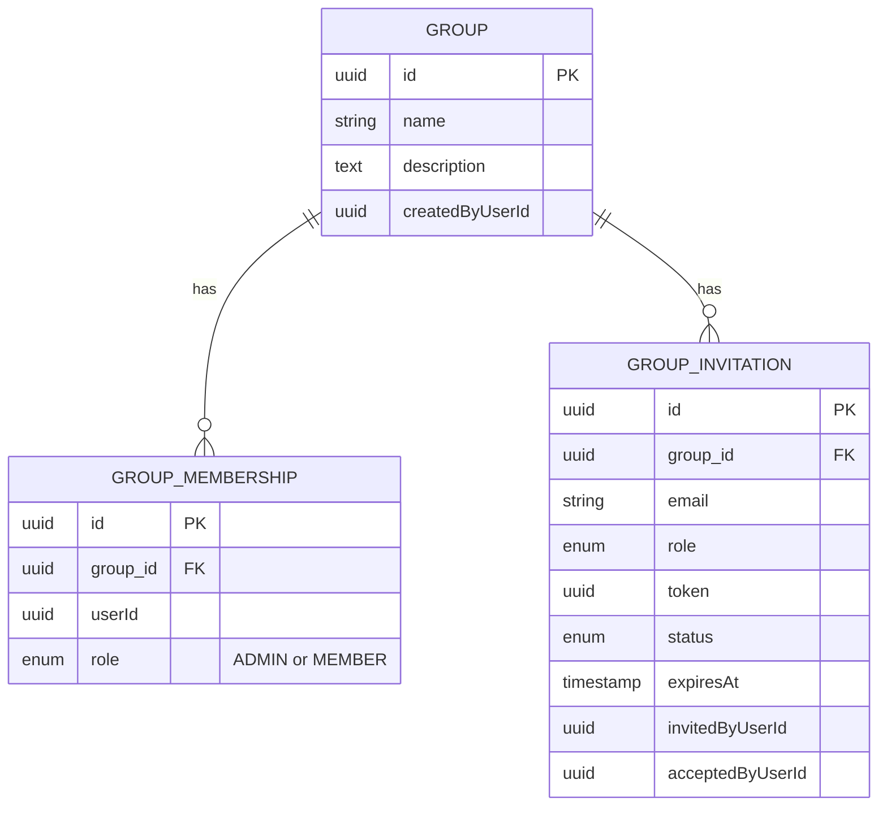

Every record also has `createdAt`, `updatedAt`, `disabledAt` and `deletedAt`.

## Rules

- The user who creates a group becomes its first **Admin**.
- A group always keeps at least one active Admin: the last one cannot be demoted, disabled or removed.
- A user has at most one membership per group. A disabled membership still holds the place; only a deleted one frees it.
- A group has at most one pending invitation per email address.
- An invitation can be answered for `app.group-invitation.ttl-days` (7) days.
- "Staff" below means the platform roles Admin and Support (plus Inspector for reading).

## Constraints

A user has one membership per group and an email one pending invitation per group, among rows not deleted; the services check before saving, and these partial indexes stop two requests at once. JPA can't declare a partial index, so the entities only say so in a comment. Flyway's [V1](../src/main/resources/db/migration/V1__create_group_schema.sql) creates the tables with these indexes. A database whose tables existed before the migrations is baselined at `V1`, so it skips it, and `ddl-auto: validate` doesn't check unique constraints, so run these by hand on it. Creating one fails if duplicates already exist, so run the check query first and settle any rows it returns.

```sql
-- Check: each should return no rows.
SELECT group_id, user_id FROM group_memberships WHERE deleted_at IS NULL
GROUP BY group_id, user_id HAVING count(*) > 1;
SELECT group_id, email FROM group_invitations WHERE status = 'PENDING' AND deleted_at IS NULL
GROUP BY group_id, email HAVING count(*) > 1;

CREATE UNIQUE INDEX IF NOT EXISTS uk_group_membership_group_user
    ON group_memberships (group_id, user_id) WHERE deleted_at IS NULL;
CREATE UNIQUE INDEX IF NOT EXISTS uk_group_invitation_pending_email
    ON group_invitations (group_id, email) WHERE status = 'PENDING' AND deleted_at IS NULL;
```

## Endpoints

| Method and path | Who may call it |
|---|---|
| `POST /api/v1/groups` | any signed-in user |
| `GET /api/v1/groups/mine` | any signed-in user |
| `GET /api/v1/groups/{id}` | members of the group, staff |
| `GET /api/v1/groups` | staff |
| `PUT /api/v1/groups` | Admins of the group, Admin or Support |
| `DELETE /api/v1/groups/{id}` | Admins of the group |
| `GET /api/v1/groups/memberships/group/{groupId}` | members of the group, staff |
| `POST /api/v1/groups/memberships`, `PUT` | Admins of the group, Admin or Support |
| `DELETE /api/v1/groups/memberships/{id}` | Admins of the group, or the member themselves (leave) |
| `POST /api/v1/groups/invitations`, `PUT` | Admins of the group, Admin or Support |
| `GET /api/v1/groups/invitations/group/{groupId}` | Admins of the group, staff |
| `POST /api/v1/groups/invitations/{id}/cancel` | Admins of the group, Admin or Support |
| `DELETE /api/v1/groups/invitations/{id}` | Admins of the group |
| `POST /api/v1/groups/invitations/accept`, `/reject` | **public**, body `{"token": "..."}` |
| `DELETE .../{id}/disable` (all three resources) | Admin or Support |

The token is only ever sent in the invitation email; no API response contains it.

## Life of an invitation

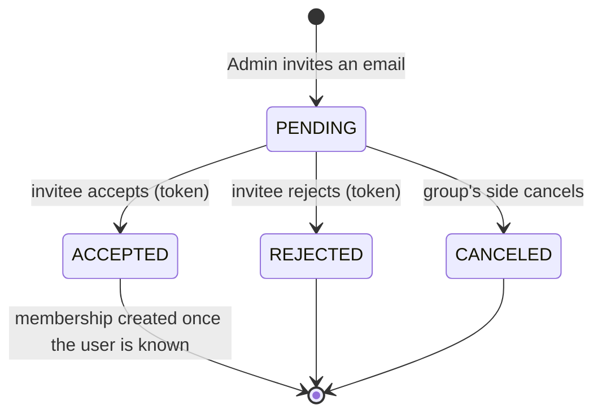

Once an invitation is no longer pending, its email links return 422. After expiry, accepting returns 422 as well. A canceled or rejected email address can be invited again.

## From acceptance to membership

This service cannot look users up, so it asks `api-user` over RabbitMQ.

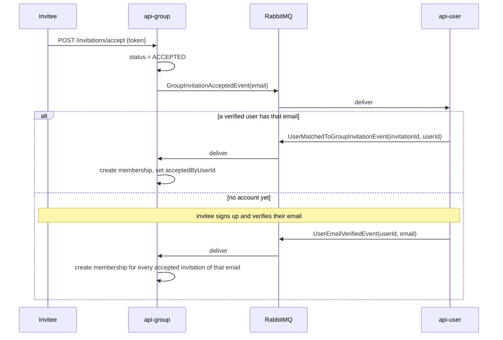

So the membership does not exist the moment `accept` returns; it appears shortly after, or after the invitee verifies their email. Someone signed in with a different email address than the invited one is refused with 403. Linking is safe to repeat: a second delivery of the same message changes nothing.

## Messages

| Direction | Message | When |
|---|---|---|
| publishes | Group × Created, Updated, Disabled, Deleted | a group changes; Disabled and Deleted are published once to their fanout exchanges, which feed `api-chat`, `api-license` and `api-payment` |
| publishes | GroupMembership × Created, Updated, Disabled, Deleted | a membership changes; each is published once to its fanout exchange, which feeds `api-chat`, `api-license`, `api-payment` and `api-destination` |
| publishes | GroupInvitation × Created, Updated, Disabled, Deleted | an invitation changes |
| publishes | `GroupInvitationAcceptedEvent`, `...RejectedEvent`, `...CanceledEvent` | an invitation is answered or canceled |
| publishes | `SendEmailRequest(GROUP_INVITATION)` | an invitation is created |
| consumes | `UserMatchedToGroupInvitationEvent`, `UserEmailVerifiedEvent` | from `api-user` |

## Settings

| Property | Default | Meaning |
|---|---|---|
| `app.frontend-url` | `http://localhost:3000` | base of the accept and reject links in the email |
| `app.group-invitation.ttl-days` | `7` | how long an invitation can be answered |

The email links are `{frontend-url}/group-invitations/accept?token=` and `/reject?token=`. They open frontend pages that then `POST` the token, so that a mail scanner following a link changes nothing.


---

**File: `api-chat/docs/README.md`**

# api-chat

Owns conversations between users and their messages, on port **8084**. A conversation is **private**, between two users, the **group chat** of a group in `api-group`, or a **support chat**: the conversation of a support ticket between one customer and Support or Admin staff. Clients send over REST and receive in real time over STOMP on a WebSocket.

## In short

Everything people say to each other in TripHuddle: private chats between two users, each group's chat, and support chats between a customer and staff. Messages arrive live over a WebSocket, and as push notifications on phones. Support tickets live here too, with their queue, statuses and ratings.

**Stack:** Spring Boot (Web, Data JPA, Data MongoDB, WebSocket/STOMP, Security), PostgreSQL (conversations, tickets), MongoDB (messages), RabbitMQ (events and the STOMP relay), Google Cloud Storage (attachments).

## User stories

- As a traveller, I open a private chat with someone, or write in my group's chat, and see replies, typing and read receipts live.
- As a traveller, I send photos and files, edit or delete my messages, and react to others'.
- As a traveller, I mute a chat, block a person, or report a message.
- As a group admin, I delete anyone's message in my group's chat.
- As a customer, I open a support ticket with a category and a first message, follow it in its chat, and rate the help.
- As a support agent, I work a queue sorted by urgency, claim tickets, write internal notes the customer never sees, and resolve or close them.
- As a moderator, I review reported messages and remove the bad ones.
- As a traveller, I'm told live when my group's itinerary is ready.

## Main flows

- **Sending a message:**

```mermaid
sequenceDiagram
    actor A as Sender
    participant CH as api-chat
    participant R as RabbitMQ STOMP relay
    actor B as Other participants
    participant N as notification
    A->>CH: POST message (clientMessageId)
    CH->>CH: check access, blocks; save
    CH->>R: MESSAGE_CREATED to each participant's topic
    R->>B: live event on every open socket
    CH-->>N: push to those not muted
```

- **A support ticket's life:** see [Support tickets](#support-tickets).

## Requirements

- **CHT-1** There is one private chat per pair of users and one chat per group, kept in step with api-group's events.
- **CHT-2** A message has up to 4,000 characters and 10 attachments. Sending again with the same `clientMessageId` returns the first message.
- **CHT-3** Blocks stop private chats both ways. Disabled or deleted users can't send. A disabled or deleted group's chat is read-only.
- **CHT-4** Members who leave keep the history up to their leaving. Rejoining brings it back.
- **CHT-5** Reports are one per reader while open. Staff review them and may remove the message.
- **CHT-6** A customer has at most 3 ongoing tickets. Tickets follow their status rules, close 7 days after being resolved, and can be rated 1 to 5.
- **CHT-7** Internal notes never reach the customer.
- **CHT-8** Real-time events reach every instance through RabbitMQ's STOMP relay. Message history, conversations, tickets and reports use cursor pagination.

---

## Technical reference

The sections below describe how it works.

## Data

Conversations, participants, support tickets and their history, blocks and reports are in PostgreSQL (`jobbie_giggle_chat`). Messages are in MongoDB (`jobbie_giggle_chat`, collection `chat_messages`). Users and groups live in their own services; this service keeps their IDs, learned from events.

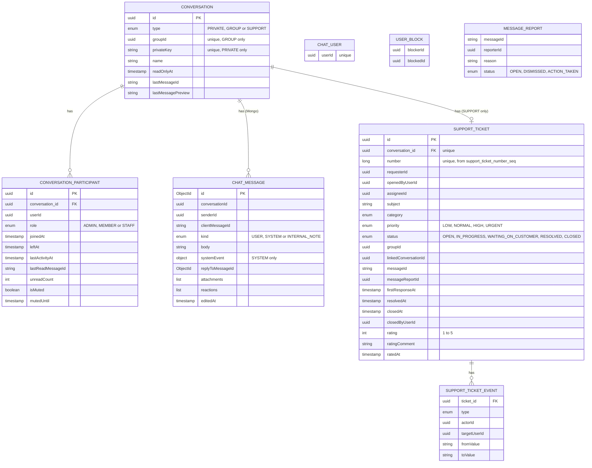

Every record also has `createdAt`, `updatedAt`, `disabledAt` and `deletedAt`.

Flyway's [V1](../src/main/resources/db/migration/V1__create_chat_schema.sql) creates the tables, the sequence `support_ticket_number_seq` that ticket numbers are drawn from, and the partial index below; `ddl-auto: validate` then checks the tables at startup.

## Constraints

A user has at most one open report of a message; the service checks before saving, and this partial index stops two requests at once. JPA can't declare a partial index, so `MessageReport` only says so in a comment. A database whose tables existed before the migrations is baselined at `V1`, so it skips it, and `ddl-auto: validate` doesn't check unique constraints, so run these by hand on it. Creating one fails if duplicates already exist, so run the check query first and settle any rows it returns.

```sql
-- Check: should return no rows.
SELECT message_id, reporter_id FROM message_reports WHERE status = 'OPEN'
GROUP BY message_id, reporter_id HAVING count(*) > 1;

CREATE UNIQUE INDEX IF NOT EXISTS uk_message_report_open
    ON message_reports (message_id, reporter_id) WHERE status = 'OPEN';
```

## Rules

- **Private chats**: any platform user can open one with any other, unless either blocks the other. There is one per pair: opening it again returns the same conversation.
- **Group chats**: one per group, created and kept in step from `api-group`'s events. Group Admins are chat Admins and may delete anyone's message.
- **Leaving a group**: the member keeps reading the history up to the moment they left, but cannot send, react or type, and receives no more events. Rejoining brings back the whole history.
- **Disabled or deleted group**: its chat becomes read-only for everyone.
- **Messages**: up to 4,000 characters and 10 attachments, and at least one of the two. The sender can edit the text at any time. Deleting hides the content but keeps it for moderation.
- **Retries**: the client sends a `clientMessageId` with each message; sending again with the same one returns the first message instead of posting twice.
- **Blocks** apply to private chats: neither side can send or open the chat. In group chats a blocked user's messages are still shown, but they trigger no push to the blocker.
- **Disabled or deleted users** cannot send, and nobody can open a new private chat with them.
- **Mute** stops push notifications for a conversation, indefinitely or until `mutedUntil`.
- **Reports**: anyone who can read a message may report it, once while the report is open. Admin, Support and Inspector review reports and may remove the message. Messages in support chats and system messages cannot be reported.
- **Message kinds**: `USER` messages are written by participants. `SYSTEM` messages record changes to a support ticket; they carry a `systemEvent` for clients to render in their own language, and nobody can edit, delete or react to them. `INTERNAL_NOTE` messages are written by staff in a support chat and never reach the customer: not in the history, events, pushes, unread counts or the conversation's last message.

## Support tickets

A support ticket is a `SUPPORT` conversation with a ticket attached. The customer is a `MEMBER` participant and the staff helping them are `STAFF` participants. "Staff" means the Support and Admin roles, read from the token.

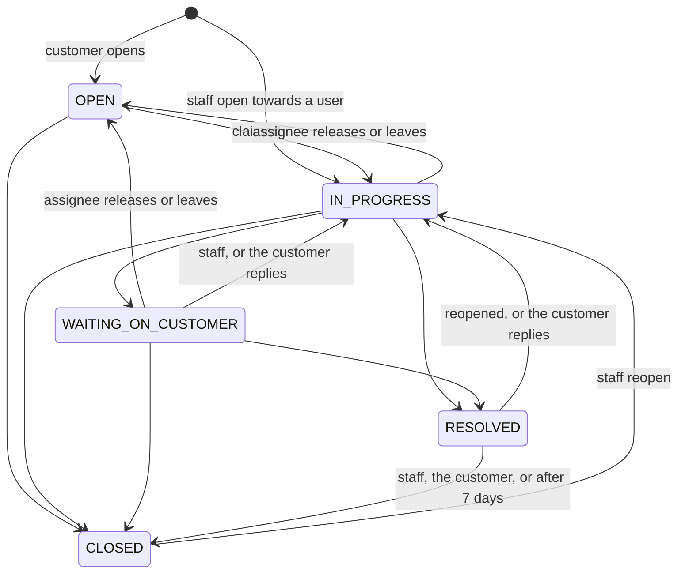

- **Opening**: a customer opens a ticket with a subject, a category and a first message. They can have at most 3 tickets (`app.chat.support.max-ongoing-tickets-per-customer`) that are `OPEN`, `IN_PROGRESS` or `WAITING_ON_CUSTOMER`. Disabled or deleted users cannot open tickets or reply. Staff can open a ticket towards another user (`userId`); it starts `IN_PROGRESS`, assigned to them, and does not count towards the user's limit. Retrying with the same `clientMessageId` returns the ticket already opened.
- **Links**: a ticket may point at a group, a conversation, a message and a message report. A customer can only point at what they took part in, can see, or reported themselves.
- **Priority**: `SAFETY` tickets start `HIGH`, all others `NORMAL`. Only staff see and change the priority.
- **Assignment**: staff claim an unassigned ticket from the queue, which makes them its assignee, adds them to the chat and moves an `OPEN` ticket to `IN_PROGRESS`. Other staff join to help. The assignee, or any Admin, can release the ticket; the assignee leaving releases it too. Either puts an `IN_PROGRESS` or `WAITING_ON_CUSTOMER` ticket back to `OPEN`. Nobody can claim or join their own ticket.
- **Status**: staff follow the diagram. `IN_PROGRESS` and `WAITING_ON_CUSTOMER` need an assignee. The customer can only close their ticket, or reopen it while `RESOLVED`. Reopening goes to `IN_PROGRESS` if the ticket is assigned, otherwise to `OPEN`. A customer's reply moves a `WAITING_ON_CUSTOMER` or `RESOLVED` ticket back the same way.
- **Closed** tickets are read-only for everyone until staff reopen them.
- **Auto-close**: a ticket left `RESOLVED` for `app.chat.support.auto-close-after-days` (7) closes on its own, with no actor. A job checks every 10 minutes. Instances running it at the same time skip the tickets another one has locked, so each ticket is closed once.
- **Rating**: once a ticket is `RESOLVED` or `CLOSED`, its customer can rate the support from 1 to 5, with an optional comment. Rating again replaces the earlier rating. The rating is kept in the ticket's events but not posted to the chat.
- **Reading**: any Support or Admin user can read every support chat in full, internal notes included, without joining. To write, react or type they must join, and they need to still hold the role.
- **Moderation**: staff cannot delete the customer's messages. Customers cannot mute a support chat; staff can.
- **History**: every change is kept in the ticket's events. All changes except priority are also posted as system messages, and participants get `CONVERSATION_UPDATED`. Staff subscribed to the support queue topic get `TICKET_UPDATED` with the whole ticket.
- **Emails**: the service publishes `SupportTicketCreatedEvent`, `SupportTicketStatusChangedEvent` and `SupportTicketRepliedEvent`. `api-user`, which knows the customer's email address, turns them into emails. `SupportTicketRepliedEvent` is only published for the first staff message after the customer last wrote, so a burst of replies sends one email.
- **Response time**: `firstResponseAt` is set by the first message a staff participant writes to the customer, on tickets the customer opened.

## Endpoints

All need a Firebase token. "Participants" includes those who left, for reading their part of the history.

| Method and path | Who may call it |
|---|---|
| `GET /api/v1/chats/conversations?cursor=&limit=&type=` | any signed-in user (their own) |
| `POST /api/v1/chats/conversations/private` `{userId}` | any signed-in user |
| `GET /api/v1/chats/conversations/{id}` | participants |
| `PUT /api/v1/chats/conversations/{id}/mute` `{isMuted, mutedUntil}` | participants, except customers of a support chat |
| `POST /api/v1/chats/conversations/{id}/read` `{messageId}` | participants |
| `GET /api/v1/chats/conversations/{id}/messages?before=&after=&limit=` | participants; Support and Admin for support chats |
| `POST /api/v1/chats/conversations/{id}/messages` `{…, isInternalNote}` | active participants; notes by staff of a support chat |
| `POST /api/v1/chats/conversations/{id}/attachments/upload-url` | active participants |
| `GET /api/v1/chats/messages/{id}` | participants who can see it; Support and Admin in support chats |
| `PATCH /api/v1/chats/messages/{id}` `{body}` | the sender, while active |
| `DELETE /api/v1/chats/messages/{id}` | the sender while active, Admins of the group |
| `PUT`, `DELETE /api/v1/chats/messages/{id}/reactions/{emoji}` | active participants |
| `POST /api/v1/chats/messages/{id}/reports` `{reason}` | participants who can see it |
| `GET /api/v1/chats/reports?status=&cursor=&limit=`, `/reports/{id}`, `/reports/{id}/context` | Admin, Support, Inspector |
| `PATCH /api/v1/chats/reports/{id}` `{status, resolutionNote, isMessageRemoved}` | Admin, Support, Inspector |
| `POST /api/v1/chats/blocks` `{userId}`, `GET`, `DELETE /blocks/{userId}` | any signed-in user (their own) |
| `POST /api/v1/chats/support-tickets` `{subject, category, clientMessageId, body, groupId, conversationId, messageId, messageReportId}` | any signed-in user; with `userId`, Support and Admin |
| `GET /api/v1/chats/support-tickets/mine?status=&cursor=&limit=` | any signed-in user (their own) |
| `GET /api/v1/chats/support-tickets?status=&category=&priority=&assigneeId=&isUnassigned=&cursor=&limit=` | Support, Admin |
| `GET /api/v1/chats/support-tickets/{id}` | its customer, Support, Admin |
| `PATCH /api/v1/chats/support-tickets/{id}` `{priority, category}` | Support, Admin |
| `PATCH /api/v1/chats/support-tickets/{id}/status` `{status}` | its customer (close, reopen), Support, Admin |
| `POST /api/v1/chats/support-tickets/{id}/claim`, `/join`, `/leave` | Support, Admin |
| `POST /api/v1/chats/support-tickets/{id}/release` | its assignee, Admin |
| `PUT /api/v1/chats/support-tickets/{id}/rating` `{rating, comment}` | its customer |
| `GET /api/v1/chats/support-tickets/{id}/events` | Support, Admin |

Conversations and messages use **cursor pagination** (`CursorPaginated` from `common`), because new messages arrive at the head of the list while it is read and would shift page numbers. Pass `nextCursor` back as `cursor` (conversations) or `before` (messages). `after=<messageId>` returns what is newer than a message, oldest first, for catching up after a reconnect. A customer's support tickets (newest first), the staff ticket queue (most urgent first, then oldest first) and message reports (oldest first) use cursors too: tickets and reports leave the queue while staff work through it, which would make page numbers skip items. Blocks use the usual `page` and `pageSize`.

## Real time

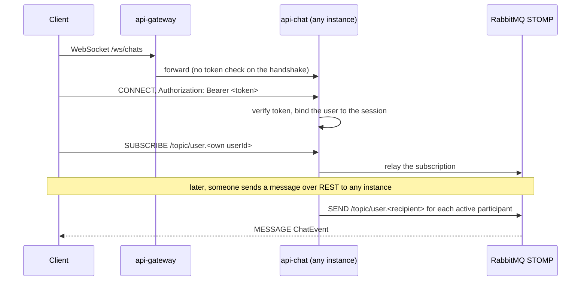

- **One topic per user.** Each event is sent to the topic of every active participant, never to a shared conversation topic. So someone removed from a group stops receiving at once, without unsubscribing.
- **Support queue topic.** The one shared topic is `/topic/support.queue`, for Support and Admin sessions only. Every new ticket and every change to a ticket is sent there as `TICKET_UPDATED`, so staff see the queue move live. The role is checked when subscribing, from the token used to CONNECT.
- A session may only subscribe to its own user topic (and staff to the support queue topic) and only `SEND` to `/app/**`. A frame that breaks these rules gets an ERROR frame. An expired token must reconnect.
- Every event is a `ChatEvent {type, conversationId, payload, occurredAt}`:

| `type` | `payload` |
|---|---|
| `MESSAGE_CREATED`, `MESSAGE_UPDATED`, `MESSAGE_DELETED`, `REACTIONS_UPDATED` | `MessageResponse` |
| `READ_RECEIPT` | `{userId, messageId, readAt}` |
| `TYPING` | `{userId, isTyping}` |
| `CONVERSATION_UPDATED` | none: refetch the conversation |
| `TICKET_UPDATED` | `SupportTicketResponse` as staff see it; only on `/topic/support.queue` |
| `ITINERARY_FINISHED` | `ItineraryFinishedEvent` from api-destination, with no conversation; on each traveller's user topic |

- **Typing**: `SEND /app/conversations/{id}/typing` with `{"isTyping": true}`. It is relayed to the other active participants and not stored.
- With `app.chat.broker.relay-enabled=false` an in-memory broker is used instead of RabbitMQ. Events then only reach clients connected to the same instance, so turn it off only for a single instance.

## Attachments

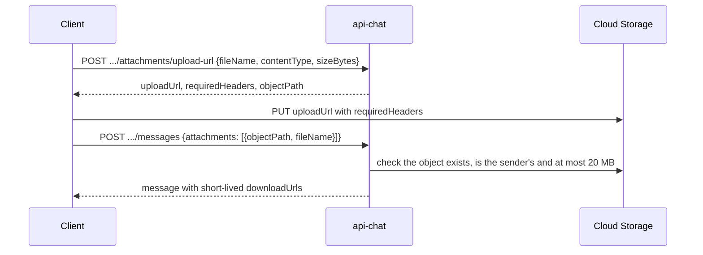

- Any file type is accepted, up to 20 MB. The signed upload URL carries `x-goog-content-length-range`, so GCS refuses a larger body.
- Objects are stored at `chats/<conversationId>/<uploaderId>/<uuid>`. A message can only attach its sender's uploads for that conversation.
- Attachments are off when `app.chat.attachments.bucket` is empty: upload URLs are then refused with 422.
- Signing URLs needs a service account: a key file in `GOOGLE_APPLICATION_CREDENTIALS` locally, or `iam.serviceAccounts.signBlob` for the runtime service account on GCP.

## Push notifications

For each new message, the service publishes a `SendPushRequest` to the notification service. Its recipients are the active participants except the sender, anyone who muted the conversation, anyone who blocks the sender, and disabled or deleted users.

## Messages

| Direction | Message | Effect |
|---|---|---|
| consumes | `UserRegisteredEvent` | the user becomes known |
| consumes | `UserDisabledEvent`, `UserDeletedEvent` | the user can no longer chat |
| consumes | `GroupCreatedEvent`, `GroupUpdatedEvent` | creates or renames the group chat |
| consumes | `GroupDisabledEvent`, `GroupDeletedEvent` | the group chat becomes read-only |
| consumes | `GroupMembershipCreatedEvent` | adds the member, or brings them back |
| consumes | `GroupMembershipUpdatedEvent` | follows their role |
| consumes | `GroupMembershipDisabledEvent`, `GroupMembershipDeletedEvent` | the member leaves the chat |
| consumes | `ItineraryFinishedEvent` | on `destination.itinerary.finished.chat.queue`; sends `ITINERARY_FINISHED` to the travellers' sockets |
| publishes | `ChatMessageSentEvent`, `ChatMessageEditedEvent`, `ChatMessageDeletedEvent` | a message is sent, edited or deleted |
| publishes | `ChatMessageReportedEvent` | a message is reported |
| publishes | `SendPushRequest` | a new message should reach phones |
| publishes | `SupportTicketCreatedEvent` | a support ticket is opened |
| publishes | `SupportTicketStatusChangedEvent` | a support ticket moves to another status |
| publishes | `SupportTicketRepliedEvent` | staff reply to the customer after the customer last wrote |

Group events arrive on separate queues, so a membership can arrive before its group. Each handler creates whatever is missing and is safe to run twice.

## Settings

| Property | Default | Meaning |
|---|---|---|
| `app.chat.broker.relay-enabled` | `true` (`CHAT_STOMP_RELAY_ENABLED`) | relay STOMP to RabbitMQ; `false` for one instance only |
| `app.chat.broker.relay-port` | `61613` (`RABBITMQ_STOMP_PORT`) | port of RabbitMQ's `rabbitmq_stomp` plugin |
| `app.chat.attachments.bucket` | empty (`CHAT_ATTACHMENTS_BUCKET`) | Cloud Storage bucket; empty turns attachments off |
| `app.chat.attachments.max-size-bytes` | `20971520` | largest attachment |
| `app.chat.attachments.upload-url-ttl-minutes` | `15` | life of an upload URL |
| `app.chat.attachments.download-url-ttl-minutes` | `60` | life of a download URL |
| `app.chat.support.max-ongoing-tickets-per-customer` | `3` | unresolved tickets a customer may have opened at once |
| `app.chat.support.auto-close-after-days` | `7` (`CHAT_SUPPORT_AUTO_CLOSE_AFTER_DAYS`) | how long a ticket stays `RESOLVED` before it closes on its own |
| `app.chat.support.auto-close-interval-ms` | `600000` | pause between runs of the auto-close job |
| `app.cors.allowed-origins` | `http://localhost:3000` | browser origins allowed to open the WebSocket |
| `RABBITMQ_HOST`, `RABBITMQ_USERNAME`, `RABBITMQ_PASSWORD`, `RABBITMQ_VIRTUAL_HOST` | | broker connection, for AMQP and STOMP |

## Testing

`mvn test` runs the unit tests, with no Docker: the authorization policies and `ChatAccess` (who is a participant, who sees which message), attachments against a mocked Storage, the event publisher's after-commit delivery, the STOMP subscription rule for the support queue, the auto-close job's batching, message previews and the architecture rules. `mvn verify` adds the integration tests, against Postgres and MongoDB in Testcontainers, with Flyway building the schema and Hibernate validating it. RabbitMQ and the STOMP broker are replaced by recorders, so each test checks what was published and which user's topic got which event; users and groups are seeded the way api-user and api-group announce them.

- `PrivateChatIT`: one chat per pair, sending with replays, the size limits, replies, blocks, inactive users, edits, deletes, reactions, read receipts, mutes, pushes and cursor pages (CHT-1, CHT-2, CHT-3, and the pagination of CHT-8). The STOMP relay itself is left to the smoke tests.
- `GroupChatIT`: chats following api-group's events in any order, read-only groups, group admins, leaving and rejoining, typing and finished itineraries (CHT-1, CHT-3, CHT-4).
- `SupportTicketIT`: the three-ticket limit, replays, links, outbound tickets, claiming, joining, leaving, releasing, the status rules, auto-close after seven days, ratings, internal notes and the queue's filters and order (CHT-6, CHT-7).
- `ModerationIT`: one open report per reader, what can't be reported, the review with its context, removal and the staff list (CHT-5).

Each integration test empties the tables and the message collection afterwards. Coverage is enforced: 85% of lines and 75% of branches, unit and integration tests together, excluding DTOs.


---

**File: `api-destination/docs/README.md`**

# api-destination

Places, their category tree, tags and photos, imported from Wikidata and Wikimedia Commons, AI content about them, trip plans with AI itineraries, and visa guidance for each traveller, all written through the openai worker, on port **8087**, in PostgreSQL with PostGIS, pgvector, pg_trgm and unaccent (`jobbie_giggle_destination`). Travellers also keep favourites and visited places, write reviews, ask about places, and find places by meaning.

## In short

The heart of the product: where to go and how. It holds the world's places, from countries down to landmarks and restaurants, imported from Wikidata with photos from Wikimedia Commons. It has the AI write about each place, finds places by words, distance or meaning, and plans trips with day-by-day itineraries. It tells each traveller what visa they need, and keeps people's favourites, reviews and questions. Everything needs a license.

**Stack:** Spring Boot (Web, Data JPA, Security), PostgreSQL 16 with PostGIS (geography), pg_trgm and unaccent (fuzzy text search) and pgvector (semantic search), RabbitMQ, Google Cloud Storage (photo copies). AI goes through the [openai](../../openai/docs/README.md) worker over amqp, and open data comes from Wikidata SPARQL, Wikimedia Commons and the passport-index dataset.

## User stories

**Exploring**
- As a traveller, I browse a country's regions, cities and landmarks, filter them by category or tag, and search by name in any language, forgiving typos.
- As a traveller, I find places near me or on the visible map.
- As a traveller, I describe what I'm after ("quiet beach town with seafood"), or ask for places like one I liked.
- As a traveller, I read a place's overview, pros and cons, what visitors say with the sources, and practical tips, in my language.
- As a traveller, I ask my own question about a place and get a sourced answer.

**Planning**
- As a traveller or group member, I make a trip plan with dates, destinations, must-sees, travellers, budget, pace and interests.
- As a traveller, I get an AI itinerary for it, and I'm told by push, email and in the app when it's ready.
- As a traveller, I have one day rewritten, or reorder, add and remove items myself.

**Visas**
- As a traveller, I see for each country on my trip what my best passport needs, with steps, costs and official links.
- As a group admin, I see every member's visa situation, and who hasn't entered their documents yet.

**My lists**
- As a traveller, I save favourites, mark places visited, and write one review per place.
- As a traveller, I report reviews or AI content that are wrong.

**Staff**
- As an administrator, I import a country from Wikidata, then fix, move, merge, hide or feature places and manage the category tree.
- As a support agent, I settle reports on content and reviews, and have content rewritten.
- As an administrator, I reload the visa rules.

## Main flows

The [root README](../../README.md#end-to-end-flows) shows planning a trip and checking visas end to end. Here:
- **AI content:** see [AI content](#ai-content).
- **Itineraries:** see [Trips and itineraries](#trips-and-itineraries).
- **Visas:** see [Visas](#visas).
- **Semantic search:** see [Semantic search](#semantic-search).

## Requirements

- **DST-1** Every route needs a token and a current license with the access entitlement, the user's own or, when acting for a group, the group's. Access lasts 48 hours past a period's end, for a renewal on its way. Staff always have access.
- **DST-2** Places form a tree under each country. Slugs, Wikidata IDs and OSM IDs are unique. Merged places answer with their target, and hidden ones are for staff only.
- **DST-3** Imports load regions, cities above a population threshold, and notable places with photos whose licences allow reuse. Wikimedia's limits are respected with pacing and retries.
- **DST-4** Text search matches every name in any language, ignoring accents and forgiving typos. Points rank by distance; otherwise featured and populous places come first.
- **DST-5** AI content is written once per place, section and language, and shared. It is served while stale and refreshed, within a daily token budget, a hard limit and a per-user share.
- **DST-6** Trip plans run up to 30 days and 10 destinations. An itinerary takes one unit of the owner's monthly quota, and a failure gives it back. Only known, listed places are linked. Travellers are told by socket, push and email.
- **DST-7** Visa checks use each traveller's best passport, and residence permits valid through the trip. Guidance is shared by everyone in the same case and carries a disclaimer. Group admins see everyone, and members only themselves.
- **DST-8** Favourites, visited places and questions are private. There is one review per user and place, and three open reports hide a review until staff decide.
- **DST-9** Semantic search embeds places in the background and caches each query's embedding, so repeated searches are instant.
- **DST-10** A deleted user's documents, marks, reviews and questions are forgotten.

---

## Technical reference

The sections below describe how it works.

## Access

Every route needs a token and a license:
- **Staff:** Admin, Support and Inspector always read; Admin and Support manage places and categories.
- **Everyone else:** needs a current subscription whose entitlements include `app.destination.access-entitlement` (`DESTINATIONS`). A value of `false`, `0`, `no` or `off` turns it off.
- **Groups:** a group's license counts only for its members, and only when they pass `groupId`.
- **Grace:** access lasts `access-grace-hours` (48) past a period's end, for a renewal on its way.

Copies kept from events: countries (api-platform), license subscriptions with entitlements (api-license), and group memberships (api-group, `.destination` queues). They only know what happened after this service started listening, so existing countries, subscriptions and memberships need a replay.

## Endpoints

| Endpoint | Who |
|---|---|
| `GET /api/v1/destinations/places?q=&countryCode=&kind=&categoryId=&tag=&withinId=&parentId=&isFeatured=&latitude=&longitude=&radiusKm=&west=&south=&east=&north=&groupId=` | licensed users, staff |
| `GET /api/v1/destinations/places/{id}`, `/slug/{slug}` | licensed users, staff; a merged place answers with its target |
| `POST /places`, `PUT /places/{id}`, `POST /places/{id}/move`, `/merge`, `/hide`, `/unhide`, `/feature`, `/unfeature`, `DELETE /places/{id}` | Admin, Support |
| `POST /places/{id}/photos/{photoId}/primary`, `DELETE /places/{id}/photos/{photoId}` | Admin, Support |
| `GET /api/v1/destinations/places/{id}/content?language=&sections=&groupId=` | licensed users, staff; `language` or else `Accept-Language`, else English |
| `POST /places/{id}/content/{section}/report {language, reason}` | licensed users |
| `POST /places/{id}/content/regenerate {language, sections}` | Admin, Support; answers `202` |
| `GET /api/v1/destinations/content-reports?isOpen=&cursor=&limit=`, `POST /content-reports/{id}/resolve?isRegenerating=` | staff read; Admin, Support resolve |
| `POST /api/v1/destinations/imports {countryCode, minCityPopulation?, minPoiSitelinks?, isIncludingPois?, isIncludingPhotos?}` | Admin, Support; answers `202` with the queued import |
| `GET /api/v1/destinations/imports?countryCode=&status=`, `GET /imports/{id}` | Admin, Support, Inspector |
| `GET /api/v1/destinations/places/semantic?q=&countryCode=&kind=&withinId=&limit=&groupId=` | licensed users, staff |
| `GET /places/{id}/similar?isSameCountry=&limit=&groupId=` | licensed users, staff |
| `PUT`, `DELETE /places/{id}/favourite`; `PUT /places/{id}/visited {visitedOn?}`, `DELETE /places/{id}/visited` | licensed users (removing: any signed-in user) |
| `GET /me/places?kind=FAVOURITE\|VISITED&cursor=&limit=`, `GET /me/place-marks?placeIds=` | the user |
| `GET /places/{id}/reviews?sort=NEWEST\|HIGHEST\|LOWEST&cursor=&limit=`, `GET /places/{id}/reviews/summary` | licensed users, staff |
| `GET`, `PUT`, `DELETE /places/{id}/reviews/mine` | the author (writing needs the license) |
| `POST /reviews/{id}/report {reason}` | licensed users, not the author |
| `POST /reviews/{id}/moderate?isHiding=&reason=`, `POST /review-reports/{id}/resolve?isHiding=` | Admin, Support |
| `GET /review-reports?isOpen=&cursor=&limit=` | staff |
| `POST /places/{id}/questions {question, language}` | licensed users; answers `202` |
| `GET /places/{id}/questions/mine?cursor=&limit=`, `GET /questions/{id}` | the asker; staff read any |
| `GET /api/v1/destinations/categories` | licensed users, staff |
| `POST`, `PUT`, `DELETE /api/v1/destinations/categories` | Admin, Support |
| `POST /api/v1/destinations/trip-plans` | licensed users; with `groupId`, members of a licensed group |
| `GET /trip-plans/mine`, `GET /trip-plans/groups/{groupId}` | the user; the group's licensed members, staff |
| `GET`, `PUT /trip-plans/{id}` | its travellers; staff read |
| `DELETE /trip-plans/{id}` | its creator, or an admin of its group |
| `POST /trip-plans/{id}/itineraries` | its travellers; answers `202` with the itinerary `GENERATING` |
| `GET /trip-plans/{id}/itineraries`, `GET /itineraries/{id}` | its travellers, staff |
| `POST /itineraries/{id}/days/{n}/regenerate?instructions=` | its travellers; answers `202` |
| `GET /trip-plans/{id}/visas?language=` | its travellers (a group's admins see everyone, members themselves), staff |
| `GET /api/v1/destinations/visas?passport=&destination=&language=&groupId=` | licensed users, staff |
| `POST /api/v1/destinations/visa-rules/imports` | Admin, Support; answers `202` |
| `GET /visa-rules/imports` | staff |
| `PUT /itineraries/{id}/days/{n}/order [itemIds]`, `POST /itineraries/{id}/days/{n}/items`, `DELETE /itineraries/{id}/items/{itemId}` | its travellers |

Search matches every name a place has, in any language, ignoring accents and forgiving typos (trigram plus full text). Words rank by match, a point ranks by distance, otherwise featured and most populous come first.

Favourites and visited places, a place's reviews, a user's questions, and the content and review reports use **cursor pagination** (`cursor`, `limit`; the answer has `nextCursor` and `hasMore`): feeds that grow at their head, and report queues that shrink as staff work through them, would make page numbers repeat or skip items. A review cursor belongs to its sort; one from another sort is refused. Other lists keep `page` and `pageSize`.

## Staff operations

- **Create:** needs an active country from api-platform's events, and a parent in the same country if given. A slug like `pt-porto` is made from the country and name unless given; slugs are never reused.
- **Names:** names, categories and tags are replaced as sent. The primary name is always among the names, so search finds it.
- **Wikidata and OpenStreetMap IDs** are unique: a second place with the same one is refused, to be merged instead.
- **Move:** moves a place with its whole subtree, within its country. Moving it into itself or into a place inside it is refused.
- **Merge:** a duplicate's children, names (as aliases), categories, tags and source IDs go to the target, and the duplicate becomes `MERGED`. Reading the duplicate answers with the target. Places in different countries, or a target inside the duplicate, are refused.
- **Hide:** hides a place from customers; its children stay listed. Staff can still read it and include it in searches with `isIncludingHidden`.
- **Delete:** only places with nothing in them; others are moved or merged first.
- **Categories:** a slug is unique among categories that aren't deleted. A new parent moves a category with its subtree, and deleting one with subcategories is refused. Places lose a deleted category.

## Importing from Wikidata

Staff queue an import per country; one country has at most one waiting or running import. `ImportJobRunner` takes waiting imports every `interval-ms` (30s), one per instance at a time. An import whose instance stops renewing its heartbeat for 15 minutes is taken up again by another instance.

1. **Country:** found by its ISO code (`P297`). Several historical states can share a code; the one with the most articles is taken. Its official languages' names are imported along with the configured `languages`.
2. **Regions:** the country's first-level administrative subdivisions (`Q10864048` and subclasses) that weren't dissolved, at the top of the country.
3. **Cities:** human settlements (`Q486972` and subclasses) with at least `minCityPopulation` (20,000) people, under the region they lie in (`P131`).
4. **Places to visit:** for each category with Wikidata classes, e.g. Castle with `Q23413`:
   - the `max-pois-per-class` (300) most notable items of that class and its subclasses, with at least `minPoiSitelinks` (5) Wikipedia articles and coordinates;
   - each is filed under that category, in the nearest city within `poi-city-radius-km` (25 km).
5. **Photos:** each place's Wikidata image (`P18`).

**Names:** a place's name is its English label, else its country's language, else any. Every label in the chosen languages becomes one of its names.

**Re-runs:** a re-run matches places by Wikidata ID, so it updates rather than duplicates.
- It sets coordinates when missing, the population, the OpenStreetMap relation (`P402`, as `relation/<id>`) when free, new names, and the category.
- It leaves the name, kind, parent, slug and visibility as staff set them, and never brings back a deleted place.

**Progress and failure:** progress, counts and the error of a `FAILED` import are on the import. What was imported before a failure stays.

**Wikimedia's limits:**
- **Pacing and retries:** queries go one at a time, at least `query-interval-ms` (2s) apart. A `429` or `5xx` is retried up to `max-attempts` (4), honouring `Retry-After` up to `max-retry-wait-seconds`.
- **User-Agent:** Wikimedia asks automated clients to send one naming the operator and a way to reach them. Set `DESTINATION_IMPORT_USER_AGENT`, e.g. `TripHuddleBot/1.0 (https://your.site; ops@your.site)`.
- **Query safety:** only Q-numbers are put into SPARQL, so nothing else can be injected.

## Photos

Images come from Wikimedia Commons, freely licensed only: CC0, public domain, CC BY, CC BY-SA, GFDL, FAL. Each photo keeps its author (as plain text), licence and its link, and the file's Commons page, and responses carry them. The frontend must show the author and licence when `isAttributionRequired`.

- **Bucket:** with `DESTINATION_PHOTOS_BUCKET` set, a copy at `photo-width` (1600 px) is stored at `places/<placeId>/<id>.<ext>` and served by signed URL (`download-url-ttl-minutes`, 6 h). Without a bucket, photos are shown from Commons, which allows that.
- **Primary photo:** a place's first photo is its primary one, shown in search results; staff can pick another.
- **Removed photos:** a photo staff remove is never added back by an import.

## AI content

Each place has three sections, each generated in each language on its own and shared by every reader:

| Section | Task | Content (strict JSON schema) | Web search | Fresh for |
|---|---|---|---|---|
| `OVERVIEW` | `place-overview` | `summary`, `highlights`, `pros`, `cons`, `goodFor`, `notIdealFor` | no | 180 days |
| `OPINIONS` | `place-opinions` | `summary`, `praise`, `complaints`, `sentiment` (positive, mixed, negative), plus the cited pages | yes | 30 days |
| `PRACTICAL` | `place-practical` | `bestTimeToVisit`, `suggestedDuration`, `costs`, `gettingThere`, `gettingAround`, `safety`, `customs`, `tips` | no | 90 days |

**Prompts:** they give the model the place's facts, so it writes about the right one rather than a namesake: its name, kind, country, breadcrumb, categories, coordinates, population and Wikidata ID. The model is told to write in the reader's language, and not to invent hours, prices or names.

**Each section comes back in one of these states:**
- **`READY`:** with the content, `isAiGenerated` (the frontend shows the label), the model and the citations.
- **`GENERATING`:** the reader asks again shortly. While another language is written, the English version stands in with `isFallback`.
- **`FAILED`:** the last try failed; a read tries again after `retry-failed-after-minutes` (60).
- **`UNAVAILABLE`:** the day's budget or the reader's share is spent.

**Life of a section:**
- **First read:** sends it to the openai worker (`AiTextRequestedEvent`, once the transaction commits) and marks it pending, so other readers don't send it again.
- **Answers:** arrive on `ai.text.completed.destination.queue`. A good one becomes the new version. A failed one leaves the last version in place, to be tried again later. An answer to a job no longer waited for is ignored, but its tokens still count.
- **Aged content:** still served, with `isRefreshing`, while a new version is written. `ContentJobs` (every 10 minutes) refreshes aged sections read in the last `refresh-viewed-within-days` (30) ahead of time; the rest wait for their next read. It also sends again jobs whose answer is over `pending-timeout-minutes` (30) late.

**Cost:**
- **Token budget:** tokens are counted per UTC day. Refreshes and staff requests stop at `daily-token-budget`; generation for readers stops at `daily-token-hard-limit`.
- **Per reader:** each reader may start `max-generations-per-user-per-day` (30) generations. Reading what exists costs nothing.

**Reports:** readers report a section; staff see open reports and keep it or regenerate it.

## Trips and itineraries

**Plans:** a trip plan belongs to a user, or to a group when created with `groupId`. Its travellers are that user, or the group's members: the group's license counts within its plans, and a member's own license doesn't open another group's.
- **What a plan holds:** title, dates (at most `max-trip-days`, 30), adults and children, budget (`BUDGET`, `MODERATE`, `LUXURY`), pace (`RELAXED`, `BALANCED`, `PACKED`), interests, notes and language.
- **Places:** up to `max-places` (10) destinations, plus must-sees; every one must be listed.

**Writing an itinerary:**
- **The job:** `POST .../itineraries` sends the `itinerary` task (a strong model, strict schema) once its transaction commits.
- **What the model gets:** the plan, its destinations, and up to `candidates-per-place` (25) of the best known places within each, with their IDs. Each item may link to one of them.
- **Checking the answer:** a place ID the model made up, or one that is no longer listed, is dropped from its item. Days past the trip's end are dropped.
- **One at a time:** a plan has at most one itinerary `GENERATING`.

**Quota:**
- **Monthly limit:** each itinerary takes one unit of the owner's monthly quota, the largest `AI_ITINERARIES_PER_MONTH` among its current subscriptions (a number, or `unlimited`; none means no itineraries).
- **Group plans:** they count against the group, whoever asks.
- **Failures:** a failed itinerary, or one whose answer is over `pending-timeout-minutes` (30) late, gives its unit back.
- **Token limits:** the day's token hard limit and the user's generation share apply as for content.

**Afterwards:**
- **Rewriting a day:** travellers rewrite one day (`itinerary-day`, optionally with instructions such as "more food, less walking"). Day rewrites are free of quota. A failed or overdue rewrite leaves the day as it was.
- **Editing:** travellers reorder, add and remove items by hand.

**Delivery:** when an itinerary is `READY` or `FAILED`, this service publishes `ItineraryFinishedEvent` to `destination.itinerary.finished.exchange`, and a push to whoever asked. Then:
- **api-chat** sends `ITINERARY_FINISHED` to every traveller's socket;
- **api-user** emails the requester `ITINERARY_READY` with a link to `plan-url` (READY only);
- **polling:** clients without these can poll `GET /itineraries/{id}`.

## Visas

**Rules:** one row per passport and destination, from the [passport-index dataset](https://github.com/ilyankou/passport-index-dataset) (MIT).
- **Requirements:** `CITIZEN`, `VISA_FREE` (with days when known), `VISA_ON_ARRIVAL`, `ETA`, `E_VISA`, `VISA_REQUIRED`, `NO_ADMISSION`, from least to most effort.
- **Loading:** staff queue an import, and `ImportJobRunner` downloads `visas.dataset-url` and upserts it. One import runs at a time. Rows with values it doesn't know (the old `covid ban`) are skipped and counted.
- **Removing:** a download of at least `min-rules-for-full-import` (30,000) rows also removes the pairs the dataset dropped. A smaller one removes nothing, as it may have been cut short.
- **Freshness:** the original repository was archived in January 2025, so point `DESTINATION_VISA_DATASET_URL` at a maintained fork in the same `Passport,Destination,Requirement` ISO2 format.

**Travellers' documents:** nationalities and residence permits come from api-user (`UserTravelDocumentsUpdatedEvent`). The latest `changedAt` wins. On `UserDeletedEvent` they are emptied, and the row stays so a late update can't bring them back. No document numbers are kept.

**A trip's checks:**
- **Who and where:** for each traveller, and each country the plan's places are in.
- **The rule:** the traveller's easiest passport, which is also shown against each of their nationalities.
- **Permits:** residence permits count only if valid until the trip ends.
- **No guidance needed:** a citizen's check is `NOT_NEEDED`, and a traveller without a nationality is `isMissingDocuments`.
- **Who sees whom:** a group's admins and staff see every traveller with their documents; members see only themselves.

**Guidance:**
- **The job:** the `visa-guidance` task (a strong model, with web search) explains the case. It is given the passport, destination, the dataset's rule and the permit countries.
- **What comes back:** steps, documents, costs, processing time, stay limit, what the permits change, official links, and warnings where official sources differ from the dataset.
- **Shared:** guidance is keyed by destination, passport, requirement, permit countries and language, so it holds nothing about any one traveller and is written once for everyone in the same case.
- **Lifecycle and limits:** like content: `GENERATING` until answered, fresh for `guidance-fresh-days` (30), retried after `retry-failed-after-minutes` (60), given up on after `pending-timeout-minutes` (30). The daily token hard limit and each user's generation share apply.
- **Disclaimer:** every response carries one, saying the guidance is AI-written and not legal advice.

## Favourites, visited places and reviews

**Marks:** a user's favourites and visited places (with an optional visit date) are theirs alone. Marking twice is harmless. A merged place's mark goes on the place it went into. Hidden and deleted places drop out of the lists while they are hidden.

**Reviews:**
- **One each:** one review per user and place, rated 1 to 5, with an optional title, text and visit date. Writing again rewrites it; deleting it frees the place for a new one.
- **Summary:** count, average to one decimal, and how many give each rating, all over the visible reviews.
- **Reports:** users report others' reviews, once each. At `review-auto-hide-reports` (3) open reports the review is hidden until staff settle the reports, keeping or hiding it. Staff can also hide or show any review.
- **Hidden reviews:** shown only to their author (with the reason) and staff. An author's edit doesn't unhide one.

## Questions about a place

- **Asking:** `POST .../questions` sends the `place-question` task (a strong model, with web search), with the place's facts and the question. Questions are limited to `max-question-length` (1,000).
- **The answer:** `answer`, `tips`, `caveats` and the cited pages. The model is told to stay on the trip.
- **Private and limited:** each question and answer is the asker's alone. The daily token hard limit and each user's generation share apply. An answer over `question-pending-timeout-minutes` (30) late fails the question.

## Semantic search

- **Place embeddings:** `ContentJobs` (every 10 minutes) sends a batch of up to `embedding-batch-size` (200) listed places to the openai worker (`place-embedding`) while the day's bulk budget lasts. Each place is described in English: name, kind, breadcrumb, other names, categories, tags, and its English overview's summary, highlights and "good for". Vectors are stored in pgvector (`vector(1536)`, HNSW cosine index).
- **Keeping them fresh:** a place is checked again when it or its English overview changes. If the text's hash is unchanged it isn't sent. A vector of the wrong length, or a failed or overdue job, leaves the place to be sent again.
- **Queries:** `GET /places/semantic?q=` normalises the query, then embeds it once (`query-embedding`) and caches it. A new query answers `GENERATING`, so ask again in a moment; after that the same query is answered from the cache.
- **Results:** listed places, nearest in meaning first, with a similarity from 0 to 1. They can be narrowed to a country, kind or subtree. With narrow filters, the index's approximate scan may return fewer than `limit`.
- **Similar places:** `GET /places/{id}/similar` uses the place's own vector, optionally within its country, and answers `GENERATING` until the place is embedded.
- **Dimensions:** `embedding-dimensions` must match the column; changing the embedding model to one with another length means changing the column and embedding again.

## Messages

| | Message | Queue |
|---|---|---|
| consumes | `CountryCreatedEvent`, `CountryDisabledEvent`, `CountryDeletedEvent` | api-platform's country queues, which nobody else reads |
| consumes | `LicenseSubscriptionActivatedEvent`, `LicenseSubscriptionEndedEvent` | their `.destination` queues, bound to the fanout exchanges |
| consumes | `LicenseSubscriptionRenewedEvent`, `LicenseEntitlementsChangedEvent` | their own queues, which nobody else reads |
| consumes | `GroupMembership*`, `GroupDisabledEvent`, `GroupDeletedEvent` | their `.destination` queues |
| publishes | `AiTextRequestedEvent` | `ai.text.requested.queue`, once its transaction commits |
| consumes | `AiTextCompletedEvent` | `ai.text.completed.destination.queue`; tasks `itinerary*` go to itineraries, `visa-guidance` to visas, `place-question` to questions, the rest to content |
| consumes | `UserTravelDocumentsUpdatedEvent` | `user.travel.documents.updated.queue` |
| consumes | `UserDeletedEvent` | `user.deleted.destination.queue`, bound to the fanout exchange; forgets the user's documents, marks, reviews and questions |
| publishes | `AiEmbeddingRequestedEvent` | `ai.embedding.requested.queue`, once its transaction commits |
| consumes | `AiEmbeddingCompletedEvent` | `ai.embedding.completed.destination.queue` |
| publishes | `ItineraryFinishedEvent` | `destination.itinerary.finished.exchange` (api-chat, api-user), once its transaction commits |
| publishes | `SendPushRequest` | `notification.push.queue`, to whoever asked for the itinerary |

An end that arrives before its activation is kept, so the activation can't reopen access.

## Settings

| Property | Env | Default | Meaning |
|---|---|---|---|
| `app.destination.access-entitlement` | `DESTINATION_ACCESS_ENTITLEMENT` | `DESTINATIONS` | the entitlement that opens the service |
| `app.destination.access-grace-hours` | `DESTINATION_ACCESS_GRACE_HOURS` | 48 | access past a period's end |
| `app.destination.max-radius-km` | | 500 | the largest radius a search may ask for |
| `app.destination.photos.bucket` | `DESTINATION_PHOTOS_BUCKET` | empty | bucket for copies of photos; empty shows them from Commons |
| `app.destination.import.user-agent` | `DESTINATION_IMPORT_USER_AGENT` | a placeholder | sent to Wikimedia; set it to name you and a contact |
| `app.destination.import.languages` | | en, de, fr, es, it, pt, ro, nl, pl | names imported, besides each country's own languages |
| `app.destination.import.*` | | see `application.yml` | thresholds, limits, pacing, retries and timeouts |
| `app.destination.content.daily-token-budget` | `DESTINATION_AI_DAILY_TOKEN_BUDGET` | 2,000,000 | tokens a UTC day before refreshes and staff requests wait |
| `app.destination.content.daily-token-hard-limit` | `DESTINATION_AI_DAILY_TOKEN_HARD_LIMIT` | 5,000,000 | tokens a UTC day before readers' generations wait too |
| `app.destination.content.max-generations-per-user-per-day` | `DESTINATION_AI_MAX_GENERATIONS_PER_USER` | 30 | generations one reader may start per UTC day |
| `app.destination.content.*` | | see `application.yml` | freshness per section, retry and timeout delays, refresh batch |
| `app.destination.trips.itinerary-quota-entitlement` | `DESTINATION_ITINERARY_QUOTA_ENTITLEMENT` | `AI_ITINERARIES_PER_MONTH` | the entitlement holding the monthly itinerary quota |
| `app.destination.trips.plan-url` | `DESTINATION_PLAN_URL` | `http://localhost:3000/trips/{planId}` | the plan's page, linked from push and email |
| `app.destination.visas.dataset-url` | `DESTINATION_VISA_DATASET_URL` | the passport-index tidy ISO2 CSV | where the visa rules are downloaded from |
| `app.destination.visas.*` | | see `application.yml` | full-import threshold, guidance freshness, retry and timeouts |
| `app.destination.social.*` | | see `application.yml` | reports that hide a review, question length and timeout |
| `app.destination.search.embedding-model` | `DESTINATION_EMBEDDING_MODEL` | empty | the embedding model; empty for the worker's own |
| `app.destination.search.*` | | see `application.yml` | dimensions, batch size, timeouts, the most results |
| `app.destination.trips.*` | | see `application.yml` | trip length, places per plan, candidates per destination, timeout |

## Testing

`mvn test` runs the unit tests, with no Docker: the Wikidata and Commons clients and the visa dataset download against mocked HTTP (parsing, pacing, retries, the licence filter), the visa dataset parser, entitlement and quota parsing, the destination policy, import naming and the architecture rules. `mvn verify` adds the integration tests, against the project's PostGIS and pgvector image (built once from `docker/postgres` as `triphuddle/postgres-test`; failsafe passes it to test-support), with Flyway building the schema and Hibernate validating it. Wikimedia and the visa dataset are mocks, the clock can be moved, RabbitMQ is replaced by a recorder, and the AI worker is answered by hand through `AiReplyListener`:

- `PlacesIT`: access with the user's or the group's license and its 48 hours of grace (DST-1); the tree, unique slugs and IDs, moves, merges, hiding and deleting (DST-2); search by any name, accents and typos, distance, map areas, subtrees and ranking (DST-4).
- `ImportsAndCategoriesIT`: imports of regions, cities and notable places with photos, again over existing places, and their failures (DST-3); photos and the category tree.
- `ContentIT`: content written once per place, section and language and shared, the English stand-in, failures, refreshes, late answers, the daily budget, the hard limit and each reader's share, reports and regeneration (DST-5).
- `TripsIT`: plans' limits, owners and groups; itineraries linking only known places, the quota taken and given back, overdue jobs, day rewrites and edits (DST-6).
- `VisasIT`: the rule import, each traveller's easiest passport, permits lasting the trip, who sees whom, shared guidance, retries and limits (DST-7).
- `SocialAndSemanticIT`: favourites and visits, one review per user and place, three reports hiding a review, questions (DST-8); place and query embeddings, the cache, similar places and retries (DST-9); and forgetting a deleted user (DST-10).

Each integration test empties the `destination_*` tables afterwards. Coverage is enforced: 85% of lines and 75% of branches, unit and integration tests together, excluding DTOs and MapStruct's generated code.

## Schema

Flyway's [V1](../src/main/resources/db/migration/V1__create_destination_schema.sql) creates the extensions, the tables, and what JPA doesn't map: the `geo` column, `destination_norm()` and the search indexes, the visa rules, AI usage and embedding tables, and the partial unique indexes. A database whose tables existed before the migrations is baselined at `V1`, so it skips it. It needs PostGIS and pgvector: docker-compose now builds `docker/postgres`, which adds pgvector to `postgis/postgis:16-3.4` (from the PostgreSQL apt archive, as that image is on Debian bullseye). Run `docker compose build postgres` and recreate the container; the data volume carries over; on an existing volume, also run `CREATE DATABASE jobbie_giggle_destination;`.

### Constraints added later

A category's slug is unique among categories not deleted, and a place has one row per content section and language. Run these on databases created before they were added; skip the second if your schema already has a unique constraint on those columns. V1 creates them; `ddl-auto: validate` doesn't check unique constraints, so run these by hand on a database baselined at `V1`. Creating one fails if duplicates already exist, so run the check query first and settle any rows it returns.

```sql
-- Check: each should return no rows.
SELECT slug FROM destination_categories WHERE deleted_at IS NULL GROUP BY slug HAVING count(*) > 1;
SELECT place_id, section, language_code FROM destination_place_contents
GROUP BY place_id, section, language_code HAVING count(*) > 1;

CREATE UNIQUE INDEX IF NOT EXISTS uk_category_slug
    ON destination_categories (slug) WHERE deleted_at IS NULL;
CREATE UNIQUE INDEX IF NOT EXISTS uk_place_content_place_section_language_code
    ON destination_place_contents (place_id, section, language_code);
```


---

**File: `api-license/docs/README.md`**

# api-license

Owns the licenses the platform offers and the subscriptions to them, on port **8085**. A license is a recurring price (monthly or yearly, in one platform currency) plus a list of entitlements that other services enforce.

## In short

What TripHuddle sells and who has it. A license is a monthly or yearly price plus entitlements: switches and limits, such as `DESTINATIONS` or `AI_ITINERARIES_PER_MONTH`, that other services enforce. People and groups subscribe to licenses, promotions lower the price, and staff can grant licenses for free. Payment itself happens in api-payment.

**Stack:** Spring Boot (Web, Data JPA, Security), PostgreSQL, RabbitMQ.

## User stories

- As a visitor, I see the published licenses and what each costs, with any running promotion, without signing in.
- As a traveller, I enter a promotion code and see the price it gives me.
- As a traveller, I subscribe to a license, then pay; as a group admin, I subscribe my group.
- As a subscriber, I switch to another license, cancel (it runs to the end of the period), or resume before it ends.
- As a subscriber, I get emails when it starts, before it renews, and when it is canceled or expires.
- As an administrator, I create a license as a draft, set its price and entitlements, publish it, and archive it later.
- As an administrator, I run promotions: by amount or percentage, automatic or by code, limited in time and redemptions.
- As an administrator, I grant a license for free, activate one paid by bank transfer, or extend a period.

## Main flows

- **A license's life:** see [Lifecycle](#lifecycle).
- **A subscription's life:** see [Subscriptions](#subscriptions). Paying is shown in [api-payment](../../api-payment/docs/README.md#checkout).

## Requirements

- **LIC-1** Only published licenses take new subscriptions. Archived ones keep their subscribers. Only drafts can be deleted. License codes are unique among licenses not deleted.
- **LIC-2** Subscribers keep the price they subscribed at. Entitlement changes reach every subscriber at once.
- **LIC-3** At most one automatic promotion runs at a time per license, and a code replaces it. Discounts never go below the floor. Redemption limits, once-per-customer and new-customers-only are enforced.
- **LIC-4** A user or group has at most one active and one pending subscription. Subscribing to another license is a switch.
- **LIC-5** Only a group's admins subscribe it, see its subscriptions, and cancel or resume them.
- **LIC-6** Unpaid subscriptions end after 48 hours and give their promotion back. Periods follow the UTC calendar. Stripe-billed subscriptions renew on Stripe's events, the others on a job.
- **LIC-7** Grants run 1 to 120 periods and don't renew. Extensions add 1 to 3650 days to subscriptions Stripe doesn't bill.
- **LIC-8** Every change is published, so payments, emails and access in other services follow.

---

## Technical reference

The sections below describe how it works.

## Data

Licenses, their entitlements, promotions, subscriptions, promotion redemptions and a copy of group admins are in PostgreSQL (`jobbie_giggle_license`).

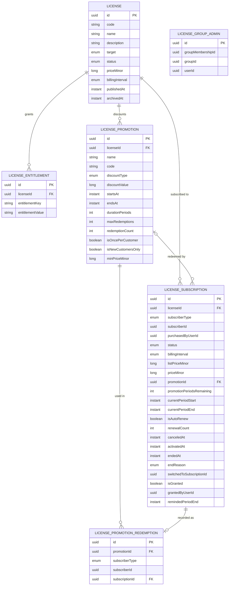

Every record also has `createdAt`, `updatedAt`, `disabledAt` and `deletedAt`.

- **Code** is `UPPER_SNAKE_CASE` and unique among licenses that are not deleted.
- **Target** says who a license is bought for: a `USER` or a `GROUP`.
- **Price** is in minor units of `app.license.currency` (default `EUR`), so `999` is 9.99 EUR.
- **Entitlements** are `UPPER_SNAKE_CASE` keys, one per key per license. A key with a value is a limit (`MAX_GROUPS=10`); a key without one is a flag (`AI_PLANNER`). Keys are free-form, so a new feature needs no change here.

## Lifecycle

```mermaid
stateDiagram-v2
    [*] --> DRAFT: create
    DRAFT --> PUBLISHED: publish
    PUBLISHED --> ARCHIVED: archive
    ARCHIVED --> PUBLISHED: publish
    DRAFT --> [*]: delete
```

- Only `PUBLISHED` licenses are visible to customers and, later, take new subscriptions.
- `ARCHIVED` licenses take no new subscriptions, but existing ones keep running.
- Only drafts can be deleted. Disabling is not used: archiving replaces it.
- Code and target can only change while a license is a draft.
- Price and interval can always change. Subscribers keep the price they subscribed at.
- Entitlements can change unless the license is archived, and they apply to every subscriber at once.

## Promotions

A promotion discounts a license from `startsAt` until `endsAt`, or until further notice if there is no end.

- **Discount:** `AMOUNT` takes `discountValue` minor units off; `PERCENTAGE` takes `discountValue`% off (1 to 100), rounded half up. The result never goes below `minPriceMinor` (default 0), and a floor above the list price never raises it.
- **Code or automatic:** a promotion without a code applies by itself; one with a code only applies when the customer enters it. A valid code replaces the automatic promotion, so a subscription gets at most one. Codes are stored in upper case and are unique per license.
- **No overlap:** the runs of a license's automatic promotions can't overlap, so at most one applies at any moment. Code promotions can run alongside them. Changes lock the license row, so two staff members can't add overlapping runs at once.
- **Duration:** `durationPeriods` is how many billing periods are discounted; none means every period. The discounted price is locked into the subscription when it is created.
- **Limits:** `maxRedemptions` caps how many subscriptions may use it; a redemption is taken in one guarded update, so two subscriptions can't both take the last one. `isOncePerCustomer` refuses a customer with a redemption of it; `isNewCustomersOnly` refuses one who ever had a subscription that started. A signed-in caller's quote checks these too: an automatic promotion they may not use is left out, and such a code is a 422.
- **Freezing:** once redeemed, only a promotion's name, end and max redemptions can change, and it can be ended but not deleted. A promotion that has not started can be deleted but not ended.
- **State** is derived, not stored: `SCHEDULED`, `RUNNING`, `EXHAUSTED` (no redemptions left) or `ENDED`.

Promotions can be added to drafts and published licenses, not to archived ones.

## Subscriptions

A subscription belongs to a subscriber: a user for a `USER` license, a group for a `GROUP` license. Its price and interval are copied from the license, so later changes to the license don't reach it; its entitlements are the license's current ones.

```mermaid
stateDiagram-v2
    [*] --> PENDING_PAYMENT: subscribe
    [*] --> ACTIVE: grant
    PENDING_PAYMENT --> ACTIVE: paid at checkout, or activated by staff
    PENDING_PAYMENT --> ENDED: cancel, or no payment within pending-expiry-hours
    ACTIVE --> ACTIVE: renew at period end
    ACTIVE --> EXPIRED: period ends without auto-renew
    ACTIVE --> ENDED: another subscription activated or granted (SWITCHED)
```

- **One at a time:** a subscriber has at most one `ACTIVE` and at most one `PENDING_PAYMENT` subscription, enforced by partial unique indexes. Subscribing again to the active license is refused; subscribing to another one is a switch.
- **Subscribing** needs a published license. A `GROUP` license needs a `groupId`, and only an admin of that group may subscribe it; a `USER` license takes none. The subscription waits for payment, and any promotion is redeemed at once, so the quoted price holds. The customer pays through Stripe Checkout in [api-payment](../../api-payment/docs/README.md#checkout).
- **Activating** ends the subscriber's active subscription, if any, as `SWITCHED`, pointing at its replacement. It happens in one of two ways:
  - **Paid at checkout:** `PaymentSubscriptionActivatedEvent` from api-payment activates it for the period Stripe billed, with auto-renew on. A payment for a subscription that no longer waits for it is refused with `LicenseSubscriptionActivationRefusedEvent`, so api-payment stops the Stripe subscription and flags a refund. This covers one that was canceled, timed out or activated by staff. A repeated payment event is ignored.
  - **By staff** (`/activate`), e.g. after a bank transfer: the first period starts now with auto-renew off, as nothing bills it, so it expires at the end of the period.
  - Proration of a switch comes in a later phase.
- **Granting** gives a user (`userId`) or a group (`groupId`), matching the license's target, a license for free for 1 to 120 periods, active at once and without auto-renew. It also switches out the active subscription. Drafts can't be granted; archived licenses can.
- **Cancelling** a pending subscription ends it and gives its promotion back. Cancelling an active one turns auto-renew off: it runs to the end of its period, and can be resumed before then. Granted subscriptions don't renew, so they can't be cancelled or resumed.
- **Cancelling and resuming a paid subscription** also reach Stripe: api-payment sets or clears `cancel_at_period_end` there.
- **Extending** pushes the end of an active subscription's period forward by 1 to 3650 days. Subscriptions Stripe bills can't be extended, as Stripe charges the next period on its own date; refund them instead.
- **Renewal:** periods follow the UTC calendar, so a monthly period from 31 January ends on the last day of February. Subscriptions to archived licenses keep renewing.
  - **Granted, or activated by staff:** `SubscriptionRenewalJob` handles them. At the end of a period, one with auto-renew gets the next period, and the others expire.
  - **Billed by Stripe** (`isBilledByStripe`): the job leaves them alone, and Stripe drives them through api-payment's events:
    - `PaymentSubscriptionRenewedEvent`: Stripe charged the next period, which the subscription moves on to, counting down promoted periods. A repeated event changes nothing. A charge for a subscription that is over is refused, as at activation.
    - `PaymentSubscriptionPastDueEvent`: the charge failed and Stripe retries. `pastDueAt` is set and access stays. The next paid renewal clears it.
    - `PaymentSubscriptionEndedEvent`: Stripe ended it, at the end of a canceled period or after its last retry, so it `EXPIRED`.
    - `PaymentSubscriptionRenewalChangedEvent`: auto-renew was turned off or on in Stripe, e.g. from the dashboard or because the user was disabled or deleted. This is applied as a cancel or resume with no actor, so the canceled email still goes out.
- **Promoted periods:** `promotionPeriodsRemaining` starts at the promotion's `durationPeriods` and counts down at each renewal. At 0 the price goes back to the list price the subscription was promised. With a promotion and no count, every period stays discounted.

### Group subscriptions

`api-license` does not ask `api-group` who administers a group: it keeps its own copy of ADMIN memberships in `license_group_admins`, from the `GroupMembership*` events `api-group` sends to the `.license` queues.

- A membership created or updated as `ADMIN` is recorded, by membership ID, so repeated or out-of-order events do no harm. Any other role, and a disabled or deleted membership, is forgotten.
- Group admins can subscribe their group, see its subscriptions, and cancel or resume them. Emails about a group subscription go to whoever bought it; a group grant sends none.
- When a group is disabled or deleted, its admins are forgotten, its active subscription stops renewing and runs out, and a pending one ends.
- The copy only holds memberships changed after `api-license` first started listening, as the `.license` queues did not exist before: memberships older than that need to be replayed, or changed once, to count.

### Jobs

| Job | Every | Does |
|---|---|---|
| `SubscriptionRenewalJob` | `app.license.renewal-interval-ms` (1 min) | renews or expires active subscriptions whose period is over, except those Stripe bills |
| `PendingSubscriptionTimeoutJob` | `app.license.pending-timeout-interval-ms` (10 min) | ends subscriptions waiting for payment longer than `app.license.pending-expiry-hours` (48, `LICENSE_PENDING_EXPIRY_HOURS`), giving their promotion back |
| `RenewalReminderJob` | `app.license.renewal-reminder-interval-ms` (1 h) | publishes `LicenseSubscriptionRenewalDueEvent` for auto-renewals within `app.license.renewal-reminder-days` (3, `LICENSE_RENEWAL_REMINDER_DAYS`), once per period end; granted subscriptions are left out |

All three take batches of 50 rows with `SKIP LOCKED`, up to 20 batches per run, so several instances split the work. Changes to a subscription lock its row, so they and the jobs don't cross.

## Endpoints

| Method and path | Who may call it |
|---|---|
| `GET /api/v1/licenses` | anyone, signed in or not; only staff (Admin, Support, Inspector) see other statuses than `PUBLISHED` and may filter by `status` |
| `GET /api/v1/licenses/{id}` | anyone, signed in or not; a license that is not published is not found for anyone but staff (Admin, Support, Inspector) |
| `GET /api/v1/licenses/{id}/price?code=&groupId=` | anyone, signed in or not, for a license they can see; an unknown, ended, used-up or not yet started code is a 422. Signed in, the caller's own limits apply, or for a group license those of `groupId` if they administer it |
| `POST /api/v1/licenses` | Admin or Support |
| `PUT /api/v1/licenses/{id}` | Admin or Support |
| `PUT /api/v1/licenses/{id}/entitlements` | Admin or Support |
| `POST /api/v1/licenses/{id}/publish`, `POST /api/v1/licenses/{id}/archive` | Admin or Support |
| `DELETE /api/v1/licenses/{id}` | Admin or Support |
| `POST /api/v1/licenses/{licenseId}/promotions` | Admin or Support |
| `GET /api/v1/licenses/{licenseId}/promotions` | Admin, Support or Inspector |
| `GET /api/v1/licenses/{licenseId}/promotions/{id}` | Admin, Support or Inspector |
| `PUT`, `DELETE /api/v1/licenses/{licenseId}/promotions/{id}` | Admin or Support |
| `POST /api/v1/licenses/{licenseId}/promotions/{id}/end` | Admin or Support |
| `POST /api/v1/licenses/subscriptions` | any signed-in user, for themselves or for a group they administer |
| `GET /api/v1/licenses/subscriptions/mine?status=`, `GET /api/v1/licenses/subscriptions/mine/active` | any signed-in user; `active` is a 204 without one |
| `GET /api/v1/licenses/subscriptions/groups/{groupId}?status=`, `GET /api/v1/licenses/subscriptions/groups/{groupId}/active` | the group's admins, Admin, Support or Inspector; `active` is a 204 without one |
| `GET /api/v1/licenses/subscriptions/{id}` | the subscriber or, for a group, its admins; Admin, Support or Inspector |
| `POST /api/v1/licenses/subscriptions/{id}/cancel`, `/resume` | the subscriber or, for a group, its admins; Admin or Support |
| `GET /api/v1/licenses/subscriptions?subscriberId=&licenseId=&status=` | Admin, Support or Inspector |
| `POST /api/v1/licenses/subscriptions/grant` | Admin or Support |
| `POST /api/v1/licenses/subscriptions/{id}/activate`, `/extend` | Admin or Support; `/activate` is for payments made outside Stripe and leaves auto-renew off |

The list is ordered cheapest first and then by name, and can be filtered by `target`. Each license carries its running automatic promotion, if any, and `promotedPriceMinor`, the price with it. Promotions are readable by Admin, Support and Inspector only, as listing them would reveal their codes. The public reads (list, one license, price quote) are listed in `additionalPermitAllMatchers()` and at the gateway, with anonymous authentication on so the policy is still asked, as in [api-platform](../../api-platform/docs/README.md#why-reads-work-without-a-token). `GET /api/v1/licenses/subscriptions` matches the one-segment public pattern too, so without a token it is a 403 from its policy rather than a 401.

## Schema

Flyway's [V1](../src/main/resources/db/migration/V1__create_license_schema.sql) creates the tables in `jobbie_giggle_license`, with the partial unique indexes JPA can't declare (one active and one pending subscription per subscriber, codes unique among rows not deleted); `ddl-auto: validate` then checks them at startup. A database whose tables existed before the migrations is baselined at `V1`, so it skips it; bring it up to date with the steps below.

If its `license_subscriptions` has no reminder column, add it:

```sql
ALTER TABLE license_subscriptions ADD COLUMN reminded_period_end TIMESTAMP(6) WITH TIME ZONE;
```

If it has no billing columns for payments in Stripe, add them:

```sql
ALTER TABLE license_subscriptions
    ADD COLUMN is_billed_by_stripe BOOLEAN NOT NULL DEFAULT FALSE,
    ADD COLUMN past_due_at TIMESTAMP(6) WITH TIME ZONE;
```

## Messages

Published once their transaction commits, so a rollback sends nothing.

| | Message | When |
|---|---|---|
| publishes | `LicenseSubscriptionPendingEvent` | a subscription is created and waits for payment; carries the list price, the first period's price and how many periods the promotion covers, for checkout |
| publishes | `LicenseSubscriptionActivatedEvent` | a subscription starts, by activation or grant; carries the entitlements; to its fanout exchange, which feeds `api-user`, `api-payment` and `api-destination` |
| publishes | `LicenseSubscriptionRenewedEvent` | a subscription moves on to its next period |
| publishes | `LicenseSubscriptionCanceledEvent` | an active subscription stops renewing; `actorId` is null when its group went away or Stripe stopped it; to its fanout exchange, which feeds `api-user` and `api-payment` |
| publishes | `LicenseSubscriptionEndedEvent` | a subscription expires, or ends early (switched, pending canceled or timed out); to its fanout exchange, which feeds `api-user`, `api-payment` and `api-destination` |
| publishes | `LicenseSubscriptionRenewalDueEvent` | an auto-renewal is within `renewal-reminder-days` |
| publishes | `LicenseEntitlementsChangedEvent` | a license's entitlements are replaced |
| publishes | `LicenseCatalogChangedEvent` | a license is published or archived, or a published or archived one is updated; carries its whole state and `changedAt`, for api-payment's Stripe catalog. Drafts are never sent |
| publishes | `LicenseSubscriptionActivationRefusedEvent` | a payment arrived for a subscription that can no longer take it: at activation, or a renewal of one that is over |
| publishes | `LicenseSubscriptionResumedEvent` | a canceled subscription renews again; for api-payment |
| consumes | `GroupMembership*`, `GroupDisabledEvent`, `GroupDeletedEvent` | from `api-group`, on the `.license` queues |
| consumes | `PaymentSubscriptionActivatedEvent` | from `api-payment`, when the first payment went through at checkout or by a switch |
| consumes | `PaymentSubscriptionRenewedEvent`, `PaymentSubscriptionPastDueEvent`, `PaymentSubscriptionEndedEvent`, `PaymentSubscriptionRenewalChangedEvent` | from `api-payment`, for subscriptions Stripe bills |

Each event carries `notifyUserId`, who its emails go to: the user, or for a group whoever bought it (nobody for a group grant). `api-user` consumes the activated, canceled, ended and renewal-due events to send emails, so a service that wants to keep its own copy of entitlements needs its own queues for them, as with the group events.


---

**File: `api-payment/docs/README.md`**

# api-payment

Takes payments for license subscriptions through Stripe, on port **8086**, with data in PostgreSQL (`jobbie_giggle_payment`). It uses the [stripe](../../stripe/docs/README.md) library to call Stripe.

So far it:
- opens Stripe Checkout for subscriptions waiting for payment, or switches a paid subscription with proration, and tells api-license once the first payment is in;
- follows what Stripe does to paid subscriptions: renewals, failed renewals and ends, and carries cancel and resume over to Stripe;
- emails the payer about each payment and each failed renewal;
- records every invoice and refund, lists them for customers, group admins and staff, and refunds for staff;
- compares paid and pending subscriptions with Stripe every day, to repair what a lost webhook missed;
- receives Stripe's webhook and works through the events it stores;
- keeps copies of what it needs from other services: published licenses, subscriptions waiting for payment, user contacts and group admins;
- pushes published licenses to Stripe as Products and Prices.

## In short

Where money changes hands. It sends people to Stripe Checkout to pay for a subscription, follows Stripe as it renews or fails to charge, records every invoice and refund, and checks against Stripe every day that nothing was missed. It tells api-license when a subscription is paid, renewed or over.

**Stack:** Spring Boot (Web, Data JPA, Security), PostgreSQL, RabbitMQ, Stripe (stripe-java through the [stripe](../../stripe/docs/README.md) library: Checkout, Billing, Tax, webhooks).

## User stories

- As a traveller or group admin, I pay for a subscription on Stripe's checkout page, by card, Link, Apple Pay or Google Pay.
- As a payer, I switch to another license and pay only the difference for the rest of the period.
- As a payer, I get an email with the amount after each payment, and one with a link to fix my card when a renewal fails.
- As a payer or group admin, I see my or my group's invoices, with Stripe's PDF.
- As an administrator, I refund all or part of an invoice, optionally ending the subscription.
- As an inspector, I see every Stripe event received and what happened to it, and staff can replay one that failed.

## Main flows

- **Paying at checkout:** see [Checkout](#checkout).
- **Renewals and failed payments:** see [Paid subscriptions](#paid-subscriptions).
- **A payment that arrives too late:** see [When the payment can't be taken](#when-the-payment-cant-be-taken).

## Requirements

- **PAY-1** Every webhook is verified by signature, stored once by its Stripe ID, and processed from that inbox with retries.
- **PAY-2** Checkout opens only for a subscription still waiting for payment. The first payment activates it in api-license for Stripe's period.
- **PAY-3** A payment for a subscription that no longer waits stops the Stripe subscription at once and flags it for refund.
- **PAY-4** Renewals, failed renewals, ends and dashboard changes are passed to api-license. Cancel and resume from api-license reach Stripe.
- **PAY-5** Every invoice and refund is recorded. Refunds never exceed what is left, and a double click makes one refund.
- **PAY-6** A daily reconciliation compares each paid or pending subscription with Stripe and repairs what a lost webhook missed.
- **PAY-7** Published licenses are pushed to Stripe as Products and tax-inclusive Prices.
- **PAY-8** Payment emails go to the payer only, and only to a verified, active account.

---

## Technical reference

The sections below describe how it works.

## Receiving events

```mermaid
sequenceDiagram
    participant S as Stripe
    participant GW as api-gateway
    participant W as StripeWebhookController
    participant DB as payment_stripe_events
    participant J as StripeEventJob
    participant H as StripeEventHandler
    S->>GW: POST /api/v1/payments/webhook
    GW->>W: forward (public route)
    W->>W: check Stripe-Signature
    W->>DB: insert, unless the event ID is stored
    W-->>S: 200 (400 on a bad signature)
    loop every app.payment.event-interval-ms
        J->>DB: lock the oldest due event (SKIP LOCKED)
        J->>H: handle(event)
        J->>DB: PROCESSED, or retry later
    end
```

- **Verify, then store:** the signature covers the raw body, so the controller takes it as a string. A missing, wrong or older-than-5-minute signature gets a 400.
- **Once per event:** a redelivered event is skipped by its Stripe ID (`insert ... on conflict do nothing`), so two deliveries arriving at once both get a 200.
- **Answer at once:** nothing is handled while Stripe waits. A slow handler never makes Stripe time out and redeliver.
- **One transaction per event:** a failing handler rolls back only its own work. The event is retried after 30s, 1m, 2m and so on, up to an hour apart. After `app.payment.event-max-attempts` (10) tries it is `FAILED`.
- **Types nobody handles** are marked `IGNORED`. Each type has at most one `StripeEventHandler` bean, and startup fails on two.
- **Order isn't guaranteed:** Stripe neither orders nor deduplicates deliveries. The job takes the oldest first, but a handler must cope with events arriving out of order, and with seeing one again after a replay.
- **API version:** an event whose `api_version` differs from stripe-java's can't be read into its models. It is set to `FAILED` at once, since retrying won't help. Move the endpoint to the right version, then replay the event.

## Statuses

| Status | Meaning |
|---|---|
| `PENDING` | waiting for its first or next attempt at `next_attempt_at` |
| `PROCESSED` | handled |
| `IGNORED` | no handler for its type |
| `FAILED` | out of attempts, or in an unreadable API version |

## Checkout

```mermaid
sequenceDiagram
    participant C as Client
    participant L as api-license
    participant P as api-payment
    participant S as Stripe
    C->>L: POST /licenses/subscriptions
    L-->>P: LicenseSubscriptionPendingEvent
    C->>P: POST /payments/checkout {subscriptionId}
    P->>S: customer, price, coupon, Checkout Session
    P-->>C: checkoutUrl
    C->>S: pays on the Stripe page
    S->>P: checkout.session.completed (webhook)
    P-->>L: PaymentSubscriptionActivatedEvent (Stripe's period)
    L-->>P: LicenseSubscriptionActivatedEvent
```

`POST /api/v1/payments/checkout {subscriptionId}` returns `{subscriptionId, checkoutUrl, expiresAt, isPaid}`:
- **A page to visit:** `checkoutUrl` is set and `isPaid` is false.
- **Already paid:** `isPaid` is true and there is no page. Either it was paid at an earlier checkout and waits for api-license, or it was paid by [switching](#switching).

- **Who:** the subscriber of a user subscription, or any admin of the group of a group one, from the local copy of group admins.
- **When:**
  - only while the subscription is `PENDING` and before its pending expiry;
  - a `404` before api-license's pending event has arrived;
  - a `409` while the license is still being pushed to Stripe;
  - a `409` once the license is archived, as Stripe sells no inactive product; the subscription then times out.
  - The payer's contact must have arrived from api-user, or it is a `409` too.
- **Reuse:** an open session with more than 5 minutes left is returned again rather than a new one.
- **Customer:** one Stripe Customer per user or per group, made the first time with the payer's email. A user's own customer follows later changes to their email and name; a group's keeps the first payer's. The customer's address and business name come from checkout.
- **Price:** the Stripe Price at the subscription's own list price, which may be older than the license's current one, so subscribers keep the price they were quoted.
- **Promotion:** when the first period is cheaper than the list price, a coupon made for this subscription alone (`subscription_<id>`, one redemption) takes off exactly the difference api-license computed, so its floor and rounding hold. It applies for the promotion's periods (×12 months for yearly licenses), or forever without a count. Stripe's own promotion code box is off.
- **Session:**
  - **Payment methods:** card and Link; cards bring Apple Pay and Google Pay.
  - **Tax:** Stripe Tax, with a required billing address and tax ID collection.
  - **Expiry:** at the subscription's pending expiry, kept within Stripe's 30 minutes to 24 hours.
  - **Metadata:** `licenseSubscriptionId`, on both the session and the Stripe Subscription it creates.

### Stripe events handled

| Event | Does |
|---|---|
| `checkout.session.completed` | when paid (or `no_payment_required`): records the Stripe subscription and customer, reads the paid period, and publishes `PaymentSubscriptionActivatedEvent`. Unpaid ones wait for the next event |
| `checkout.session.async_payment_succeeded` | the same, for a payment that confirmed later |
| `checkout.session.expired` | forgets the session, so the next checkout opens a new one |

Renewals and the rest of a paid subscription's life are under [Paid subscriptions](#paid-subscriptions).

A paid session whose pending event hasn't arrived yet fails and is retried, with the usual backoff. A repeated one is handled once.

### Switching

A subscriber whose active subscription Stripe already bills doesn't get a second Stripe subscription. Instead the one they have is moved to the new price (`switchPrice`):
- **Price:** the new subscription's price and coupon replace the old ones. With no coupon, any old discount is dropped.
- **Period:** a new period starts now (`billing_cycle_anchor` now).
- **Charge:** the unused part of the old period is credited, and the difference is charged at once to the saved card (`proration_behavior=always_invoice`).
- **All or nothing:** `payment_behavior=error_if_incomplete`, so a declined or unconfirmed charge leaves the subscription as it was.

Once the charge goes through:
1. The Stripe subscription moves from the old billing subscription to the new one.
2. `PaymentSubscriptionActivatedEvent` goes out, and api-license switches as usual.
3. The old one's end changes nothing in Stripe, as it holds no Stripe subscription any more.

If Stripe answers `402` (declined, or the card needs the customer), checkout opens a page instead. When that page is paid, the old Stripe subscription is canceled at once, without a credit.

### When the payment can't be taken

Money may come in for a subscription that no longer waits for it: it was canceled, timed out, or activated by staff while the page was open. This is found two ways:
- api-payment sees it ended or active already;
- or api-license refuses the activation (`LicenseSubscriptionActivationRefusedEvent`).

Either way, the Stripe subscription is canceled at once so it never charges again, `refund_due_at` is set, and an error is logged. Staff then refund the invoice, through the API or the dashboard; see [Invoices and refunds](#invoices-and-refunds).

To make this rare, the open session is expired as soon as the subscription ends while pending, or staff activate it.

## Paid subscriptions

Stripe renews what it bills. api-license's renewal job leaves those subscriptions alone and follows these events instead:

| Stripe event | Does |
|---|---|
| `invoice.paid` | emails the payer the amount, tax included, with a link to Stripe's invoice page; nothing is sent for a free invoice. For a renewal (`subscription_cycle`), it reads Stripe's new period and publishes `PaymentSubscriptionRenewedEvent`. A first invoice that arrives before its checkout event is retried |
| `invoice.payment_failed` | for a renewal only: publishes `PaymentSubscriptionPastDueEvent` and emails the payer the amount due, Stripe's next try and a link to pay or change the card. Access stays while Stripe retries, as set in the Stripe dashboard. A later successful retry comes as `invoice.paid` |
| `customer.subscription.deleted` | publishes `PaymentSubscriptionEndedEvent`, and api-license expires the subscription. It doesn't fire for one we stopped ourselves (refund due), or one that was switched away |
| `customer.subscription.updated` | when `cancel_at_period_end` differs from what api-payment last set, e.g. it was changed in the dashboard: records it and publishes `PaymentSubscriptionRenewalChangedEvent` |

Changes the other way:
- **Cancel and resume** in api-license (`LicenseSubscriptionCanceledEvent` on its `.payment` queue, `LicenseSubscriptionResumedEvent`) set or clear `cancel_at_period_end` in Stripe. The flag is recorded first, so the `customer.subscription.updated` it causes isn't sent back.
- **A disabled or deleted user's** paid subscriptions stop at the end of their period. api-license, which doesn't follow users, is told with `PaymentSubscriptionRenewalChangedEvent`.
- **A disabled or deleted group's** subscriptions stop through api-license, which already cancels them.

## Invoices and refunds

Every subscription invoice is recorded in `payment_invoices` from `invoice.paid`, `invoice.payment_failed`, `invoice.voided` and `invoice.marked_uncollectible`. Each record keeps:
- the number, Stripe's status, the total, the tax and the amount paid;
- Stripe's hosted page and PDF;
- for paid invoices, the payment intent that paid it, read from Stripe's invoice payments.

Refunds are made against that payment intent.

- **Staff refund:** `POST /invoices/{id}/refund {amountMinor?, isEndingSubscription?, isRequestedByCustomer?}` refunds part or all of what is left.
  - Without an amount it refunds all that is left; more than that is refused.
  - The idempotency key covers the invoice, the amount refunded so far and this amount, so a double click makes one refund.
  - With `isEndingSubscription`, the Stripe subscription is canceled at once, and Stripe's `customer.subscription.deleted` then expires the subscription in api-license.
- **Dashboard refunds:** `refund.created`, `refund.updated` and `refund.failed` record every refund, whoever made it.
  - A refund is matched to its invoice by our `invoiceId` metadata, or by its payment intent.
  - The invoice's `amount_refunded_minor` counts every refund that went through or is on its way, so a failed or canceled one stops counting.
  - Refunds of payments that are no recorded invoice are skipped.
- **Payments that couldn't be taken** ([above](#when-the-payment-cant-be-taken)): their `refund_due_at` is cleared as soon as a refund of the subscription's invoice is recorded. `GET /subscriptions?isRefundDue=true` lists the ones still waiting.

## Reconciliation

`ReconciliationJob` runs every `app.payment.reconcile-interval-ms` (10 min) and compares each billing subscription with Stripe about once every `app.payment.reconcile-every-hours` (24). It takes those Stripe holds something for: active ones with a Stripe subscription and no refund due, and pending ones with a checkout session. It handles up to 100 per run, one transaction each, with `SKIP LOCKED`.

| Stripe says | Sent on |
|---|---|
| a pending checkout is `complete` and paid | handled as `checkout.session.completed` |
| a pending checkout `expired` | the session is forgotten |
| the subscription is `canceled` or `incomplete_expired` | `PaymentSubscriptionEndedEvent` |
| it is `past_due` or `unpaid` | `PaymentSubscriptionPastDueEvent` |
| otherwise | `PaymentSubscriptionRenewedEvent` with Stripe's period: api-license moves on only if the period is later, and otherwise only clears a past-due mark |
| `cancel_at_period_end` differs from what is recorded | `PaymentSubscriptionRenewalChangedEvent` |

Everything it sends is something its receiver already takes more than once. A comparison that fails is logged, and that subscription waits for its next turn.

Payment emails go to the payer: the user, or for a group the admin who subscribed it. They need a verified email address, and an account that is not disabled or deleted.

## Copies from other services

No HTTP between services, so api-payment keeps what it needs from their events. Each copy copes with repeated and out-of-order events.

| Copy | Table | From | Rules |
|---|---|---|---|
| Licenses | `payment_license_products` | `LicenseCatalogChangedEvent` | the whole state of a published or archived license; an event older than the stored `changedAt` is dropped. Each change queues a Stripe sync |
| Subscriptions waiting for payment | `payment_subscriptions` | `LicenseSubscriptionPendingEvent`, Activated and Ended on `.payment` queues | `PENDING`, then `ACTIVE` or `ENDED`. An activation or end that arrives before the pending event is kept, and the pending event only fills in the details. Grants are never recorded |
| User contacts | `payment_user_contacts` | `UserContactUpdatedEvent`, `UserDisabledEvent`, `UserDeletedEvent` | the latest contact by `changedAt`; disabling and deleting set `disabled_at` and `deleted_at`, which a later contact doesn't clear |
| Group admins | `payment_group_admins` | `GroupMembership*`, `GroupDisabledEvent`, `GroupDeletedEvent` on `.payment` queues | as in `api-license`: ADMIN memberships are kept, any other role or a removed membership or group is forgotten |

The copies only know what happened after the `.payment` queues and the new events exist. Existing users, group admins and published licenses need a replay once: for licenses, updating each published one without changes is enough, as an update republishes it.

## Stripe catalog

`CatalogSyncJob` (every `app.payment.catalog-sync-interval-ms`, 30s) pushes each changed license to Stripe, one transaction per license:

1. **Product:** created with the ID `license_<licenseId>`, so a repeated create finds it, or updated to the stored name, description and tax code. It is active only while the license is published. Archiving it in Stripe stops new checkouts but not existing subscriptions.
2. **Price:** the current price is found by its lookup key `license_<licenseId>_<interval>_<amount>_<currency>`, or created recurring and tax-inclusive (`tax_behavior=inclusive`). It is then made the product's default price. A price change creates a new Price and leaves the old ones, so subscribers keep theirs.
3. **Retries:** a failure is retried after 1m, 2m, 4m and so on, up to an hour apart, and never given up on. `last_sync_error` shows why.

Checkout will ask `CatalogSyncService.ensurePrice` for the Price at a subscription's own list price, which may be an older one.

Metadata on both: `licenseId` and `licenseCode`. Promotions are not synced: each checkout will get its own coupon.

## Endpoints

| Endpoint | Who |
|---|---|
| `POST /api/v1/payments/checkout` | the subscriber, or an admin of the subscribed group |
| `POST /api/v1/payments/webhook` | Stripe only: public, with a signature check |
| `GET /api/v1/payments/invoices/mine?cursor=&limit=` | any signed-in user, for their own subscriptions; newest first |
| `GET /api/v1/payments/invoices/groups/{groupId}?cursor=&limit=` | the group's admins; Admin, Support or Inspector |
| `GET /api/v1/payments/invoices?subscriberId=&licenseSubscriptionId=&status=&page=&pageSize=` | Admin, Support or Inspector |
| `GET /api/v1/payments/invoices/{id}` | the subscriber or, for a group, its admins; Admin, Support or Inspector; with its refunds |
| `POST /api/v1/payments/invoices/{id}/refund` | Admin or Support |
| `GET /api/v1/payments/subscriptions?status=&subscriberId=&isRefundDue=` | Admin, Support or Inspector |
| `GET /api/v1/payments/stripe-events?status=&eventType=&cursor=&limit=` | Admin, Support or Inspector; newest first, without payloads |
| `GET /api/v1/payments/stripe-events/{id}` | Admin, Support or Inspector; with the raw payload |
| `POST /api/v1/payments/stripe-events/{id}/replay` | Admin or Support; only `FAILED` or `IGNORED` events, which go back to `PENDING` with their attempts reset |

A user's or group's invoices and the Stripe events use **cursor pagination** (`cursor`, `limit`; the answer has `nextCursor` and `hasMore`), as both grow at their head while being read. The staff invoice list keeps `page` and `pageSize`, for its page numbers and total.

Stripe can also resend an event from its dashboard. A resend keeps the event ID, so it is skipped as a duplicate; use replay for events stored here.

## Settings

| Property | Env | Default | Meaning |
|---|---|---|---|
| `app.payment.event-interval-ms` | `PAYMENT_EVENT_INTERVAL_MS` | 5000 | pause between runs of the event job |
| `app.payment.event-max-attempts` | `PAYMENT_EVENT_MAX_ATTEMPTS` | 10 | attempts before an event is `FAILED` |
| `app.payment.catalog-sync-interval-ms` | `PAYMENT_CATALOG_SYNC_INTERVAL_MS` | 30000 | pause between runs of the catalog sync |
| `app.payment.product-tax-code` | `PAYMENT_PRODUCT_TAX_CODE` | empty | Stripe Tax code of license products, e.g. `txcd_10103001`; empty uses the account's default |
| `app.payment.checkout-success-url` | `PAYMENT_CHECKOUT_SUCCESS_URL` | `http://localhost:3000/account/subscriptions/{subscriptionId}?checkout=success` | where Stripe sends a customer who paid |
| `app.payment.checkout-cancel-url` | `PAYMENT_CHECKOUT_CANCEL_URL` | `http://localhost:3000/account/subscriptions/{subscriptionId}?checkout=canceled` | where Stripe sends a customer who went back |
| `app.payment.subscription-url` | `PAYMENT_SUBSCRIPTION_URL` | `http://localhost:3000/account/subscriptions/{subscriptionId}` | the subscription's page, linked from payment emails |
| `app.payment.reconcile-interval-ms` | `PAYMENT_RECONCILE_INTERVAL_MS` | 600000 | pause between runs of the reconciliation job |
| `app.payment.reconcile-every-hours` | `PAYMENT_RECONCILE_EVERY_HOURS` | 24 | how often each subscription is compared with Stripe |

The Stripe settings are in the [stripe docs](../../stripe/docs/README.md#settings).

## Running locally

1. Use test-mode keys only. Put `STRIPE_SECRET_KEY=sk_test_...` in your environment.
2. Get the CLI's signing secret, which stays the same for the key, and set it as `STRIPE_WEBHOOK_SECRET`:
   ```bash
   docker compose run --rm stripe-cli listen --print-secret
   ```
3. Start forwarding to the gateway on the host:
   ```bash
   docker compose --profile stripe up -d stripe-cli
   ```
4. Send a test event:
   ```bash
   docker compose run --rm stripe-cli trigger invoice.paid
   ```

Events then show up in `GET /api/v1/payments/stripe-events`; types without a handler are `IGNORED`. Pay with Stripe's test card `4242 4242 4242 4242` on a checkout page to go through the whole flow.

The Stripe CLI uses your account's default API version, unless the CLI is told otherwise (`--latest` or the account setting). If it differs from `2026-10-28.endive`, events are stored but handled ones go `FAILED`.

## Stripe setup

- **Webhook endpoint:** `https://<gateway>/api/v1/payments/webhook`, on API version `2026-10-28.endive`, sending:
  - `checkout.session.completed`, `checkout.session.async_payment_succeeded`, `checkout.session.expired`
  - `invoice.paid`, `invoice.payment_failed`, `invoice.voided`, `invoice.marked_uncollectible`
  - `customer.subscription.updated`, `customer.subscription.deleted`
  - `refund.created`, `refund.updated`, `refund.failed`
- **Stripe Tax:** your tax registrations, and a default tax code or `PAYMENT_PRODUCT_TAX_CODE`.
- **Retries:** a Smart Retries schedule, with the subscription canceled after the last failed try, so past-due subscriptions end.

## Schema

Flyway's [V1](../src/main/resources/db/migration/V1__create_payment_schema.sql) creates the tables and their indexes; `ddl-auto: validate` then checks them at startup. A database whose tables existed before the migrations is baselined at `V1`, so it skips it. `create-databases.sql` only runs on a new postgres volume, so on an existing one also run `CREATE DATABASE jobbie_giggle_payment;`.

## Messages

| | Message | Queue |
|---|---|---|
| consumes | `LicenseCatalogChangedEvent` | `license.catalog.changed.queue` |
| consumes | `LicenseSubscriptionPendingEvent` | `license.subscription.pending.queue` |
| consumes | `LicenseSubscriptionActivatedEvent`, `LicenseSubscriptionEndedEvent` | their `.payment` queues |
| consumes | `LicenseSubscriptionActivationRefusedEvent` | `license.subscription.activation.refused.queue` |
| consumes | `LicenseSubscriptionCanceledEvent`, `LicenseSubscriptionResumedEvent` | `license.subscription.canceled.payment.queue`, `license.subscription.resumed.queue` |
| consumes | `UserContactUpdatedEvent` | `user.contact.updated.queue` |
| consumes | `UserDisabledEvent`, `UserDeletedEvent` | their `.payment` queues |
| consumes | `GroupMembership*`, `GroupDisabledEvent`, `GroupDeletedEvent` | their `.payment` queues |

| publishes | `PaymentSubscriptionActivatedEvent`, `PaymentSubscriptionRenewedEvent`, `PaymentSubscriptionPastDueEvent`, `PaymentSubscriptionEndedEvent`, `PaymentSubscriptionRenewalChangedEvent` | their `payment.subscription.*.queue`, once their transaction commits |
| publishes | `SendEmailRequest` (`LICENSE_PAYMENT_SUCCEEDED`, `LICENSE_PAYMENT_FAILED`) | notification's email queue |


---

**File: `api-platform/docs/README.md`**

# api-platform

Owns the reference data every other part of the product relies on: countries, currencies and languages, on port **8082**. It also stores feature flags.

## In short

The shared reference lists every part of the product relies on: countries, currencies and languages. Apps read them without signing in, for example to fill a country picker. It also stores feature flags.

**Stack:** Spring Boot (Web, Data JPA, Data MongoDB, Security), PostgreSQL, MongoDB, RabbitMQ.

## User stories

- As a visitor on the sign-up or pricing page, I see the lists of countries, currencies and languages without an account.
- As an administrator, I add, correct, disable or delete a country, currency or language.
- As api-destination, I learn about each new or removed country, so that places can be imported under it.
- As a developer, I turn a feature on or off with a flag.

## Main flows

```mermaid
sequenceDiagram
    actor A as Administrator
    participant P as api-platform
    participant D as api-destination
    A->>P: POST /countries (PT, PRT, 620, Portugal)
    P->>P: check the codes are free
    P-->>D: CountryCreatedEvent
    D->>D: copy the country; places can be imported for it
```

## Requirements

- **PLT-1** Countries have unique ISO alpha-2, alpha-3 and numeric codes. Currencies and languages have unique codes. The database enforces it.
- **PLT-2** Reading the lists needs no token; changing them needs Admin or Support.
- **PLT-3** Countries, currencies and languages publish created, disabled and deleted events. api-destination consumes the country events.
- **PLT-4** Feature flags are stored by unique key.

---

## Technical reference

The sections below describe how it works.

## Data

Countries, currencies and languages are in PostgreSQL (`jobbie_giggle_platform`); feature flags are documents in MongoDB.

```mermaid
erDiagram
    COUNTRY }o--o| CURRENCY : "default currency"
    COUNTRY }o--o| LANGUAGE : "default language"
    COUNTRY {
        uuid id PK
        string alpha2
        string alpha3
        string numericCode
        string name
        string callingCode
        decimal standardVatRate
        boolean isEuVatMember
        boolean isEuMember
        boolean isEeaMember
        boolean isSchengenMember
    }
    CURRENCY {
        uuid id PK
        string code
        string name
        string symbol
        enum symbolPosition
        int minorUnits
    }
    LANGUAGE {
        uuid id PK
        string code
        string name
        string nativeName
        boolean isRightToLeft
    }
    FEATURE_FLAG {
        objectid id PK
        string flagKey
        string name
        string description
    }
```

Every record also has `createdAt`, `updatedAt`, `disabledAt` and `deletedAt`. Codes are unique: a currency or language by `code`, a country by each of `alpha2`, `alpha3` and `numericCode`.

## Constraints

The codes the services check before saving are unique in the database too, so two requests at once can't both create a code. Flyway's `V1` creates the tables with these constraints and `V2` seeds every ISO 3166-1 country, the currencies and languages they default to. A database whose tables existed before the migrations is baselined at `V1`, so it gets the seed but not the constraints, and `ddl-auto: validate` doesn't check them; run these by hand. Creating one fails if duplicates already exist, so run the check query first and settle any rows it returns.

```sql
-- Check: each should return no rows.
SELECT alpha2 FROM countries GROUP BY alpha2 HAVING count(*) > 1;
SELECT alpha3 FROM countries GROUP BY alpha3 HAVING count(*) > 1;
SELECT numeric_code FROM countries GROUP BY numeric_code HAVING count(*) > 1;
SELECT code FROM currencies GROUP BY code HAVING count(*) > 1;
SELECT code FROM languages GROUP BY code HAVING count(*) > 1;

CREATE UNIQUE INDEX IF NOT EXISTS uk_country_alpha2 ON countries (alpha2);
CREATE UNIQUE INDEX IF NOT EXISTS uk_country_alpha3 ON countries (alpha3);
CREATE UNIQUE INDEX IF NOT EXISTS uk_country_numeric_code ON countries (numeric_code);
CREATE UNIQUE INDEX IF NOT EXISTS uk_currency_code ON currencies (code);
CREATE UNIQUE INDEX IF NOT EXISTS uk_language_code ON languages (code);
```

## Endpoints

The three resources have the same endpoints, under `/api/v1/platform/countries`, `/currencies` and `/languages`.

| Method and path | Who may call it |
|---|---|
| `GET /{resource}`, `GET /{resource}/{id}` | anyone, signed in or not |
| `POST /{resource}`, `PUT /{resource}` | Admin or Support |
| `DELETE /{resource}/{id}/disable` | Admin or Support |
| `DELETE /{resource}/{id}` | Admin or Support |

A deleted record answers 404 to every endpoint and is left out of lists. Its codes stay taken, as the unique constraints still hold them.

**Feature flags have no endpoints and no service.** They are meant to be managed by administrators directly in the database.

## Why reads work without a token

```mermaid
flowchart LR
    R[GET without token] --> M{permitted matcher?}
    M -->|yes| A[anonymous authentication]
    A --> P["@PreAuthorize: policy.canGetById / canGetAll"]
    P -->|returns true| OK[200]
    M -->|no| X[401]
```

The read routes are listed in `additionalPermitAllMatchers()`, and `anonymousAuthenticationEnabled()` returns `true` so that the policy is still asked.

## Messages

Publishes one event when a country, currency or language is created, disabled or deleted (nine in all), for example `CountryCreatedEvent(countryId, alpha2)`, once its transaction commits, so a rolled-back change sends nothing. Nothing consumes them yet. This service consumes no messages.

## Testing

`mvn test` runs the unit tests, with no Docker: the authorization policies against the shared matrix (`PlatformMatrices`), the services with their collaborators mocked, the MapStruct mappers and the architecture rules. `mvn verify` adds the integration tests, against Postgres and MongoDB in Testcontainers, with Flyway building the schema and Hibernate validating it:

- `CountryApiIT`, `CurrencyApiIT` and `LanguageApiIT` extend `AbstractCrudApiIT` from [test-support](../../test-support), which covers create, read, list, update, disable, delete, 400/404/422 and every role over HTTP. Each adds its own cases: events, defaults, codes taken by seeded or deleted records, and a duplicate the database refuses.
- `SeedMigrationIT` checks the data V2 seeds: counts, memberships, disabled countries and currencies, and that running it again changes nothing.
- `FeatureFlagIT` checks a flag key is unique (PLT-4).

Fixtures use codes ISO leaves to users (alpha-2 `QB`–`QZ` and `X?`, numeric 900–999, currency `QB?`–`QZ?`, language `zz…`), so they never meet the seeded data, and each integration test deletes its rows afterwards. Coverage is enforced: 85% of lines and 75% of branches, unit and integration tests together, excluding DTOs and MapStruct's generated code.


---

**File: `api-gateway/docs/README.md`**

# api-gateway

The single public entry point, on port **8080**. It validates the Firebase token, applies CORS, and forwards each request to the right service, which it finds through Eureka. It is a Spring Cloud Gateway (WebFlux) application and holds no data.

## In short

The one door every request from the apps comes through. It checks that the caller is signed in, then passes the request on to the service that handles it, and gives a quick error rather than hanging when that service is down.

**Stack:** Spring Cloud Gateway (WebFlux), Spring Security OAuth2 resource server (Firebase JWTs), Resilience4j circuit breakers, Eureka client.

## User stories

- As a client app, I call one address for every feature, and open the chat WebSocket through it too.
- As a user, I get a fast error when a service is down, instead of waiting.
- As a visitor, I read public pages (licenses and prices, countries) and answer an invitation without signing in.
- As a developer, I read each service's OpenAPI document through the gateway.
- As Stripe, I deliver webhooks without a token; api-payment checks my signature.

## Main flows

```mermaid
sequenceDiagram
    participant C as Client
    participant GW as api-gateway
    participant E as eureka-server
    participant S as Service
    C->>GW: GET /api/v1/groups/mine + token
    GW->>GW: verify the Firebase token (unless the route is public)
    GW->>E: where is api-group?
    GW->>S: forward, within 60s
    alt service answers
        S-->>C: response
    else down or too slow
        GW-->>C: fallback error
    end
```

## Requirements

- **GW-1** Every route needs a valid Firebase JWT, except the public ones listed under [Security](#security).
- **GW-2** Requests are routed by path prefix to a service instance found through Eureka.
- **GW-3** Each HTTP route has a circuit breaker and a 60-second time limit. The WebSocket route has neither.
- **GW-4** CORS allows only the configured origins.
- **GW-5** Each service's OpenAPI document is reachable at `/<service>/v3/api-docs`; Swagger is public only in local development.

---

## Technical reference

The sections below describe how it works.

## Routing

| Path | Goes to | Notes |
|---|---|---|
| `/api/v1/users/**` | `api-user` | circuit breaker, 60s time limit |
| `/api/v1/platform/**` | `api-platform` | circuit breaker, 60s time limit |
| `/api/v1/groups/**` | `api-group` | circuit breaker, 60s time limit |
| `/api/v1/chats/**` | `api-chat` | circuit breaker, 60s time limit |
| `/api/v1/licenses/**` | `api-license` | circuit breaker, 60s time limit |
| `/api/v1/payments/**` | `api-payment` | circuit breaker, 60s time limit; includes the Stripe webhook |
| `/api/v1/destinations/**` | `api-destination` | circuit breaker, 60s time limit |
| `/ws/chats/**` | `api-chat`, as WebSocket (`lb:ws://`) | no circuit breaker or time limit: they would cut every socket |
| `/api-user/v3/api-docs` | `api-user` `/api-docs` | OpenAPI document |
| `/api-platform/v3/api-docs` | `api-platform` `/api-docs` | OpenAPI document |
| `/api-group/v3/api-docs` | `api-group` `/api-docs` | OpenAPI document |
| `/api-chat/v3/api-docs` | `api-chat` `/api-docs` | OpenAPI document |
| `/api-license/v3/api-docs` | `api-license` `/api-docs` | OpenAPI document |
| `/api-payment/v3/api-docs` | `api-payment` `/api-docs` | OpenAPI document |
| `/api-destination/v3/api-docs` | `api-destination` `/api-docs` | OpenAPI document |

When a service does not answer, the circuit breaker forwards to `/fallback`, which answers 503 Service Unavailable, so clients retry later rather than take it for a missing resource.

```mermaid
flowchart LR
    C[Client] --> GW[api-gateway :8080]
    GW -->|/api/v1/users/**| U[api-user :8081]
    GW -->|/api/v1/platform/**| P[api-platform :8082]
    GW -->|/api/v1/groups/**| G[api-group :8083]
    GW -->|/api/v1/chats/**, /ws/chats| CH[api-chat :8084]
    GW -->|/api/v1/licenses/**| L[api-license :8085]
    GW -->|/api/v1/payments/**| PA[api-payment :8086]
    GW -->|/api/v1/destinations/**| D[api-destination :8087]
    GW -.->|look up instances| E[eureka-server :8761]
```

## Security

Every route needs a valid Firebase JWT except:

| Route | Why it is public |
|---|---|
| `GET /api/v1/platform/countries/**`, `currencies/**`, `languages/**` | reference data |
| `GET /api/v1/licenses`, `GET /api/v1/licenses/*`, `GET /api/v1/licenses/*/price` | the license catalog and price quotes, e.g. for a pricing page |
| `POST /api/v1/groups/invitations/accept`, `/reject` | the invitee may have no account; the token is the proof |
| `/api/v1/users/verify-email` | opened from the verification email |
| `/api/v1/users/forgot-password` | permitted here; no service route behind it yet |
| `/api/v1/payments/webhook`, `/api/v1/payments/webhook/**` | Stripe calls it without a token; `api-payment` checks the Stripe signature |
| `/ws/chats/**` | browsers cannot put a token on the WebSocket handshake; `api-chat` checks the one in the STOMP CONNECT frame |
| `/actuator/health`, `/fallback` | health and fallback; health is the only actuator endpoint exposed, and any other under `/actuator` is refused |

Swagger paths are public only when `app.swagger.public=true` (local development).

A route that is public here must also be public in the service behind it: the service checks the token again.

## Settings

| Property | Default | Meaning |
|---|---|---|
| `app.cors.allowed-origins` | `http://localhost:3000` | origins allowed to call `/api/**` |
| `app.swagger.public` | `false` | open the Swagger paths without a token |

## Testing

`GatewayIT` starts the gateway with a plain HTTP server standing in for every service, found through Spring Cloud's simple discovery client instead of Eureka, and requests carrying test JWTs. It checks that each prefix reaches its service unchanged and the OpenAPI paths are rewritten (GW-2, GW-5), that exactly the public routes pass without a token (GW-1), the CORS preflight for allowed and other origins (GW-4), that a service that is down answers 503 through `/fallback` (GW-3), and that no actuator endpoint but health is reachable. `GatewaySecurityTest` checks the role claim becomes the same authority the services use. `mvn verify` runs both; no Docker is needed. Coverage is enforced: 85% of lines and 75% of branches.

## Adding a service

Add a route (and its Swagger route) in `application.yml`, a `timelimiter` instance, and any public paths in `SecurityConfig`.


---

**File: `notification/docs/README.md`**

# notification

Sends emails and push notifications, on port **8090**. It has no HTTP API. Other services ask for an email by publishing a `SendEmailRequest` to `notification.email.queue`, and this service renders the template and sends it over SMTP. They ask for a push by publishing a `SendPushRequest` to `notification.push.queue`, and this service sends it to every registered device of the recipients through Firebase Cloud Messaging.

## In short

The backend's post office. Other services ask it to send an email of a given type, or a push to some users' phones. It fills in the email template and sends it over SMTP, and sends pushes through Firebase Cloud Messaging to every device each user registered.

**Stack:** Spring Boot, Spring Mail with Thymeleaf templates, MongoDB (device tokens), Firebase Admin SDK (FCM), RabbitMQ.

## User stories

- As a user, I get emails to verify my address, welcome me, reset my password, invite me to a group, follow my support tickets, my subscription and payments, and tell me my itinerary is ready.
- As a user, I get pushes on all my phones for new messages and finished itineraries, and none on a phone I signed out of.
- As a service, I ask for an email by its type with the data it needs, without knowing anything about SMTP or templates.
- As an operator, I find every email that couldn't be sent in the dead-letter queue's log.

## Main flows

- **Sending an email:** see [Flow](#flow).
- **Sending a push:** see [Push notifications](#push-notifications).

## Requirements

- **NTF-1** Each email type has a subject and a template; requests carry the template's data.
- **NTF-2** Mail-server failures are retried three times, and other failures go to the dead-letter queue at once. Failed emails are logged.
- **NTF-3** A device token belongs to one app install and moves with it to another account. Tokens FCM rejects are forgotten.
- **NTF-4** Pushes go out 500 tokens at a time. Only a failure of the whole call is retried, so no device gets a push twice.
- **NTF-5** It has no HTTP API; everything arrives over RabbitMQ.

---

## Technical reference

The sections below describe how it works.

## Flow

```mermaid
sequenceDiagram
    participant S as api-user / api-group
    participant Q as notification.email.queue
    participant L as EmailNotificationListener
    participant E as EmailService
    participant M as SMTP server
    participant D as notification.email.dlq
    S->>Q: SendEmailRequest(type, recipientEmail, templateData)
    Q->>L: deliver
    L->>E: send(request)
    E->>E: render templates/email/<template>.html
    E->>M: send message
    alt mail failure (connection, timeout)
        L-->>Q: retry, up to 3 attempts (2s, 4s)
        L->>D: after the last attempt
    else other failure (bad template, bad data)
        L->>D: at once, no retry
    end
```

`EmailDlqListener` reads the dead-letter queue and logs each failed email for manual follow-up.

## Email types

| `NotificationEmailType` | Template | Subject | Requested by |
|---|---|---|---|
| `EMAIL_VERIFICATION` | `email-verification.html` | Verify your TripHuddle email address | `api-user`, at registration |
| `WELCOME` | `welcome.html` | Welcome to TripHuddle! | `api-user`, after verification |
| `PASSWORD_RESET` | `password-reset.html` | Reset your TripHuddle password | `api-user` |
| `PROFILE_PICTURE_UPDATED` | `profile-picture-updated.html` | Your TripHuddle profile pictures were updated | `api-user` |
| `GROUP_INVITATION` | `group-invitation.html` | You have been invited to a group on TripHuddle | `api-group` |
| `SUPPORT_TICKET_CREATED` | `support-ticket-created.html` | Your TripHuddle support ticket | `api-user`, for a ticket in `api-chat` |
| `SUPPORT_TICKET_REPLIED` | `support-ticket-replied.html` | Support replied to your TripHuddle ticket | `api-user`, for a ticket in `api-chat` |
| `SUPPORT_TICKET_RESOLVED` | `support-ticket-resolved.html` | Your TripHuddle support ticket was resolved | `api-user`, for a ticket in `api-chat` |
| `SUPPORT_TICKET_CLOSED` | `support-ticket-closed.html` | Your TripHuddle support ticket was closed | `api-user`, for a ticket in `api-chat` |
| `LICENSE_SUBSCRIPTION_ACTIVATED` | `license-subscription-activated.html` | Your TripHuddle subscription is active | `api-user`, for a subscription in `api-license` |
| `LICENSE_SUBSCRIPTION_RENEWAL_REMINDER` | `license-subscription-renewal-reminder.html` | Your TripHuddle subscription renews soon | `api-user`, for a subscription in `api-license` |
| `LICENSE_SUBSCRIPTION_CANCELED` | `license-subscription-canceled.html` | Your TripHuddle subscription was canceled | `api-user`, for a subscription in `api-license` |
| `LICENSE_SUBSCRIPTION_EXPIRED` | `license-subscription-expired.html` | Your TripHuddle subscription has ended | `api-user`, for a subscription in `api-license` |
| `LICENSE_PAYMENT_SUCCEEDED` | `license-payment-succeeded.html` | Your TripHuddle payment was received | `api-payment`, for each paid invoice |
| `LICENSE_PAYMENT_FAILED` | `license-payment-failed.html` | We could not renew your TripHuddle subscription | `api-payment`, for a failed renewal |
| `ITINERARY_READY` | `itinerary-ready.html` | Your TripHuddle itinerary is ready | `api-user`, for an itinerary in `api-destination` |

Templates are Thymeleaf files in `src/main/resources/templates/email`. The variables each one needs come from `templateData` in the request.

## Push notifications

Device tokens are stored in MongoDB (`jobbie_giggle_notification`, collection `device_tokens`). Users register them through `api-user`, which publishes `UserDeviceRegisteredEvent` and `UserDeviceUnregisteredEvent`.

```mermaid
sequenceDiagram
    participant CH as api-chat
    participant Q as notification.push.queue
    participant P as PushService
    participant F as Firebase Cloud Messaging
    CH->>Q: SendPushRequest(recipientUserIds, title, body, data)
    Q->>P: deliver
    P->>P: look up the recipients' device tokens
    P->>F: sendEachForMulticast, 500 tokens at a time
    F-->>P: result per token
    P->>P: forget tokens FCM reports UNREGISTERED or INVALID_ARGUMENT
```

- A token belongs to one app install. If another account registers it, it moves to that account.
- Only a failure of the whole FCM call is retried. A retry would push again to every device that already got it, so single tokens failing are not.
- With `firebase.enabled=false`, push requests are logged and dropped.

## Adding an email

1. Add a value to `NotificationEmailType` in the `amqp` module.
2. Add the template file.
3. Add the template name and the subject to the two `switch` statements in `EmailService`.

## Settings

| Property | Meaning |
|---|---|
| `spring.mail.*` | SMTP host, port and account; the password comes from `SMTP_PASSWORD` |
| `RABBITMQ_HOST`, `RABBITMQ_USERNAME`, `RABBITMQ_PASSWORD`, `RABBITMQ_VIRTUAL_HOST` | broker connection |
| `spring.data.mongodb.uri` | where device tokens are stored (`MONGODB_HOST`, `MONGODB_PORT`, `MONGODB_DATABASE`) |
| `firebase.project-id`, `firebase.enabled` (`FIREBASE_ENABLED`) | Firebase project for FCM, and whether to send pushes at all; credentials are the application default ones |

## Testing

`mvn test` runs the unit tests, with no Docker: every email type rendered from its template with the values its senders put in, and again without the optional ones, attachments, pushes in batches of 500 with rejected tokens forgotten (NTF-1, NTF-3, NTF-4), and the architecture rules. `mvn verify` adds `NotificationIT`, against a real RabbitMQ and MongoDB in Testcontainers, with the mail sender and FCM replaced by mocks: emails and pushes taken off their queues, mail-server and FCM failures tried three times and then dead-lettered, failures that will never pass dead-lettered after one try (NTF-2), and device tokens moving between accounts (NTF-3).

Coverage is enforced: 85% of lines and 75% of branches, unit and integration tests together. `FirebaseMessagingConfig` is the only class left out: it needs real Google credentials.


---

**File: `openai/docs/README.md`**

# openai

The AI worker, on port **8088**. Other services send it jobs over amqp; it calls OpenAI and answers each job on the requesting service's own queue. It knows nothing about places, trips or visas: prompts and schemas come with each job. It has no HTTP endpoints.

It also still provides the older `AiTextGenerator` bean (chat completions), described further down, which nothing uses yet.

## In short

The AI worker. Services send it jobs (write this text to this schema, or embed these texts), and it calls OpenAI and answers each job on the asking service's own queue. It knows nothing about places, trips or visas: every job brings its own prompts and schema.

**Stack:** Spring Boot, OpenAI Responses and Embeddings APIs over Spring `RestClient`, RabbitMQ.

## User stories

- As api-destination, I send a job with a system prompt, a user prompt and a JSON schema, and get valid JSON back, with the web pages it cited when I asked for web search.
- As api-destination, I send up to 256 texts and get one embedding for each, in order.
- As an operator, I choose a cheap model for bulk work and a stronger one for itineraries, visas and questions.
- As an operator, I see the tokens each job used, to keep AI spending under control.
- As an operator, I turn the worker off without stopping the services that use it; their jobs fail cleanly.

## Main flows

See [AI jobs](#ai-jobs).

## Requirements

- **AI-1** Text jobs ask for strict JSON when they carry a schema, and use web search when asked. Answers aren't stored at OpenAI.
- **AI-2** The model comes from the job, else from its task's setting, else the default.
- **AI-3** Rate limits, timeouts and server errors are retried with backoff, honouring `Retry-After`. An answer cut short is retried with more room, and a schema job's non-JSON answer is retried.
- **AI-4** Every job gets an answer, `COMPLETED` or `FAILED` with the reason, and the tokens of every attempt.
- **AI-5** Answers go only to registered reply queues, so AI output can't be pushed into another service's queue.
- **AI-6** It has no HTTP API, and runs a set number of jobs at once per instance.

---

## Technical reference

The sections below describe how it works.

## AI jobs

```mermaid
sequenceDiagram
    participant S as Requesting service
    participant Q as ai.text.requested.queue
    participant W as AiWorkerListener
    participant R as AiJobRunner
    participant O as OpenAI
    S->>Q: AiTextRequestedEvent(jobId, replyQueue, task, prompts, schema, isWebSearch)
    Q->>W: one job per consumer thread
    W->>W: reply queue known?
    W->>R: runText
    R->>O: POST /responses
    O-->>R: output, citations, usage
    R->>R: retry if rate-limited, cut short or not JSON
    W-->>S: AiTextCompletedEvent on replyQueue
```

| Request (from `amqp.ai`) | Queue | Answer |
|---|---|---|
| `AiTextRequestedEvent` | `ai.text.requested.queue` | `AiTextCompletedEvent`: `COMPLETED` with the text or JSON, citations, model, tokens and attempts, or `FAILED` with the reason |
| `AiEmbeddingRequestedEvent` (1 to 256 texts) | `ai.embedding.requested.queue` | `AiEmbeddingCompletedEvent`: one vector per text, in order |

- **Text** goes through OpenAI's Responses API (`POST /responses`):
  - **Instructions:** the job's system prompt goes in as instructions, and the user prompt as input.
  - **Not stored:** with `store: false`, OpenAI doesn't keep the answer; the requester does.
  - **JSON:** when a job carries `jsonSchema` and `schemaName`, the answer is asked for as `json_schema` in strict mode. Strict mode needs every property listed in `required` and `additionalProperties: false`. The requester owns the schema.
  - **Web search:** with `isWebSearch`, the `web_search` tool is on. The pages the answer cites come back as `citations`, without repeats, in order of first use.
- **Embeddings** go through `POST /embeddings`, as floats.
- **Models:** the job's `model` if given, else the model configured for its `task`, else the default `integration.openai.model`. The default config sends `itinerary`, `visa-guidance` and `place-question` to a stronger model.
- **Retries:**
  - **Up to `max-attempts` (3):** rate limits (429), timeouts and server errors are retried, with doubling pauses capped at `max-retry-ms`. A `Retry-After` from OpenAI is honoured, within that cap.
  - **Cut short:** an answer cut short at the token limit is retried with twice the room, up to four times the job's limit.
  - **Not JSON:** a schema job whose answer isn't JSON is retried.
  - **Final at once:** a refusal, a 4xx other than those, or a bad request (no prompt, a bad schema name, a schema that isn't JSON).
- **Tokens:** every attempt's tokens are summed into the answer, so requesters can track cost.
- **Never thrown:** a job that can't be done is answered `FAILED`, never thrown. Only failing to publish the answer is retried by the listener, and then goes to `default.dlq`.
- **Disabled:** with `enabled` off or no `api-key`, every job is answered `FAILED` without calling OpenAI.
- **Reply queues:** the worker answers only on queues in `AiQueues.REPLY_QUEUE_NAMES`. A job naming any other queue is logged and dropped, so AI output can't be pushed into another service's queue. A service that sends jobs adds its reply queue there; today those are `api-destination`'s `ai.text.completed.destination.queue` (`AiTextCompletedContract`) and `ai.embedding.completed.destination.queue` (`AiEmbeddingCompletedContract`).
- **Duplicates:** a job delivered twice may call OpenAI twice. Requesters match answers by `jobId` and keep the first.

## Worker settings (`integration.openai.worker`)

| Property | Env | Default | Meaning |
|---|---|---|---|
| `concurrency` | `OPENAI_WORKER_CONCURRENCY` | 4 | jobs run at once per instance, so calls in flight |
| `task-models.<task>` | `OPENAI_MODEL_ITINERARY`, `OPENAI_MODEL_VISA`, `OPENAI_MODEL_QUESTION` | `gpt-4.1` for `itinerary`, `visa-guidance`, `place-question` | the model per task |
| `embedding-model` | `OPENAI_EMBEDDING_MODEL` | `text-embedding-3-small` | the embedding model |
| `max-output-tokens` | | 4000 | default limit on an answer |
| `max-attempts` | | 3 | calls per job |
| `retry-base-ms`, `max-retry-ms` | | 2000, 30000 | first pause and longest pause |
| `read-timeout-seconds` | | 180 | how long to wait for an answer; web search is slow |
| `web-search-tool` | | `web_search` | the Responses API tool type |

`integration.openai.enabled`, `api-key` and `model` now read `OPENAI_ENABLED`, `OPENAI_API_KEY` and `OPENAI_MODEL`.

## The older text generator

### Design

```mermaid
classDiagram
    class AiTextGenerator {
        <<interface>>
        +generateText(GenerateTextRequest) String
    }
    class OpenAiChatCompletionsTextGenerator
    class DisabledAiTextGenerator
    class OpenAiAutoConfiguration
    class OpenAiProperties
    AiTextGenerator <|.. OpenAiChatCompletionsTextGenerator
    AiTextGenerator <|.. DisabledAiTextGenerator
    OpenAiAutoConfiguration ..> OpenAiProperties
    OpenAiAutoConfiguration ..> AiTextGenerator : creates one
```

- `integration.openai.enabled=true`: the bean is `OpenAiChatCompletionsTextGenerator`, which calls `POST {base-url}/chat/completions`.
- Otherwise: the bean is `DisabledAiTextGenerator`, which throws `OpenAiIntegrationException` on every call.

### A generation call

```mermaid
sequenceDiagram
    participant C as Caller
    participant G as OpenAiChatCompletionsTextGenerator
    participant O as OpenAI API
    C->>G: generateText(systemPrompt, userPrompt, existingText, context)
    G->>G: build system and user messages
    G->>O: POST /chat/completions
    O-->>G: choices[0].message.content
    G-->>C: trimmed text
```

`userPrompt` is required. `context` and `existingText` are added to the user message when present. Without a `systemPrompt`, a default writing-assistant prompt is used. Any failure surfaces as `OpenAiIntegrationException`.

## Settings (`integration.openai`)

| Property | Default | Meaning |
|---|---|---|
| `enabled` | `true` in `application.yml` | use the OpenAI client |
| `api-key` | empty | OpenAI API key; required when enabled |
| `model` | `gpt-4o-mini` | model name |
| `base-url` | `https://api.openai.com/v1` | API base URL |
| `temperature` | `0.4` | sampling temperature |
| `max-tokens` | `800` | upper limit of generated tokens |

## Testing

`mvn test` runs the unit tests, with no Docker: what the client sends OpenAI and how it reads answers, citations, refusals, cut answers, embeddings and errors, against mocked HTTP (AI-1, AI-3); the job runner's models, retries, backoff, token growth and failures with a mocked client (AI-2, AI-3, AI-4); the listener's reply-queue check (AI-5); the older text generator: what it sends, its default system prompt and each way an answer fails it, and which generator is wired with OpenAI on or off; the settings' defaults; and the architecture rules. `mvn verify` adds `AiWorkerIT`: jobs go through a real RabbitMQ in Testcontainers to the worker, which calls a fake OpenAI over HTTP and answers on api-destination's reply queues, so the messages are checked end to end, retries and failures included.

Coverage is enforced: 85% of lines and 75% of branches, unit and integration tests together.


---

**File: `stripe/docs/README.md`**

# stripe

A library that holds the Stripe client and webhook verification. It has no endpoints, no port and no data. Only `api-payment` uses it, by importing `StripeConfig`.

## In short

A small library that keeps everything Stripe-specific in one place: the configured client, webhook signature checks, and thin wrappers for customers, checkout, subscriptions, invoices, refunds and the catalogue. api-payment is its only user.

**Stack:** stripe-java 34.1.0, pinned to Stripe API version `2026-10-28.endive`.

## User stories

- As api-payment, I verify that a webhook really comes from Stripe and is recent, before trusting it.
- As api-payment, I create customers and refunds with idempotency keys, so a retry never makes two customers or refunds twice.
- As an operator, I can't start the service with a missing key, a wrong key type, or a Stripe API version the code wasn't written for.

## Requirements

- **STR-1** Webhooks are accepted only with a valid signature within the tolerance.
- **STR-2** Customers and refunds are created with idempotency keys.
- **STR-3** Startup fails without valid keys, or when the configured API version differs from stripe-java's.

---

## Technical reference

The sections below describe how it works.

## What it provides

| Bean | Purpose |
|---|---|
| `StripeClient` | stripe-java's client, built from `integration.stripe.*` |
| `StripeWebhooks` | `verify(payload, signatureHeader)` checks a webhook's signature and age and returns the `Event`; `parse(payload)` reads a stored event back; `isReadable(event)` says whether the event is in the API version the models are made for |

| `StripeCustomerClient` | `create` a customer with an idempotency key; `updateContact` |
| `StripeCheckoutClient` | `retrieve` a session's state; `createSubscriptionSession`: subscription mode, card and Link (cards bring Apple Pay and Google Pay), Stripe Tax, a required billing address saved on the customer, tax ID collection, and either our coupon or no promotion code box; `ensureCoupon` with our own ID, at most one redemption; `expireIfOpen` |
| `StripeSubscriptionClient` | `retrieve` status and current period (read from the item, where the API keeps it now); `cancelNow` without proration or a final invoice; `setCancelAtPeriodEnd`; `switchPrice` to a new price and coupon, starting a new period now and charging the prorated difference at once, all or nothing |
| `StripeInvoiceClient` | `paidPaymentIntentId`: the payment intent that paid an invoice, from its invoice payments |
| `StripeRefundClient` | `create` a refund from a payment intent, with an idempotency key; `of` converts Stripe's refund from an event |
| `StripeCatalogClient` | `upsertProduct` creates a Product with our own ID, or updates it; `ensurePrice` finds a Price by lookup key or creates it, recurring and tax-inclusive; `setDefaultPrice` |

`StripeSignatureException` is thrown for a missing or wrong signature, or one older than the tolerance.

## Settings

| Property | Env | Default | Meaning |
|---|---|---|---|
| `integration.stripe.secret-key` | `STRIPE_SECRET_KEY` | none, required | `sk_...` or `rk_...`; test-mode keys locally |
| `integration.stripe.webhook-secret` | `STRIPE_WEBHOOK_SECRET` | none, required | the endpoint's `whsec_...` signing secret |
| `integration.stripe.api-version` | | none, required | must equal stripe-java's `Stripe.API_VERSION` |
| `integration.stripe.webhook-tolerance-seconds` | | 300 | the oldest a signature may be |
| `integration.stripe.connect-timeout-ms` / `read-timeout-ms` | | 10000 / 30000 | API call timeouts |
| `integration.stripe.max-network-retries` | | 2 | retries of failed calls; stripe-java adds idempotency keys |

Failed API calls throw `StripeIntegrationException`, with Stripe's HTTP status and error code.

Startup fails when a key or secret is missing or has the wrong prefix, or when the API versions differ.

## API version

stripe-java sends the API version it was generated for on every call. Its models only read objects in that version. That makes `stripe.version` in the root pom the API version pin: 34.1.0 is `2026-10-28.endive`.

The webhook endpoint in Stripe must use the same version, because Stripe renders event objects in the endpoint's version. An upgrade therefore means changing the dependency, `integration.stripe.api-version` and the endpoint's version together.


---

**File: `amqp/docs/README.md`**

# amqp

The messaging library shared by every service that talks over RabbitMQ. It holds the broker configuration, the publisher, and the definition of every message: one **event** record and one **contract** class per message.

Services never call each other over HTTP. Everything between them goes through the queues defined here.

## In short

The shared language services speak over RabbitMQ. It defines every message, which queues and exchanges carry it, and how failures are retried, so a publisher and its consumers always agree.

**Stack:** Spring AMQP with RabbitMQ, Jackson JSON messages.

## User stories

- As a service, I publish an event once, and every service that cares receives it on its own queue.
- As a service, I can take the same message twice without harm, and a message I keep failing on ends up in a dead-letter queue instead of blocking the queue.
- As a developer, I add a consumer to an existing event by adding a queue and a binding here, without touching the publisher.
- As a developer, I find every message, its producer and its consumers in one catalogue.

## Requirements

- **MQ-1** Each message is an event record plus a contract class naming its queue, dead-letter queue and, for several consumers, its fanout exchange.
- **MQ-2** One consumer: the message goes to the default exchange with the queue as routing key. Several consumers: one fanout exchange, with a queue per consuming service.
- **MQ-3** Durable queues and exchanges are declared at startup. A binding to a queue no contract lists fails startup.
- **MQ-4** A failing listener is retried three times with growing pauses, then the message goes to a dead-letter queue.
- **MQ-5** Values both ends must agree on, such as `LicenseTarget` and `BillingInterval`, live here, not in each service.

---

## Technical reference

The sections below describe how it works.

## Conventions

- **Event**: a Java record with the data, for example `GroupInvitationAcceptedEvent(groupInvitationId, groupId, email, role)`.
- **Contract**: a class with two constants, the queue name and its dead-letter queue name.
- **Queue names**: `<domain>.<thing>.<action>.queue` and `.dlq`, for example `group.invitation.accepted.queue`.
- **Registration**: each domain has a `*Queues` class listing its queue names. `RabbitMQConfig` declares all of them as durable queues at startup, in whichever service starts first.
- **Publishing**:
  - **One consumer:** `RabbitMQMessageProducer.publish(event, "", queueName)`. The empty exchange is RabbitMQ's default exchange, so the message goes straight to the named queue.
  - **Several consumers:** `publish(event, XxxContract.XXX_EXCHANGE_NAME, "")`.
- **One consumer per queue.** A queue is a work queue, not a topic: if two services listened on the same queue, each message would reach only one of them.
- **Fanout exchanges for several consumers.** An event that several services consume has a durable fanout exchange, `<domain>.<thing>.<action>.exchange`, and one queue per consuming service bound to it.
  - Example: `group.membership.created.exchange` feeds `group.membership.created.queue` (`api-chat`), `.license.queue` (`api-license`) and `.payment.queue` (`api-payment`), all named in `GroupMembershipCreatedContract`.
  - The publisher sends once. `RabbitMQConfig` declares the exchanges and bindings listed in each domain's `*Exchanges` class: `GroupExchanges`, `UserExchanges` and `LicenseExchanges`.
  - It refuses to start if a binding names a queue no `*Queues` class lists.
  - **Exchanges today:** the four group-membership events, group disabled and deleted, user disabled and deleted, and license subscription activated, canceled and ended. Group events and license activated and ended also feed `api-destination`'s `.destination` queues. `destination.itinerary.finished.exchange` (`DestinationExchanges`) feeds `api-chat` and `api-user`, and user deleted feeds `api-destination` too.
- **Adding a consumer** to such an event: add a `XXX_<SERVICE>_QUEUE_NAME` and its DLQ to the contract, list them in the `*Queues` class, bind the queue in the `*Exchanges` class, and listen on it. The publisher doesn't change.
- **Making a single-consumer event fan out:** add the exchange name to the contract, add it to the `*Exchanges` class with the existing queue, and change its publisher to the exchange. The existing consumer keeps its queue.
- **Format**: JSON, through `Jackson2JsonMessageConverter`.
- **Shared types**: a value both ends of a message must agree on lives next to the messages, so services don't each keep a copy. Both travel as their names, so the JSON is unchanged:
  - `license.BillingInterval` (`MONTH`, `YEAR`, with `months()` and `addTo` for UTC calendar periods), typed in `LicenseCatalogChangedEvent` and `LicenseSubscriptionPendingEvent`;
  - `license.LicenseTarget` (`USER`, `GROUP`): who a license is for, and the type of a subscriber. It is typed as `target` and `subscriberType` in every license event.
  - `api-license`, `api-payment` and, for the license emails, `api-user` use them.

## Delivery and failure

```mermaid
flowchart LR
    P[Publisher service] -->|"publish(event, '', queue)"| Q[(queue)]
    Q --> L[Listener]
    L -->|success| Done([done])
    L -->|exception| R{fewer than 3 attempts?}
    R -->|"yes: wait 2s, 4s"| L
    R -->|no| D[(default.dlq)]
```

Listeners that use `simpleRabbitListenerContainerFactory` get this retry policy. The notification service has its own factories that dead-letter to `notification.email.dlq` and `notification.push.dlq` instead.

## Message catalogue

| Domain | Messages | Published by | Consumed by |
|---|---|---|---|
| `notification` | `SendEmailRequest` | `api-user`, `api-group` | `notification` |
| `notification` | `SendPushRequest` | `api-chat` | `notification` |
| `user` | `UserRegisteredEvent`, `UserDisabledEvent`, `UserDeletedEvent` | `api-user` | `api-chat`; Disabled and Deleted go through fanout exchanges, to `api-payment` too, and Deleted to `api-destination` |
| `user` | `UserContactUpdatedEvent`: email, name and whether the email is verified, on registering, verifying and changing them | `api-user` | `api-payment` |
| `user` | `UserDeviceRegisteredEvent`, `UserDeviceUnregisteredEvent` | `api-user` | `notification` |
| `user` | `UserTravelDocumentsUpdatedEvent`: a user's nationalities and residence permits (`ResidencePermitKind`), the whole set with `changedAt` | `api-user` | `api-destination` |
| `user` | `UserProfilePictureUpdatedEvent` | `api-user` | nobody yet |
| `user` | `UserEmailVerifiedEvent` | `api-user` | `api-group` |
| `user` | `UserMatchedToGroupInvitationEvent` | `api-user` | `api-group` |
| `platform` | Country × Created, Disabled, Deleted (3) | `api-platform` | `api-destination` |
| `platform` | Currency, Language × Created, Disabled, Deleted (6) | `api-platform` | nobody yet |
| `group` | Group × Created, Updated, Disabled, Deleted (4) | `api-group` | `api-chat`; Disabled and Deleted through fanout exchanges to `api-license`, `api-payment` and `api-destination` too |
| `group` | GroupMembership × Created, Updated, Disabled, Deleted (4) | `api-group` | `api-chat`, `api-license`, `api-payment` and `api-destination`, through fanout exchanges |
| `group` | GroupInvitation × Created, Updated, Disabled, Deleted, Rejected, Canceled (6) | `api-group` | nobody yet |
| `group` | `GroupInvitationAcceptedEvent` | `api-group` | `api-user` |
| `chat` | ChatMessage × Sent, Edited, Deleted, Disabled, Reported (5) | `api-chat` | nobody yet |
| `chat` | SupportTicket × Created, StatusChanged, Replied (3) | `api-chat` | `api-user` |
| `license` | LicenseSubscription × Activated, Canceled, Ended, RenewalDue (4) | `api-license` | `api-user`; Activated, Canceled and Ended go through fanout exchanges, to `api-payment` too, and Activated and Ended to `api-destination` |
| `license` | `LicenseSubscriptionPendingEvent`: what a subscription waiting for payment must be charged | `api-license` | `api-payment` |
| `license` | `LicenseCatalogChangedEvent`: a published or archived license's whole state | `api-license` | `api-payment` |
| `license` | `LicenseSubscriptionActivationRefusedEvent`: a payment for a subscription that no longer waits for one | `api-license` | `api-payment` |
| `payment` | `PaymentSubscriptionActivatedEvent`: a subscription's first payment went through at checkout or by a switch, with Stripe's period | `api-payment` | `api-license` |
| `payment` | PaymentSubscription × Renewed, PastDue, Ended, RenewalChanged (4): what Stripe did to a subscription it bills | `api-payment` | `api-license` |
| `license` | `LicenseSubscriptionResumedEvent`, and `LicenseSubscriptionCanceledEvent` on a `.payment` queue | `api-license` | `api-payment` |
| `notification` | `SendEmailRequest` for payment emails | `api-payment` | `notification` |
| `ai` | `AiTextRequestedEvent`, `AiEmbeddingRequestedEvent`: AI jobs, each naming its reply queue | any service | `openai` |
| `ai` | `AiTextCompletedEvent`, `AiEmbeddingCompletedEvent`: the answers, on the requester's queue in `AiQueues.REPLY_QUEUE_NAMES` | `openai` | the requester: `api-destination` on `ai.text.completed.destination.queue` and `ai.embedding.completed.destination.queue` |
| `license` | `LicenseSubscriptionRenewedEvent`, `LicenseEntitlementsChangedEvent` | `api-license` | `api-destination` |
| `destination` | `ItineraryFinishedEvent`: an itinerary READY or FAILED, with its travellers and plan link, through a fanout exchange | `api-destination` | `api-chat` (sockets), `api-user` (email) |
| `notification` | `SendPushRequest` for finished itineraries, `SendEmailRequest` `ITINERARY_READY` | `api-destination`, `api-user` | `notification` |

Messages on a queue with no consumer stay there until one is added.

```mermaid
flowchart LR
    U[api-user] -- SendEmailRequest --> N[notification]
    G[api-group] -- SendEmailRequest --> N
    G -- GroupInvitationAccepted --> U
    U -- UserMatchedToGroupInvitation --> G
    U -- UserEmailVerified --> G
    U -- "UserRegistered, Disabled, Deleted" --> CH[api-chat]
    G -- "Group*, GroupMembership*" --> CH
    CH -- SendPushRequest --> N
    CH -- "SupportTicket*" --> U
    G -- "GroupMembership*, GroupDisabled, GroupDeleted" --> L[api-license]
    L -- "LicenseSubscription*" --> U
    L -- "LicenseCatalogChanged, LicenseSubscriptionPending, Activated, Ended" --> PA[api-payment]
    U -- "UserContactUpdated, UserDisabled, UserDeleted" --> PA
    G -- "GroupMembership*, GroupDisabled, GroupDeleted" --> PA
    PA -- "PaymentSubscription*" --> L
    L -- "ActivationRefused, Canceled, Resumed" --> PA
    PA -- SendEmailRequest --> N
    U -- "UserDevice*" --> N
    PL[api-platform] -- reference data events --> X([no consumer yet])
```

## Adding a message

1. Add `XxxEvent` (record) and `XxxContract` (queue and DLQ names) in the domain's package.
2. Add both names to the domain's `*Queues` class.
3. Publish with `RabbitMQMessageProducer`; consume with `@RabbitListener(queues = XxxContract.XXX_QUEUE_NAME, containerFactory = "simpleRabbitListenerContainerFactory")`.


---

**File: `common/docs/README.md`**

# common

Shared building blocks for the API services. It is a library, not a running service: every API service (`api-user`, `api-platform`, `api-group`, `api-chat`, `api-license`, `api-payment`, `api-destination`) depends on it and builds its controllers, services, repositories, mappers and security rules on it.

## In short

The shared toolbox the API services are built from, so they all look and behave the same: base entities, repositories, services and controllers for CRUD, the security setup and per-resource policies, pagination, and one error format.

**Stack:** Spring Boot (Web, Data JPA, Data MongoDB, Security, WebSocket), Firebase Admin SDK, MapStruct, springdoc OpenAPI.

## User stories

- As a developer adding a resource, I extend the base entity, repository, service, controller and mapper, and get create, read, list, update, disable and delete with the usual rules.
- As a developer, I write one authorization policy per resource, and `@PreAuthorize` asks it.
- As a client developer, I get every error in the same `ErrorResponse` shape, and every list in the same paging shape.
- As a developer, I page through a feed with a cursor, using `PageCursor` and `CursorPaginated.of`.

## Requirements

- **CMN-1** Every record has an ID, `createdAt`, `updatedAt`, `disabledAt` and `deletedAt`. Lookups leave out deleted, and where asked disabled, records.
- **CMN-2** Tokens are Firebase JWTs. The `role` claim becomes `ROLE_<ROLE>`, and the caller's platform ID comes from the `userId` claim.
- **CMN-3** Errors map to 400, 403, 404, 422 or 500, with one body shape.
- **CMN-4** Offset pages take `page` and `pageSize` up to 100. Cursor pages take `cursor` and `limit` up to 100.
- **CMN-5** Unique rules are declared on the entity class and enforced in each service's DDL. See [Conventions](#conventions).

---

## Technical reference

The sections below describe how it works.

## What is inside

| Package | Contents |
|---|---|
| `entity` | `BaseJpaEntity`, `BaseMongoDocument`: ID, `createdAt`, `updatedAt`, `disabledAt`, `deletedAt` |
| `repository` | `BaseJpaRepository`, `BaseMongoRepository`: lookups that leave out deleted and/or disabled records |
| `service` | `BaseService`, `BaseJpaService`, `BaseMongoService`: the CRUD contract; `FirebaseUserService` |
| `controller` | `BaseController`, `BaseJpaController`, `BaseMongoController`: the CRUD endpoints |
| `mapper` | `BaseMapper`: entity to and from DTOs (implemented with MapStruct) |
| `security` | `BaseSecurityConfig`, `BaseAuthorizationPolicy`, `BaseStompAuthChannelInterceptor`, `SecurityUtils`, `UserRole`, the Firebase role converter |
| `dto`, `filter` | `Paginated`, `PaginationMetaData`, `PaginationFilter`, `CursorPaginated`, `PageCursor`, `CursorPaginationFilter`, `ErrorResponse` |
| `exception` | `GlobalExceptionHandler` and the shared exceptions |
| `config` | `FirebaseConfig`, `BaseOpenApiConfig`, `BaseWebSocketConfig`, `BaseStorageConfig`, `StompDestinations`, `StompBrokerProperties`, `StorageBucketProperties` |

## The base types

```mermaid
classDiagram
    class BaseController {
        +create()
        +getAll()
        +update()
    }
    class BaseJpaController {
        +getById(UUID)
        +disable(UUID)
        +delete(UUID)
    }
    class BaseMongoController {
        +getById(String)
        +disable(String)
        +delete(String)
    }
    class BaseService {
        +create()
        +getAll()
        +update()
    }
    class BaseJpaService {
        +getEntityById(UUID)
        +getById(UUID)
        +disable(UUID)
        +delete(UUID)
    }
    class BaseMongoService {
        +getEntityById(String)
        +getById(String)
        +disable(String)
        +delete(String)
    }
    class BaseJpaRepository {
        +findByIdAndDeletedAtIsNull()
        +findAllByDeletedAtIsNull()
    }
    class BaseMongoRepository {
        +findByIdAndDeletedAtIsNull()
        +findAllByDeletedAtIsNull()
    }
    BaseController <|-- BaseJpaController
    BaseController <|-- BaseMongoController
    BaseService <|-- BaseJpaService
    BaseService <|-- BaseMongoService
    BaseJpaController ..> BaseJpaService
    BaseMongoController ..> BaseMongoService
    BaseJpaService ..> BaseJpaRepository
    BaseMongoService ..> BaseMongoRepository
```

A resource in a service is one entity plus one class per row above: a controller, a service, a repository, a mapper and an authorization policy.

## How a request is handled

```mermaid
sequenceDiagram
    participant C as Client
    participant F as Security filter chain
    participant Ctl as Controller
    participant P as Authorization policy
    participant S as Service
    participant R as Repository
    C->>F: HTTP request with Firebase JWT
    F->>F: validate token, read role claim
    F->>Ctl: authenticated request
    Ctl->>P: @PreAuthorize("@XxxPolicy.canY(...)")
    P-->>Ctl: allowed or 403
    Ctl->>S: call
    S->>R: read or write
    S-->>Ctl: response DTO
    Ctl-->>C: JSON
```

## Conventions

- **Soft delete and disable.** Nothing is removed from the database. `delete` sets `deletedAt`, `disable` sets `disabledAt`. The base repositories offer six lookups: by ID or all, filtered on `deletedAt`, on `disabledAt`, or on both.
- **Pagination.** Lists take a `PaginationFilter` (`page` from 1, `pageSize` up to 100) and return `Paginated<T>`. A service calls `filter.toPageable()` and `Paginated.of(page, mapper::toResponseList)`. Lists that grow at their head while being read, such as chat messages, take a `CursorPaginationFilter` (`cursor`, `limit` up to 100) and return `CursorPaginated<T>` (`data`, `nextCursor`, `hasMore`) instead, so new items do not shift the pages. So do work queues that shrink while staff page through them. A cursor list orders by its keys with the ID last, e.g. `order by createdAt desc, id desc`, and one query serves every page: `(:isFirst = true or createdAt < :at or (createdAt = :at and id < :id))`, with `PageCursor.FIRST_INSTANT` and `FIRST_ID` standing in on the first page. The service decodes the cursor with `PageCursor.decode(cursor, keyCount)`, fetches `filter.toLimit()` (one row more than the limit), and builds the answer with `CursorPaginated.of(rows, limit, row -> PageCursor.of(row.getCreatedAt(), row.getId()), mapper)`.
- **Unique constraints.** Declared on the entity class, never on a field: `@Table(name = ..., uniqueConstraints = @UniqueConstraint(name = "uk_<entity>_<columns>", columnNames = ...))`, with `_id` left off the column names, e.g. `uk_place_slug` or `uk_place_mark_user_place_kind`. `ddl-auto: validate` doesn't check them, so each one also goes in the service's hand-run DDL. A rule that holds only for some rows, such as those not deleted, is a partial unique index, which JPA can't declare: the entity says so in a comment, and the DDL has the index.
- **Roles.** `UserRole` is `Customer`, `Sales`, `Inspector`, `Support`, `Admin`. The role travels in the Firebase `role` claim and becomes the authority `ROLE_<ROLE>`.
- **Caller identity.** `SecurityUtils.extractUserId` reads the platform user ID from the `userId` claim.
- **Authorization.** Each resource has a policy bean implementing `BaseAuthorizationPolicy`. Disabling is Admin or Support unless a policy says otherwise.
- **Public routes.** A service lists them in `additionalPermitAllMatchers()`. If such a route also has `@PreAuthorize`, the service must return `true` from `anonymousAuthenticationEnabled()`.

## Error responses

`GlobalExceptionHandler` turns exceptions into an `ErrorResponse`:

| Exception | Status |
|---|---|
| `ResourceNotFoundException` | 404 |
| `AccessDeniedException` | 403 |
| `IllegalStateException` (a business rule was broken) | 422 |
| Bean validation failure | 400, with `validationErrors` |


---

**File: `eureka-server/docs/README.md`**

# eureka-server

The service registry, on port **8761**. Every service registers here at startup under its `spring.application.name`, and the gateway asks it where the instances of a service are.

It has no code beyond the application class and no data of its own.

```mermaid
flowchart LR
    U[api-user] -->|register| E[eureka-server :8761]
    P[api-platform] -->|register| E
    G[api-group] -->|register| E
    N[notification] -->|register| E
    O[openai] -->|register| E
    GW[api-gateway] -->|"fetch registry (every 5s)"| E
    GW -->|"lb://API-USER"| U
```

Services reach it at `http://eureka-server:8761/eureka/`. The server does not register with itself and does not fetch a registry.

## In short

The phone book of the backend: every service says where it runs, and the gateway looks them up there.

**Stack:** Spring Cloud Netflix Eureka Server.

## User stories

- As a service, I register at startup under my name, so that the gateway can find me.
- As the gateway, I find a healthy instance of a service by its name.
- As an operator, I run several instances of a service, and requests are spread over them.

## Requirements

- **EUR-1** Services register under `spring.application.name`, and the gateway routes to `lb://<NAME>`.
- **EUR-2** It keeps no other data and needs no database.

## Testing

`EurekaServerIT` starts the registry, registers a service the way a client does, and checks it is listed while the registry lists no instance of itself (EUR-1, EUR-2). There is no coverage gate: the only class is the application, which coverage leaves out.


---

**File: `smoke-tests/docs/README.md`**

# smoke-tests

End-to-end tests of the running system. They talk to the gateway as a client would, read the emails it sends, and never import a service's code or open its database. They also check that every requirement in the READMEs has a test.

## In short

- `mvn test` runs only `TraceabilityTest`. It needs no Docker and no running system.
- `mvn verify -Psmoke` runs the smoke tests against a running stack.
- Each smoke test names the requirements it proves with `@Requirement`. A class that walks one of the root README's end-to-end flows names it with `@Flow`.
- `IntegrationCoverage` lists the requirements that integration tests prove better than a client could: retries, locks, uniqueness in the database. Each entry names the integration tests that prove it, with `@CoveredBy("module:ClassName")`.

## Traceability

`TraceabilityTest` reads every README and collects the requirement IDs: `FR-` and `NFR-` in the root, and each module's own IDs (`PLT-`, `CHT-`, `DST-` and the rest). It also reads the root README's flows. It fails when:

- a test names an ID or a flow no README has;
- a `@CoveredBy` names a test class that doesn't exist in that module.

It writes `target/traceability.md`: every ID, its README, and what proves it. IDs and flows without a test are listed there. They fail the build only with `-Dtraceability.strict=true`, so the suite can grow one flow at a time. Turn strict on once it's complete.

## Running against a local stack

`scripts/smoke-stack.sh start` starts, on this machine:

- the infrastructure from `docker-compose.yml` (Postgres, MongoDB, RabbitMQ, Zipkin) and Mailpit;
- the fake OpenAI in `fakes/fake_openai.py`;
- every service's jar, with environment overrides that replace compose's host names with `localhost`, point emails at Mailpit and AI at the fake, and accept only the Firebase test project's tokens.

`scripts/smoke-stack.sh stop` stops it all and drops the data.

```bash
mvn -DskipTests package
```

```bash
SMOKE_FIREBASE_PROJECT_ID=... GOOGLE_APPLICATION_CREDENTIALS=/path/to/key.json scripts/smoke-stack.sh start
```

```bash
SMOKE_FIREBASE_API_KEY=... GOOGLE_APPLICATION_CREDENTIALS=/path/to/key.json mvn -pl smoke-tests verify -Psmoke
```

| Setting | What it is |
|---|---|
| `SMOKE_FIREBASE_PROJECT_ID` | A Firebase project for tests only. Services accept its tokens and no others. |
| `SMOKE_FIREBASE_API_KEY` | Its web API key. Tests sign users up and in through Firebase's REST API, as the app does. |
| `GOOGLE_APPLICATION_CREDENTIALS` | Its service-account key. api-user sets claims with it, and the tests give staff their role. |
| `STRIPE_SECRET_KEY`, `STRIPE_WEBHOOK_SECRET` | Test mode, for the payment flow. Without them api-payment isn't started. |
| `SMOKE_BASE_URL` | The gateway. The default is `http://localhost:8080`; set it to test a deployment. |
| `SMOKE_MAILPIT_URL` | Mailpit's API. The default is `http://localhost:8025`. |

## What is faked

| Outside | In smoke runs |
|---|---|
| Firebase Auth | The test project, with real tokens |
| Email | Mailpit, read through its API |
| OpenAI | `fake_openai.py`: canned answers in the shape each job's schema asks for, and vectors derived from the text |
| Stripe | Test mode, with the Stripe CLI forwarding signed webhooks |
| FCM | Off; pushes are dropped. `notification`'s integration tests cover them |
| Wikidata, Commons, the visa dataset | Not called. Tests create places directly, and imports are proved by api-destination's integration tests |

## Data

Each test creates its own users and data, with emails starting with `smoke-`, so tests don't depend on each other. Countries use codes ISO leaves to users. On a shared deployment, codes from deleted countries stay taken; sweep that data now and then.

## In CI

`smoke-testing.yml` runs on pull requests into `main`, `e2e-testing` and `live`, on pushes to `main`, nightly, and on demand. A run on demand can take a `base-url` to test a deployment instead of starting the stack. The unit and integration tests run first, and the smoke tests start only if they pass. Without the Firebase secrets (`SMOKE_FIREBASE_PROJECT_ID`, `SMOKE_FIREBASE_API_KEY`, `SMOKE_FIREBASE_CREDENTIALS`), for example on a fork's pull request, the job says so and skips. `SMOKE_STRIPE_SECRET_KEY` adds the payment flow.


---

**File: `docs/testing-strategy.md`**

# Testing strategy

A plan for unit, integration and smoke tests across the services: shared building blocks in a `test-support`
module, the tests themselves in each service, and end-to-end smoke tests in their own module. api-platform is the
worked example. The decisions taken are collected at the end.

## Where we start

- No tests exist yet in any module.
- `common` already builds a test-jar, and six services already depend on it (`<classifier>tests</classifier>`), so
  shared test code has a home.
- `spring-boot-starter-test`, `spring-security-test` and the Testcontainers BOM (1.21.3) are already in the build.
  JaCoCo is in the local Maven cache but not configured.
- Every Postgres service now has Flyway migrations, so integration tests can build the schema exactly as production
  does: Flyway runs on an empty container, then Hibernate's `ddl-auto: validate` checks the entities against it.

## Principles

1. **Two kinds of test, split by name.** `*Test` are unit tests: no Spring context, no Docker, milliseconds each,
   run by Surefire. `*IT` are integration tests: a real Spring context against real Postgres/Mongo/RabbitMQ in
   Testcontainers, run by Failsafe. `mvn test` stays fast, and `mvn verify` runs everything.
2. **Test behaviour through the public seam.** Services are tested through their public methods with their
   collaborators mocked. Controllers, security, validation and persistence are tested together over HTTP, because
   most bugs there sit between the layers (a `@PreAuthorize` expression naming the wrong bean, a 500 where a 409 was
   meant).
3. **Write the generic part once.** Every resource built on `BaseJpaController` / `BaseJpaService` /
   `BaseAuthorizationPolicy` behaves the same for create, get, list, update, disable and delete. That behaviour is
   tested by abstract base tests in `common`. A new resource gets them by extending one class and supplying its
   fixtures, so coverage grows with the code instead of lagging behind it.
4. **Rules the compiler can't enforce become ArchUnit rules.** For example, every endpoint must have `@PreAuthorize`.
   The rules live in `common`, and each service runs them with one line.
5. **One container per kind per JVM.** Containers start once and are shared by every IT in the module. Each test
   cleans up what it wrote, so the suite stays fast as it grows.

## Building blocks in `test-support`

A new module, `test-support`, holds the shared test code as ordinary main-scope code (package
`com.triphuddle.testsupport`). It depends on `common`, `amqp`, `spring-boot-starter-test`, `spring-security-test`,
`spring-boot-testcontainers`, the Testcontainers modules, ArchUnit and Awaitility, so a service adds one
test-scoped dependency and gets all of them. It is the "common" home for testing, in a module of its own because
Maven doesn't pass a test-jar's dependencies on to the modules that use it. `common`'s own tests stay in `common`,
and the services' dependencies on `common`'s test-jar go away.

```xml
<dependency>
    <groupId>com.triphuddle</groupId>
    <artifactId>test-support</artifactId>
    <version>0.0.1-SNAPSHOT</version>
    <scope>test</scope>
</dependency>
```

| Class | What it gives a service |
|---|---|
| `@IntegrationTest` | Meta-annotation: `@SpringBootTest(webEnvironment = MOCK)`, `@AutoConfigureMockMvc`, `@ActiveProfiles("it")`, `@Import(PostgresContainerConfig.class)` |
| `PostgresContainerConfig` | A singleton Postgres container (the project's PostGIS + pgvector image) wired with `@ServiceConnection`; Flyway runs on it at context start |
| `MongoContainerConfig` | The same for MongoDB, for chat, user, platform and notification |
| `TestAuth` | Request post-processors for each role: `TestAuth.admin()`, `TestAuth.user(id)`, `TestAuth.anonymous()`. They go through the real `FirebaseJwtGrantedAuthoritiesConverter`, so role parsing is exercised too |
| `AuthorizationMatrix` + `AbstractAuthorizationPolicyTest<P>` | A service declares who may do what; the base test checks every operation × every role (and anonymous), allowed and denied |
| `AbstractCrudApiIT<C, U, R>` | Every CRUD behaviour over HTTP: 201/200/404/400/401/403/422, pagination, disable, delete, security matrix. A resource supplies fixtures and gets about 25 tests |
| `ArchitectureRules` | ArchUnit rules: endpoints have `@PreAuthorize`, controllers don't touch repositories, entities extend `BaseJpaEntity`, no field injection |
| `JsonAssertions` | Helpers to read `Paginated<R>` and `ErrorResponse` bodies |

| `RecordingMessageProducer` | Replaces `RabbitMQMessageProducer` in API ITs: records instead of sending, with `assertPublished(event, queue)` and `assertNothingPublished()` |
| `RabbitContainerConfig` | A real RabbitMQ container, imported only by messaging ITs, which send a real message and check the listener's effect. That covers JSON serialisation, queue names and the dead-letter setup |

## In each service

```
src/test/java/com/triphuddle/api/<service>/
├── ArchitectureTest.java                  # applies ArchitectureRules
├── fixtures/                              # test data builders: CountryFixtures, ...
├── security/<Resource>AuthorizationPolicyTest.java
├── service/<Resource>ServiceTest.java     # Mockito, business rules and events
├── mapper/<Resource>MapperTest.java       # the generated MapStruct implementation, no Spring
├── api/<Resource>ApiIT.java               # extends AbstractCrudApiIT, plus resource-specific cases
├── repository/<Resource>RepositoryIT.java # only for custom queries (native SQL, @Query)
├── messaging/<Listener>IT.java            # consumers: message in, state and events out
└── migration/MigrationIT.java             # seeds and data migrations (schema is already checked by every IT)
src/test/resources/application-it.yml      # turns off Eureka, Zipkin and anything that dials out
```

## Build changes (root `pom.xml`)

```xml
<build>
  <pluginManagement>
    <plugins>
      <plugin>
        <groupId>org.apache.maven.plugins</groupId>
        <artifactId>maven-failsafe-plugin</artifactId>
        <executions>
          <execution><goals><goal>integration-test</goal><goal>verify</goal></goals></execution>
        </executions>
      </plugin>
      <plugin>
        <groupId>org.jacoco</groupId>
        <artifactId>jacoco-maven-plugin</artifactId>
        <version>0.8.12</version>
        <configuration>
          <excludes>
            <exclude>**/*Application.class</exclude>
            <exclude>**/dto/**</exclude>
            <exclude>**/config/*Properties.class</exclude>
          </excludes>
        </configuration>
        <executions>
          <execution><id>agent-unit</id><goals><goal>prepare-agent</goal></goals></execution>
          <execution><id>agent-it</id><goals><goal>prepare-agent-integration</goal></goals></execution>
          <execution><id>merge</id><phase>verify</phase><goals><goal>merge</goal></goals>
            <configuration>
              <fileSets><fileSet><directory>${project.build.directory}</directory>
                <includes><include>jacoco*.exec</include></includes></fileSet></fileSets>
              <destFile>${project.build.directory}/jacoco-merged.exec</destFile>
            </configuration>
          </execution>
          <execution><id>report</id><phase>verify</phase><goals><goal>report</goal></goals>
            <configuration><dataFile>${project.build.directory}/jacoco-merged.exec</dataFile></configuration>
          </execution>
          <execution><id>gate</id><phase>verify</phase><goals><goal>check</goal></goals>
            <configuration>
              <dataFile>${project.build.directory}/jacoco-merged.exec</dataFile>
              <rules><rule><element>BUNDLE</element><limits>
                <limit><counter>LINE</counter><value>COVEREDRATIO</value><minimum>0.85</minimum></limit>
                <limit><counter>BRANCH</counter><value>COVEREDRATIO</value><minimum>0.75</minimum></limit>
              </limits></rule></rules>
            </configuration>
          </execution>
        </executions>
      </plugin>
    </plugins>
  </pluginManagement>
</build>
```

Also, in the `<dependencyManagement>` of the root `pom.xml`: `com.tngtech.archunit:archunit-junit5`. Each service adds
`spring-boot-testcontainers`, `testcontainers:postgresql` (and `mongodb` / `rabbitmq` as needed) and
`archunit-junit5`, all in test scope. The thresholds are explained under Decisions.

## Worked example: api-platform

api-platform has three JPA resources (Country, Currency, Language) of the same shape, a Mongo document (FeatureFlag),
events for each lifecycle change, public reads with admin-only writes, and a seed migration. It is small enough to
show completely and has every layer the other services have.

### 1. Shared: the authorization matrix (`test-support`)

```java
package com.triphuddle.testsupport.security;

/** The operations every BaseAuthorizationPolicy answers for. */
public enum Operation { CREATE, GET_BY_ID, GET_ALL, UPDATE, DISABLE, DELETE }

/** Who may do what; anyone not listed for an operation must be refused it. */
public final class AuthorizationMatrix {

    private final Map<Operation, Set<Caller>> allowed = new EnumMap<>(Operation.class);

    public static AuthorizationMatrix create() {
        return new AuthorizationMatrix();
    }

    public AuthorizationMatrix allow(Operation operation, Caller... callers) {
        allowed.computeIfAbsent(operation, o -> EnumSet.noneOf(Caller.class)).addAll(List.of(callers));
        return this;
    }

    public AuthorizationMatrix allowEveryone(Operation operation) {
        return allow(operation, Caller.values());
    }

    public boolean isAllowed(Operation operation, Caller caller) {
        return allowed.getOrDefault(operation, Set.of()).contains(caller);
    }
}
```

`Caller` is `ANONYMOUS, USER, ADMIN, SUPPORT, INSPECTOR, SALES`. Each one knows how to build the `Authentication`
it stands for: an `AnonymousAuthenticationToken`, or a `JwtAuthenticationToken` whose authorities come from the real
`FirebaseJwtGrantedAuthoritiesConverter`.

```java
package com.triphuddle.testsupport.security;

/**
 * Checks a policy against its matrix for every operation and caller, allowed and denied alike.
 */
public abstract class AbstractAuthorizationPolicyTest<C, U, P extends BaseAuthorizationPolicy<C, U, UUID>> {

    protected abstract P policy();

    protected abstract AuthorizationMatrix matrix();

    protected abstract C createRequest();

    protected abstract U updateRequest();

    @ParameterizedTest(name = "{0} by {1}")
    @MethodSource("everyOperationAndCaller")
    void answersAsTheMatrixSays(Operation operation, Caller caller) {
        Authentication auth = caller.authentication();
        UUID id = UUID.randomUUID();
        boolean granted = switch (operation) {
            case CREATE -> policy().canCreate(auth, createRequest());
            case GET_BY_ID -> policy().canGetById(auth, id);
            case GET_ALL -> policy().canGetAll(auth);
            case UPDATE -> policy().canUpdate(auth, updateRequest());
            case DISABLE -> policy().canDisable(auth);
            case DELETE -> policy().canDelete(auth, id);
        };
        assertThat(granted).as("%s by %s", operation, caller).isEqualTo(matrix().isAllowed(operation, caller));
    }

    @Test
    void refusesWritesWithoutAuthentication() {
        assertThat(policy().canCreate(null, createRequest())).isFalse();
        assertThat(policy().canUpdate(null, updateRequest())).isFalse();
        assertThat(policy().canDelete(null, UUID.randomUUID())).isFalse();
    }

    static Stream<Arguments> everyOperationAndCaller() {
        return Arrays.stream(Operation.values())
                .flatMap(o -> Arrays.stream(Caller.values()).map(c -> Arguments.of(o, c)));
    }
}
```

### 2. Platform: the policy test (36 cases from about 20 lines)

```java
package com.triphuddle.api.platform.security;

class CountryAuthorizationPolicyTest
        extends AbstractAuthorizationPolicyTest<CreateCountryRequest, UpdateCountryRequest, CountryAuthorizationPolicy> {

    @Override
    protected CountryAuthorizationPolicy policy() {
        return new CountryAuthorizationPolicy();
    }

    @Override
    protected AuthorizationMatrix matrix() {
        return AuthorizationMatrix.create()
                .allowEveryone(GET_BY_ID)
                .allowEveryone(GET_ALL)
                .allow(CREATE, ADMIN, SUPPORT)
                .allow(UPDATE, ADMIN, SUPPORT)
                .allow(DISABLE, ADMIN, SUPPORT)
                .allow(DELETE, ADMIN, SUPPORT);
    }

    @Override
    protected CreateCountryRequest createRequest() {
        return CountryFixtures.createRequest().build();
    }

    @Override
    protected UpdateCountryRequest updateRequest() {
        return CountryFixtures.updateRequest(UUID.randomUUID()).build();
    }
}
```

The matrix doubles as a readable spec of who may do what, matching the "Who may call it" table in the README.

### 3. Platform: test data builders

```java
package com.triphuddle.api.platform.fixtures;

/** Valid countries and requests, to be changed only where a test cares. */
public final class CountryFixtures {

    private static final AtomicInteger SEQ = new AtomicInteger();

    /** A valid request with codes no other call has used, so tests can't collide. */
    public static CreateCountryRequest.CreateCountryRequestBuilder createRequest() {
        int n = SEQ.incrementAndGet();
        return CreateCountryRequest.builder()
                .alpha2(code2(n)).alpha3(code3(n)).numericCode("%03d".formatted(n % 1000))
                .name("Testland " + n).callingCode("+999")
                .standardVatRate(new BigDecimal("19.00"))
                .isEuVatMember(false).isEuMember(false).isEeaMember(false).isSchengenMember(false);
    }

    public static UpdateCountryRequest.UpdateCountryRequestBuilder updateRequest(UUID id) { /* same, with the id */ }

    public static Country entity() { /* a Country with an id and audit timestamps set */ }

    private static String code2(int n) { return "" + (char) ('A' + n / 26 % 26) + (char) ('A' + n % 26); }
    // ...
}
```

The request DTOs get `@Builder(toBuilder = true)` next to their Lombok `@Data`, so a test changes only the field it
cares about: `CountryFixtures.createRequest().alpha2("ro").build()`.

### 4. Platform: the service unit test

Business rules, conflicts and events, with the repository, mapper, other services and producer mocked. The mapper is
the real MapStruct implementation (`Mappers.getMapper`), so a wrong mapping fails here rather than silently.

```java
package com.triphuddle.api.platform.service;

@ExtendWith(MockitoExtension.class)
class CountryServiceTest {

    @Mock CountryRepository countryRepository;
    @Mock CurrencyService currencyService;
    @Mock LanguageService languageService;
    @Mock RabbitMQMessageProducer messageProducer;
    @Spy CountryMapper countryMapper = Mappers.getMapper(CountryMapper.class);
    @InjectMocks CountryService countryService;

    @Nested
    class Create {

        @Test
        void savesTheCountryWithItsDefaultsAndPublishesCreated() {
            Currency eur = CurrencyFixtures.entity("EUR");
            Language fr = LanguageFixtures.entity("fr");
            CreateCountryRequest request = CountryFixtures.createRequest()
                    .defaultCurrencyId(eur.getId()).defaultLanguageId(fr.getId()).build();
            given(currencyService.getEntityById(eur.getId())).willReturn(eur);
            given(languageService.getEntityById(fr.getId())).willReturn(fr);
            given(countryRepository.save(any())).willAnswer(withId());

            CountryResponse response = countryService.create(request);

            assertThat(response.getAlpha2()).isEqualTo(request.getAlpha2());
            assertThat(response.getDefaultCurrencyId()).isEqualTo(eur.getId());
            assertThat(response.getDefaultLanguageId()).isEqualTo(fr.getId());
            then(messageProducer).should().publish(
                    new CountryCreatedEvent(response.getId(), request.getAlpha2()),
                    "", CountryCreatedContract.COUNTRY_CREATED_QUEUE_NAME);
        }

        @Test
        void leavesDefaultsEmptyWhenNotGiven() { /* no currency/language lookups happen */ }

        @ParameterizedTest
        @EnumSource(CountryCode.class) // ALPHA2, ALPHA3, NUMERIC
        void refusesACodeAlreadyTaken(CountryCode taken) {
            CreateCountryRequest request = CountryFixtures.createRequest().build();
            taken.stubExists(countryRepository, request);

            assertThatThrownBy(() -> countryService.create(request))
                    .isInstanceOf(IllegalStateException.class)
                    .hasMessageContaining(taken.value(request));
            then(countryRepository).should(never()).save(any());
            then(messageProducer).shouldHaveNoInteractions();
        }

        @Test
        void failsWhenTheDefaultCurrencyDoesNotExist() {
            // currencyService throws ResourceNotFoundException -> nothing saved, nothing published
        }
    }

    @Nested
    class Update {
        @Test void appliesTheChangesAndPublishesNothing() { }
        @Test void allowsKeepingItsOwnCodes() { /* existsBy...AndIdNot is asked with its own id */ }
        @ParameterizedTest @EnumSource(CountryCode.class) void refusesACodeTakenByAnother(CountryCode taken) { }
        @Test void failsForAnUnknownId() { }
    }

    @Nested
    class DisableAndDelete {
        @Test void disableStampsDisabledAtAndPublishesDisabled() { }
        @Test void deleteStampsDeletedAtAndPublishesDeleted() { }
        @Test void bothFailForAnUnknownId() { }
        @Test void aDeletedCountryIsNotFoundForReadUpdateDisableAndDelete() { /* decided: deleted is gone */ }
    }

    @Test
    void getAllAsksForTheRequestedPage() {
        // PaginationFilter(page 2, size 10) -> PageRequest.of(1, 10); maps the content and metadata
    }
}
```

### 5. Shared: the CRUD API base (`test-support`)

```java
package com.triphuddle.testsupport.api;

/**
 * Everything a BaseJpaController resource does over HTTP, against the real stack: security, validation, service,
 * Flyway schema and Postgres. A resource extends it and supplies fixtures.
 */
@IntegrationTest
public abstract class AbstractCrudApiIT<C, U, R> {

    @Autowired protected MockMvc mvc;
    @Autowired protected ObjectMapper json;

    /** e.g. "/api/v1/platform/countries" */
    protected abstract String basePath();

    protected abstract AuthorizationMatrix matrix();

    /** A valid create request, unique on every call. */
    protected abstract C validCreate();

    /** A valid update of the resource with this id. */
    protected abstract U validUpdate(UUID id);

    /** Requests that must be refused with 400, each named by what is wrong with it. */
    protected abstract Map<String, C> invalidCreates();

    /** A create that clashes with an existing resource, given that resource's create; empty if none can. */
    protected abstract Optional<C> clashingCreate(C existing);

    protected abstract UUID idOf(R response);

    protected abstract Class<R> responseType();

    // --- happy path ----------------------------------------------------------------------------------------------

    @Test
    void createsThenReadsBackTheSameResource() throws Exception {
        R created = create(validCreate());
        R read = get(idOf(created), Caller.ADMIN);
        assertThat(read).usingRecursiveComparison().isEqualTo(created);
    }

    @Test
    void updatesAResource() throws Exception {
        R created = create(validCreate());
        U update = validUpdate(idOf(created));
        mvc.perform(put(basePath()).with(Caller.ADMIN.request()).contentType(JSON).content(json.writeValueAsBytes(update)))
                .andExpect(status().isOk());
        assertUpdated(get(idOf(created), Caller.ADMIN), update);
    }

    @Test
    void listsPageByPage() throws Exception {
        for (int i = 0; i < 3; i++) create(validCreate());
        mvc.perform(get(basePath()).param("page", "1").param("pageSize", "2").with(Caller.ADMIN.request()))
                .andExpect(status().isOk())
                .andExpect(jsonPath("$.content.length()").value(2))
                .andExpect(jsonPath("$.metaData.totalElements").value(greaterThanOrEqualTo(3)));
    }

    @Test void disableStampsDisabledAt() throws Exception { /* 200, disabledAt set */ }
    @Test void deleteStampsDeletedAt() throws Exception { /* 200, deletedAt set */ }
    @Test void aDeletedResourceIs404EverywhereAndLeavesTheList() throws Exception { }

    // --- failures -----------------------------------------------------------------------------------------------

    @Test void unknownIdIs404ForRead() throws Exception { /* GET /{random} -> 404 ErrorResponse */ }
    @Test void unknownIdIs404ForUpdateDisableDelete() throws Exception { }
    @Test void malformedIdIs400() throws Exception { /* GET /not-a-uuid -> 400 */ }

    @TestFactory
    Stream<DynamicTest> invalidCreatesAre400() {
        return invalidCreates().entrySet().stream().map(e -> dynamicTest(e.getKey(), () ->
                mvc.perform(post(basePath()).with(Caller.ADMIN.request()).contentType(JSON)
                                .content(json.writeValueAsBytes(e.getValue())))
                        .andExpect(status().isBadRequest())));
    }

    @Test
    void clashingCreateIs422() throws Exception {
        C first = validCreate();
        create(first);
        Assumptions.assumeTrue(clashingCreate(first).isPresent());
        mvc.perform(post(basePath()).with(Caller.ADMIN.request()).contentType(JSON)
                        .content(json.writeValueAsBytes(clashingCreate(first).get())))
                .andExpect(status().isUnprocessableEntity());
    }

    @Test void paginationOutOfRangeIs400() throws Exception { /* page=0, pageSize=101 */ }

    // --- security, from the same matrix as the policy test -------------------------------------------------------

    @ParameterizedTest(name = "{0} by {1}")
    @MethodSource("com.triphuddle.testsupport.security.AuthorizationMatrix#everyOperationAndCaller")
    void httpAnswersAsTheMatrixSays(Operation operation, Caller caller) throws Exception {
        R existing = create(validCreate());
        int status = perform(operation, idOf(existing), caller).andReturn().getResponse().getStatus();
        if (matrix().isAllowed(operation, caller)) {
            assertThat(status).as("%s by %s", operation, caller).isBetween(200, 299);
        } else {
            // Anonymous callers are refused with 401 where the route isn't public, 403 where the policy refuses them.
            assertThat(status).as("%s by %s", operation, caller).isIn(401, 403);
        }
    }

    /** Override to check the fields an update changed. */
    protected void assertUpdated(R after, U update) { }

    // create(..), get(..), perform(..) helpers omitted
}
```

### 6. Platform: the API IT

```java
package com.triphuddle.api.platform.api;

class CountryApiIT extends AbstractCrudApiIT<CreateCountryRequest, UpdateCountryRequest, CountryResponse> {

    @Override protected String basePath() { return "/api/v1/platform/countries"; }
    @Override protected AuthorizationMatrix matrix() { return PlatformMatrices.REFERENCE_DATA; }
    @Override protected CreateCountryRequest validCreate() { return CountryFixtures.createRequest().build(); }
    @Override protected UpdateCountryRequest validUpdate(UUID id) { return CountryFixtures.updateRequest(id).name("Renamed").build(); }
    @Override protected UUID idOf(CountryResponse r) { return r.getId(); }
    @Override protected Class<CountryResponse> responseType() { return CountryResponse.class; }

    @Override
    protected Map<String, CreateCountryRequest> invalidCreates() {
        return Map.of(
                "lower-case alpha2", CountryFixtures.createRequest().alpha2("ro").build(),
                "four-letter alpha3", CountryFixtures.createRequest().alpha3("ROUX").build(),
                "numeric code with letters", CountryFixtures.createRequest().numericCode("6A2").build(),
                "blank name", CountryFixtures.createRequest().name(" ").build(),
                "VAT with three decimals", CountryFixtures.createRequest().standardVatRate(new BigDecimal("19.001")).build(),
                "negative VAT", CountryFixtures.createRequest().standardVatRate(new BigDecimal("-1")).build(),
                "missing EU flag", CountryFixtures.createRequest().isEuMember(null).build());
    }

    @Override
    protected Optional<CreateCountryRequest> clashingCreate(CreateCountryRequest existing) {
        return Optional.of(CountryFixtures.createRequest().alpha2(existing.getAlpha2()).build());
    }

    @Override
    protected void assertUpdated(CountryResponse after, UpdateCountryRequest update) {
        assertThat(after.getName()).isEqualTo("Renamed");
    }

    // --- what only countries do ----------------------------------------------------------------------------------

    @Autowired RecordingMessageProducer published;

    @Test
    void createPublishesCountryCreated() throws Exception {
        CountryResponse created = create(validCreate());
        published.assertPublished(new CountryCreatedEvent(created.getId(), created.getAlpha2()),
                CountryCreatedContract.COUNTRY_CREATED_QUEUE_NAME);
    }

    @Test
    void aCreateThatFailsAtCommitPublishesNothing() throws Exception {
        // Two concurrent creates of one alpha2: the loser fails on uk_country_alpha2 at commit, so only the winner's
        // CountryCreatedEvent may be recorded (NFR-4: events go out after commit).
    }

    @Test
    void linksItsDefaultCurrencyAndLanguage() throws Exception {
        // create a currency and a language through their APIs, then a country pointing at them; read it back
    }

    @Test
    void anUnknownDefaultCurrencyIs404AndCreatesNothing() throws Exception { }

    @Test
    void readsArePublicWithoutAToken() throws Exception {
        mvc.perform(get(basePath()).param("page", "1").param("pageSize", "10")).andExpect(status().isOk());
    }
}
```

`CurrencyApiIT` and `LanguageApiIT` are the same 30 or so lines each. Adding a resource means adding one class like
this, and it arrives with about 25 generic tests plus its own.

### 7. Platform: the seed migration IT

The schema itself needs no test of its own: every IT context runs Flyway and `ddl-auto: validate` against it. What
needs a test is the data in V2.

```java
package com.triphuddle.api.platform.migration;

@IntegrationTest
class SeedMigrationIT {

    @Autowired JdbcTemplate jdbc;

    @Test
    void seedsEveryIsoCountryCurrencyAndLanguage() {
        assertThat(count("countries")).isEqualTo(249);
        assertThat(count("currencies")).isEqualTo(153);
        assertThat(count("languages")).isEqualTo(77);
    }

    @Test
    void everyCountryButAntarcticaHasADefaultCurrencyAndLanguage() {
        assertThat(jdbc.queryForList("select alpha2 from countries where default_currency_id is null or "
                + "default_language_id is null", String.class)).containsExactly("AQ");
    }

    @Test
    void membershipsMatchTheTreaties() {
        assertThat(alpha2Where("is_eu_member")).hasSize(27).contains("BG", "HR").doesNotContain("GB");
        assertThat(alpha2Where("is_eea_member")).hasSize(30).contains("IS", "LI", "NO");
        assertThat(alpha2Where("is_schengen_member")).hasSize(29).contains("CH").doesNotContain("IE", "CY");
    }

    @Test
    void disablesTheUnservedCountriesAndOnlyTheirUnsharedCurrencies() {
        assertThat(alpha2Where("disabled_at is not null")).hasSize(59).contains("RU", "PS", "NG", "EH")
                .doesNotContain("MA", "EG", "ET", "MG", "CV");
        assertThat(codesWhere("currencies", "disabled_at is not null")).contains("XOF", "XAF", "RUB")
                .doesNotContain("MAD", "ILS", "EUR", "USD");
    }

    @Test
    void reRunningTheSeedChangesNothing() { /* run V2 again through Flyway's resource; counts unchanged */ }
}
```

Because the API ITs share the database with the seed, their fixtures use codes no real country has (`QA`–`QZ`, `XA`–`XZ`
are user-assigned in ISO 3166). That's also why `CountryFixtures` generates unique codes.

### 8. Platform: mapper, Mongo and architecture

```java
class CountryMapperTest {
    private final CountryMapper mapper = Mappers.getMapper(CountryMapper.class);

    @Test void mapsTheMembershipFlagsBothWays() { /* isEuMember <-> euMember, the Lombok boolean trap */ }
    @Test void exposesDefaultIdsButNeverTakesEntitiesFromRequests() { }
    @Test void updateLeavesIdAndAuditFieldsAlone() { }
}

@DataMongoTest
@Import(MongoContainerConfig.class)
class FeatureFlagRepositoryIT {
    @Test void flagKeyIsUnique() { /* second save with the same key -> DuplicateKeyException */ }
}

@AnalyzeClasses(packages = "com.triphuddle.api.platform")
class ArchitectureTest {
    @ArchTest static final ArchTests rules = ArchTests.in(ArchitectureRules.class);
}
```

The rule that earns its keep:

```java
public static final ArchRule ENDPOINTS_ARE_AUTHORIZED = methods()
        .that().areDeclaredInClassesThat().areAnnotatedWith(RestController.class)
        .and().arePublic()
        .and().areAnnotatedWith(GetMapping.class).or().areAnnotatedWith(PostMapping.class)
        .or().areAnnotatedWith(PutMapping.class).or().areAnnotatedWith(DeleteMapping.class)
        .should().beAnnotatedWith(PreAuthorize.class)
        .because("an endpoint without @PreAuthorize is open to anyone the filter chain lets through");
```

### What api-platform ends up with

| Class | Covered by |
|---|---|
| `CountryService`, `CurrencyService`, `LanguageService` | `*ServiceTest` (every branch), `*ApiIT` (wired) |
| `*Controller` | `*ApiIT` |
| `*AuthorizationPolicy` | `*AuthorizationPolicyTest` (every role), `*ApiIT` (through HTTP) |
| `*Mapper` (generated) | `*MapperTest`, and the service tests through `@Spy` |
| `*Repository` derived queries | `*ApiIT` conflict tests on real Postgres |
| `SecurityConfig` public matchers | `readsArePublicWithoutAToken`, matrix ITs as anonymous |
| `GlobalExceptionHandler` (common) | 400/404/422 cases in the ITs, plus its own unit test in `common` |
| V1, V2 migrations | every IT context (schema), `SeedMigrationIT` (data) |
| `FeatureFlag` | `FeatureFlagRepositoryIT` |

Expected: above 90% lines and 80% branches for api-platform, with about 15 test classes, most of them short.

## Smoke tests: every flow and requirement, end to end

The third layer, after unit and integration tests. Unit tests and ITs prove each service on its own, with
RabbitMQ faked or contained. Smoke tests prove the system: the real services from `docker-compose`, talking through
the real gateway, RabbitMQ, Postgres, Mongo and the notification service. Each one walks a flow or requirement the
READMEs describe, as a client would.

### What they cover

The READMEs already number what the system must do, so the smoke suite can be checked against them:

| Source | IDs | Examples |
|---|---|---|
| Root README, "End-to-end flows" | 5 flows | Joining a group by invitation; Subscribing and paying; Planning a trip; Checking visas; Getting help from support |
| Root README, "Software requirements" | FR-1 to FR-28, NFR-1 to NFR-11 | FR-6 one pending invitation per email and group; NFR-1 every request needs a token |
| Each service's README | 82 IDs across 14 modules | PLT-1 to PLT-4, GRP-1 to GRP-5, DST-1 to DST-10, … |

Each test says which IDs it proves. A traceability check reads every README, collects the IDs, and fails the build
when one has no test or when a test names an ID no README has. So a new requirement written in a README shows up as
a failing build until someone tests it, and a requirement removed from a README takes its stale test with it.

Some requirements aren't observable end to end: NFR-5's `SKIP LOCKED` sharing, or "a failed message is retried
three times". Those are marked `@CoveredBy(SomeIT.class)` with the integration test that proves them, so the
traceability report still accounts for every ID.

### Where they live

A new module, `smoke-tests`, that depends on nothing but `amqp` (for the event classes) and test libraries. It is a
black box: it never imports a service's classes or reads a service's database. It talks HTTP and STOMP to the
gateway, and reads what the outside world would see: Mailpit for emails, a fake push sink, Stripe test mode.

```
smoke-tests/src/test/java/com/triphuddle/smoke/
├── support/
│   ├── SmokeTest.java            # meta-annotation: tag "smoke", stack started, clients injected
│   ├── Stack.java                # starts docker-compose (or points at a running deployment by env var)
│   ├── Actors.java               # creates real users per test: admin, support, customers
│   ├── GatewayClient.java        # REST client through the gateway, one per actor
│   ├── StompClient.java          # real-time events
│   ├── Mailbox.java              # Mailpit's API: await an email, follow its link
│   ├── Requirement.java          # @Requirement({"FR-6", "GRP-2"})
│   ├── Flow.java                 # @Flow("Joining a group by invitation")
│   └── CoveredBy.java            # @CoveredBy(GroupInvitationApiIT.class) for what only an IT can prove
├── flows/                        # one class per root-README flow
│   ├── JoiningAGroupByInvitationSmokeTest.java
│   ├── SubscribingAndPayingSmokeTest.java
│   ├── PlanningATripSmokeTest.java
│   ├── CheckingVisasSmokeTest.java
│   └── GettingHelpFromSupportSmokeTest.java
├── requirements/                 # one class per service, for its own IDs
│   ├── PlatformSmokeTest.java
│   ├── GroupSmokeTest.java
│   └── ...
└── TraceabilityTest.java         # every README ID has a test, every tested ID is in a README
```

### What one looks like

```java
@SmokeTest
@Flow("Joining a group by invitation")
class JoiningAGroupByInvitationSmokeTest {

    @Autowired Actors actors;
    @Autowired Mailbox mailbox;

    @Test
    @Requirement({"FR-5", "FR-6", "FR-7", "FR-2", "GRP-1", "CHT-2", "NTF-1"})
    void anInviteeWhoSignsUpBecomesAMemberAndJoinsTheGroupChat() {
        Actor admin = actors.verifiedUser();
        GroupResponse group = admin.groups().create("Lisbon 2027");

        String email = actors.freshEmail();
        admin.groups().invite(group.getId(), email);

        Email invitation = mailbox.awaitEmail(email, "invited you to");
        Actor invitee = actors.signUp(email);                           // Firebase sign-up, as the app does it
        invitee.followLink(mailbox.awaitEmail(email, "Verify").link()); // FR-2
        invitee.followLink(invitation.link());

        await().atMost(Duration.ofSeconds(20)).untilAsserted(() -> {
            assertThat(admin.groups().members(group.getId())).extracting("userId").contains(invitee.userId());
            assertThat(invitee.chat().conversations()).extracting("groupId").contains(group.getId());
        });
    }

    @Test
    @Requirement("FR-6")
    void aSecondPendingInvitationForTheSameEmailIsRefused() {
        Actor admin = actors.verifiedUser();
        GroupResponse group = admin.groups().create("Porto");
        String email = actors.freshEmail();
        admin.groups().invite(group.getId(), email);

        assertThat(admin.groups().inviteRaw(group.getId(), email).statusCode()).isEqualTo(422);
    }
}
```

And for api-platform, the requirements that only the running system shows:

```java
@SmokeTest
class PlatformSmokeTest {

    @Test
    @Requirement({"PLT-2", "NFR-1"})
    void listsAreReadableWithoutATokenButChangesNeedAdminOrSupport() {
        assertThat(Anonymous.get("/api/v1/platform/countries?page=1&pageSize=5").statusCode()).isEqualTo(200);
        assertThat(actors.verifiedUser().platform().createCountryRaw(validCountry()).statusCode()).isEqualTo(403);
        assertThat(actors.support().platform().createCountryRaw(validCountry()).statusCode()).isEqualTo(201);
    }

    @Test
    @Requirement("PLT-3")
    void aCountryCreatedHereReachesApiDestination() {
        CountryResponse country = actors.admin().platform().createCountry(validCountry());
        await().untilAsserted(() ->
                assertThat(actors.admin().destination().countries()).extracting("alpha2").contains(country.getAlpha2()));
    }

    @Test
    @CoveredBy({CountryApiIT.class, SeedMigrationIT.class})
    @Requirement({"PLT-1", "PLT-4"})
    void uniquenessIsProvedByTheIntegrationTests() { }
}
```

### Running them

- **Locally:** `mvn -pl smoke-tests verify -Psmoke`. This starts the stack with Testcontainers' `ComposeContainer`
  from `docker-compose.yml` plus a `docker-compose.smoke.yml` override that swaps in the fakes below. Expect minutes,
  not seconds.
- **Against a deployment:** `SMOKE_BASE_URL=https://staging… mvn -pl smoke-tests verify -Psmoke`. The same tests run
  against staging after each deploy, and a red result blocks promotion.
- **In CI:** after unit tests and ITs pass: on pull requests into `live`, `main` and `e2e-testing`, on pushes to
  `main`, nightly, and manually. See CI below.

### What gets faked, and how

| External | In smoke tests |
|---|---|
| Firebase Auth | A separate Firebase test project: `Actors` creates users through the Admin SDK, sets their `role` and `userId` claims, and signs in for real tokens. The services accept that project's issuer only under a `smoke` profile |
| Stripe | Stripe test mode with the Stripe CLI forwarding real signed webhooks, as `docker-compose` already does |
| OpenAI | A fake worker on the same queues that answers with canned JSON, so flows run without cost or flakiness |
| Wikidata, Commons, passport-index | WireMock with recorded responses for one small country |
| Email | Mailpit, which the tests read through its API |
| Push (FCM) | A fake that records what would have been sent |

### Data

Every test creates its own users, groups and resources with unique names, so tests never depend on each other or on
order and can run in parallel. Nothing is cleaned up between tests. The stack is thrown away at the end, and against
staging the data is tagged `smoke-` so a job can sweep it.

## Rollout

1. **`test-support`, `common` and `amqp`:** the build plugins, the `test-support` module, and `common`'s own tests
   (`BaseAuthorizationPolicy`, `FirebaseJwtGrantedAuthoritiesConverter`, `PaginationFilter`, `GlobalExceptionHandler`,
   `CursorPaginationFilter`).
2. **api-platform** as the pilot, exactly as above. We review it together before going wider.
3. **api-group, api-user, api-license:** CRUD-heavy, so they lean on the generic bases most.
4. **api-payment:** adds Stripe. Stripe is faked at the `stripe` module's client interface, and webhooks are tested
   with signed payloads.
5. **api-chat:** WebSocket/STOMP and Mongo messages.
6. **api-destination:** PostGIS and pgvector search, the AI worker over AMQP, Wikidata/Commons over HTTP (WireMock).
7. **notification, openai, stripe, api-gateway:** smaller suites, mostly unit tests and HTTP fakes.
8. **smoke-tests:** the module, the traceability check and the fakes first, then one flow at a time in the root
   README's order. Until every ID has a test, the traceability check reports the missing IDs without failing the build.

Each step lands with its coverage gate on, so no module goes back below the bar once it reaches it.

## Where it stands

Steps 1 to 7 of the rollout are done, and `mvn verify` runs 1,863 tests in about three and a half minutes on a laptop with images cached. Every module with code has its gate on:

| Module | Lines | Branches |
|---|---|---|
| common | 99.8% | 96.9% |
| amqp | 100% | 100% |
| stripe | 100% | 97.6% |
| api-platform | 100% | 100% |
| api-group | 100% | 95.4% |
| api-user | 100% | 96.4% |
| api-license | 99.9% | 93.8% |
| api-payment | 99.9% | 90.1% |
| api-chat | 98.7% | 89.3% |
| api-destination | 98.8% | 85.8% |
| notification | 93.8% | 94.8% |
| openai | 100% | 93.0% |
| api-gateway | 100% | 100% |

What the tests still leave out, and why:

- **Clients that need real Google credentials:** `FirebaseMessagingConfig` in notification and the `StorageConfig` beans in api-chat and api-destination only hand Application Default Credentials to Google's SDK. The code that uses them is tested against mocks.
- **Guards the API can't reach today:**
  - a system message can't be reported, but system messages exist only in support chats, which refuse reports first;
  - "claim the ticket before working on it", as reopening an unassigned ticket goes back to OPEN;
  - a question over the configured length, as the request's own validation has the same limit;
  - editing someone else's message, which the policy refuses first.

  They stay in case the rules around them change.
- **Races:** a reaction to a message deleted between the check and the update. The duplicate send and the used-up promotion races are unit-tested.
- **Failures that can't happen:** SHA-256 missing from the JVM, unreadable JSON the service stored itself, and `null` from a SQL `count(*)`.
- **Short-circuit leftovers:** branches inside conditions that are already decided by an earlier part, such as filters re-checking what the query selected.

eureka-server has one integration test and no gate, as its only class is the application.

Step 8 has its frame: the `smoke-tests` module, the traceability check, the stack script and fakes, `smoke-testing.yml` and `mutation-testing.yml`. Traceability counts 121 requirements: 94 have a test (85 through integration tests, the rest through smoke tests), and 27 are left, almost all `FR-` IDs waiting for their flow. One of the five flows, "Getting help from support", has its smoke test. None has run yet: they need the Firebase test project and its secrets.

Where the plan changed:

- **api-gateway's backends** are a plain JDK HTTP server, not WireMock, which wasn't available offline. The tests are the same.
- **The smoke stack** is the infrastructure from `docker-compose.yml` plus each service's jar, started by `scripts/smoke-stack.sh`. The compose file has no services to start.
- **Messaging ITs** set the broker through `@DynamicPropertySource`, as amqp's own does. The shared config's connection factory ignores `@ServiceConnection`.
- **Workers without a database** (notification, openai) exclude the JDBC auto-configuration in their `it` profile, as test-support brings JPA onto the test classpath.

Found and fixed while writing the tests, beyond what "Found while planning" lists:

- api-chat: the queue's assignee filter failed on a null UUID; review, report and block responses had no `createdAt`.
- api-destination: Wikidata's importer threw on every notable place without a population, a ternary unboxing a null; a visa import queued after a dead one always failed, as Hibernate inserted before it updated; plan, itinerary, review, mark, report and import responses had no `createdAt`.
- notification: failures that can never pass were retried three times before dead-lettering, though the code meant to dead-letter them at once.
- api-gateway: there was no `/fallback`, so a service that was down answered 404; `/actuator/health` wasn't exposed; any other actuator endpoint is now refused.
- Every service publishes RabbitMQ events after commit through `RabbitMQMessageProducer.publishAfterCommit`; api-chat and api-destination dropped their own copies.

## Found while planning

The tests above would fail today on these:

- `CountryService.getEntityById` uses `findById`, so a deleted country can still be read, updated, disabled and
  deleted again (each time publishing another `CountryDeletedEvent`). `getAll` lists deleted ones too. The same holds
  for currencies and languages.
- Events are published inside the transaction. If the save then fails at commit, the event has already gone out.
  api-license already publishes after commit, and NFR-4 in the root README says every service does.

## CI (GitHub Actions)

Built on the two workflows already in `.github/workflows`.

**`unit-integration-testing.yml`**: same triggers as today (pull requests and pushes on `main`, `e2e-testing` and
`live`, nightly, manual). It changes from `mvn test` to `mvn verify`, so integration tests and the JaCoCo gate run.
`ubuntu-latest` has Docker for Testcontainers. It keeps `-Dfirebase.enabled=false`, which `common` and
`notification` already honour, and uploads the Surefire, Failsafe and JaCoCo reports as artifacts.

**`smoke-testing.yml`** (new):

| Trigger | Runs against |
|---|---|
| Pull requests into `live`, `main` and `e2e-testing` | the docker-compose stack built from the PR |
| Pushes to `main` and nightly | the docker-compose stack |
| Manual (`workflow_dispatch`) with an optional `base-url` input | the stack, or the given deployment (staging, once it exists) |

It needs `needs: test`-style ordering only within a run: it starts after the unit and integration job passes. Its
secrets: the Firebase test project's service-account JSON, the Stripe test secret key, and the Stripe CLI's
webhook secret. When staging exists, its deploy triggers this workflow with the staging URL, and a red run blocks
promotion.

**`mutation-testing.yml`** (new): nightly PIT on the `service` and `security` packages of each module, report only.

**`push-live-to-branches.yml`**: merges with a GitHub App installation token instead of `GITHUB_TOKEN`. GitHub starts
no workflows for pushes made with `GITHUB_TOKEN`, so today `main` and `e2e-testing` never run their tests after a
merge. Setting it up takes a GitHub App with `contents: write` on the repository, installed there, with its app ID and
private key as repository secrets (`actions/create-github-app-token` turns them into a token).

## Decisions

| Topic | Decision |
|---|---|
| Shared test code | A new `test-support` module |
| RabbitMQ in ITs | `RecordingMessageProducer` in API ITs; a real RabbitMQ container only in messaging ITs |
| Deleted resources | 404 on every operation and absent from lists; the api-platform fix lands with the pilot |
| Events | Published after commit in every service (NFR-4); tests check a rolled-back change publishes nothing. api-platform is fixed with the pilot |
| Coverage gate | 85% lines, 75% branches per module, unit and integration coverage combined. Reported while a module's suite is being written, enforced once it is done |
| Mutation testing | PIT nightly on `service` and `security` packages, report only |
| Event contracts | A JSON round-trip test per event class in `amqp`, plus consumers' messaging ITs with real messages |
| Test data | `@Builder(toBuilder = true)` on request DTOs; fixtures hold valid defaults |
| Style | AssertJ; Mockito BDD (`given`/`then`); sentence method names; `@Nested` per method under test |
| api-gateway | ITs with WireMock standing in for the services: routing, token rejection, public routes, headers |
| Local runs | `mvn test` is unit-only and needs no Docker; `mvn verify` runs everything and needs Docker |
| CI | GitHub Actions, as above |
| Smoke-test sign-in | A separate Firebase test project with real tokens; CI holds its service-account credential |
| Stripe in smoke tests | Test mode through the Stripe CLI, with real signed webhooks; CI holds a test secret key |
| Smoke-test runs | Pull requests into all three branches, pushes to `main`, nightly, and manually against any base URL |
| Staging | None yet; the manual run takes a base URL, and data created there is tagged `smoke-` for sweeping |
| Requirement IDs | Stay in the READMEs; the traceability check parses all of them |

