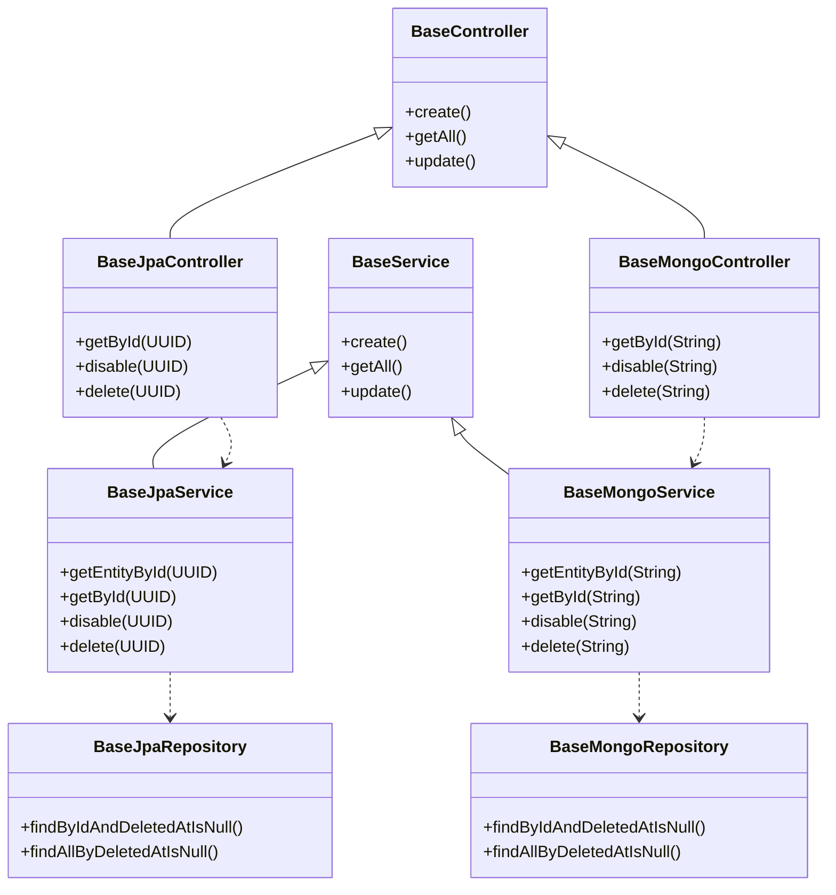
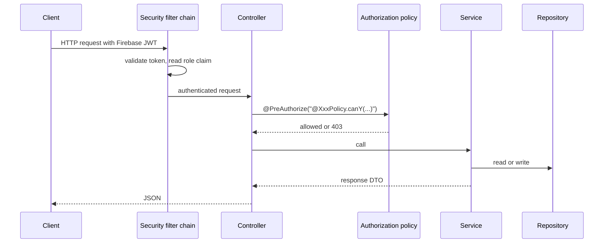

# common

Shared building blocks for the API services. It is a library, not a running service: every API service (`api-user`, `api-platform`, `api-group`, `api-chat`, `api-license`, `api-payment`, `api-destination`) depends on it and builds its controllers, services, repositories, mappers and security rules on it.

## In short

The shared toolbox the API services are built from, so they all look and behave the same: base entities, repositories, services and controllers for CRUD, the security setup and per-resource policies, pagination, and one error format.

**Stack:** Spring Boot (Web, Data JPA, Data MongoDB, Security, WebSocket), Firebase Admin SDK, MapStruct, springdoc OpenAPI.

## User stories

- As a developer adding a resource, I extend the base entity, repository, service, controller and mapper, and get create, read, list, update, disable and delete with the usual rules.
- As a developer, I write one authorization policy per resource, and `@PreAuthorize` asks it.
- As a client developer, I get every error in the same `ErrorResponse` shape, and every list in the same paging shape.
- As a developer, I page through a feed with a cursor, using `PageCursor` and `CursorPaginated.of`.

## Requirements

- **CMN-1** Every record has an ID, `createdAt`, `updatedAt`, `disabledAt` and `deletedAt`. Lookups leave out deleted, and where asked disabled, records.
- **CMN-2** Tokens are Firebase JWTs. The `role` claim becomes `ROLE_<ROLE>`, and the caller's platform ID comes from the `userId` claim.
- **CMN-3** Errors map to 400, 403, 404, 422 or 500, with one body shape.
- **CMN-4** Offset pages take `page` and `pageSize` up to 100. Cursor pages take `cursor` and `limit` up to 100.
- **CMN-5** Unique rules are declared on the entity class and enforced in each service's DDL. See [Conventions](#conventions).

---

## Technical reference

The sections below describe how it works.

## What is inside

| Package | Contents |
|---|---|
| `entity` | `BaseJpaEntity`, `BaseMongoDocument`: ID, `createdAt`, `updatedAt`, `disabledAt`, `deletedAt` |
| `repository` | `BaseJpaRepository`, `BaseMongoRepository`: lookups that leave out deleted and/or disabled records |
| `service` | `BaseService`, `BaseJpaService`, `BaseMongoService`: the CRUD contract; `FirebaseUserService` |
| `controller` | `BaseController`, `BaseJpaController`, `BaseMongoController`: the CRUD endpoints |
| `mapper` | `BaseMapper`: entity to and from DTOs (implemented with MapStruct) |
| `security` | `BaseSecurityConfig`, `BaseAuthorizationPolicy`, `BaseStompAuthChannelInterceptor`, `SecurityUtils`, `UserRole`, the Firebase role converter |
| `dto`, `filter` | `Paginated`, `PaginationMetaData`, `PaginationFilter`, `CursorPaginated`, `PageCursor`, `CursorPaginationFilter`, `ErrorResponse` |
| `exception` | `GlobalExceptionHandler` and the shared exceptions |
| `config` | `FirebaseConfig`, `BaseOpenApiConfig`, `BaseWebSocketConfig`, `BaseStorageConfig`, `StompDestinations`, `StompBrokerProperties`, `StorageBucketProperties` |

## The base types

A resource in a service is one entity plus one class per row above: a controller, a service, a repository, a mapper and an authorization policy.

## How a request is handled

## Conventions

- **Soft delete and disable.** Nothing is removed from the database. `delete` sets `deletedAt`, `disable` sets `disabledAt`. The base repositories offer six lookups: by ID or all, filtered on `deletedAt`, on `disabledAt`, or on both.
- **Pagination.** Lists take a `PaginationFilter` (`page` from 1, `pageSize` up to 100) and return `Paginated<T>`. A service calls `filter.toPageable()` and `Paginated.of(page, mapper::toResponseList)`. Lists that grow at their head while being read, such as chat messages, take a `CursorPaginationFilter` (`cursor`, `limit` up to 100) and return `CursorPaginated<T>` (`data`, `nextCursor`, `hasMore`) instead, so new items do not shift the pages. So do work queues that shrink while staff page through them. A cursor list orders by its keys with the ID last, e.g. `order by createdAt desc, id desc`, and one query serves every page: `(:isFirst = true or createdAt < :at or (createdAt = :at and id < :id))`, with `PageCursor.FIRST_INSTANT` and `FIRST_ID` standing in on the first page. The service decodes the cursor with `PageCursor.decode(cursor, keyCount)`, fetches `filter.toLimit()` (one row more than the limit), and builds the answer with `CursorPaginated.of(rows, limit, row -> PageCursor.of(row.getCreatedAt(), row.getId()), mapper)`.
- **Unique constraints.** Declared on the entity class, never on a field: `@Table(name = ..., uniqueConstraints = @UniqueConstraint(name = "uk_<entity>_<columns>", columnNames = ...))`, with `_id` left off the column names, e.g. `uk_place_slug` or `uk_place_mark_user_place_kind`. `ddl-auto: validate` doesn't check them, so each one also goes in the service's hand-run DDL. A rule that holds only for some rows, such as those not deleted, is a partial unique index, which JPA can't declare: the entity says so in a comment, and the DDL has the index.
- **Roles.** `UserRole` is `Customer`, `Sales`, `Inspector`, `Support`, `Admin`. The role travels in the Firebase `role` claim and becomes the authority `ROLE_<ROLE>`.
- **Caller identity.** `SecurityUtils.extractUserId` reads the platform user ID from the `userId` claim.
- **Authorization.** Each resource has a policy bean implementing `BaseAuthorizationPolicy`. Disabling is Admin or Support unless a policy says otherwise.
- **Public routes.** A service lists them in `additionalPermitAllMatchers()`. If such a route also has `@PreAuthorize`, the service must return `true` from `anonymousAuthenticationEnabled()`.

## Error responses

`GlobalExceptionHandler` turns exceptions into an `ErrorResponse`:

| Exception | Status |
|---|---|
| `ResourceNotFoundException` | 404 |
| `AccessDeniedException` | 403 |
| `IllegalStateException` (a business rule was broken) | 422 |
| Bean validation failure | 400, with `validationErrors` |
