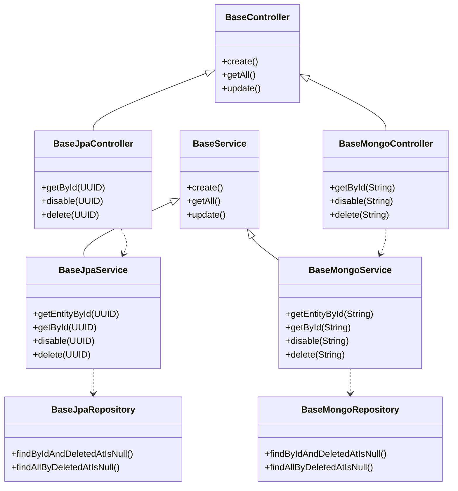
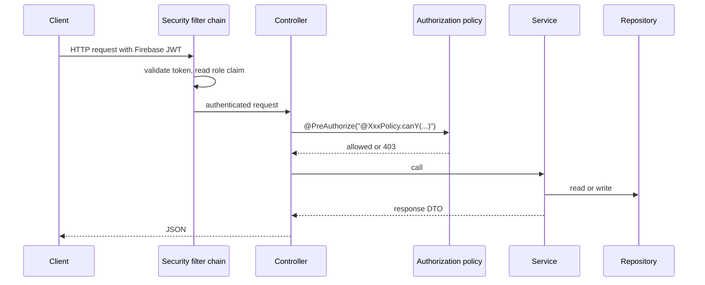

# common

Shared building blocks for the API services. It is a library, not a running service: `api-user`, `api-platform` and `api-group` depend on it and inherit their controllers, services, repositories, mappers and security rules from it.

## What is inside

| Package | Contents |
|---|---|
| `entity` | `BaseJpaEntity`, `BaseMongoDocument`: ID, `createdAt`, `updatedAt`, `disabledAt`, `deletedAt` |
| `repository` | `BaseJpaRepository`, `BaseMongoRepository`: lookups that leave out deleted and/or disabled records |
| `service` | `BaseService`, `BaseJpaService`, `BaseMongoService`: the CRUD contract; `FirebaseUserService` |
| `controller` | `BaseController`, `BaseJpaController`, `BaseMongoController`: the CRUD endpoints |
| `mapper` | `BaseMapper`: entity to and from DTOs (implemented with MapStruct) |
| `security` | `BaseSecurityConfig`, `BaseAuthorizationPolicy`, `SecurityUtils`, `UserRole`, the Firebase role converter |
| `dto`, `filter` | `Paginated`, `PaginationMetaData`, `PaginationFilter`, `ErrorResponse` |
| `exception` | `GlobalExceptionHandler` and the shared exceptions |
| `config` | `FirebaseConfig`, `BaseOpenApiConfig` |

## The base types

A resource in a service is one entity plus one class per row above: a controller, a service, a repository, a mapper and an authorization policy.

## How a request is handled

## Conventions

- **Soft delete and disable.** Nothing is removed from the database. `delete` sets `deletedAt`, `disable` sets `disabledAt`. The base repositories offer six lookups: by ID or all, filtered on `deletedAt`, on `disabledAt`, or on both.
- **Pagination.** Lists take a `PaginationFilter` (`page` from 1, `pageSize` up to 100) and return `Paginated<T>`. A service calls `filter.toPageable()` and `Paginated.of(page, mapper::toResponseList)`.
- **Roles.** `UserRole` is `Customer`, `Sales`, `Inspector`, `Support`, `Admin`. The role travels in the Firebase `role` claim and becomes the authority `ROLE_<ROLE>`.
- **Caller identity.** `SecurityUtils.extractUserId` reads the platform user ID from the `userId` claim.
- **Authorization.** Each resource has a policy bean implementing `BaseAuthorizationPolicy`. Disabling is Admin or Support unless a policy says otherwise.
- **Public routes.** A service lists them in `additionalPermitAllMatchers()`. If such a route also has `@PreAuthorize`, the service must return `true` from `anonymousAuthenticationEnabled()`.

## Error responses

`GlobalExceptionHandler` turns exceptions into an `ErrorResponse`:

| Exception | Status |
|---|---|
| `ResourceNotFoundException` | 404 |
| `AccessDeniedException` | 403 |
| `IllegalStateException` (a business rule was broken) | 422 |
| Bean validation failure | 400, with `validationErrors` |
