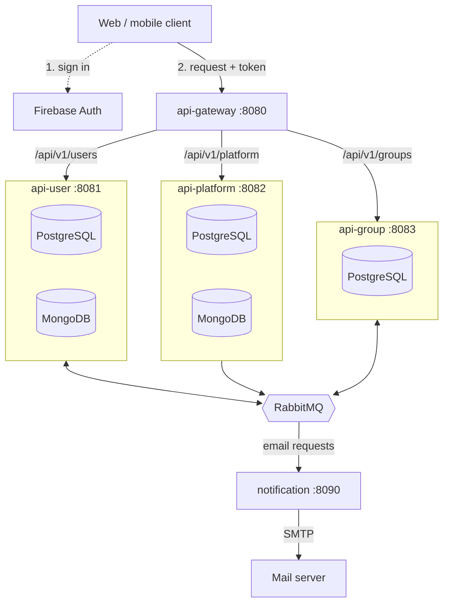
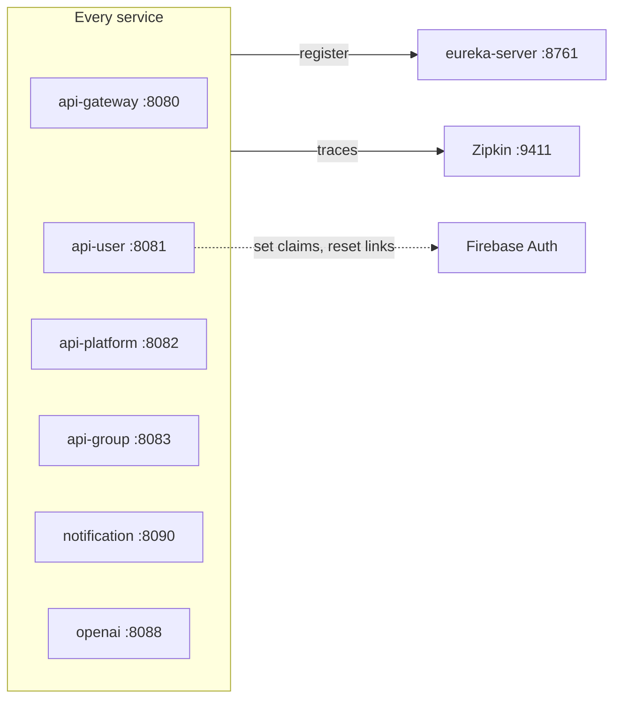
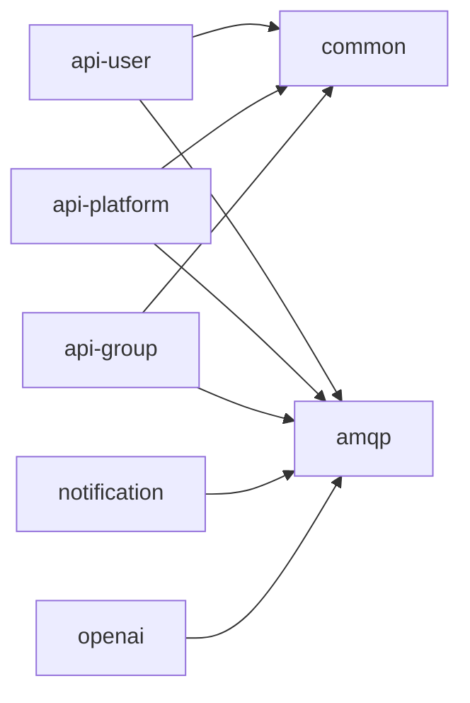
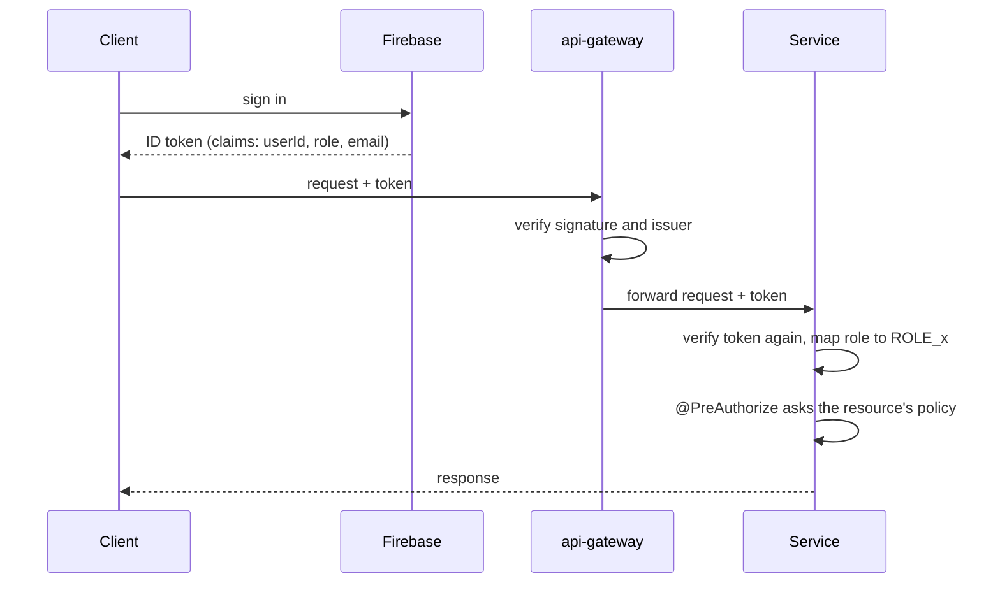
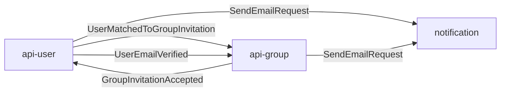
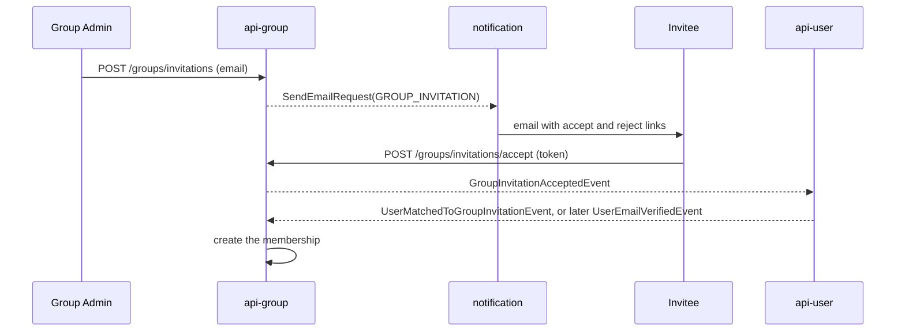

# TripHuddle backend architecture

TripHuddle's backend is a set of small Spring Boot services behind one gateway. Each service owns its own data, clients reach them over HTTP through the gateway, and the services talk to each other only through RabbitMQ.

Built with Java 17, Spring Boot 3.2.2 and Spring Cloud 2023.0.0, as one Maven multi-module project.

## The system at a glance

Each API service box contains the data stores only it uses.

### Supporting pieces

The first diagram leaves out what every service uses in the same way. Those are here.

- **Eureka**: every service registers with it, and the gateway looks services up there to route requests.
- **Zipkin**: every service sends its traces there.
- **Firebase**: besides signing users in, it is called directly by `api-user`, to set token claims and create password reset links.
- **`openai`** registers and traces like the others but is not connected to any other service yet.

## Modules

| Module | Kind | Port | Responsibility | Docs |
|---|---|---|---|---|
| `api-gateway` | service | 8080 | public entry point: token check, CORS, routing | [docs](../api-gateway/docs/README.md) |
| `eureka-server` | service | 8761 | service registry | [docs](../eureka-server/docs/README.md) |
| `api-user` | service | 8081 | users, profiles, preferences, Firebase accounts | [docs](../api-user/docs/README.md) |
| `api-platform` | service | 8082 | countries, currencies, languages, feature flags | [docs](../api-platform/docs/README.md) |
| `api-group` | service | 8083 | groups, memberships, invitations | [docs](../api-group/docs/README.md) |
| `notification` | service | 8090 | sends emails requested by other services | [docs](../notification/docs/README.md) |
| `openai` | service | 8088 | text generation behind one interface | [docs](../openai/docs/README.md) |
| `common` | library | | base classes, security, pagination, error handling | [docs](../common/docs/README.md) |
| `amqp` | library | | RabbitMQ setup and every message definition | [docs](../amqp/docs/README.md) |

The gateway and the Eureka server depend on neither library.

## Principles

- **One service, one data store.** No service reads another's database. `api-group` stores user IDs, never user records.
- **No HTTP between services.** A service that needs something from another publishes a message and reacts to the reply. A slow or stopped service delays work but does not fail the caller's request.
- **The same shape everywhere.** A resource is an entity plus a controller, service, repository, mapper and authorization policy, all built on the base types in `common`.
- **Nothing is physically deleted.** Deleting sets `deletedAt` and disabling sets `disabledAt`.

## Authentication and authorization

Firebase Authentication issues the tokens. The backend never sees passwords.

- The token carries two custom claims that `api-user` sets: `userId` (the platform user ID) and `role`.
- Roles: `Customer` (default), `Sales`, `Inspector`, `Support`, `Admin`.
- The gateway and each service both validate the token, so a route that is public must be opened in both places.
- Group-level rights (Admin or Member of a group) are separate from platform roles and are decided inside `api-group` from memberships.

## Messaging

Every message is a record (the event) plus a contract class naming its queue and dead-letter queue, all defined in `amqp`. A message is published to the default exchange with the queue name as routing key, so it lands in exactly that queue, and each queue has one consumer.

A listener that throws is retried three times with a growing pause; after that the message goes to a dead-letter queue. Most created, updated, disabled and deleted events have no consumer yet; they exist so that future services can react without the publisher changing. The full catalogue is in the [amqp docs](../amqp/docs/README.md).

### Example: inviting someone to a group

## Data

| Service | PostgreSQL | MongoDB |
|---|---|---|
| `api-user` | `jobbie_giggle_user`: users, user profiles | user preferences |
| `api-platform` | `jobbie_giggle_platform`: countries, currencies, languages | feature flags |
| `api-group` | `jobbie_giggle_group`: groups, memberships, invitations | none |

Relational schemas are checked at startup (`ddl-auto: validate`), so the tables must exist before a service starts.

## Cross-cutting concerns

| Concern | How |
|---|---|
| Service discovery | every service registers with Eureka; the gateway routes to `lb://<SERVICE-NAME>` |
| Resilience | a circuit breaker and a 60s time limit per route at the gateway |
| Errors | `GlobalExceptionHandler` returns one `ErrorResponse` shape: 400, 403, 404, 422, 500 |
| API documentation | each API service serves OpenAPI at `/api-docs`; the gateway exposes it at `/<service>/v3/api-docs` |
| Tracing | every service reports to Zipkin at `http://zipkin:9411` |
| Pagination | `page` (from 1) and `pageSize` (up to 100) in; `Paginated<T>` with metadata out |

## What a deployment needs

- PostgreSQL at host `postgres`, MongoDB at `mongodb`, RabbitMQ, Eureka at `eureka-server`, Zipkin at `zipkin`.
- Environment: `RABBITMQ_HOST`, `RABBITMQ_USERNAME`, `RABBITMQ_PASSWORD`, `RABBITMQ_VIRTUAL_HOST`, `SMTP_PASSWORD`, and Google application default credentials for the Firebase Admin SDK.

## Adding a service

1. Create the module, depend on `common` and `amqp`, and add it to the root `pom.xml`.
2. For each resource, add the entity, repository, DTOs, mapper, policy, service and controller on top of the base types.
3. Add a `SecurityConfig` implementing `BaseSecurityConfig` and list any public routes.
4. Define its events and contracts in `amqp` and register the queue names.
5. Add its routes, time limit and public paths to the gateway.
6. Add a `docs/README.md` and a row in the modules table above.
