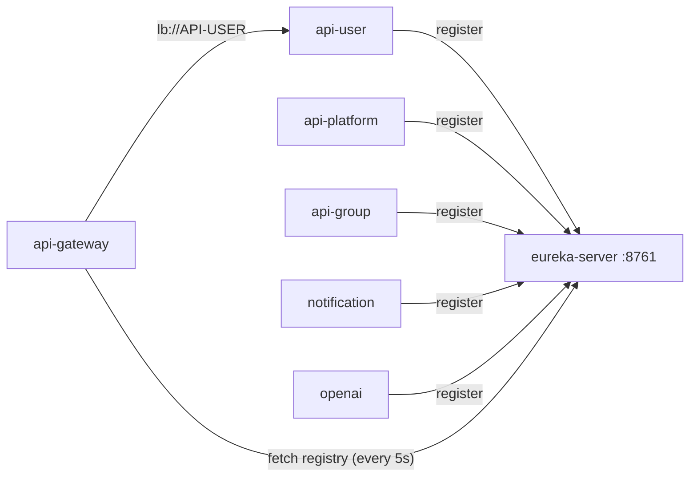

# eureka-server

The service registry, on port **8761**. Every service registers here at startup under its `spring.application.name`, and the gateway asks it where the instances of a service are.

It has no code beyond the application class and no data of its own.

Services reach it at `http://eureka-server:8761/eureka/`. The server does not register with itself and does not fetch a registry.
