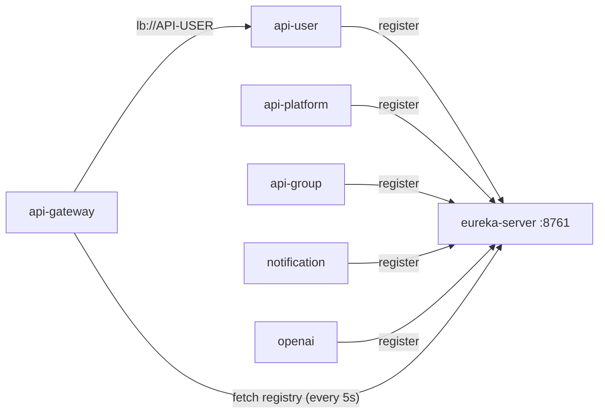

# eureka-server

The service registry, on port **8761**. Every service registers here at startup under its `spring.application.name`, and the gateway asks it where the instances of a service are.

It has no code beyond the application class and no data of its own.

Services reach it at `http://eureka-server:8761/eureka/`. The server does not register with itself and does not fetch a registry.

## In short

The phone book of the backend: every service says where it runs, and the gateway looks them up there.

**Stack:** Spring Cloud Netflix Eureka Server.

## User stories

- As a service, I register at startup under my name, so that the gateway can find me.
- As the gateway, I find a healthy instance of a service by its name.
- As an operator, I run several instances of a service, and requests are spread over them.

## Requirements

- **EUR-1** Services register under `spring.application.name`, and the gateway routes to `lb://<NAME>`.
- **EUR-2** It keeps no other data and needs no database.
