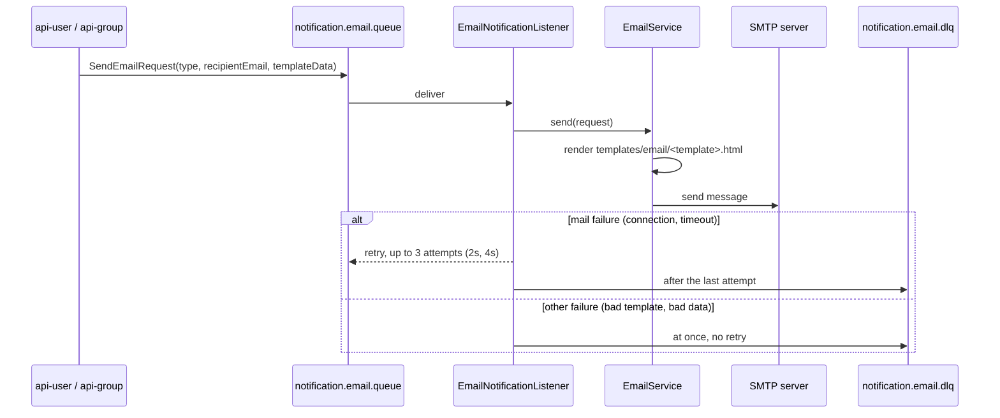
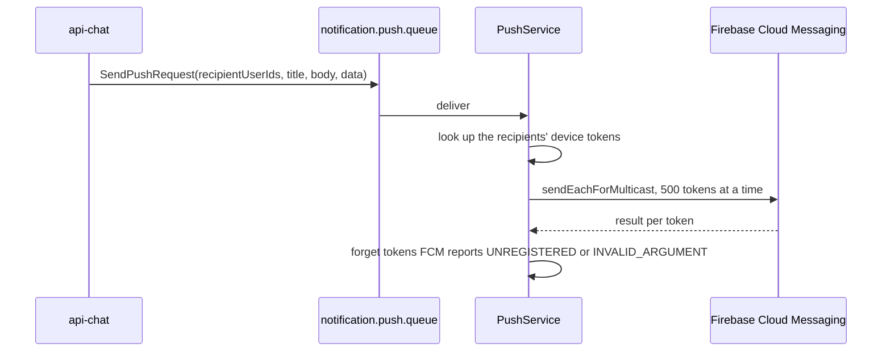

# notification

Sends emails and push notifications, on port **8090**. It has no HTTP API. Other services ask for an email by publishing a `SendEmailRequest` to `notification.email.queue`, and this service renders the template and sends it over SMTP. They ask for a push by publishing a `SendPushRequest` to `notification.push.queue`, and this service sends it to every registered device of the recipients through Firebase Cloud Messaging.

## Flow

`EmailDlqListener` reads the dead-letter queue and logs each failed email for manual follow-up.

## Email types

| `NotificationEmailType` | Template | Subject | Requested by |
|---|---|---|---|
| `EMAIL_VERIFICATION` | `email-verification.html` | Verify your TripHuddle email address | `api-user`, at registration |
| `WELCOME` | `welcome.html` | Welcome to TripHuddle! | `api-user`, after verification |
| `PASSWORD_RESET` | `password-reset.html` | Reset your TripHuddle password | `api-user` |
| `PROFILE_PICTURE_UPDATED` | `profile-picture-updated.html` | Your TripHuddle profile pictures were updated | `api-user` |
| `GROUP_INVITATION` | `group-invitation.html` | You have been invited to a group on TripHuddle | `api-group` |
| `SUPPORT_TICKET_CREATED` | `support-ticket-created.html` | Your TripHuddle support ticket | `api-user`, for a ticket in `api-chat` |
| `SUPPORT_TICKET_REPLIED` | `support-ticket-replied.html` | Support replied to your TripHuddle ticket | `api-user`, for a ticket in `api-chat` |
| `SUPPORT_TICKET_RESOLVED` | `support-ticket-resolved.html` | Your TripHuddle support ticket was resolved | `api-user`, for a ticket in `api-chat` |
| `SUPPORT_TICKET_CLOSED` | `support-ticket-closed.html` | Your TripHuddle support ticket was closed | `api-user`, for a ticket in `api-chat` |
| `LICENSE_SUBSCRIPTION_ACTIVATED` | `license-subscription-activated.html` | Your TripHuddle subscription is active | `api-user`, for a subscription in `api-license` |
| `LICENSE_SUBSCRIPTION_RENEWAL_REMINDER` | `license-subscription-renewal-reminder.html` | Your TripHuddle subscription renews soon | `api-user`, for a subscription in `api-license` |
| `LICENSE_SUBSCRIPTION_CANCELED` | `license-subscription-canceled.html` | Your TripHuddle subscription was canceled | `api-user`, for a subscription in `api-license` |
| `LICENSE_SUBSCRIPTION_EXPIRED` | `license-subscription-expired.html` | Your TripHuddle subscription has ended | `api-user`, for a subscription in `api-license` |
| `LICENSE_PAYMENT_SUCCEEDED` | `license-payment-succeeded.html` | Your TripHuddle payment was received | `api-payment`, for each paid invoice |
| `LICENSE_PAYMENT_FAILED` | `license-payment-failed.html` | We could not renew your TripHuddle subscription | `api-payment`, for a failed renewal |

Templates are Thymeleaf files in `src/main/resources/templates/email`. The variables each one needs come from `templateData` in the request.

## Push notifications

Device tokens are stored in MongoDB (`jobbie_giggle_notification`, collection `device_tokens`). Users register them through `api-user`, which publishes `UserDeviceRegisteredEvent` and `UserDeviceUnregisteredEvent`.

- A token belongs to one app install. If another account registers it, it moves to that account.
- Only a failure of the whole FCM call is retried. A retry would push again to every device that already got it, so single tokens failing are not.
- With `firebase.enabled=false`, push requests are logged and dropped.

## Adding an email

1. Add a value to `NotificationEmailType` in the `amqp` module.
2. Add the template file.
3. Add the template name and the subject to the two `switch` statements in `EmailService`.

## Settings

| Property | Meaning |
|---|---|
| `spring.mail.*` | SMTP host, port and account; the password comes from `SMTP_PASSWORD` |
| `RABBITMQ_HOST`, `RABBITMQ_USERNAME`, `RABBITMQ_PASSWORD`, `RABBITMQ_VIRTUAL_HOST` | broker connection |
| `spring.data.mongodb.uri` | where device tokens are stored (`MONGODB_HOST`, `MONGODB_PORT`, `MONGODB_DATABASE`) |
| `firebase.project-id`, `firebase.enabled` (`FIREBASE_ENABLED`) | Firebase project for FCM, and whether to send pushes at all; credentials are the application default ones |
