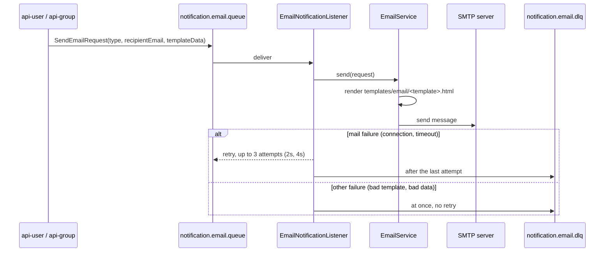

# notification

Sends emails, on port **8090**. It has no HTTP API: other services ask for an email by publishing a `SendEmailRequest` to `notification.email.queue`, and this service renders the template and sends it over SMTP.

## Flow

`EmailDlqListener` reads the dead-letter queue and logs each failed email for manual follow-up.

## Email types

| `NotificationEmailType` | Template | Subject | Requested by |
|---|---|---|---|
| `EMAIL_VERIFICATION` | `email-verification.html` | Verify your TripHuddle email address | `api-user`, at registration |
| `WELCOME` | `welcome.html` | Welcome to TripHuddle! | `api-user`, after verification |
| `PASSWORD_RESET` | `password-reset.html` | Reset your TripHuddle password | `api-user` |
| `PROFILE_PICTURE_UPDATED` | `profile-picture-updated.html` | Your TripHuddle profile pictures were updated | `api-user` |
| `GROUP_INVITATION` | `group-invitation.html` | You have been invited to a group on TripHuddle | `api-group` |

Templates are Thymeleaf files in `src/main/resources/templates/email`. The variables each one needs come from `templateData` in the request.

## Adding an email

1. Add a value to `NotificationEmailType` in the `amqp` module.
2. Add the template file.
3. Add the template name and the subject to the two `switch` statements in `EmailService`.

## Settings

| Property | Meaning |
|---|---|
| `spring.mail.*` | SMTP host, port and account; the password comes from `SMTP_PASSWORD` |
| `RABBITMQ_HOST`, `RABBITMQ_USERNAME`, `RABBITMQ_PASSWORD`, `RABBITMQ_VIRTUAL_HOST` | broker connection |
