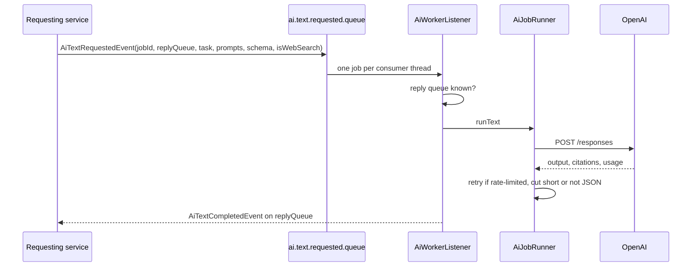
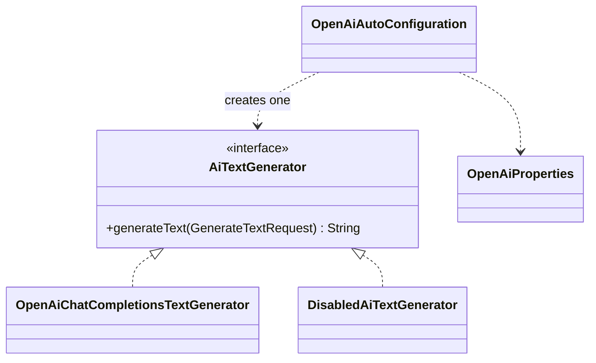
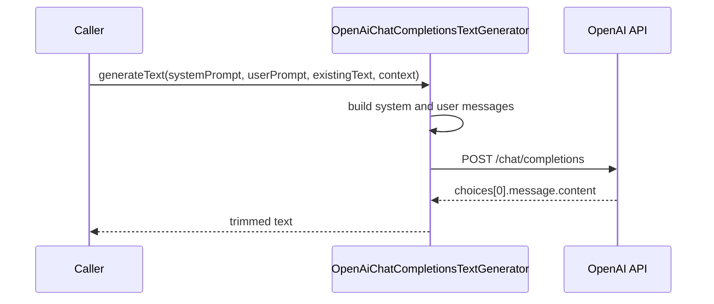

# openai

The AI worker, on port **8088**. Other services send it jobs over amqp; it calls OpenAI and answers each job on the requesting service's own queue. It knows nothing about places, trips or visas: prompts and schemas come with each job. It has no HTTP endpoints.

It also still provides the older `AiTextGenerator` bean (chat completions), described further down, which nothing uses yet.

## In short

The AI worker. Services send it jobs (write this text to this schema, or embed these texts), and it calls OpenAI and answers each job on the asking service's own queue. It knows nothing about places, trips or visas: every job brings its own prompts and schema.

**Stack:** Spring Boot, OpenAI Responses and Embeddings APIs over Spring `RestClient`, RabbitMQ.

## User stories

- As api-destination, I send a job with a system prompt, a user prompt and a JSON schema, and get valid JSON back, with the web pages it cited when I asked for web search.
- As api-destination, I send up to 256 texts and get one embedding for each, in order.
- As an operator, I choose a cheap model for bulk work and a stronger one for itineraries, visas and questions.
- As an operator, I see the tokens each job used, to keep AI spending under control.
- As an operator, I turn the worker off without stopping the services that use it; their jobs fail cleanly.

## Main flows

See [AI jobs](#ai-jobs).

## Requirements

- **AI-1** Text jobs ask for strict JSON when they carry a schema, and use web search when asked. Answers aren't stored at OpenAI.
- **AI-2** The model comes from the job, else from its task's setting, else the default.
- **AI-3** Rate limits, timeouts and server errors are retried with backoff, honouring `Retry-After`. An answer cut short is retried with more room, and a schema job's non-JSON answer is retried.
- **AI-4** Every job gets an answer, `COMPLETED` or `FAILED` with the reason, and the tokens of every attempt.
- **AI-5** Answers go only to registered reply queues, so AI output can't be pushed into another service's queue.
- **AI-6** It has no HTTP API, and runs a set number of jobs at once per instance.

---

## Technical reference

The sections below describe how it works.

## AI jobs

| Request (from `amqp.ai`) | Queue | Answer |
|---|---|---|
| `AiTextRequestedEvent` | `ai.text.requested.queue` | `AiTextCompletedEvent`: `COMPLETED` with the text or JSON, citations, model, tokens and attempts, or `FAILED` with the reason |
| `AiEmbeddingRequestedEvent` (1 to 256 texts) | `ai.embedding.requested.queue` | `AiEmbeddingCompletedEvent`: one vector per text, in order |

- **Text** goes through OpenAI's Responses API (`POST /responses`):
  - **Instructions:** the job's system prompt goes in as instructions, and the user prompt as input.
  - **Not stored:** with `store: false`, OpenAI doesn't keep the answer; the requester does.
  - **JSON:** when a job carries `jsonSchema` and `schemaName`, the answer is asked for as `json_schema` in strict mode. Strict mode needs every property listed in `required` and `additionalProperties: false`. The requester owns the schema.
  - **Web search:** with `isWebSearch`, the `web_search` tool is on. The pages the answer cites come back as `citations`, without repeats, in order of first use.
- **Embeddings** go through `POST /embeddings`, as floats.
- **Models:** the job's `model` if given, else the model configured for its `task`, else the default `integration.openai.model`. The default config sends `itinerary`, `visa-guidance` and `place-question` to a stronger model.
- **Retries:**
  - **Up to `max-attempts` (3):** rate limits (429), timeouts and server errors are retried, with doubling pauses capped at `max-retry-ms`. A `Retry-After` from OpenAI is honoured, within that cap.
  - **Cut short:** an answer cut short at the token limit is retried with twice the room, up to four times the job's limit.
  - **Not JSON:** a schema job whose answer isn't JSON is retried.
  - **Final at once:** a refusal, a 4xx other than those, or a bad request (no prompt, a bad schema name, a schema that isn't JSON).
- **Tokens:** every attempt's tokens are summed into the answer, so requesters can track cost.
- **Never thrown:** a job that can't be done is answered `FAILED`, never thrown. Only failing to publish the answer is retried by the listener, and then goes to `default.dlq`.
- **Disabled:** with `enabled` off or no `api-key`, every job is answered `FAILED` without calling OpenAI.
- **Reply queues:** the worker answers only on queues in `AiQueues.REPLY_QUEUE_NAMES`. A job naming any other queue is logged and dropped, so AI output can't be pushed into another service's queue. A service that sends jobs adds its reply queue there; today those are `api-destination`'s `ai.text.completed.destination.queue` (`AiTextCompletedContract`) and `ai.embedding.completed.destination.queue` (`AiEmbeddingCompletedContract`).
- **Duplicates:** a job delivered twice may call OpenAI twice. Requesters match answers by `jobId` and keep the first.

## Worker settings (`integration.openai.worker`)

| Property | Env | Default | Meaning |
|---|---|---|---|
| `concurrency` | `OPENAI_WORKER_CONCURRENCY` | 4 | jobs run at once per instance, so calls in flight |
| `task-models.<task>` | `OPENAI_MODEL_ITINERARY`, `OPENAI_MODEL_VISA`, `OPENAI_MODEL_QUESTION` | `gpt-4.1` for `itinerary`, `visa-guidance`, `place-question` | the model per task |
| `embedding-model` | `OPENAI_EMBEDDING_MODEL` | `text-embedding-3-small` | the embedding model |
| `max-output-tokens` | | 4000 | default limit on an answer |
| `max-attempts` | | 3 | calls per job |
| `retry-base-ms`, `max-retry-ms` | | 2000, 30000 | first pause and longest pause |
| `read-timeout-seconds` | | 180 | how long to wait for an answer; web search is slow |
| `web-search-tool` | | `web_search` | the Responses API tool type |

`integration.openai.enabled`, `api-key` and `model` now read `OPENAI_ENABLED`, `OPENAI_API_KEY` and `OPENAI_MODEL`.

## The older text generator

### Design

- `integration.openai.enabled=true`: the bean is `OpenAiChatCompletionsTextGenerator`, which calls `POST {base-url}/chat/completions`.
- Otherwise: the bean is `DisabledAiTextGenerator`, which throws `OpenAiIntegrationException` on every call.

### A generation call

`userPrompt` is required. `context` and `existingText` are added to the user message when present. Without a `systemPrompt`, a default writing-assistant prompt is used. Any failure surfaces as `OpenAiIntegrationException`.

## Settings (`integration.openai`)

| Property | Default | Meaning |
|---|---|---|
| `enabled` | `true` in `application.yml` | use the OpenAI client |
| `api-key` | empty | OpenAI API key; required when enabled |
| `model` | `gpt-4o-mini` | model name |
| `base-url` | `https://api.openai.com/v1` | API base URL |
| `temperature` | `0.4` | sampling temperature |
| `max-tokens` | `800` | upper limit of generated tokens |
