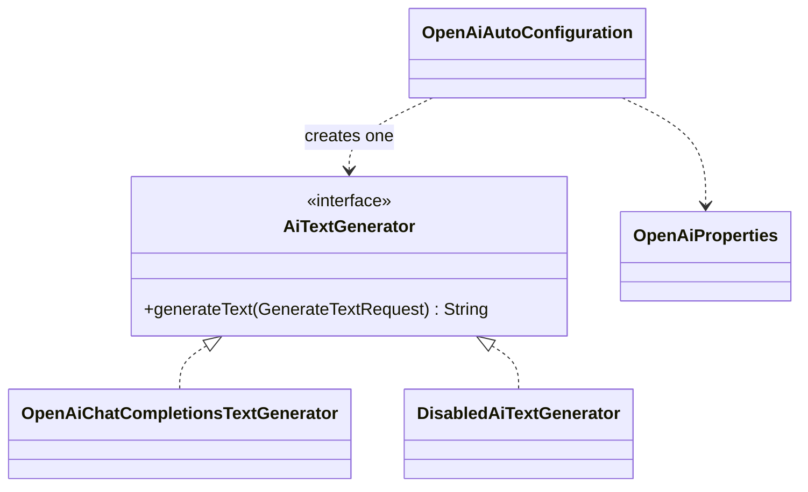
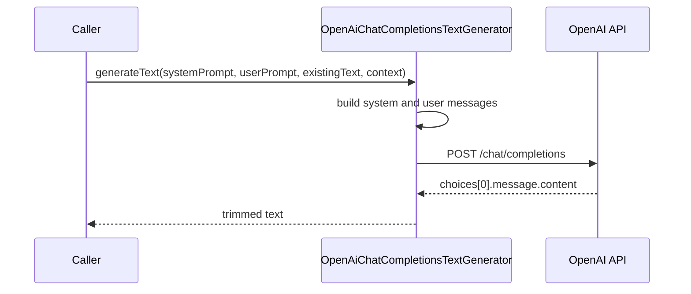

# openai

Text generation behind one interface, `AiTextGenerator`, on port **8088**. The rest of the code asks for text without knowing which provider produces it.

It has no HTTP endpoints and no message listeners yet; today it provides the generator bean and its configuration.

## Design

- `integration.openai.enabled=true`: the bean is `OpenAiChatCompletionsTextGenerator`, which calls `POST {base-url}/chat/completions`.
- Otherwise: the bean is `DisabledAiTextGenerator`, which throws `OpenAiIntegrationException` on every call.

## A generation call

`userPrompt` is required. `context` and `existingText` are added to the user message when present. Without a `systemPrompt`, a default writing-assistant prompt is used. Any failure surfaces as `OpenAiIntegrationException`.

## Settings (`integration.openai`)

| Property | Default | Meaning |
|---|---|---|
| `enabled` | `true` in `application.yml` | use the OpenAI client |
| `api-key` | empty | OpenAI API key; required when enabled |
| `model` | `gpt-4o-mini` | model name |
| `base-url` | `https://api.openai.com/v1` | API base URL |
| `temperature` | `0.4` | sampling temperature |
| `max-tokens` | `800` | upper limit of generated tokens |
